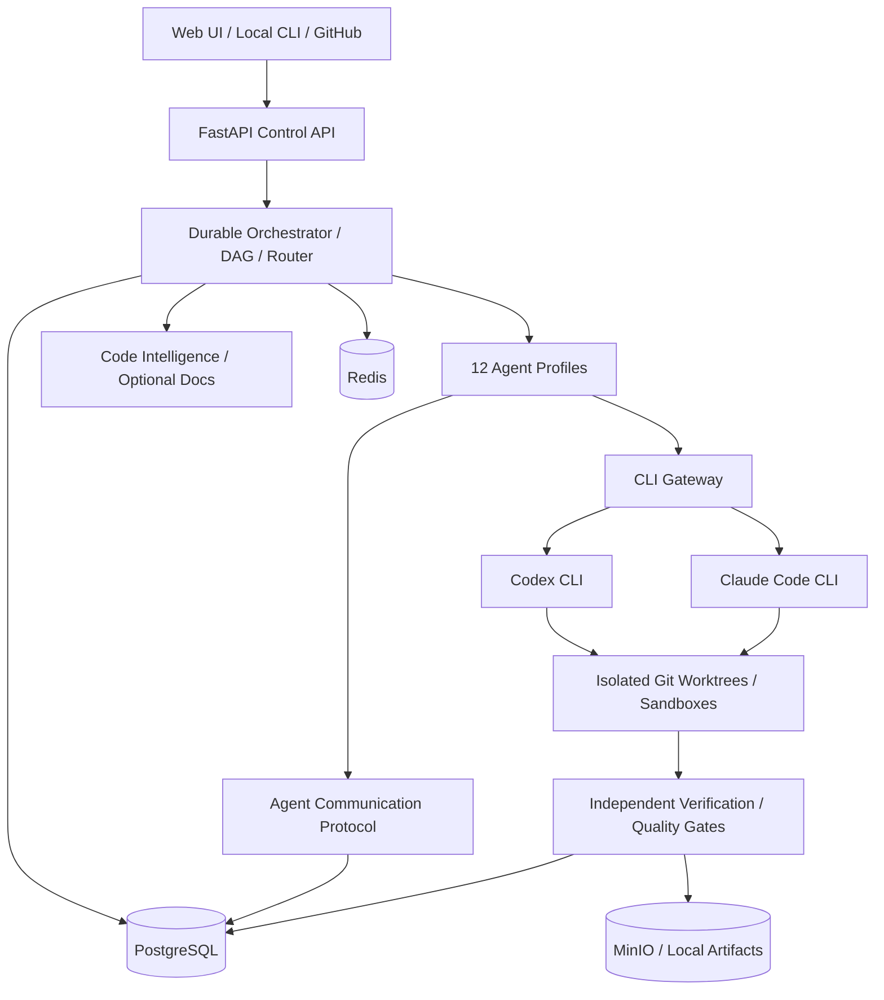

# Техническое задание: AiCodingDev v1.0

**Статус:** утверждённая концепция; техническая спецификация для реализации  
**Название продукта:** AiCodingDev  
**Версия документа:** 1.0  
**Дата:** 2026-11-08  
**Формат:** self-hosted / local-first / GitHub hybrid  
**Язык интерфейса:** русский по умолчанию; архитектура готова к i18n  

> Этот документ задаёт требования и проектные решения, а не утверждает, что продукт уже реализован. Примеры контрактов — нормативные контракты самой платформы, а не обещание неизменности внешнего CLI.

## 1. Цель и границы

Создать платформу управляемой AI-разработки, где пользователь формулирует задачу, наблюдает за работой и общением агентов, даёт уточнения и утверждает результаты. Платформа оркестрирует 12 логических ролей, исполняемых **только официальными OpenAI Codex CLI и Anthropic Claude Code CLI**, авторизованными предусмотренным разработчиками CLI способом по пользовательским подпискам. Запрещены платные AI API, AI API keys, Gemini, обход лимитов подписок и неофициальные методы авторизации. Внутренний REST API между компонентами платформы разрешён. Генеративные локальные LLM не используются. Опциональные локальные модели embeddings допустимы только в будущем и не должны быть обязательны.

**Обязательные результаты v1.0:** веб-интерфейс Mission Control; локальная работа с репозиториями; GitHub-интеграция; durable DAG orchestration; 12 agent profiles; CLI adapters; Live Agent Chat; независимые quality gates; evidence; standards registry; code intelligence; approvals; аудит; recovery; мониторинг. Внешняя документация необязательна.

**Вне v1.0:** собственная LLM, AI API, автономный production deployment без разрешения, безусловный auto-merge, обязательная векторная БД, Kubernetes как обязательная зависимость, обещание официальной ISO-сертификации.

## 2. Архитектурные принципы

1. **Modular Monolith + Workers:** FastAPI backend с модульными границами, очередями и независимыми воркерами; без преждевременного дробления на микросервисы.
2. **PostgreSQL — source of truth**; Redis — очередь/эфемерное состояние; MinIO или файловое хранилище — крупные артефакты; Git — исходники и диффы.
3. **CLI Gateway** нормализует особенности двух официальных CLI и не передаёт управление оболочкой напрямую пользователю или агенту.
4. **Evidence-first:** результат AI не равен проверенному результату. Независимые проверки обязательны.
5. **Human-in-the-loop:** опасные изменения требуют утверждения.
6. **Least privilege:** изолированные worktree/sandbox, отдельные права и аудит.
7. **Versioned contracts:** HTTP API, ACP, CLI execution contract и схемы данных версионируются.
8. **No hidden reasoning capture:** показываются только доступные официальные CLI события, сообщения и артефакты, без попыток извлечения скрытых рассуждений.



## 3. Технологический стек

| Слой | Технология | Обязательность |
|---|---|---|
| Frontend | React, TypeScript, Vite, Tailwind | P0 |
| Backend | Python 3.12+, FastAPI, Pydantic v2 | P0 |
| DB | PostgreSQL 17+; Alembic migrations | P0 |
| Queue | Redis + Dramatiq (или согласованный эквивалент) | P0 |
| Storage | MinIO или локальный S3-compatible/file adapter | P0 |
| CLI | Официальные Codex CLI и Claude Code CLI | P0 |
| Git | Git CLI, worktrees, optional GitHub App | P0 |
| Index | ripgrep, tree-sitter, PostgreSQL FTS/pg_trgm; LSP по поддерживаемым языкам | P0 |
| Sandbox | Docker с жёсткими ограничениями; локальный fallback только по явной политике | P0 |
| Monitoring | OpenTelemetry, Prometheus/Grafana | P1 |
| Vector | pgvector, локальные embeddings | P2, необязательно |

Версии CLI не фиксировать без проверки совместимости; поддерживать compatibility matrix и feature detection.

## 4. Роли агентов

| Роль (`role`) | Зона ответственности | Проверяемый выход |
|---|---|---|
| `requirements` | требования, критерии приёмки | requirements, traceability |
| `architect` | архитектура, ADR, границы модулей | ADR, диаграммы, constraints |
| `planner` | DAG, оценка сложности, риски | план задач и зависимости |
| `developer` | реализация кода | diff, тесты, комментарии |
| `reviewer` | независимое code review | findings, verdict |
| `security` | threat model, SAST/SCA/secrets | findings, evidence |
| `qa` | тест-план, unit/integration/E2E | отчёты тестов |
| `database` | схема, миграции, запросы | миграции, rollback plan |
| `performance` | профилирование, benchmark | воспроизводимые измерения |
| `devops` | CI/CD, сборка, окружения | pipeline и результаты |
| `maintenance` | диагностика, обновления, refactor | impact analysis, diff |
| `documentation` | README, API, runbooks | обновлённые документы |

Роли — **логические профили**, не отдельные подписки, аккаунты или микросервисы. Любую роль может исполнять один из двух CLI при наличии доступа и подходящих возможностей. Независимое ревью по возможности выполняет другой провайдер; если он недоступен, policy engine определяет fallback, блокировку или ручное ревью. Нельзя ложно маркировать самопроверку как независимую.

## 5. Режимы и маршрутизация

`CREATE`, `DEVELOP`, `DEBUG`, `AUDIT`, `MODERNIZE`, `SECURITY`, `OPTIMIZE`, `TEST`, `MAINTAIN`, `DOCUMENT`, `REVIEW`.

**L1:** детерминированные инструменты либо один CLI; **L2:** один CLI + тесты; **L3:** исполнитель + независимый reviewer; **L4:** двойной анализ, security/QA gates и human approval; **L5:** совместный архитектурный анализ, ADR, прототип и approval.

Router учитывает: сложность, риск, тип файлов, capability matrix, доступность CLI, авторизацию, историю подтверждённого качества, политику проекта, число параллельных сессий и наблюдаемые ограничения. При недоступности обоих CLI задача переходит в `BLOCKED`, без обхода лимитов. Использовать явную policy snapshot для воспроизводимости.

## 6. Workflow и конечные автоматы

**Run:** `CREATED → DISCOVERY → PLANNED → AWAITING_APPROVAL? → RUNNING → VERIFYING → COMPLETED`; альтернативные `PAUSED`, `BLOCKED`, `FAILED`, `CANCELLED`. Запрещать невалидные переходы. `COMPLETED` только при успешных обязательных gates и выполнении approval policy.

**Task:** `PENDING → READY → LEASED → RUNNING → VERIFYING → SUCCEEDED`; альтернативные `BLOCKED`, `RETRY_WAIT`, `FAILED`, `CANCELLED`. DAG-план валидировать на отсутствие циклов; задачи доступны только после выполнения зависимостей. Установить `max_attempts`, retry budget, timeout, lease heartbeat, optimistic locking (`version`).

**Execution:** `QUEUED → STARTING → RUNNING → EXITED → COLLECTED`; альтернативные `TIMED_OUT`, `CANCELLED`, `CRASHED`, `AUTH_REQUIRED`, `RATE_LIMITED`.

Повтор запуска не должен повторять уже подтверждённые внешние действия. Recovery сверяет БД, leases, PID/process group, Git worktree, артефакты и checkpoint. Все события — с корреляционными идентификаторами.

## 7. PostgreSQL: схема данных

### 7.1 Соглашения

- PK: UUID; все времена `timestamptz` UTC; внешние идентификаторы отдельно от PK.
- Каждая tenant-scoped таблица имеет `workspace_id` либо наследуемую строго проверяемую ссылку. Межтенантные ссылки запрещены.
- Критические атрибуты — типизированные колонки; `jsonb` — только для расширяемых конфигураций, snapshot и payload.
- Все изменения схемы — Alembic; миграции должны иметь проверяемый план rollback или явное обоснование необратимости.
- `CHECK`, FK, `UNIQUE`, индексы, optimistic locking и RLS для tenant data; service role не должен бесконтрольно обходить RLS.
- Секреты и CLI auth tokens **не хранить** в PostgreSQL; только состояние авторизации и безопасные ссылки на OS credential store.

### 7.2 Каталог таблиц и обязательные поля

| Таблица | Ключевые поля и ограничения |
|---|---|
| `users` | `id`, `email UNIQUE`, `display_name`, `status`, `created_at` |
| `workspaces` | `id`, `name`, `slug UNIQUE`, `settings`, `created_at` |
| `workspace_members` | `workspace_id`, `user_id`, `role`, `joined_at`; UNIQUE(workspace_id,user_id) |
| `projects` | `id`, `workspace_id`, `name`, `description`, `status`, `created_at`, `updated_at` |
| `repositories` | `id`, `project_id`, `provider`, `remote_url`, `default_branch`, `local_root_ref`, `last_synced_at` |
| `project_settings` | `project_id PK`, `documentation_mode`, `routing_policy_id`, `quality_profile`, `security_profile`, `settings_version` |
| `runs` | `id`, `project_id`, `requested_by`, `mode`, `objective`, `status`, `base_commit_sha`, `policy_snapshot`, `version`, timestamps |
| `tasks` | `id`, `run_id`, `agent_role`, `title`, `instructions`, `status`, `complexity` 1..5, `risk_level`, `acceptance_criteria`, `max_attempts`, `version` |
| `task_dependencies` | `(task_id, depends_on_task_id) PK`, `dependency_type`; self-reference forbidden |
| `task_attempts` | `id`, `task_id`, `attempt_no`, `status`, `provider`, `started_at`, `finished_at`, `failure_category`; UNIQUE(task_id,attempt_no) |
| `agent_profiles` | `id`, `role UNIQUE`, `instruction_template_version`, `allowed_tools`, `policy_profile_id`, `enabled` |
| `agent_assignments` | `id`, `task_id`, `agent_profile_id`, `provider`, `assigned_at`, `reason` |
| `cli_providers` | `id`, `code UNIQUE` (`codex`,`claude`), `display_name`, `enabled` |
| `cli_installations` | `id`, `provider_id`, `host_id`, `binary_path`, `detected_version`, `auth_status`, `capabilities`, `checked_at` |
| `cli_sessions` | `id`, `installation_id`, `session_ref`, `status`, `started_at`, `last_seen_at`; no credentials |
| `cli_executions` | `id`, `task_attempt_id`, `installation_id`, `session_id?`, `status`, `command_profile`, `worktree_ref`, `pid_ref`, `exit_code`, `failure_category`, `output_artifact_id`, timestamps |
| `agent_messages` | `id`, `run_id`, `task_id?`, `sender_role`, `recipient_role`, `message_type`, `correlation_id`, `reply_to_id`, `schema_version`, `payload`, `created_at` |
| `message_deliveries` | `message_id`, `consumer_id`, `delivery_count`, `acked_at`, `last_error`; UNIQUE(message_id,consumer_id) |
| `agent_decisions` | `id`, `run_id`, `task_id?`, `decision_type`, `rationale`, `evidence_refs`, `decided_by`, `created_at` |
| `chat_threads` | `id`, `run_id`, `scope`, `target_role?`, `created_by`, `created_at` |
| `chat_messages` | `id`, `thread_id`, `sender_type`, `sender_id?`, `body`, `message_kind`, `source_event_id?`, `created_at` |
| `user_directives` | `id`, `run_id`, `chat_message_id`, `target`, `directive_type`, `status`, `impact_status`, `submitted_by`, `created_at` |
| `directive_impacts` | `(directive_id,task_id) PK`, `impact_type`, `resolution` |
| `directive_acknowledgements` | `id`, `directive_id`, `recipient_role`, `status`, `acknowledged_at` |
| `agent_activity_events` | `id`, `run_id`, `task_id?`, `execution_id?`, `event_type`, `payload`, `occurred_at` |
| `knowledge_entries` | `id`, `project_id`, `kind`, `title`, `body_ref`, `content_hash`, `visibility`, `created_at` |
| `architecture_decisions` | `id`, `project_id`, `adr_number`, `title`, `status`, `content_ref`, `approved_at` |
| `code_index_snapshots` | `id`, `repository_id`, `commit_sha`, `index_version`, `status`, `created_at`; UNIQUE(repository_id,commit_sha,index_version) |
| `code_symbols` | `id`, `snapshot_id`, `file_path`, `symbol_name`, `symbol_kind`, `start_line`, `end_line`, `content_hash` |
| `code_dependencies` | `id`, `snapshot_id`, `source_symbol_id`, `target_symbol_id?`, `target_ref?`, `edge_type` |
| `knowledge_chunks` | `id`, `source_type`, `source_id`, `snapshot_id?`, `chunk_index`, `text_ref`, `content_hash`, `search_vector`, `metadata` |
| `retrieval_queries` | `id`, `run_id`, `task_id`, `query_text`, `strategy`, `created_at` |
| `retrieval_results` | `query_id`, `chunk_id`, `rank`, `score`, `selected`; UNIQUE(query_id,chunk_id) |
| `context_packs` | `id`, `task_attempt_id`, `source_commit`, `policy_version`, `manifest`, `content_hash`, `artifact_id`, `created_at` |
| `indexing_jobs` | `id`, `repository_id`, `commit_sha`, `status`, `started_at`, `finished_at`, `error` |
| `technologies` | `id`, `name`, `ecosystem`, `created_at` |
| `technology_versions` | `id`, `technology_id`, `version_label`, `support_status` |
| `project_technologies` | `project_id`, `technology_version_id`, `detected_from`, `confirmed_by`; composite PK |
| `documentation_sources` | `id`, `technology_version_id`, `source_type`, `uri_or_file_ref`, `trust_level`, `license_info`, `refresh_policy`, `enabled` |
| `documentation_snapshots` | `id`, `source_id`, `content_hash`, `fetched_at`, `status`, `storage_ref` |
| `documentation_sections` | `id`, `snapshot_id`, `section_path`, `heading`, `body_ref`, `content_hash` |
| `quality_gates` | `id`, `profile_id`, `gate_type`, `required`, `config`, `timeout_seconds` |
| `gate_executions` | `id`, `run_id`, `task_id?`, `gate_id`, `status`, `started_at`, `finished_at`, `evidence_id?` |
| `test_results` | `id`, `gate_execution_id`, `suite`, `passed`, `failed`, `skipped`, `report_artifact_id` |
| `findings` | `id`, `run_id`, `task_id?`, `source_gate_id?`, `severity`, `rule_id`, `file_path?`, `line?`, `status`, `evidence_id?` |
| `standards` | `id`, `code`, `edition`, `title`, `reference_uri`, `active`; UNIQUE(code,edition) |
| `standard_controls` | `id`, `standard_id`, `clause_ref`, `control_code`, `description`, `verification_method` |
| `project_controls` | `project_id`, `control_id`, `applicability`, `rationale`, `approved_by`; composite PK |
| `compliance_results` | `id`, `run_id`, `control_id`, `status`, `evidence_id?`, `reviewed_by?`, `checked_at` |
| `artifacts` | `id`, `project_id`, `kind`, `storage_ref`, `sha256`, `size_bytes`, `mime_type`, `created_at` |
| `evidence` | `id`, `run_id`, `task_id?`, `kind`, `artifact_id`, `producer`, `verification_status`, `created_at` |
| `evidence_links` | `id`, `evidence_id`, `target_type`, `target_id`, `relation` |
| `policies` | `id`, `workspace_id?`, `project_id?`, `policy_type`, `version`, `definition`, `active` |
| `approvals` | `id`, `run_id`, `task_id?`, `action_type`, `status`, `requested_by`, `decided_by?`, `decision_reason?`, timestamps |
| `checkpoints` | `id`, `run_id`, `task_id?`, `state_version`, `state_ref`, `created_at` |
| `outbox_events` | `id`, `aggregate_type`, `aggregate_id`, `event_type`, `payload`, `published_at?`, `created_at` |
| `worker_leases` | `id`, `resource_type`, `resource_id`, `worker_id`, `lease_until`, `heartbeat_at`, `fencing_token` |
| `usage_metrics` | `id`, `execution_id`, `provider`, `metric_name`, `metric_value`, `unit`, `source`, `observed_at` |
| `routing_decisions` | `id`, `task_id`, `selected_provider`, `score_breakdown`, `reason`, `policy_version`, `created_at` |
| `provider_health` | `id`, `installation_id`, `auth_status`, `availability`, `observed_at`, `error_category?` |
| `audit_events` | `id`, `workspace_id`, `actor_type`, `actor_id?`, `action`, `resource_type`, `resource_id`, `metadata`, `created_at` |

### 7.3 Пример нормативного DDL

```sql
CREATE TABLE runs (
  id uuid PRIMARY KEY,
  project_id uuid NOT NULL REFERENCES projects(id),
  requested_by uuid NOT NULL REFERENCES users(id),
  mode text NOT NULL CHECK (mode IN ('CREATE','DEVELOP','DEBUG','AUDIT','MODERNIZE','SECURITY','OPTIMIZE','TEST','MAINTAIN','DOCUMENT','REVIEW')),
  objective text NOT NULL,
  status text NOT NULL,
  base_commit_sha varchar(64),
  policy_snapshot jsonb NOT NULL DEFAULT '{}'::jsonb,
  version bigint NOT NULL DEFAULT 0,
  created_at timestamptz NOT NULL DEFAULT now(),
  started_at timestamptz,
  finished_at timestamptz
);
CREATE INDEX ix_runs_project_status_created ON runs(project_id,status,created_at DESC);

CREATE TABLE tasks (
  id uuid PRIMARY KEY,
  run_id uuid NOT NULL REFERENCES runs(id),
  agent_role text NOT NULL,
  title text NOT NULL,
  instructions text NOT NULL,
  status text NOT NULL,
  complexity smallint NOT NULL CHECK (complexity BETWEEN 1 AND 5),
  risk_level text NOT NULL CHECK (risk_level IN ('low','medium','high','critical')),
  acceptance_criteria jsonb NOT NULL DEFAULT '[]'::jsonb,
  max_attempts int NOT NULL DEFAULT 3 CHECK (max_attempts BETWEEN 1 AND 10),
  version bigint NOT NULL DEFAULT 0,
  created_at timestamptz NOT NULL DEFAULT now(),
  updated_at timestamptz NOT NULL DEFAULT now()
);
CREATE INDEX ix_tasks_run_status ON tasks(run_id,status);
CREATE TABLE task_dependencies (
  task_id uuid NOT NULL REFERENCES tasks(id) ON DELETE CASCADE,
  depends_on_task_id uuid NOT NULL REFERENCES tasks(id) ON DELETE CASCADE,
  dependency_type text NOT NULL DEFAULT 'finish',
  PRIMARY KEY(task_id,depends_on_task_id),
  CHECK (task_id <> depends_on_task_id)
);
CREATE INDEX ix_task_dependencies_parent ON task_dependencies(depends_on_task_id);

CREATE TABLE agent_messages (
  id uuid PRIMARY KEY,
  run_id uuid NOT NULL REFERENCES runs(id),
  task_id uuid REFERENCES tasks(id),
  sender_role text NOT NULL,
  recipient_role text NOT NULL,
  message_type text NOT NULL,
  correlation_id uuid,
  reply_to_id uuid REFERENCES agent_messages(id),
  schema_version text NOT NULL DEFAULT '1.0',
  payload jsonb NOT NULL,
  created_at timestamptz NOT NULL DEFAULT now()
);
CREATE INDEX ix_agent_messages_run_time ON agent_messages(run_id,created_at);
CREATE INDEX ix_agent_messages_correlation ON agent_messages(correlation_id);
```

**Важно для реализации:** приведённый DDL иллюстрирует основные ограничения; полный комплект миграций обязан реализовать **все** таблицы каталога, FK, tenant-safe composite keys, RLS, partial indexes, state constraints и тесты миграций. В `task_dependencies` отдельная проверка/триггер запрещает связи задач разных runs; DAG cycle detection — транзакционно при утверждении плана. Для сообщений и событий предусмотреть retention и архивирование.

## 8. Internal REST API v1

**Base:** `/api/v1`; JSON; OpenAPI 3.1; UUID; RFC 7807 `application/problem+json` для ошибок; пагинация cursor-based; `Idempotency-Key` для POST-команд; `ETag`/version для конфликтующих изменений; RBAC, CSRF для cookie-сессий; rate limiting; audit trail.

| Метод | Endpoint | Действие / право |
|---|---|---|
| GET/POST | `/workspaces` | просмотр/создание workspace |
| GET/POST | `/projects` | список/создание проектов |
| GET/PATCH | `/projects/{project_id}` | настройки и метаданные |
| POST | `/projects/{project_id}/repositories` | привязка репозитория |
| GET | `/projects/{project_id}/technologies` | определённый стек |
| GET/PATCH | `/projects/{project_id}/documentation-policy` | OFF/SMART/STRICT |
| POST | `/runs` | создание запуска |
| GET | `/runs/{run_id}` | состояние |
| GET | `/runs/{run_id}/tasks` | DAG и статусы |
| POST | `/runs/{run_id}/pause` | приостановка |
| POST | `/runs/{run_id}/resume` | продолжение |
| POST | `/runs/{run_id}/cancel` | отмена |
| GET | `/runs/{run_id}/events` | SSE stream, Last-Event-ID |
| GET | `/runs/{run_id}/activity` | история событий |
| GET | `/runs/{run_id}/chat` | потоки чата |
| POST | `/runs/{run_id}/chat/messages` | сообщение пользователя |
| POST | `/runs/{run_id}/directives` | поручение/исправление |
| GET | `/runs/{run_id}/directives/{directive_id}` | обработка поручения |
| GET | `/tasks/{task_id}` | задача и критерии |
| GET | `/tasks/{task_id}/messages` | ACP-сообщения |
| GET | `/tasks/{task_id}/evidence` | доказательства |
| GET | `/runs/{run_id}/quality` | gates, findings, verdict |
| GET | `/runs/{run_id}/compliance` | матрица контроля |
| GET | `/runs/{run_id}/report` | отчёт |
| GET | `/providers` | Codex/Claude health и capabilities |
| POST | `/providers/{provider_id}/probe` | перепроверить установку/доступ |
| PATCH | `/providers/{provider_id}/settings` | безопасные настройки |
| GET | `/approvals` | ожидающие подтверждения |
| POST | `/approvals/{approval_id}/decision` | approve/reject |
| GET/POST | `/documentation/sources` | список/регистрация источника |
| POST | `/documentation/sources/{source_id}/refresh` | обновить кэш |
| GET | `/audit-events` | журнал аудита |

### 8.1 Создание запуска

```http
POST /api/v1/runs
Idempotency-Key: 78c8baf8-2026-11-08
Content-Type: application/json
```
```json
{
  "project_id": "9d11d142-56b9-4b60-ae72-c9ed65db1912",
  "mode": "DEVELOP",
  "objective": "Implement secure user authentication",
  "routing": {"strategy": "adaptive", "allowed_providers": ["codex", "claude"]},
  "quality_profile": "strict",
  "approval_policy": "risk_based"
}
```
**201 Created:** `{ "run_id": "<uuid>", "status": "CREATED", "event_stream": "/api/v1/runs/<uuid>/events" }`.

### 8.2 Пользовательское поручение

```json
{
  "target": {"type": "role", "role": "developer"},
  "directive_type": "CHANGE_REQUEST",
  "message": "Добавь журналирование административных действий",
  "expected_run_version": 12,
  "requires_impact_preview": true
}
```
**202 Accepted:** `{ "directive_id": "<uuid>", "status": "IMPACT_ANALYSIS_PENDING" }`. Далее `impact preview → confirm (если затронуты критические операции) → safe checkpoint/pause → replan → dispatch → ack`. Сообщение пользователя не может незаметно изменить уже работающий CLI-процесс.

### 8.3 События SSE

События `run.state_changed`, `task.state_changed`, `agent.message`, `cli.output`, `directive.impact_ready`, `approval.requested`, `gate.completed`, `run.completed`; каждый event содержит `event_id`, `run_id`, `timestamp`, `payload`, `schema_version`. Поддержать повторное подключение через `Last-Event-ID`, дедупликацию и разграничение доступа. Вывод CLI очищать от секретов и ограничивать по размеру.

## 9. CLI Execution Contract v1.0

**Правило:** CLI запускается только через серверный allowlisted adapter, в управляемом рабочем каталоге. Версия, поддерживаемые команды, формат машинного вывода, noninteractive режим и авторизация определяются runtime-probe для установленной официальной версии. Не предполагать универсальных CLI-флагов и не использовать обходные механизмы подписок.

### 9.1 Adapter API

```python
from typing import Protocol

class CLIExecutor(Protocol):
    async def probe(self) -> dict: ...
    async def check_auth(self) -> dict: ...
    async def execute(self, request: dict) -> dict: ...
    async def cancel(self, execution_id: str) -> None: ...
    async def collect_result(self, execution_id: str) -> dict: ...
```

### 9.2 ExecutionRequest

```json
{
  "contract_version": "1.0",
  "execution_id": "<uuid>",
  "task_id": "<uuid>",
  "provider": "codex",
  "agent_role": "developer",
  "workspace": {"worktree_id": "wt-104", "base_commit": "a1b2c3d4"},
  "input": {
    "objective": "Implement authentication",
    "context_refs": ["SPEC-018", "ADR-004"],
    "acceptance_criteria": ["Invalid credentials rejected", "Tests pass"]
  },
  "limits": {"timeout_seconds": 1800, "max_attempts": 2},
  "permissions": {"network": "restricted", "write_scope": "worktree", "production_access": false}
}
```

### 9.3 ExecutionResult

```json
{
  "contract_version": "1.0",
  "execution_id": "<uuid>",
  "provider": "codex",
  "status": "completed",
  "exit_code": 0,
  "artifacts": [{"type": "git_diff", "ref": "artifact-200"}],
  "claims": [{"type": "implementation_completed", "evidence_refs": ["artifact-200"]}],
  "verification": {"status": "pending"},
  "usage": {"tokens": null, "source": "not_exposed_by_cli"}
}
```

`exit_code=0` не равен `verified`. Счётчики токенов и остаток лимитов показывать только если они действительно предоставлены CLI; иначе `unknown`. Ошибки нормализовать: `CLI_NOT_INSTALLED`, `AUTH_REQUIRED`, `RATE_LIMITED`, `TIMEOUT`, `SANDBOX_DENIED`, `PROCESS_FAILED`, `OUTPUT_PARSE_ERROR`, `UNSUPPORTED_VERSION`, `CANCELLED`. Протокол вывода — normalized events: `started`, `output`, `tool_event`, `artifact`, `warning`, `finished`; raw logs — отдельный защищённый artifact. Нельзя автоматически предоставлять агенту unrestricted shell, сеть, secrets или production credentials.

## 10. Agent Communication Protocol (ACP) v1.0

Агенты не общаются напрямую по произвольным каналам. Они публикуют **структурированные сообщения через Orchestrator**, который проверяет schema, policy, ACL, correlation, лимиты и сохраняет audit trail.

Типы: `TASK_ASSIGN`, `HANDOFF`, `QUESTION`, `ANSWER`, `REVIEW_REQUEST`, `FINDING`, `FIX_REQUEST`, `EVIDENCE_SUBMITTED`, `DECISION_PROPOSAL`, `DECISION_RECORDED`, `BLOCKED`, `TASK_COMPLETED`.

```json
{
  "protocol": "acp/1.0",
  "message_id": "<uuid>",
  "run_id": "<uuid>",
  "task_id": "<uuid>",
  "from": {"role": "reviewer", "provider": "claude"},
  "to": {"role": "developer"},
  "type": "FIX_REQUEST",
  "correlation_id": "<uuid>",
  "reply_to_id": null,
  "payload": {
    "finding": "Missing authorization check",
    "severity": "high",
    "file": "app/auth/service.py",
    "evidence_refs": ["finding-44"],
    "requested_action": "Add authorization check and regression test"
  },
  "created_at": "2026-11-08T09:00:00Z"
}
```

**Правила:** UUID в production вместо условных строк; JSON Schema + строгая валидация `payload` по `type`; 1 сообщение ≤ 32 KiB, крупные данные — только artifact refs; max review/fix loops по policy (по умолчанию 3); idempotent consumer; bounded context; no self-authorized critical actions; недоверенные сообщения не могут переопределить system policy. Для доставки использовать PostgreSQL transactional outbox + Redis at-least-once + idempotent consumers; не заявлять exactly-once для внешних процессов.

## 11. Live Agent Chat / Mission Control

Обязательный интерфейс с потоками `All Agents`, `Codex`, `Claude`, `Role`, `Task`, `Approvals`. Пользователь видит структурированные межагентные сообщения, события, безопасные выдержки CLI-вывода, ссылки на diff/тесты/evidence, время и статусы. Доступны `ASK`, `NEW_TASK`, `CHANGE_REQUEST`, `STOP`, `PAUSE`, `RESUME`, `REVIEW`, `APPROVE`, `REJECT`. Все пользовательские команды проходят impact analysis, RBAC и policy. Поддержать фильтры, поиск, timeline, упоминания ролей, diff viewer, отображение текущего исполнителя и статуса обработки поручения. Отображение «сообщение доставлено» и «задача выполнена» должно различаться.

**UI-экраны:** Dashboard, Projects, Repository Explorer, Run Graph, Live Agent Chat, Task Detail, CLI Providers, Standards & Compliance, Evidence & Quality, Approvals, Knowledge/Documentation, Analytics, Settings/Audit. UI должен быть responsive, доступным с клавиатуры и показывать ошибки/пустые состояния.

## 12. Code Intelligence и необязательная документация

**Обязательный локальный индекс:** Git commit-aware snapshots; file tree; symbols (tree-sitter); LSP при доступности; ripgrep; PostgreSQL FTS/pg_trgm; dependency graph; test links; incremental hashing; context packs. Индекс привязан к repository/commit; выдача устаревшего фрагмента блокируется или явно маркируется. Контекст ограничивается бюджетом, ранжируется по точному совпадению, зависимостям, задаче и актуальности.

**Documentation Policy:** `OFF` — не загружать внешнюю документацию; `SMART` (default) — сначала локальный код и кэш, при необходимости запросить разрешение на загрузку; `STRICT` — для указанных проверок обязательны утверждённые источники, иначе `BLOCKED`/`MANUAL_REVIEW`. Модуль импорта URL/PDF/MD/HTML/Git — опционален для запуска задач; кэш хранится централизованно, не в постоянной памяти моделей. Версии документации и лицензии учитывать; загрузку защищать от SSRF, zip bombs, опасных файлов и prompt injection. Векторный поиск/embeddings не являются требованием v1.0.

**Экономия контекста:** deterministic search first → symbol/graph search → optional docs → compact Context Pack → CLI → incremental reindex. Не передавать целые репозитории и большие истории без необходимости; кэшировать по content hash + commit + policy version; измерять полезность по подтверждённым результатам, а не обещать фиксированную экономию токенов.

## 13. Standards & Compliance Engine

**Registry:** стандарт, версия/редакция, применимость, контроль, метод проверки, evidence, verdict. Статусы: `PASS`, `FAIL`, `NOT_APPLICABLE`, `UNVERIFIED`, `MANUAL_REVIEW`. Автоматические проверки не равны официальной сертификации. Учитывать лицензии на полные тексты стандартов.

| Область | Ориентиры |
|---|---|
| Requirements | ISO/IEC/IEEE 29148 |
| Architecture | ISO/IEC/IEEE 42010; ADR/C4 как методики |
| Lifecycle | ISO/IEC/IEEE 12207 |
| Quality | ISO/IEC 25010; ISO/IEC 25023 |
| Review | IEEE 1028 |
| Security | ISO/IEC 27001/27002, NIST SSDF SP 800-218, OWASP ASVS, CWE |
| Testing | ISO/IEC/IEEE 29119 |
| SQL | ISO/IEC 9075 |
| DevOps/Supply chain | SLSA, OpenSSF |
| Maintenance | ISO/IEC/IEEE 14764 |
| Documentation | ISO/IEC/IEEE 15289, 26514 |

Трассировка: `standard → edition → clause/control → project applicability → agent role → check → evidence → verdict`. Применимость и точные редакции стандартов утверждаются для проекта; формулировки контроля не выдавать за полный официальный текст стандарта.

## 14. Независимые Quality Gates

Профили: `basic`, `strict`, `critical`. Типовые инструменты: Ruff, ESLint, PHPStan, Semgrep, Gitleaks, Trivy, OSV, pytest, Vitest, Playwright, Checkov, OPA, Syft, Cosign, k6 — только при применимости стеку и наличии в окружении. Проверки запускаются из управляемого Verification Engine, а не подтверждаются словами агента.

Обязательные категории при наличии соответствующего кода: formatting/lint, typecheck, build, unit, integration, E2E для затронутых критичных потоков, SAST/SCA/secrets, migration validation, performance benchmark при заявлении об ускорении, independent review согласно уровню риска. `PASS` — только при сохранённом результате процесса и evidence. `SKIPPED` не равен `PASS`. Для critical flows — тесты всех утверждённых критичных сценариев; целевой coverage core ≥85% с оговорёнными исключениями; 100% обязательных тестов должны проходить. Отчёт должен включать environment, command, exit code, commit SHA, timestamps, artifacts.

## 15. Безопасность и управление доступом

- RBAC: `owner`, `admin`, `developer`, `reviewer`, `viewer`; workspace/project-scoped permissions.
- OS credential storage для CLI auth; никогда не логировать cookies, tokens, API keys, SSH keys.
- Sandbox: filesystem allowlist, write only to assigned worktree, network egress policy, CPU/RAM/time limits, process tree termination, no privileged Docker, no production secrets.
- Пользовательские и репозиторные тексты — недоверенные данные; prompt injection не может менять policy/permissions.
- GitHub webhooks проверять по подписи, события дедуплицировать; branch protection и PR approvals уважать.
- Dangerous actions (production deploy, destructive DB migration, deleting data, changing secrets, unrestricted network, merge) требуют explicit human approval.
- Audit events append-only на логическом уровне; политики retention, резервное копирование и доступ к артефактам.
- Импорт документации: SSRF protection, private IP denylist, DNS rebinding mitigation, content-size and MIME limits, archive validation.
- Supply chain: dependency pinning, SCA, SBOM, artifact integrity checks, secure CI.

## 16. Надёжность, наблюдаемость, эксплуатация

Transactional outbox: в одной DB transaction сохранять state transition и outbox event; dispatcher доставляет в Redis; consumers идемпотентны. Leases с fencing token предотвращают параллельное выполнение после истечения аренды. После crash — reconcile CLI process/worktree/DB state. Повторная доставка не должна повторно выполнять опасное действие. Backups PostgreSQL и artifacts; тест восстановления; миграции с dry-run. Логи структурированы, коррелированы `run_id/task_id/execution_id`, секреты редактируются.

Метрики: run success rate, verified completion rate, gate failures, retry count, provider availability, task latency, context pack size, индекс freshness, agent message count, queue lag, approval wait time; CLI token usage только если достоверно доступно. Alerting на auth failures, stuck leases, high error rates, storage capacity, failed backups.

## 17. Репозиторий и модули

```text
aicodingdev/
  apps/
    web/                  # React/TS UI
    api/                  # FastAPI app
    worker/               # background jobs
  packages/
    contracts/            # JSON Schema, OpenAPI, ACP
    cli_adapters/         # codex / claude
    orchestration/        # DAG, FSM, router
    agent_runtime/        # 12 role profiles
    code_intelligence/    # index, retrieval, context packs
    standards/            # registry, controls, evidence
    verification/         # quality gates
    security/             # sandbox/policy
  infrastructure/
    docker/
    migrations/
    monitoring/
  docs/
    adr/
    architecture/
    api/
    runbooks/
  tests/
    contract/
    integration/
    e2e/
    security/
```

Внутренние границы модулей определяются публичными интерфейсами и событиями; запретить прямые обращения между модулями к приватным таблицам без согласованного repository/service API.

## 18. План реализации

| Этап | Содержание | Условие завершения |
|---|---|---|
| 0. Foundation | ADR, contracts, repo, CI, environments | архитектура/схемы утверждены |
| 1. Identity/Projects | auth, RBAC, workspaces, repos | tenant isolation tests |
| 2. Workflow Core | runs, tasks, DAG, outbox, leases | recovery/idempotency tests |
| 3. CLI Gateway | Codex/Claude adapters, probes, sandbox | smoke/contract tests с реальными CLI |
| 4. Agent Runtime | 12 profiles, routing, ACP | agent handoff tests |
| 5. Mission Control | dashboard, live chat, directives, SSE | UI E2E + impact/replan tests |
| 6. Code Intelligence | indexing, graph, Context Packs | freshness/retrieval tests |
| 7. Quality/Standards | gates, evidence, compliance | false-pass prevention tests |
| 8. GitHub/Approvals | PR workflows, reviews, approvals | permission tests |
| 9. Hardening/Release | threat model, performance, DR, docs | release acceptance checklist |

Этапы выполнять с вертикальными end-to-end срезами; предварительный горизонт — порядка 20 недель при достаточной команде, не обязательный срок. Каждая фаза включает документацию, тесты, миграции и demo.

## 19. Приёмочные сценарии v1.0

1. Пользователь подключает локальный Git-репозиторий, создаёт проект и запускает задачу в режиме DEVELOP.
2. Система определяет стек, индексирует код по commit и создаёт проверяемый DAG без циклов.
3. Router назначает доступный официальный CLI без использования AI API.
4. Codex реализует изменение в отдельном worktree; Claude выполняет независимое ревью, если policy требует и провайдер доступен.
5. Все межагентные сообщения видны в Live Agent Chat, без скрытых chain-of-thought.
6. Пользователь отправляет CHANGE_REQUEST во время выполнения; система делает impact analysis, безопасный checkpoint, replan и acknowledgement.
7. При ошибке/таймауте CLI система фиксирует failure category, не объявляет успех и соблюдает retry budget.
8. При разрыве соединения UI после восстановления показывает тот же run и SSE события без дублей.
9. При аварии worker система не создаёт повторный merge/опасную миграцию и восстанавливает незавершённый workflow.
10. Без документации (`OFF`) система выполняет задачу через локальный индекс кода; `SMART` не скачивает источник без предусмотренного разрешения.
11. Ошибочные тесты блокируют `COMPLETED`; CLI exit code 0 сам по себе не даёт verified status.
12. Пользователь без прав не может читать чужой workspace, отправлять поручения или утверждать критические операции.
13. Production deploy/merge/destructive migration невозможны без явного approval.
14. Evidence содержит commit, команду проверки, exit code, время и artifact checksum.
15. Все API contracts проходят schema validation, backward compatibility checks и negative tests.
16. Подписка/авторизация CLI недоступна: задача `BLOCKED`, показана причина, нет обходных путей.

## 20. Тестирование

- **Unit:** FSM, DAG cycle detection, routing policy, impact analysis, permission checks, context ranker.
- **Contract:** OpenAPI, CLI request/result, ACP payload per type, SSE schemas, idempotency.
- **Integration:** PostgreSQL transactions/RLS, Redis outbox, artifact storage, Git worktrees, sandbox, CLI adapters.
- **E2E:** project → run → agent handoff → diff → verification → approval → PR; chat corrections; pause/resume.
- **Chaos/recovery:** kill worker, network disconnect, Redis restart, CLI timeout, lost lease, duplicate message.
- **Security:** SSRF, prompt injection, path traversal, command injection, cross-tenant access, secret leakage, webhook spoofing.
- **Performance:** indexing incremental update, concurrent runs, SSE fan-out, queue latency; baseline и регрессионные пороги утвердить по результатам измерений.

Тесты, зависящие от реальных CLI-подписок, выделить в opt-in integration suite; обычный CI использует mock/fake adapters и не должен требовать авторизации подписки.

## 21. API и контрактные артефакты разработки

В рамках реализации создать и версионировать:

- `packages/contracts/openapi.yaml` — полная OpenAPI 3.1 с request/response/error schemas и RBAC.
- `packages/contracts/cli-execution-request.schema.json` и `cli-execution-result.schema.json`.
- `packages/contracts/acp-envelope.schema.json` и типизированные payload schemas.
- `packages/contracts/events.schema.json` — SSE события.
- `infrastructure/migrations/` — полный DDL, индексы, RLS и миграции.
- `docs/architecture/data-model.md` — ERD, cardinality, invariants.
- `docs/architecture/state-machines.md` — разрешённые переходы.
- `docs/architecture/permissions-matrix.md` — права по действиям.
- `docs/runbooks/` — recovery, backups, CLI auth, incident response.

**Definition of Done:** код, тесты, контракты, миграции, threat assessment, documentation, evidence, review и соответствующие approvals. Ни один пункт не может заменяться голословным заявлением AI.

## 22. Архитектурные решения (ADR)

- **ADR-0001:** Modular Monolith + workers.
- **ADR-0002:** PostgreSQL source of truth, Redis queue, transactional outbox.
- **ADR-0003:** Official Codex CLI and Claude Code CLI only; subscription authentication; no AI APIs.
- **ADR-0004:** Centralized Agent Communication Protocol, evidence-first verification, human approvals.
- **ADR-0005:** Code Intelligence and Optional Documentation Retrieval — mandatory code index, documentation `OFF/SMART/STRICT`, default `SMART`, no mandatory vector DB.
- **ADR-0006:** Isolated Git worktrees, sandbox and protected GitHub actions.

## 23. Нефункциональные требования и критерии выпуска

- **Корректность:** 100% обязательных acceptance tests проходят; незавершённые/непроверенные задачи не получают `COMPLETED`.
- **Безопасность:** отсутствие открытых критических находок в утверждённом release gate; все опасные действия gated.
- **Надёжность:** успешное восстановление после запланированных fault-injection тестов без потери подтверждённых действий.
- **Изоляция:** cross-tenant access тесты отрицательны; секреты не попадают в логи/артефакты.
- **Аудит:** каждое поручение, решение, approval, запуск CLI и gate имеет traceable event.
- **Поддерживаемость:** backward-compatible contracts, ADR, versioned migrations, operator runbooks.
- **Производительность:** измеренные SLO устанавливаются после базового нагрузочного тестирования; не заявлять неподтверждённых цифр.
- **Документация:** локальный индекс работает независимо от Documentation Cache.

---

**Итог:** AiCodingDev v1.0 — управляемая self-hosted система разработки с двумя официальными AI CLI, 12 логическими агентами, живым чатом, проверяемым исполнением, локальной памятью кода, необязательной документацией, стандартами и полным аудитом. Следующий практический шаг — разложить эту спецификацию на миграции, машиночитаемые контракты и задачи по этапам 0–9.
