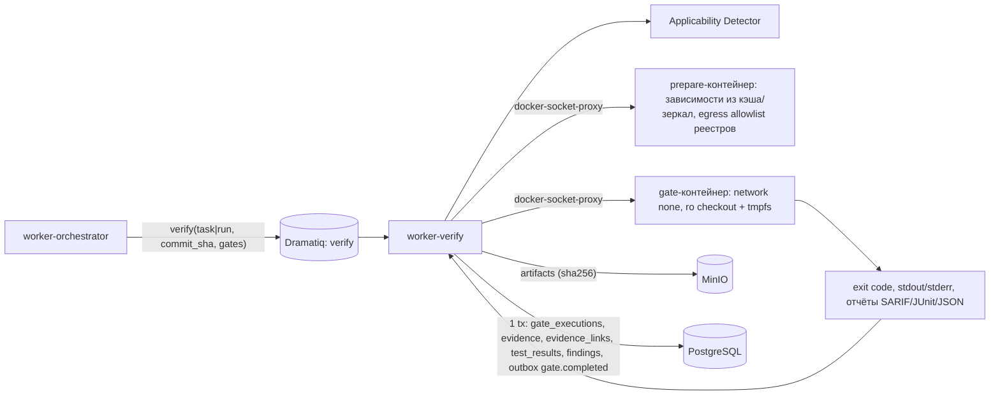
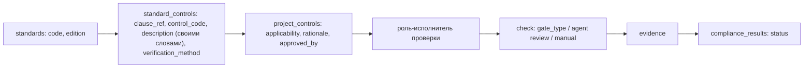

# Quality Gates, Verification Engine и Standards & Compliance

**Статус:** Phase 0, проект на утверждение. Ничего из описанного не реализовано и не протестировано.
**Требования:** ТЗ §2 п.4 (evidence-first), §6 (`COMPLETED` только при успешных обязательных gates), §7.2 (`quality_gates`, `gate_executions`, `test_results`, `findings`, `standards`, `standard_controls`, `project_controls`, `compliance_results`, `artifacts`, `evidence`, `evidence_links`), §13, §14, §15 (supply chain), §18 этап 7 (false-pass prevention tests), §19 AC-11/AC-14.
**Решения:** ADR-0004 (evidence-first), ADR-0010 (отдельные контейнеры, без CLI credentials), ADR-0012.
**Дополнение к ТЗ:** таблица `quality_profiles` (BRIEF) — ТЗ ссылается на `profile_id` без таблицы.

---

## 1. Принципы

1. Результат агента ≠ проверенный результат. Гейт получает `PASS` только по **сохранённому результату процесса**, запущенного Verification Engine на **точном commit SHA**, с evidence (ТЗ §14, AC-11).
2. `SKIPPED` ≠ `PASS`; `ERROR` ≠ `PASS`; отсутствие инструмента ≠ `PASS`.
3. Слова агента («тесты прошли») не принимаются; `EVIDENCE_SUBMITTED` от агента сохраняется как `UNVERIFIED` и максимум служит подсказкой, что запускать.
4. Инструменты используются только при применимости к стеку и наличии в verification-образе (ТЗ §14).
5. Автоматические проверки соответствия стандартам не являются сертификацией (ТЗ §13).

## 2. Типы гейтов и профили

### 2.1 Типы гейтов (`quality_gates.gate_type`)

Значение `gate_type` — суффикс идентификатора `QG-<TYPE>`.

| ID | `gate_type` | Категория |
|---|---|---|
| `QG-FORMAT` | `FORMAT` | formatting |
| `QG-LINT` | `LINT` | lint |
| `QG-TYPECHECK` | `TYPECHECK` | typecheck |
| `QG-BUILD` | `BUILD` | build |
| `QG-UNIT` | `UNIT` | unit tests |
| `QG-INTEGRATION` | `INTEGRATION` | integration tests |
| `QG-E2E` | `E2E` | E2E критичных потоков |
| `QG-SAST` | `SAST` | статический анализ безопасности |
| `QG-SCA` | `SCA` | уязвимости зависимостей |
| `QG-SECRETS` | `SECRETS` | секреты в коде/истории изменений |
| `QG-IAC` | `IAC` | IaC/контейнерные конфигурации |
| `QG-POLICY` | `POLICY` | policy-as-code (OPA) |
| `QG-MIGRATION` | `MIGRATION` | валидация миграций |
| `QG-PERF` | `PERF` | бенчмарк при заявлении об ускорении |
| `QG-REVIEW` | `REVIEW` | независимое ревью (агент другого провайдера или человек) |
| `QG-COVERAGE` | `COVERAGE` | покрытие core |
| `QG-SBOM` | `SBOM` | генерация SBOM |
| `QG-SIGN` | `SIGN` | подпись/проверка подписи артефактов |
| `QG-SCOPE` | `SCOPE` | diff в пределах `path_policy` роли (AGENT_ROLES §1.2) |

### 2.2 Матрица профилей

Категории, которые ТЗ §14 делает обязательными «при наличии соответствующего кода», обязательны **во всех** профилях (`R`); профили различаются порогами и дополнительными гейтами. Обозначения: `R` — обязателен, если применим; `R*` — обязателен при условии в скобках; `O` — выполняется информативно, не блокирует; `—` — не выполняется.

| Гейт | `basic` | `strict` | `critical` |
|---|---|---|---|
| `FORMAT` | R (только изменённые файлы) | R | R |
| `LINT` | R: ошибки блокируют | R: ошибки + новые предупреждения уровня, заданного профилем | R: ноль новых предупреждений |
| `TYPECHECK` | R* (есть конфигурация typechecker в проекте) | R (типизированный язык или конфигурация) | R; нет конфигурации для типизированного языка → `MANUAL_REVIEW` |
| `BUILD` | R | R | R |
| `UNIT` | R: 100% обязательных тестов проходят | R | R |
| `INTEGRATION` | R* (есть набор) | R | R |
| `E2E` | R* (затронуты критичные потоки и есть набор) | R (затронутые критичные потоки) | R (все утверждённые критичные сценарии) |
| `SAST` | R: блок на `critical` | R: блок на `high`+ | R: блок на `medium`+ (новые находки) |
| `SCA` | R: блок на `critical` | R: блок на `high`+ | R: блок на `medium`+ при наличии исправленной версии, `high`+ всегда |
| `SECRETS` | R: любая находка блокирует | R | R |
| `IAC` | O | R* (есть IaC/Dockerfile): блок на `high`+ | R: блок на `medium`+ |
| `POLICY` | — | O | R* (в проекте есть политики `.rego`) |
| `MIGRATION` | R* (есть миграции) | R* | R* + деструктивная → approval `DESTRUCTIVE_MIGRATION` |
| `PERF` | R* (заявлено ускорение) | R* | R* + регрессия критичных путей (если есть baseline) |
| `REVIEW` | по уровню: L3+ независимое | L3+ независимое | L2+ независимое; `SELF_REVIEW_FALLBACK` запрещён |
| `COVERAGE` | O (отчёт) | R: core ≥ 85%, снижение ≤ 1 п.п. | R: core ≥ 85%, без снижения |
| `SBOM` | — | O | R (Syft) |
| `SIGN` | — | — | R* (выпускаются релизные артефакты/образы) |
| `SCOPE` | R | R | R |

Уровни L1–L5 добавляют гейты к профилю (ROUTING_POLICY §8): эффективный набор = профиль ∪ уровень. Пороги severity относятся к **новым** находкам относительно `base_commit` (baseline хранится как artifact); существующие находки показываются, но не блокируют в `basic`/`strict`, в `critical` блокируют `critical`-severity и существующие.

Профили хранятся в `quality_profiles` (`code`, `version`, `definition jsonb`) — глобальные (`workspace_id NULL`) и переопределения workspace (могут только ужесточать); строки `quality_gates` (`profile_id`, `gate_type`, `required`, `config`, `timeout_seconds`) материализуют определение. Версия профиля фиксируется в `runs.policy_snapshot.quality`.

## 3. Применимость

### 3.1 Детекция стека

Applicability Detector (worker-verify, детерминированный) по commit строит `applicability_report` (artifact) из: `project_technologies` (ТЗ §7.2), маркерных файлов и изменённых путей.

| Маркер | Стек/область | Гейты и инструменты |
|---|---|---|
| `pyproject.toml`, `setup.cfg`, `requirements*.txt`, `*.py` | Python | FORMAT/LINT — Ruff; TYPECHECK — mypy/pyright при конфигурации; UNIT/INTEGRATION — pytest; COVERAGE — coverage.py |
| `package.json` + `tsconfig.json` / `*.ts(x)` / `*.js` | JS/TS | LINT — ESLint при конфигурации; TYPECHECK — `tsc` при `tsconfig.json`; UNIT — Vitest при зависимости; E2E — Playwright при конфигурации |
| `composer.json`, `*.php` | PHP | LINT/TYPECHECK — PHPStan при `phpstan.neon*` |
| любые исходники | все | SAST — Semgrep (правила по языкам); SECRETS — Gitleaks |
| lock-файлы (`poetry.lock`, `uv.lock`, `package-lock.json`, `pnpm-lock.yaml`, `composer.lock`, …) | зависимости | SCA — OSV-Scanner и/или Trivy (fs) |
| `Dockerfile*`, `*.tf`, `k8s/**`, `helm/**`, `docker-compose*` | IaC/контейнеры | IAC — Checkov; Trivy (config/image) |
| `*.rego`, каталог политик | policy-as-code | POLICY — OPA |
| `**/migrations/**`, Alembic `env.py` | миграции | MIGRATION — upgrade/downgrade/upgrade на эфемерной БД + сравнение схемы |
| сценарии `*.k6.js`, `bench/**` + заявление об ускорении | производительность | PERF — k6 / бенчмарки стека |
| сборка релиза/образа | supply chain | SBOM — Syft; SIGN — Cosign |

### 3.2 Правила применимости

- `NOT_APPLICABLE` выставляется только детектором и подтверждается `applicability_report` (evidence с перечнем проверенных маркеров); засчитывается как выполнение обязательного гейта.
- Агент не может объявить гейт неприменимым. Пользователь роли `admin` может изменить применимость для проекта только через policy (`quality_profiles` override/`policies`) — новая версия, audit, вступает в силу в новом snapshot (директива `CHANGE_REQUEST` → replan).
- Гейт применим, но инструмента нет в verification-образе (**missing tool**):

| Профиль | Эффект |
|---|---|
| `basic` | `gate_executions.status = ERROR` (`error_code = TOOL_UNAVAILABLE`); задача/run → `BLOCKED` (`MANUAL_REVIEW`), approval `MANUAL_REVIEW` с вариантами: установить инструмент и перезапустить, либо изменить применимость policy (admin, audited) |
| `strict` | как `basic` для FORMAT/LINT/TYPECHECK/COVERAGE/IAC/POLICY/SBOM; для BUILD/UNIT/INTEGRATION/E2E/SAST/SCA/SECRETS/MIGRATION → `FAIL` |
| `critical` | `FAIL` для любого обязательного гейта |

`MANUAL_REVIEW` никогда не превращает гейт в `PASS`: run завершится только после реального прогона или изменения применимости в policy (ТЗ §6).

## 4. Verification Engine

### 4.1 Архитектура



| Свойство | Решение |
|---|---|
| Изоляция | Отдельные эфемерные контейнеры verification-образов (по toolchain), **без** credential volume CLI, без доступа к worktree агента: checkout из локального bare-зеркала репозитория `git worktree add --detach <sha>` в каталог verification; проверка `git rev-parse HEAD == sha` до запуска (иначе `ERROR`). |
| Образы | Собираются платформой, версии инструментов закреплены, образ по digest; digest и версии инструментов фиксируются в evidence. |
| Сеть | Шаг `prepare` (установка зависимостей) — только egress-proxy с allowlist реестров пакетов проекта; шаги гейтов — `network none`. |
| Ресурсы | cpu/mem/pids лимиты, `timeout_seconds` из `quality_gates`; non-root, read-only rootfs, cap-drop ALL. |
| Команды | Только allowlisted `gate command templates` из профиля (argv, без shell); параметры — пути и SHA, не тексты агентов. Конфигурация инструментов берётся из репозитория (например, `ruff.toml`), но изменение конфигурации гейта в diff (ослабление правил, исключения путей, `skip`) детектируется и даёт finding `high` + требует независимого ревью. |
| Идемпотентность | ключ `(run_id, task_id?, gate_id, commit_sha, profile_version)`; повторная доставка не создаёт второй PASS; повтор после `ERROR` создаёт новую `gate_executions` строку (история сохраняется). |
| Повторы | `ERROR` инфраструктурного типа (контейнер не стартовал, хранилище недоступно) — до 2 автоматических повторов; `FAIL` не повторяется автоматически. |

### 4.2 Evidence гейта (AC-14)

Для каждого прогона создаётся `evidence` (`kind = gate_result`, `producer = verification_engine`, `commit_sha`, `command`, `exit_code`, `environment`, `started_at`, `finished_at` — дополнение BRIEF) и artifacts с sha256:

```json
{
  "evidence_id": "0193a6f2-6c1e-7d2a-9b11-3f0e5c2d5a01",
  "gate_execution_id": "0193a6f2-6c1e-7d2a-9b11-3f0e5c2d5a02",
  "gate_type": "UNIT",
  "commit_sha": "a1b2c3d4e5f60718293a4b5c6d7e8f9012345678",
  "command": ["pytest", "-q", "--junitxml=/out/junit.xml"],
  "working_dir": "/verify/repo",
  "environment": {
    "image": "aicd/verify-python@sha256:5d41402abc4b2a76b9719d911017c5925d41402abc4b2a76b9719d911017c592",
    "tool_versions": {"pytest": "8.x", "python": "3.12.x"},
    "env_allowlist": {"CI": "true", "TZ": "UTC"},
    "network": "none",
    "host_id": "0193a6f2-6c1e-7d2a-9b11-3f0e5c2d5a03"
  },
  "exit_code": 0,
  "started_at": "2026-11-08T09:20:00Z",
  "finished_at": "2026-11-08T09:21:13Z",
  "artifacts": [
    {"kind": "test_report", "ref": "artifact:0193a6f2-6c1e-7d2a-9b11-3f0e5c2d5a04", "sha256": "0f343b0931126a20f133d67c2b018a3b0f343b0931126a20f133d67c2b018a3b", "mime_type": "application/xml"},
    {"kind": "gate_log", "ref": "artifact:0193a6f2-6c1e-7d2a-9b11-3f0e5c2d5a05", "sha256": "7c222fb2927d828af22f592134e8932480637c0d7c222fb2927d828af22f5921", "mime_type": "text/plain"}
  ],
  "parsed": {"suite": "pytest", "passed": 412, "failed": 0, "skipped": 3, "errors": 0},
  "verification_status": "VERIFIED"
}
```

Значения в примере иллюстративны (не результаты реальных прогонов). Значения env — только из allowlist; секреты в verification не передаются вовсе. `evidence_links`: evidence → `gate_execution` (`relation = produced_by`), → `task` (`verifies`), → `finding` (`supports`).

`evidence.verification_status`: `VERIFIED` — процесс выполнен Verification Engine, результат разобран, артефакты сохранены и хеши совпадают при повторном чтении; `REJECTED` — несоответствие (SHA, хеш, отчёт противоречит коду выхода); `UNVERIFIED` — evidence агента или человека без прогона; `PENDING` — прогон идёт.

## 5. Правила вердикта

### 5.1 Статус гейта (`gate_execution_status`)

| Статус | Условие |
|---|---|
| `PASS` | процесс выполнен на точном SHA; код выхода записан; отчёт разобран; **код выхода и отчёт согласованы**; пороги профиля соблюдены; evidence `VERIFIED` |
| `FAIL` | пороги нарушены, тесты упали, найдены блокирующие находки; или missing tool в профилях, где это `FAIL` (§3.2); или «пустой» прогон (см. ниже) |
| `ERROR` | инструмент упал/timeout/отчёт не разобран/инфраструктура/SHA не совпал; ≠ PASS |
| `SKIPPED` | гейт применим, но не выполнен (зависимость упала, run отменён, исчерпан бюджет); ≠ PASS; обязательный `SKIPPED` блокирует завершение |
| `NOT_APPLICABLE` | детектор подтвердил неприменимость с evidence |
| `PENDING`/`RUNNING` | промежуточные |

Специальные правила против ложного PASS:

- Код выхода 0, но отчёт содержит failed/errors > 0 → `FAIL`. Ненулевой код, отчёт отсутствует → `ERROR`.
- `UNIT`/`INTEGRATION`/`E2E`: выполнено 0 тестов при наличии тестовых файлов → `FAIL` (`EMPTY_SUITE`); доля `skipped` > 20% или рост числа skip/xfail в diff → finding `high` и `FAIL` в `strict`/`critical`.
- Отчёт сформирован не для того SHA/не той командой (метаданные отчёта, mtime вне окна прогона) → `ERROR` + evidence `REJECTED`.
- `REVIEW`: `PASS` только при вердикте `approved` от ревью с маркировкой `independent` (или `human_review` с приложенным отчётом и approval), выполненном на том же SHA, что и итоговые гейты; `self_review` засчитывается только где policy это разрешила (`basic`/`strict` с approval `SELF_REVIEW_FALLBACK`) и отображается как «self-review», никогда как независимое.
- `PERF`: `PASS` только при статистически заданном пороге (медиана N ≥ 5 прогонов baseline и candidate в одном окружении, улучшение ≥ заявленного с учётом разброса); иначе `FAIL` заявления (код может быть принят, но claim ускорения отклоняется).

### 5.2 Завершение задачи

Задача `VERIFYING → SUCCEEDED`, только если все обязательные гейты задачи на commit последней попытки `PASS`/`NOT_APPLICABLE`, `SCOPE` пройден, review-цикл закрыт `approved` (где требуется). Иначе: `FAIL` → attempt `failure_category = GATE_FAILED`, задача `RETRY_WAIT` (новая попытка с findings в inbox) до `max_attempts`, затем `FAILED`; `ERROR` → повтор гейта; missing tool → §3.2.

### 5.3 Завершение run (`VERIFYING → COMPLETED`)

Run получает `COMPLETED` только при одновременном выполнении:

1. Все задачи DAG `SUCCEEDED` (задачи, отменённые утверждённым replan, исключены из DAG версии плана).
2. Run-level верификация на интегрированном head commit run: каждый обязательный гейт эффективного набора имеет **последнее** выполнение `PASS` или `NOT_APPLICABLE` с evidence `VERIFIED`. Ни один обязательный гейт не `FAIL`/`ERROR`/`SKIPPED`/отсутствует.
3. Нет открытых findings (`OPEN`/`ACKNOWLEDGED`) с severity ≥ порога профиля (`basic`: `critical`; `strict`: `high`; `critical`: `medium`), кроме `ACCEPTED_RISK` с approved решением (в `critical` профиле `critical`-severity нельзя принять как риск). `FIXED` требует `VERIFIED_FIXED` (повторный прогон гейта, который нашёл проблему).
4. Требования независимости ревью выполнены (ROUTING_POLICY §5).
5. Все approvals, требуемые approval policy, `APPROVED` (без `PENDING`).
6. Нет `compliance_results.status = FAIL` для контролей, отмеченных в проекте как блокирующие.
7. Exit code 0 агентов не учитывается вовсе (AC-11).

Иначе run остаётся `VERIFYING` (ожидание повторов), переходит в `BLOCKED` (approval/manual review) или `FAILED` (исчерпаны попытки). Отчёт run (`GET /runs/{id}/report`) включает для каждого гейта environment, command, exit code, commit SHA, timestamps, artifacts (ТЗ §14).

## 6. Coverage

- **Core** — пути `quality_profiles.definition.coverage.core_globs` (по умолчанию `src/**`, `app/**`, `packages/**`, `lib/**`), исключая тесты, сгенерированный код, миграции, vendored-код, `__init__`-файлы без логики.
- Метрика: line coverage core (branch coverage отображается, где инструмент поддерживает; порог по branch — опционально в профиле). Цель **≥ 85%** для `strict`/`critical` (ТЗ §14).
- Для проектов, где baseline < 85%, `strict` допускает **ratchet**: блок при снижении > 1 п.п. и обязательность ≥ 85% для **изменённых строк** (diff coverage), пока core не достигнет цели; `critical` — ratchet без снижения + diff coverage ≥ 85%.
- **Исключения**: запись `coverage_exceptions[] = {glob, reason, approved_by, approved_at, expires_at, max_files}` в override профиля проекта; утверждает `admin` (не автор run при four-eyes), срок ≤ 180 дней, audit event; просроченные исключения игнорируются; все исключения перечисляются в отчёте run. Исключение на весь core запрещено.

## 7. Тесты предотвращения ложного прохождения (план, ТЗ §18 этап 7)

Набор `tests/verification/false_pass/` (Phase 6), использует FakeAdapter и фикстурные репозитории:

| # | Сценарий | Ожидание |
|---|---|---|
| FP-01 | Агент заявляет `tests_passed`, тесты на самом деле падают | `UNIT = FAIL`, задача не `SUCCEEDED`, run не `COMPLETED` |
| FP-02 | CLI exit 0, гейты не запускались | run не `COMPLETED` (обязательные гейты отсутствуют) |
| FP-03 | Тест-раннер exit 0, JUnit содержит failures | `FAIL` |
| FP-04 | Раннер exit ≠ 0, отчёта нет | `ERROR`, не `PASS` |
| FP-05 | Набор тестов пуст / все тесты удалены в diff | `FAIL (EMPTY_SUITE)` + finding |
| FP-06 | Diff добавляет `skip`/`xfail` массово | finding `high`, `FAIL` в strict |
| FP-07 | Diff ослабляет конфигурацию линтера/исключает пути | finding `high`, обязательное независимое ревью |
| FP-08 | Отчёт от другого SHA (подложенный файл в репозитории) | `ERROR`, evidence `REJECTED` |
| FP-09 | Применимый гейт, инструмент отсутствует | по профилю `MANUAL_REVIEW`/`FAIL`, не `PASS` |
| FP-10 | Обязательный гейт `SKIPPED` | run не `COMPLETED` |
| FP-11 | Self-review при требовании независимого | `REVIEW` не `PASS`; при fallback — маркировка `self_review` |
| FP-12 | Агент присылает `EVIDENCE_SUBMITTED` с «готовым» JUnit | evidence `UNVERIFIED`, гейт выполняется заново |
| FP-13 | Изменение после последнего прогона гейта (новый commit) | старые `PASS` не засчитываются для нового SHA |
| FP-14 | Artifact изменён в хранилище после записи | sha256 не совпал → evidence `REJECTED`, гейт `ERROR` |
| FP-15 | Секрет в diff, тесты зелёные | `SECRETS = FAIL`, run не `COMPLETED` |
| FP-16 | Заявлено ускорение без бенчмарка | `PERF = FAIL` (claim отклонён) |
| FP-17 | Открытый `critical` finding при всех зелёных гейтах | run не `COMPLETED` |
| FP-18 | Повторная доставка задания verify | один результат, без дублирующего `PASS` |

## 8. Standards & Compliance Engine

### 8.1 Модель реестра



Трассировка: `standard → edition → clause/control → project applicability → agent role → check → evidence → verdict` (ТЗ §13). Поля:

| Таблица | Ключевые поля (ТЗ §7.2 + дополнения) |
|---|---|
| `standards` | `code`, `edition`, `title`, `reference_uri`, `active`; UNIQUE(code, edition) — глобальная |
| `standard_controls` | `standard_id`, `clause_ref` (ссылка на раздел/номер, без текста), `control_code` (внутренний, например `ASVS-V2-AUTH-01`), `description` (формулировка платформы), `verification_method` (`automated_gate`, `agent_review`, `manual`, `document_check`); доп.: `check_ref` (`gate_type` или шаблон review-чеклиста), `responsible_role` (`agent_role`), `default_severity` |
| `project_controls` | `project_id`, `control_id`, `applicability` (`applicable`/`not_applicable`/`undecided`), `rationale`, `approved_by`; доп.: `blocking boolean`, `approved_at` |
| `compliance_results` | `run_id`, `control_id`, `status`, `evidence_id?`, `reviewed_by?`, `checked_at` |

### 8.2 Статусы (`compliance_status`) и правила

| Статус | Когда |
|---|---|
| `PASS` | есть evidence `VERIFIED` от `automated_gate`, связанного с контролем, на commit run; либо `manual`/`document_check` подтверждён человеком с правом (`reviewed_by`) и приложенным artifact |
| `FAIL` | связанный гейт `FAIL` или findings с `control_refs` контроля открыты выше порога |
| `NOT_APPLICABLE` | `project_controls.applicability = not_applicable` с `rationale` и `approved_by` |
| `UNVERIFIED` | применим, но проверка не выполнялась / нет evidence / `undecided` применимость |
| `MANUAL_REVIEW` | проверка требует человека (`agent_review` результат агента — максимум `MANUAL_REVIEW` до подтверждения человеком) |

Агентский анализ никогда сам по себе не даёт `PASS` контролю. Применимость и редакции стандартов утверждаются для проекта пользователем роли `admin` (ТЗ §13). Матрица `GET /runs/{id}/compliance` показывает каждый контроль со статусом, evidence и ответственной ролью.

### 8.3 Начальный seed (формулировки — собственные, не тексты стандартов)

Платформа хранит только идентификаторы, ссылки и **собственные краткие формулировки** проверяемых свойств. Полные тексты стандартов не включаются (лицензии, ТЗ §13); пользователь может подключить лицензированные тексты как приватный `documentation_sources` с `license_info`. `edition` заполняется при утверждении проекта (seed содержит актуальную на момент Phase 6 редакцию с пометкой «требует подтверждения»).

| Область | Стандарт (`code`) | Пример контроля (формулировка платформы) | Метод | Роль |
|---|---|---|---|---|
| Requirements | ISO/IEC/IEEE 29148 | Каждое требование имеет уникальный ID и хотя бы один проверяемый критерий приёмки | `document_check` (схема requirements_doc) | requirements |
| | | Каждое требование трассируется к задаче и тесту | `automated_gate` (проверка матрицы трассировки) | requirements, qa |
| Architecture | ISO/IEC/IEEE 42010 | Для значимого архитектурного решения есть ADR с контекстом, альтернативами и последствиями | `document_check` | architect |
| | | Описаны заинтересованные стороны и их ключевые вопросы к архитектуре | `manual` | architect |
| Lifecycle | ISO/IEC/IEEE 12207 | Изменение прошло цикл план → реализация → верификация → ревью с записями | `automated_gate` (история run) | planner |
| Quality | ISO/IEC 25010 / 25023 | Для изменённой функциональности есть измерение сопровождаемости (линт, сложность) и надёжности (тесты) | `automated_gate` (LINT, UNIT) | qa |
| Review | IEEE 1028 | Ревью выполнено участником, не являющимся автором, с записанными замечаниями и вердиктом | `automated_gate` (REVIEW + маркировка) | reviewer |
| Security | ISO/IEC 27001/27002 | Секреты не хранятся в репозитории | `automated_gate` (SECRETS) | security |
| | NIST SSDF SP 800-218 | Зависимости проверяются на известные уязвимости перед выпуском | `automated_gate` (SCA) | security |
| | OWASP ASVS | Аутентификационные эндпоинты защищены от перебора (лимиты/блокировки) | `agent_review` → `MANUAL_REVIEW` | security |
| | CWE | Отсутствуют находки SAST категорий инъекций (SQL/команды) уровня high+ | `automated_gate` (SAST, правила с CWE-тегами) | security |
| Testing | ISO/IEC/IEEE 29119 | Есть тест-план, связывающий сценарии с критериями приёмки, и отчёт выполнения | `document_check` + `automated_gate` | qa |
| SQL | ISO/IEC 9075 | Миграции применяются и откатываются на чистой БД без ошибок | `automated_gate` (MIGRATION) | database |
| DevOps/Supply chain | SLSA | Сборка воспроизводится в контролируемом окружении, артефакт имеет provenance/подпись | `automated_gate` (BUILD, SIGN) | devops |
| | OpenSSF | Для релиза сформирован SBOM | `automated_gate` (SBOM) | devops |
| Maintenance | ISO/IEC/IEEE 14764 | Изменение сопровождения имеет анализ влияния | `document_check` (analysis_report) | maintenance |
| Documentation | ISO/IEC/IEEE 15289, 26514 | Изменение публичного API отражено в пользовательской/API документации | `agent_review` → `MANUAL_REVIEW` | documentation |

### 8.4 Отказ от сертификации

Отчёты Standards & Compliance — внутренний инструмент трассировки. Они **не являются** сертификацией, аудитом соответствия или заключением третьей стороны; UI и отчёты содержат это предупреждение (ТЗ §1, §13).

## 9. Предлагаемые дополнения

| Предложение | Обоснование |
|---|---|
| Перечисление `gate_type`: `FORMAT`, `LINT`, `TYPECHECK`, `BUILD`, `UNIT`, `INTEGRATION`, `E2E`, `SAST`, `SCA`, `SECRETS`, `IAC`, `POLICY`, `MIGRATION`, `PERF`, `REVIEW`, `COVERAGE`, `SBOM`, `SIGN`, `SCOPE` | ТЗ §7.2 без значений; `QG-<TYPE>` |
| `gate_executions.commit_sha`, `error_code` (`TOOL_UNAVAILABLE`, `TIMEOUT`, `INFRA`, `SHA_MISMATCH`, `REPORT_UNPARSABLE`, `EMPTY_SUITE`), `attempt_no`, `profile_version` | вердикт и идемпотентность |
| Перечисление `project_controls.applicability`: `applicable`, `not_applicable`, `undecided` | ТЗ §7.2 без значений |
| Перечисление `standard_controls.verification_method`: `automated_gate`, `agent_review`, `manual`, `document_check` | ТЗ §13 |
| Колонки `standard_controls.check_ref`, `responsible_role`, `default_severity`; `project_controls.blocking`, `approved_at` | трассировка контроль → роль → check |
| `findings.control_refs text[]` | связь findings ↔ контролей |
| Artifact kinds `gate_log`, `applicability_report`, `sbom`, `signature` | словарь artifacts |
