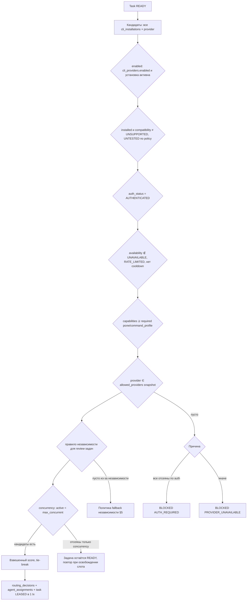

# Routing Policy v1.0 — Intelligent Router

**Статус:** Phase 0, проект на утверждение. Ничего из описанного не реализовано.
**Требования:** ТЗ §4 (независимое ревью), §5 (L1–L5, факторы Router, `BLOCKED` при недоступности обоих CLI, policy snapshot), §7.2 (`routing_decisions`, `agent_assignments`, `provider_health`, `cli_installations`, `runs.policy_snapshot`, `policies`), §16 (метрика verified completion rate), §19 AC-03/AC-04/AC-16.
**Решения:** ADR-0003, ADR-0004, ADR-0007.
**Связанные документы:** [AGENT_ROLES.md](AGENT_ROLES.md), [QUALITY_GATES.md](QUALITY_GATES.md), [../protocols/CLI_ADAPTER_CONTRACT.md](../protocols/CLI_ADAPTER_CONTRACT.md).

---

## 1. Назначение

Router (модуль `orchestration.router` в `worker-orchestrator`) для каждой задачи в `READY`:

1. фиксирует уровень сложности `L1…L5` и `risk_level` (при материализации плана; пересчёт при replan);
2. выбирает установку CLI (`cli_installations`: провайдер × хост) или переводит задачу в `BLOCKED`;
3. записывает `routing_decisions` (выбор, `score_breakdown`, причина, `policy_version`) и `agent_assignments` в одной транзакции с переходом задачи `READY → LEASED`.

Router детерминирован: одинаковые входы (snapshot policy, состояние провайдеров, история качества на момент решения) дают одинаковое решение; случайность не используется. Все входы решения сохраняются в `score_breakdown`.

## 2. Классификация сложности L1–L5

### 2.1 Детерминированные сигналы

Вычисляются Code Intelligence по плану задачи (`files_hint`, описание) и индексу commit (ADR-0005):

| Сигнал | Определение |
|---|---|
| `files_estimated` | файлы из `files_hint` + прямые обратные зависимости затронутых символов (1 уровень) |
| `modules_touched` | число top-level модулей/пакетов среди `files_estimated` |
| `sensitive_categories` | множество из: `auth`, `crypto`, `permissions`, `secrets_handling`, `payments`, `migrations`, `ci_workflow`, `iac`, `public_api`; определяются по путям (настраиваемые glob в policy), именам символов и импортам (например, библиотеки криптографии) |
| `migration_kind` | `none` / `additive` / `destructive` (детектор DDL — см. AGENT_ROLES §2.8) |
| `public_api_change` | изменение OpenAPI/GraphQL/proto-схем, экспортируемых символов, на которые есть внешние ссылки |
| `architecture_change` | новый модуль/сервис/хранилище, новая категория внешней зависимости, флаг `architecture` от planner |
| `content_class` | `docs_only`, `tests_only`, `formatting_only`, `code` |
| `coverage_touched` | покрытие затронутых файлов по последнему `QG-COVERAGE` (если есть) |

### 2.2 Детерминированный минимум (floor)

Правила применяются все; floor = максимум сработавших.

| # | Условие | Floor |
|---|---|---|
| F1 | `content_class ∈ {docs_only, formatting_only}` и `files_estimated ≤ 3` | L1 |
| F2 | `content_class = code` или `tests_only` | L2 |
| F3 | `files_estimated > 10` или `modules_touched > 2` или `public_api_change` или `migration_kind = additive` | L3 |
| F4 | `sensitive_categories` ∩ {`auth`, `crypto`, `permissions`, `secrets_handling`, `payments`, `ci_workflow`, `iac`} ≠ ∅ или `migration_kind = destructive` | L4 |
| F5 | `architecture_change` | L5 |
| F6 | минимальный уровень режима (AGENT_ROLES §4) | по режиму |

### 2.3 Итоговый уровень

```
level = max(floor_deterministic, planner_estimate, mode_minimum, user_requested_minimum)
```

- Конфликт оценок разрешается **максимумом** (ТЗ: безопасная сторона).
- Понижение уровня ниже floor — только через policy override проекта (`policies.policy_type='routing'`, `complexity_overrides` с glob и обоснованием), утверждённый `admin`, с audit event; override сохраняется в snapshot.
- Пользователь может только повысить уровень задачи/run.
- Уровень хранится в `tasks.complexity` (1..5); причины — в `routing_decisions.score_breakdown.classification`.

## 3. Оценка риска

Баллы суммируются:

| Фактор | Баллы |
|---|---|
| каждая категория из `sensitive_categories` (кроме `public_api`, `migrations`) | +3 (не более +6) |
| `migration_kind = destructive` | +4 |
| `migration_kind = additive` | +1 |
| `public_api_change` | +2 |
| изменения `ci_workflow`/`iac` | +2 |
| `coverage_touched < 50%` или неизвестно для кода | +1 |
| ожидаемый diff > 500 строк | +1 |
| мажорное обновление зависимости | +2 |
| режим `SECURITY` или `MODERNIZE` | +1 |
| план включает защищённое действие (merge, deploy, migration apply) | +2 |

Порог: 0–1 → `low`; 2–3 → `medium`; 4–6 → `high`; ≥ 7 → `critical`. Planner может предложить более высокий риск (берётся максимум). `risk_level` влияет на approvals (approval policy `risk_based`: `high` → approval результата перед MERGE обязательно, `critical` → дополнительно four-eyes) и на обязательность security-шагов (AGENT_ROLES §4).

## 4. Алгоритм маршрутизации



### 4.1 Жёсткие фильтры

| # | Фильтр | Источник | Причина исключения в `score_breakdown.excluded[]` |
|---|---|---|---|
| H1 | провайдер и установка включены | `cli_providers.enabled`, settings | `disabled` |
| H2 | установлен, `compatibility ≠ UNSUPPORTED`; `UNTESTED` только если `allow_untested_cli_versions` | probe | `not_installed`, `unsupported_version`, `untested_version` |
| H3 | `auth_status = AUTHENTICATED` (статус `UNKNOWN` допустим, только если последнее исполнение на установке успешно < 1 ч назад) | `cli_installations`, `provider_health` | `auth_required` |
| H4 | `availability ∈ {AVAILABLE, DEGRADED}`, `now ≥ cooldown_until` | `provider_health` | `unavailable`, `rate_limited` |
| H5 | требуемые capabilities (`noninteractive_mode`, `machine_readable_output ≠ none`; для задач с `session_ref_hint` — `resume_session`) | матрица совместимости | `capability_missing:<flag>` |
| H6 | `provider ∈ snapshot.routing.allowed_providers` | `runs.policy_snapshot` | `policy_disallowed` |
| H7 | независимость (раздел 5) для задач `reviewer`/`security` и review-задач `qa`/`architect`/`database` | история попыток | `independence_conflict` |
| H8 | `active_executions(installation) < max_concurrent` (по умолчанию 2 на установку, ≤ `max_concurrent_per_provider` на workspace) | `cli_executions` в `STARTING/RUNNING` | `concurrency_full` |

Если после H1–H7 кандидатов нет — задача `BLOCKED`: `AUTH_REQUIRED`, если единственная причина исключения всех кандидатов — `auth_required`; иначе `PROVIDER_UNAVAILABLE` (ТЗ §5, AC-16). Задача разблокируется автоматически событием `provider.health_changed`/`provider.auth_restored` (повторный роутинг), без ручного вмешательства и без обходных путей. Если run не имеет ни одной исполнимой задачи, run → `BLOCKED` с той же причиной в `runs.blocked_reason`.

### 4.2 Взвешенная оценка

Для каждого оставшегося кандидата `i`:

```
score_i = w_q·Q_i + w_c·C_i + w_a·A_i + w_l·L_i + w_d·D_i + w_h·H_i + w_r·(1 − R_i)
```

| Компонента | Определение (∈ [0,1]) | Вес по умолчанию |
|---|---|---|
| `Q` quality | сглаженный verified completion rate (провайдер × роль), раздел 7 | `w_q = 0.40` |
| `C` capability fit | доля желательных (необязательных) capabilities роли: `machine_readable_output = jsonl_stream`, `tool_events_exposed`, `token_usage_exposed` | `w_c = 0.10` |
| `A` availability | `AVAILABLE` = 1.0, `DEGRADED` = 0.5 | `w_a = 0.15` |
| `L` load | `1 − active/max_concurrent` | `w_l = 0.10` |
| `D` diversity | 1, если провайдер ≠ провайдер реализации для задач qa/security L4+ и для второго анализа L4/L5; 0, если совпадает; 0.5, если неприменимо | `w_d = 0.10` |
| `H` hint | `snapshot.routing.provider_hints[role][provider]`, по умолчанию 0.5 для обоих | `w_h = 0.05` |
| `R` recent failures | `min(1, Σ exp(−age_h/6))` по `PROCESS_FAILED`/`TIMEOUT`/`OUTPUT_PARSE_ERROR` на установке за 24 ч, делённое на 3 | `w_r = 0.10` |

Сумма весов = 1.0 (валидируется при сохранении policy). **Stickiness:** для повторных попыток и FIX-итераций одной задачи провайдер предыдущей попытки получает бонус `+0.15` (сохраняет независимость ревью и контекст сессии), если не исключён фильтрами и последняя неудача не связана с самим провайдером (`PROCESS_FAILED`/`TIMEOUT` подряд ≥ 2 → бонус снимается).

**Tie-break** (если `|score_1 − score_2| < 0.01`): (1) меньшая загрузка `active/max_concurrent`; (2) меньшее число назначений этого провайдера в текущем run; (3) лексикографически меньший `provider` code, затем `installation_id`.

### 4.3 Запись решения

`routing_decisions`: `task_id`, `selected_provider`, `reason` (человекочитаемо, ≤ 500 символов), `policy_version` (= `policy_snapshot.snapshot_id`), `score_breakdown`:

```json
{
  "classification": {"level": "L3", "floor": "L3", "floor_rules": ["F2", "F3"], "planner_estimate": "L2", "mode_minimum": "L2", "risk_points": 3, "risk_level": "medium"},
  "candidates": [
    {"installation_id": "0193a6f2-6c1e-7d2a-9b11-3f0e5c2d3a01", "provider": "codex", "components": {"Q": 0.69, "C": 1.0, "A": 1.0, "L": 0.5, "D": 0.5, "H": 0.5, "R": 0.0}, "stickiness": 0.0, "score": 0.751},
    {"installation_id": "0193a6f2-6c1e-7d2a-9b11-3f0e5c2d3a02", "provider": "claude", "components": {"Q": 0.67, "C": 0.67, "A": 1.0, "L": 0.9, "D": 0.5, "H": 0.5, "R": 0.0}, "stickiness": 0.0, "score": 0.750}
  ],
  "excluded": [],
  "tie_break": "lower_load",
  "selected_installation_id": "0193a6f2-6c1e-7d2a-9b11-3f0e5c2d3a02",
  "weights": {"w_q": 0.40, "w_c": 0.10, "w_a": 0.15, "w_l": 0.10, "w_d": 0.10, "w_h": 0.05, "w_r": 0.10},
  "quality_inputs": {"codex": {"s": 12.4, "n": 16.8}, "claude": {"s": 10.1, "n": 14.0}},
  "review_independence": "not_required"
}
```

## 5. Правило независимого ревью

**Авторы** проверяемого изменения = множество провайдеров всех попыток, создавших коммиты в проверяемом диапазоне (`base_commit..head`). Ревью (`reviewer`, `security`, а также review-задачи `qa`, `architect`, `database`) **независимо**, только если провайдер ревьюера ∉ авторы.

| Ситуация | Действие |
|---|---|
| Есть доступный провайдер ∉ авторы | назначить его; `review_independence = independent` |
| Такого нет (недоступен, не авторизован, отключён policy, или оба провайдера уже авторы) | применить `snapshot.review.independence_fallback` |

| Fallback | Поведение | Маркировка | Разрешён в профиле |
|---|---|---|---|
| `BLOCK` | задача ревью → `BLOCKED` (`PROVIDER_UNAVAILABLE`); ожидание независимого провайдера; по истечении `independence_wait_hours` (по умолчанию 24) — эскалация в `MANUAL_REVIEW` | — | все |
| `MANUAL_REVIEW` | approval `MANUAL_REVIEW` (решает пользователь роли RBAC `reviewer`+, не автор run при four-eyes); задача `BLOCKED` (`MANUAL_REVIEW`); человек прикладывает отчёт ревью (artifact) | `human_review` | все |
| `SELF_REVIEW_FALLBACK` | approval `SELF_REVIEW_FALLBACK`; после одобрения ревью выполняет провайдер-автор в новой сессии | `self_review` — **никогда** не `independent` (ТЗ §4) | `basic`, `strict`; запрещён в `critical` |

Значения по умолчанию: `basic` → `SELF_REVIEW_FALLBACK`; `strict` → `MANUAL_REVIEW`; `critical` → `BLOCK`. Маркировка хранится в `TASK_ASSIGN.review_independence`, `routing_decisions.score_breakdown.review_independence`, в evidence ревью и отображается в UI/отчёте; гейт `QG-REVIEW` с требованием `independent` не засчитывается для `self_review` (QUALITY_GATES §2).

Независимость требуется с уровня, заданного `snapshot.review.independence_required_from_level` (по умолчанию `L3`; ТЗ §5: L3 = исполнитель + независимый reviewer). Профиль `critical` устанавливает `L2` (QUALITY_GATES §2.2).

## 6. Rate limits и недоступность

1. Наблюдённый `RATE_LIMITED` (CLI_ADAPTER_CONTRACT §6) → `provider_health.availability = RATE_LIMITED`, `cooldown_until` по формуле backoff (база 60 с, ×2, максимум 3600 с, jitter ±20%, не меньше retry-after, если CLI его сообщил).
2. После снятия cooldown в течение 1 ч `max_concurrent` установки уменьшается вдвое (минимум 1) — учёт «наблюдаемых ограничений» (ТЗ §5).
3. Задача: `RETRY_WAIT` с `next_attempt_at = cooldown_until` либо немедленный reroute на другой допустимый провайдер (если проходит все фильтры, включая независимость). `max_attempts` не расходуется, расходуется `retry_budget_seconds`; по исчерпании — `BLOCKED` (`PROVIDER_UNAVAILABLE`).
4. **Запрещено**: смена аккаунтов/логинов, использование нескольких подписок одного провайдера для обхода лимита, дробление задач ради обхода лимита, параллельные «пробные» запуски, обращение к AI API (ТЗ §1, §5). Платформа поддерживает одну установку-аккаунт на провайдера на хост; несколько хостов допустимы только как штатная конфигурация оператора и отображаются в CLI Providers.
5. `AUTH_REQUIRED` → `BLOCKED` (`AUTH_REQUIRED`), failover только при `failover_on_auth_required = true`.

## 7. История качества

**Verified completion rate (VCR)** для пары (провайдер, роль) в рамках workspace (межтенантная агрегация запрещена):

- **Успех** попытки: задача достигла `SUCCEEDED`, и все обязательные гейты на commit этой попытки `PASS`, и (для реализующих ролей) итоговый вердикт ревью `approved` без `REVIEW_REJECTED`; для проверяющих ролей (`reviewer`, `security`) — вердикт не отменён последующим `MANUAL_REVIEW`/пользователем и не пропущено находок, позже выявленных гейтами `critical`/`high` в тех же строках.
- **Неудача**: `failure_category ∈ {GATE_FAILED, REVIEW_REJECTED, PROCESS_FAILED, OUTPUT_PARSE_ERROR, TIMEOUT, SANDBOX_DENIED, POLICY_DENIED}`.
- **Исключаются** (не характеризуют качество агента): `AUTH_REQUIRED`, `RATE_LIMITED`, `CLI_NOT_INSTALLED`, `UNSUPPORTED_VERSION`, `CANCELLED`, `LEASE_LOST`, `WORKER_CRASH`, `INTERNAL_ERROR`.
- **Окно** 90 дней, вес попытки `0.5^(age_days / 30)` (экспоненциальное затухание).
- **Байесовское сглаживание** (Beta-prior `α = β = 2`, априорное среднее 0.5):

```
Q = (s_w + α) / (n_w + α + β)
```

где `s_w` — взвешенная сумма успехов, `n_w` — взвешенная сумма учтённых попыток. При `n_w = 0` → `Q = 0.5` (нейтрально). Пересчёт — инкрементально по событиям `task_attempt.finished`/`gate.completed`; значения на момент решения записываются в `quality_inputs`.

## 8. Шаблоны исполнения L1–L5

Эффективный набор гейтов задачи = гейты профиля run ∪ гейты, требуемые уровнем (QUALITY_GATES §3).

| Уровень | Роли и шаги | Обязательные гейты (сверх профиля) | Ревью | Approvals |
|---|---|---|---|---|
| **L1** | детерминированный инструмент (formatter, codemod) или одна роль на одном CLI; план — шаблонный без CLI-planner | formatting/lint; build, если затронут код | нет | только защищённые действия по policy |
| **L2** | одна роль на одном CLI + тесты | lint, typecheck, build, unit | нет (самопроверка не маркируется как ревью) | по policy |
| **L3** | исполнитель + независимый reviewer | L2 + integration (если применимо), SAST, secrets, `QG-REVIEW` (independent) | независимое (§5) | по policy |
| **L4** | двойной анализ: до реализации обе модели независимо анализируют задачу (две analysis-задачи роли `architect` или профильной роли на разных провайдерах, затем сведение planner); реализация; security- и qa-задачи на провайдере ≠ исполнителя | L3 + SCA, E2E критичных потоков, migration validation (если есть), coverage; задачи `security` и `qa` обязательны | независимое + security review | `PLAN_APPROVAL` (план и сведение анализа) и approval результата перед `MERGE` (обязателен при `risk ≥ high`) |
| **L5** | совместный архитектурный анализ (`architect` на обоих провайдерах + сведение), ADR, прототип (задача с `write_scope: worktree` в ветке прототипа), затем реализация по шаблону L4 | все гейты L4 + архитектурное ревью прототипа, `QG-REVIEW` ADR | независимое на каждом этапе | `PLAN_APPROVAL` с утверждением ADR до реализации, approval по результатам прототипа, approval результата перед `MERGE` |

Если для L4/L5 доступен только один провайдер, «двойной анализ» невозможен: применяется `independence_fallback` (для `critical` — `BLOCK`), факт отражается в отчёте; одномодельный повторный анализ не выдаётся за двойной.

## 9. Policy snapshot

При создании run (`POST /runs`) Orchestrator собирает эффективную policy (глобальная → workspace → project → параметры запроса, где запрос может только сужать) и сохраняет неизменяемый snapshot в `runs.policy_snapshot`; `routing_decisions.policy_version` ссылается на `snapshot_id`. Изменение policy во время run не влияет на него, кроме явного replan по директиве (новый snapshot с `supersedes`).

```json
{
  "snapshot_id": "0193a6f2-6c1e-7d2a-9b11-3f0e5c2d4a00",
  "snapshot_schema_version": "1.0",
  "created_at": "2026-11-08T09:00:00Z",
  "supersedes": null,
  "sources": [
    {"policy_id": "0193a6f2-6c1e-7d2a-9b11-3f0e5c2d4a01", "scope": "global", "policy_type": "routing", "version": 3},
    {"policy_id": "0193a6f2-6c1e-7d2a-9b11-3f0e5c2d4a02", "scope": "project", "policy_type": "routing", "version": 1}
  ],
  "routing": {
    "strategy": "adaptive",
    "allowed_providers": ["codex", "claude"],
    "weights": {"w_q": 0.40, "w_c": 0.10, "w_a": 0.15, "w_l": 0.10, "w_d": 0.10, "w_h": 0.05, "w_r": 0.10},
    "stickiness_bonus": 0.15,
    "provider_hints": {},
    "max_concurrent_per_installation": 2,
    "max_concurrent_per_provider_workspace": 4,
    "allow_untested_cli_versions": true,
    "failover_on_auth_required": false,
    "complexity_rules_version": "1.0",
    "complexity_overrides": [],
    "sensitive_path_globs": {"auth": ["**/auth/**", "**/login*"], "ci_workflow": [".github/workflows/**"], "migrations": ["**/migrations/**"]}
  },
  "risk": {"thresholds": {"medium": 2, "high": 4, "critical": 7}},
  "review": {"independence_required_from_level": "L3", "independence_fallback": "MANUAL_REVIEW", "independence_wait_hours": 24, "max_loops": 3},
  "quality": {"profile": "strict", "profile_version": 1, "coverage_core_min": 0.85},
  "approval_policy": {"mode": "risk_based", "plan_approval_from_level": "L4", "result_approval_from_risk": "high", "four_eyes_for": ["MERGE", "PRODUCTION_DEPLOY", "DESTRUCTIVE_MIGRATION", "DATA_DELETION", "SECRET_CHANGE", "UNRESTRICTED_NETWORK"]},
  "retry": {"max_attempts_default": 3, "retry_budget_seconds": 7200, "backoff": {"base_seconds": 30, "factor": 2, "max_seconds": 1800, "jitter": 0.2}, "rate_limit_cooldown": {"base_seconds": 60, "max_seconds": 3600}},
  "documentation_mode": "SMART",
  "sandbox": {"network_default": "restricted", "local_execution_fallback": false},
  "acp": {"acl_version": "1.0", "max_message_bytes": 32768, "max_messages_per_attempt": 50},
  "quality_history": {"window_days": 90, "half_life_days": 30, "prior_alpha": 2, "prior_beta": 2},
  "content_hash": "sha256:9a1f0c3b5d7e9f1a2b3c4d5e6f708192a3b4c5d6e7f8091a2b3c4d5e6f708192"
}
```

`content_hash` — sha256 канонического JSON без поля `content_hash`; используется в `run.created` событии и для проверки неизменности.

## 10. Примеры решений

| # | Задача | Классификация | Состояние провайдеров | Решение | Обоснование |
|---|---|---|---|---|---|
| 1 | DOCUMENT: обновить README, 1 файл | F1 → L1, risk low | оба AVAILABLE | codex (tie-break: load) | L1, ревью не требуется |
| 2 | DEVELOP: изменение внутренней логики сервиса, 6 файлов, 1 модуль, без изменения API | F2 → L2, planner L2, risk low (coverage неизвестно +1) | оба AVAILABLE | claude (Q выше) | L2: unit + build |
| 3 | DEVELOP: изменение `app/auth/service.py` | F4 → L4, risk high (auth +3, coverage +1) | оба AVAILABLE | developer → codex; двойной анализ: architect на codex и claude; security+qa → claude | L4, diversity |
| 4 | Review-задача к №3, профиль `strict` | L4 | claude `RATE_LIMITED` (cooldown 20 мин) | H4 исключает claude, H7 исключает codex (автор) → `RETRY_WAIT` до `cooldown_until` (ожидание 20 мин ≤ `independence_wait_hours`), approval `MANUAL_REVIEW` не создаётся | независимость важнее скорости |
| 5 | Любая задача | — | codex `AUTH_REQUIRED`, claude `UNAVAILABLE` | `BLOCKED` (`PROVIDER_UNAVAILABLE`) | причины разные → не только auth (AC-16) |
| 6 | Любая задача | — | codex `AUTH_REQUIRED`, claude отключён policy (`allowed_providers=["codex"]`) | `BLOCKED` (`AUTH_REQUIRED`) | единственная причина по допустимым — auth |
| 7 | FIX-итерация 2 задачи developer | L3 | оба AVAILABLE, попытка 1 на codex | codex (stickiness +0.15) | сохраняет независимость claude-ревьюера |
| 8 | MODERNIZE: новый сервис очередей | F5 → L5, risk high | только claude авторизован | architect только на claude; профиль `critical` → `BLOCK` до доступности codex, затем `MANUAL_REVIEW` | двойной анализ невозможен, self-review не выдаётся за независимый |
| 9 | Ревью при профиле `basic`, codex недоступен ≥ 24 ч | L3 | автор claude | approval `SELF_REVIEW_FALLBACK` → ревью claude с меткой `self_review` | разрешено в basic, маркировка честная |

Пояснение к №4: при политике `MANUAL_REVIEW` Router сначала проверяет, станет ли независимый провайдер доступен в пределах `independence_wait_hours` (известный `cooldown_until`); если да — `RETRY_WAIT`, иначе — approval `MANUAL_REVIEW`.

## 11. Тестирование Router (план)

Unit (ТЗ §20): таблица floor-правил; суммирование риска и пороги; каждый жёсткий фильтр и выбор причины `BLOCKED`; детерминизм (одинаковые входы → одинаковые решения, property-based); tie-break; stickiness; независимость при смене провайдера между попытками; fallback по профилям; запрет `SELF_REVIEW_FALLBACK` в `critical`; формула Q (граничные `n=0`, затухание); валидация суммы весов. Integration: разблокировка по `provider.auth_restored`; cooldown после `RATE_LIMITED` в FakeAdapter.

## 12. Предлагаемые дополнения

| Предложение | Обоснование |
|---|---|
| Перечисление `review_independence`: `independent`, `self_review_fallback`, `human_review`, `not_required` | маркировка ревью (ТЗ §4) |
| Перечисление `independence_fallback`: `BLOCK`, `MANUAL_REVIEW`, `SELF_REVIEW_FALLBACK` | policy |
| Колонки `provider_health.cooldown_until`, `routing_decisions.installation_id`, `routing_decisions.review_independence`, `runs.policy_snapshot_hash` | rate-limit, воспроизводимость |
| Таблица/материализованное представление `provider_quality_stats(workspace_id, provider, agent_role, s_w, n_w, updated_at)` | инкрементальный расчёт Q |
