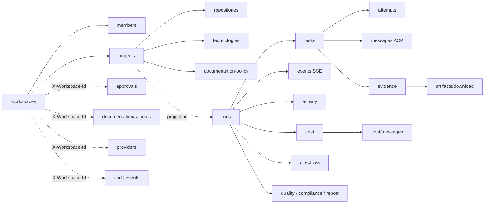
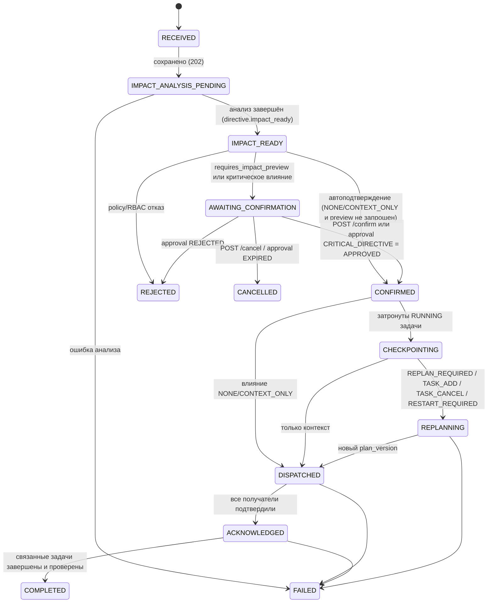

# API_DESIGN — правила Internal REST API v1

**Статус:** Phase 0, проект на утверждение. Ничего из описанного не реализовано и не протестировано.
**Источник требований:** ТЗ §8 (REST API), §8.1–8.3, §11 (Live Agent Chat), §15 (безопасность), §19 (AC-08, AC-12, AC-15), §20–21.
**Машиночитаемый контракт:** [`openapi.yaml`](openapi.yaml) (OpenAPI 3.1.0). В Phase 1 (P1-03, ADR-0013) переносится в `packages/contracts/openapi.yaml` как единственный источник.
**Связанные решения:** ADR-0001, ADR-0002, ADR-0007, ADR-0008, ADR-0009, ADR-0011, ADR-0012, ADR-0013.

При расхождении с ТЗ приоритет у ТЗ. Все операции, отсутствующие в таблице ТЗ §8, помечены в `openapi.yaml` расширением `x-tz-addition: true` и суффиксом «[дополнение к ТЗ]» в `summary`; ниже они помечены «**(доп.)**».

---

## 1. Общие принципы

| Аспект | Решение |
|---|---|
| Base path | `/api/v1` (major-версия в пути). Health — вне версии: `/health/live`, `/health/ready`. |
| Формат | `application/json; charset=utf-8`; ошибки — `application/problem+json` (RFC 7807/9457); SSE — `text/event-stream`; отчёт run — также `text/markdown` по `Accept`. |
| Идентификаторы | UUIDv7 (ADR-0008), строки в каноническом виде. Внешние ID (PR number, PID) — отдельные поля. |
| Время | UTC, ISO 8601 с `Z` (`2026-11-08T09:00:00Z`). |
| Имена | `snake_case` для полей и query-параметров; ресурсы во множественном числе, `kebab-case` в пути (`documentation-policy`, `audit-events`). |
| Перечисления | Строго по `docs/README.md` §3. Новые значения — только через раздел §19 «Предлагаемые дополнения». |
| Строгость запросов | Все request-схемы `additionalProperties: false`; неизвестное поле ⇒ `422 validation_error`. |
| Толерантность ответов | Response-схемы открыты для аддитивного расширения: клиент **обязан** игнорировать неизвестные поля и обрабатывать неизвестные значения enum как «unknown» (см. §16). |
| `null` vs отсутствие | В ответах nullable-поля присутствуют со значением `null`; в PATCH (merge-patch) отсутствие поля = «не менять», `null` = «очистить» (только для nullable). |
| Команды | Действия над агрегатами — отдельные POST-ресурсы-команды (`/pause`, `/decision`, `/confirm`), а не PATCH статуса. Прямое изменение `status` через PATCH запрещено: FSM переходы выполняет только Orchestrator (ADR-0007). |
| Размер тела | ≤ 256 KiB на запрос (иначе `413 payload_too_large`); строковые лимиты заданы в схемах (`objective` ≤ 20000, `message` ≤ 8000). |

## 2. Ресурсная модель



Принцип адресации: **плоские канонические URI для ресурсов с собственным UUID** (`/runs/{run_id}`, `/tasks/{task_id}`, `/evidence/{evidence_id}`) и вложенность только для подчинённых коллекций. Это совпадает с таблицей ТЗ §8 и позволяет определять tenant по самому ресурсу (§6).

### 2.1 Каталог операций (61 = 37 из ТЗ §8 + 24 дополнения)

| Группа | Операции |
|---|---|
| Auth **(доп.)** | `POST /auth/login`, `POST /auth/logout`, `GET /auth/session` |
| Health **(доп.)** | `GET /health/live`, `GET /health/ready` (без аутентификации) |
| Workspaces | `GET/POST /workspaces`; **(доп.)** `GET/POST /workspaces/{workspace_id}/members`, `PATCH/DELETE /workspaces/{workspace_id}/members/{user_id}`; **(доп., Phase 8, OQ-45 (c), (f))** `GET/PATCH /workspaces/{workspace_id}`, `GET /workspaces/{workspace_id}/events` (SSE уведомлений workspace, §13.1) |
| Projects | `GET/POST /projects`, `GET/PATCH /projects/{project_id}`, `POST /projects/{project_id}/repositories`, **(доп.)** `GET /projects/{project_id}/repositories`, `GET /projects/{project_id}/repositories/{repository_id}/tree`, `GET /projects/{project_id}/repositories/{repository_id}/file`, **(Phase 8, OQ-45 (c))** `.../branches`, `.../commits` (Repository Explorer, FR-PRJ-05), `GET /projects/{project_id}/technologies`, `GET/PATCH /projects/{project_id}/documentation-policy`, `GET /projects/{project_id}/controls`, `POST /projects/{project_id}/controls/{control_id}/approval` |
| Runs | **(доп.)** `GET /runs`; `POST /runs`, `GET /runs/{run_id}`, `GET /runs/{run_id}/tasks`, `POST /runs/{run_id}/pause|resume|cancel`, `GET /runs/{run_id}/events` (SSE), `GET /runs/{run_id}/activity` |
| Chat/Directives | `GET /runs/{run_id}/chat`, `POST /runs/{run_id}/chat/messages`, `POST /runs/{run_id}/directives`, `GET /runs/{run_id}/directives/{directive_id}`; **(доп.)** `GET /runs/{run_id}/directives`, `POST .../directives/{directive_id}/confirm`, `POST .../directives/{directive_id}/cancel` |
| Tasks | `GET /tasks/{task_id}`, `GET /tasks/{task_id}/messages`, `GET /tasks/{task_id}/evidence`; **(доп.)** `GET /tasks/{task_id}/attempts` |
| Evidence **(доп.)** | `GET /evidence/{evidence_id}`, `GET /artifacts/{artifact_id}/download`; **(Phase 8, OQ-45 (c))** `GET /runs/{run_id}/evidence` |
| Quality | `GET /runs/{run_id}/quality`, `GET /runs/{run_id}/compliance`, `GET /runs/{run_id}/report`; **(доп., Phase 7, OQ-43 (d))** `GET /runs/{run_id}/findings`, `GET /findings/{finding_id}`, `POST /findings/{finding_id}/transitions`, `POST /runs/{run_id}/compliance/{control_id}/review` |
| Providers | `GET /providers`, `POST /providers/{provider_id}/probe`, `PATCH /providers/{provider_id}/settings`; **(доп., Phase 8, OQ-45 (c))** `GET /providers/{provider_id}/probes/{probe_request_id}` (статус probe, §15) |
| Approvals | `GET /approvals`, `POST /approvals/{approval_id}/decision`; **(доп.)** `GET /approvals/{approval_id}` |
| Documentation | `GET/POST /documentation/sources`, `POST /documentation/sources/{source_id}/refresh`; **(доп., Phase 8, OQ-45 (c))** `GET /technologies` (технологии workspace) |
| Audit | `GET /audit-events` |
| Analytics **(доп., P8-07)** | `GET /analytics/summary` (экран Analytics ТЗ §11, метрики ТЗ §16, FR-CI-08) |

Обоснование дополнений: auth — без них невозможна cookie-сессия (ADR-0009); members — RBAC требует управления ролями (AC-12); `GET /runs`, `GET .../repositories`, `GET .../directives`, `GET /tasks/{id}/attempts`, `GET /approvals/{id}`, `GET /evidence/{id}` — экраны Dashboard/Run Graph/Task Detail/Evidence (ТЗ §11) без них не строятся; `confirm`/`cancel` директивы — шаг «confirm» из ТЗ §8.2 не имеет эндпоинта в таблице; artifacts download — evidence ссылается на artifact (AC-14); health — эксплуатация (ТЗ §16); findings/transitions, review контроля и применимость контролей проекта — экраны Quality/Standards & Compliance Phase 7: жизненный цикл находок и вердикт человека по контролю (QUALITY_GATES §5.3, §8.2) и утверждение применимости admin (ТЗ §13) без них невыполнимы (OQ-43 (d)).

## 3. Аутентификация и CSRF (ADR-0009)

- **Сессия:** локальные учётные записи (argon2id), серверные сессии в `user_sessions` (хранится только `token_hash`). Cookie `aicd_session`: `HttpOnly; Secure; SameSite=Strict; Path=/api`. Абсолютный TTL 12 ч, idle-TTL 30 мин (настраиваемо); ротация идентификатора при логине и смене роли.
- **CSRF (double-submit + server binding):** при логине генерируется `csrf_token` (256 бит), его хэш хранится в `user_sessions.csrf_token_hash`; значение отдаётся в теле `SessionInfo.csrf_token` и в cookie `aicd_csrf` (не HttpOnly, `SameSite=Strict`). Для **всех** небезопасных методов (`POST/PATCH/PUT/DELETE`) обязателен заголовок `X-CSRF-Token`, совпадающий с хэшем сессии (сравнение в константное время). Отсутствие/несовпадение ⇒ `403 csrf_failed`. Дополнительно проверяется `Origin` (или `Sec-Fetch-Site: same-origin`) — defence in depth.
- **Исключения:** `POST /auth/login` (сессии ещё нет) защищён проверкой `Origin`/`Sec-Fetch-Site` и rate limit; `GET`-запросы (включая SSE) CSRF-токен не требуют и не имеют побочных эффектов.
- **OpenAPI:** `securitySchemes.cookieAuth` (`apiKey` in cookie `aicd_session`) + `csrfHeader` (`apiKey` in header `X-CSRF-Token`); глобально требуются оба; для `GET` переопределено на `cookieAuth`; для login/health — `security: []`.
- **Эндпоинты (доп. к ТЗ):** `POST /auth/login` → `200 SessionInfo` + `Set-Cookie`; неверные данные ⇒ `401 unauthenticated` без уточнения причины; блокировка после 5 неудач (`user_credentials.locked_until`). `POST /auth/logout` → `204`, сессия отзывается (`revoked_at`), открытые SSE этой сессии закрываются. `GET /auth/session` → текущий пользователь, `csrf_token`, членства и роли (для восстановления SPA после перезагрузки).
- **Нет API-ключей:** ни для пользователей, ни для AI (ТЗ §1, ADR-0003). OIDC — открытый вопрос (OQ, ADR-0009).

## 4. Tenant scoping

**Решение:** workspace определяется **из адресуемого ресурса**, а заголовок `X-Workspace-Id` используется **только** для коллекций, у которых нет родительского ресурса с workspace.

| Случай | Источник workspace |
|---|---|
| `/projects/{id}`, `/runs/{id}`, `/tasks/{id}`, `/evidence/{id}`, `/artifacts/{id}`, `/approvals/{id}`, `/documentation/sources/{id}`, вложенные коллекции | Колонка `workspace_id` ресурса (денормализована, ADR-0008) |
| `POST /runs` | `projects.workspace_id` по `project_id` из тела |
| `/workspaces/{workspace_id}/members` | Путь |
| `GET/POST /projects`, `GET /runs`, `GET /approvals`, `GET/POST /documentation/sources`, `GET /technologies`, `GET /providers`, `POST /providers/{id}/probe`, `GET /providers/{id}/probes/{probe_request_id}`, `PATCH /providers/{id}/settings`, `GET /audit-events` | Заголовок `X-Workspace-Id` (обязателен) |
| `GET/PATCH /workspaces/{workspace_id}`, `GET /workspaces/{workspace_id}/events` | Путь |
| `GET/POST /workspaces`, `/auth/*` | Не требуется (список собственных workspace — через SECURITY DEFINER функцию членства) |

**Обоснование выбора заголовка вместо `/workspaces/{id}/projects`:** таблица ТЗ §8 фиксирует плоские пути `/projects`, `/approvals`, `/audit-events`; заголовок сохраняет их без изменения и даёт единое место (middleware) для резолва tenant. Query-параметр отвергнут, т.к. он попадает в access-логи и кэши как часть URL и смешивается с фильтрами.

**Алгоритм (middleware → service):**
1. Аутентификация сессии.
2. Резолв `workspace_id` (ресурс/тело/заголовок). Для ресурсов — лёгкий lookup `(id) → workspace_id` под ролью `aicd_app` через SECURITY DEFINER функцию, возвращающую только `workspace_id`.
3. Проверка членства `workspace_members`. **Не член ⇒ `404 not_found`** (тот же ответ, что и для несуществующего ID — защита от перечисления, AC-12). Член без нужного права ⇒ `403 forbidden`.
4. `SET LOCAL app.workspace_id / app.user_id / app.actor_type` и выполнение запроса в транзакции — RLS (ADR-0008) является вторым барьером: даже ошибка в шаге 3 не раскрывает чужие строки.
5. Если `X-Workspace-Id` передан на ресурсный эндпоинт и не совпадает с workspace ресурса ⇒ `404 not_found`.

Межтенантные ссылки в телах (`project_id`, `technology_version_id` глобален — допустим, `approval_id` в `DirectiveTarget`, `thread_id`) проверяются на принадлежность тому же workspace; иначе `404 not_found` (а не 422), чтобы не раскрывать существование.

## 5. Авторизация (RBAC)

Роли workspace: `owner`, `admin`, `developer`, `reviewer`, `viewer` (ТЗ §15). Проектные переопределения в v1 допускаются **только на понижение** (например, `developer` → `viewer` для одного проекта); эффективная роль = min(workspace role, project override).

Каждая операция в `openapi.yaml` несёт `x-required-permission`. Проверка выполняется декларативно (зависимость FastAPI, построенная из того же каталога), а не вручную в обработчиках; CI-тест сверяет, что у каждого маршрута есть право и оно совпадает со спецификацией (§18).

### 5.1 Каталог прав

| Право | owner | admin | developer | reviewer | viewer |
|---|:-:|:-:|:-:|:-:|:-:|
| `workspace:create`¹ | ✔ | ✔ | ✔ | ✔ | ✔ |
| `member:read` | ✔ | ✔ | ✔ | ✔ | ✔ |
| `member:manage` | ✔ | — | — | — | — |
| `workspace:update` (название workspace, OQ-45 (f)) | ✔ | ✔ | — | — | — |
| `workspace:policy` (политики workspace — `settings`, `x-permission-depends-on: settings`) | ✔ | — | — | — | — |
| `project:read` | ✔ | ✔ | ✔ | ✔ | ✔ |
| `project:create`, `project:update`, `repository:attach` | ✔ | ✔ | — | — | — |
| `run:read`, `chat:read`, `evidence:read`, `quality:read`, `approval:read`, `provider:read`, `documentation:read`, `artifact:download` | ✔ | ✔ | ✔ | ✔ | ✔ |
| `artifact:download_raw` (kind `raw_cli_log`) | ✔ | ✔ | — | — | — |
| `run:create`, `run:control` | ✔ | ✔ | ✔ | — | — |
| `chat:write` | ✔ | ✔ | ✔ | ✔ | — |
| `directive:create` | ✔ все типы | ✔ все типы | ✔ все типы | ✔ только `ASK`, `REVIEW`, `APPROVE`/`REJECT`² | — |
| `directive:confirm` | ✔ | ✔ | ✔ свои | ✔ свои | — |
| `approval:decide` | см. §5.3 | см. §5.3 | см. §5.3 | см. §5.3 | — |
| `finding:triage` | ✔ | ✔ | ✔ без `ACCEPTED_RISK` | ✔ без `ACCEPTED_RISK` | — |
| `compliance:review` | ✔ | ✔ | ✔ | ✔ | — |
| `provider:probe`, `provider:settings` | ✔ | ✔ | — | — | — |
| `documentation:register` | ✔ | ✔ | — | — | — |
| `documentation:refresh` | ✔ | ✔ | ✔ | — | — |
| `audit:read` | ✔ | ✔ | — | — | — |
| `github:read` | ✔ | ✔ | ✔ | ✔ | ✔ |
| `github:manage` | ✔ | ✔ | — | — | — |
| `pull_request:create`, `pull_request:merge` (запрос merge; решение — approval `MERGE`, §5.3) | ✔ | ✔ | ✔ | — | — |

¹ Любой аутентифицированный пользователь; инсталляционная настройка `allow_workspace_creation` (по умолчанию `true` для single-team self-hosted) может ограничить создание.
² `APPROVE`/`REJECT` через чат — только для approvals, которые пользователь вправе решать (§5.3).

### 5.2 Матрица «эндпоинт × роль»

Обозначения: ✔ — разрешено; — — `403 forbidden`; «своё» — только автор; не-член workspace всегда получает `404`.

| Операция | Право | owner | admin | developer | reviewer | viewer |
|---|---|:-:|:-:|:-:|:-:|:-:|
| `POST /auth/login` | public | ✔ | ✔ | ✔ | ✔ | ✔ |
| `POST /auth/logout`, `GET /auth/session` | authenticated | ✔ | ✔ | ✔ | ✔ | ✔ |
| `GET /health/live`, `GET /health/ready` | public | ✔ | ✔ | ✔ | ✔ | ✔ |
| `GET /workspaces` | authenticated | ✔ | ✔ | ✔ | ✔ | ✔ |
| `POST /workspaces` | workspace:create | ✔ | ✔ | ✔ | ✔ | ✔ |
| `GET /workspaces/{id}/members`, `GET /workspaces/{id}` | member:read | ✔ | ✔ | ✔ | ✔ | ✔ |
| `PATCH /workspaces/{id}` (`name`; `settings` — дополнительно workspace:policy) | workspace:update | ✔ | ✔ (без `settings`) | — | — | — |
| `GET /workspaces/{id}/events` (SSE уведомлений, §13.1) | run:read | ✔ | ✔ | ✔ | ✔ | ✔ |
| `POST/PATCH/DELETE .../members[/{user_id}]` | member:manage | ✔ | — | — | — | — |
| `GET /projects`, `GET /projects/{id}` | project:read | ✔ | ✔ | ✔ | ✔ | ✔ |
| `POST /projects`, `PATCH /projects/{id}` | project:create / update | ✔ | ✔ | — | — | — |
| `GET /projects/{id}/repositories`, `.../repositories/{repository_id}/tree|file|branches|commits`, `/technologies`, `GET .../documentation-policy` | project:read | ✔ | ✔ | ✔ | ✔ | ✔ |
| `POST /projects/{id}/repositories` | repository:attach | ✔ | ✔ | — | — | — |
| `PATCH /projects/{id}/documentation-policy` | project:update | ✔ | ✔ | — | — | — |
| `GET /runs`, `GET /runs/{id}`, `/tasks`, `/events`, `/activity` | run:read | ✔ | ✔ | ✔ | ✔ | ✔ |
| `POST /runs` | run:create | ✔ | ✔ | ✔ | — | — |
| `POST /runs/{id}/pause|resume|cancel` | run:control | ✔ | ✔ | ✔ | — | — |
| `GET /runs/{id}/chat`, `GET .../directives[/{id}]` | chat:read | ✔ | ✔ | ✔ | ✔ | ✔ |
| `POST /runs/{id}/chat/messages` | chat:write | ✔ | ✔ | ✔ | ✔ | — |
| `POST /runs/{id}/directives` | directive:create | ✔ | ✔ | ✔ | частично (§5.4) | — |
| `POST .../directives/{id}/confirm|cancel` | directive:confirm | ✔ | ✔ | своё | своё | — |
| `GET /tasks/{id}`, `/attempts`, `/messages` | run:read | ✔ | ✔ | ✔ | ✔ | ✔ |
| `GET /tasks/{id}/evidence`, `GET /runs/{id}/evidence`, `GET /evidence/{id}` | evidence:read | ✔ | ✔ | ✔ | ✔ | ✔ |
| `GET /artifacts/{id}/download` | artifact:download (+`download_raw` для `raw_cli_log`) | ✔ | ✔ | ✔ (не raw) | ✔ (не raw) | ✔ (не raw) |
| `GET /runs/{id}/quality|compliance|report`, `GET /runs/{id}/findings`, `GET /findings/{id}` | quality:read | ✔ | ✔ | ✔ | ✔ | ✔ |
| `POST /findings/{id}/transitions` | finding:triage (§5.5) | ✔ | ✔ | ✔ кроме `ACCEPTED_RISK` | ✔ кроме `ACCEPTED_RISK` | — |
| `POST /runs/{id}/compliance/{control_id}/review` | compliance:review | ✔ | ✔ | ✔ | ✔ | — |
| `GET /projects/{id}/controls` | project:read | ✔ | ✔ | ✔ | ✔ | ✔ |
| `POST /projects/{id}/controls/{control_id}/approval` | project:update | ✔ | ✔ | — | — | — |
| `GET /providers`, `GET /providers/{id}/probes/{probe_request_id}` | provider:read | ✔ | ✔ | ✔ | ✔ | ✔ |
| `POST /providers/{id}/probe`, `PATCH .../settings` | provider:probe / settings | ✔ | ✔ | — | — | — |
| `GET /approvals`, `GET /approvals/{id}` | approval:read | ✔ | ✔ | ✔ | ✔ | ✔ |
| `POST /approvals/{id}/decision` | approval:decide | §5.3 | §5.3 | §5.3 | §5.3 | — |
| `GET /documentation/sources`, `GET /technologies` | documentation:read | ✔ | ✔ | ✔ | ✔ | ✔ |
| `POST /documentation/sources` | documentation:register | ✔ | ✔ | — | — | — |
| `POST /documentation/sources/{id}/refresh` | documentation:refresh | ✔ | ✔ | ✔ | — | — |
| `GET /audit-events` | audit:read | ✔ | ✔ | — | — | — |
| `GET /analytics/summary` (P8-07; агрегаты run workspace — то же право, что у списка run) | run:read | ✔ | ✔ | ✔ | ✔ | ✔ |
| `GET /integrations/github/installations`, `GET /projects/{id}/pull-requests` (P8) | github:read | ✔ | ✔ | ✔ | ✔ | ✔ |
| `POST /integrations/github/installations[/setup]`, `DELETE …/installations/{id}` (P8) | github:manage | ✔ | ✔ | — | — | — |
| `POST /runs/{id}/pull-requests` (P8) | pull_request:create | ✔ | ✔ | ✔ | — | — |
| `POST /projects/{id}/pull-requests/{pr_id}/merge-request` (P8) | pull_request:merge | ✔ | ✔ | ✔ | — | — |
| `POST /integrations/github/webhook` (P8) | public (HMAC) | — | — | — | — | — |

### 5.3 Решение по approvals (`approval:decide`, `x-permission-depends-on: action_type`)

| `approval_action_type` | Минимальная роль |
|---|---|
| `MANUAL_REVIEW`, `SELF_REVIEW_FALLBACK` | `reviewer` |
| `PLAN_APPROVAL`, `DOCS_DOWNLOAD` | `developer` |
| `MERGE`, `DESTRUCTIVE_MIGRATION`, `CRITICAL_DIRECTIVE` | `admin` |
| `PRODUCTION_DEPLOY`, `SECRET_CHANGE`, `UNRESTRICTED_NETWORK`, `DATA_DELETION`, `LOCAL_EXECUTION_FALLBACK` | `owner` |

Иерархия ролей: `owner ⊃ admin ⊃ developer ⊃ reviewer ⊃ viewer` для решений по approvals (reviewer-типы могут решать и вышестоящие роли).

**Four-eyes:** для `MERGE`, `PRODUCTION_DEPLOY`, `DESTRUCTIVE_MIGRATION`, `DATA_DELETION`, `SECRET_CHANGE`, `UNRESTRICTED_NETWORK`, `CRITICAL_DIRECTIVE`, `LOCAL_EXECUTION_FALLBACK` пользователь, инициировавший действие (автор run/директивы), не может его утвердить ⇒ `403 four_eyes_violation`. Исключение — workspace с единственным участником и политикой `allow_single_member_self_approval=true`; такое решение помечается в `audit_events.metadata.self_approved=true`. Агент никогда не является решающей стороной (ТЗ §10 «no self-authorized critical actions»). Поле `Approval.can_decide` вычисляется сервером, чтобы UI не дублировал правила.

### 5.4 Право на директивы по `directive_type`

| `directive_type` | reviewer | developer / admin / owner | Допустимые `target.type` |
|---|:-:|:-:|---|
| `ASK` | ✔ | ✔ | `run`, `role`, `task` |
| `REVIEW` | ✔ | ✔ | `role`, `task` |
| `NEW_TASK` | — | ✔ | `run`, `role` |
| `CHANGE_REQUEST` | — | ✔ | `run`, `role`, `task` |
| `STOP` | — | ✔ | `run`, `task` |
| `PAUSE`, `RESUME` | — | ✔ | `run`, `task` |
| `APPROVE`, `REJECT` | ✔ если §5.3 разрешает | ✔ если §5.3 разрешает | `approval` |

Недопустимое сочетание типа и цели ⇒ `422 validation_error` (pointer `/target/type`). Политика проекта может дополнительно запретить тип (`403 policy_denied`).

### 5.5 Решения по находкам (`finding:triage`, `x-permission-depends-on: to_status`) и вердикт по контролю

| `to_status` | Минимальная роль | Условия |
|---|---|---|
| `ACKNOWLEDGED`, `FALSE_POSITIVE` | `reviewer` | из `OPEN` (`FALSE_POSITIVE` — также из `ACKNOWLEDGED`) |
| `OPEN` (повторное открытие) | `reviewer` | из `FALSE_POSITIVE`/`ACCEPTED_RISK`; решение (`resolved_by`) снимается |
| `ACCEPTED_RISK` | `admin` | из `OPEN`/`ACKNOWLEDGED`; не выше допустимого профилем run уровня (`critical`-профиль: `critical` нельзя) ⇒ иначе `422` |

Причина (`reason`) обязательна для любого перехода; `FIXED`/`VERIFIED_FIXED` выставляет только Verification Engine (QUALITY_GATES §5.3). Переход вне FSM ⇒ `409 invalid_state_transition` (`current_status`). Решение записывает пользователь сессии (`resolved_by`, триггер БД 0008), ETag находки — `findings.version` (миграция 0010), `If-Match` обязателен. Отказ по роли аудируется (`authz.denied`, `permission = finding:triage:<to_status>`).

`compliance:review` (reviewer+; роль проверяется и в БД — `sys_record_compliance_review`, ≥ `approval_min_role('MANUAL_REVIEW')`): вердикт `PASS`/`FAIL` с обоснованием и evidence этого run для контроля `manual`/`document_check`/`agent_review` в `MANUAL_REVIEW`/`UNVERIFIED` или переопределение `UNVERIFIED` автоматического контроля. Контроль, вердикт которого выставил gate (`PASS`/`FAIL`), `NOT_APPLICABLE`, неутверждённая применимость или терминальный run ⇒ `409 invalid_state_transition`; evidence не этого run / не `VERIFIED` для `PASS` ⇒ `422`. Применимость и `blocking` контроля утверждает `admin` (`project:update`, ТЗ §13).

## 6. Ошибки: RFC 7807 `application/problem+json`

Схема `Problem`: `type` (URI), `title`, `status`, `detail`, `instance`, `code` (машиночитаемый, совпадает с последним сегментом `type`), `request_id` (W3C trace-id, совпадает с логами), `errors[]` (`pointer` — JSON Pointer, `code`, `message`) и расширения `current_version`, `current_status`, `retry_after_seconds`. `type` — URN `urn:aicd:problem:<code>` (self-hosted инсталляции не обязаны иметь публичный домен документации; URN — валидный URI).

`detail` никогда не содержит stack trace, SQL, stderr CLI, путей хоста, значений секретов или факта существования чужих ресурсов.

| `code` | HTTP | Когда |
|---|---|---|
| `malformed_request` | 400 | Невалидный JSON, неверный Content-Type-кодировка |
| `idempotency_key_missing` | 400 | POST-команда без `Idempotency-Key` |
| `unauthenticated` | 401 | Нет/недействительная сессия, неверный логин |
| `session_expired` | 401 | Истёк TTL/idle-TTL сессии |
| `csrf_failed` | 403 | Нет/неверный `X-CSRF-Token` или чужой `Origin` |
| `forbidden` | 403 | Член workspace без нужного права |
| `four_eyes_violation` | 403 | Самоутверждение критического действия |
| `policy_denied` | 403 | Запрещено политикой проекта/workspace (например, тип директивы, `LOCAL_EXECUTION_FALLBACK`) |
| `not_found` | 404 | Нет ресурса **или** ресурс в чужом workspace (единый ответ) |
| `conflict` | 409 | Нарушение уникальности (slug, повторная привязка репозитория, участник уже есть) |
| `version_mismatch` | 409 | `expected_run_version` в теле не совпал с `runs.version` (`current_version` в ответе) |
| `invalid_state_transition` | 409 | Команда недопустима в текущем состоянии FSM (`current_status` в ответе) |
| `idempotency_key_in_flight` | 409 | Запрос с тем же ключом ещё выполняется |
| `last_owner` | 409 | Удаление/понижение последнего owner |
| `replay_window_exceeded` | 410 | SSE: `Last-Event-ID` старше хранимого окна `run_event_log` |
| `precondition_failed` | 412 | `If-Match` не совпал (в ответе актуальный `ETag`) |
| `payload_too_large` | 413 | Тело > 256 KiB |
| `unsupported_media_type` | 415 | Не `application/json` |
| `validation_error` | 422 | Нарушение схемы/бизнес-валидации (`errors[]`) |
| `invalid_cursor` | 422 | Испорченный cursor или cursor от других фильтров |
| `idempotency_key_reuse` | 422 | Тот же ключ, другое тело/метод/путь |
| `precondition_required` | 428 | PATCH/команда, требующая `If-Match`, без него |
| `rate_limited` | 429 | Превышен лимит (`Retry-After`, `RateLimit-*`) |
| `internal_error` | 500 | Непредвиденная ошибка (только `request_id`) |
| `provider_unavailable` | 503 | Нет живого `worker-exec` для probe; используется только для синхронных операций — для runs недоступность провайдера выражается `BLOCKED`, а не ошибкой HTTP (ТЗ §5, AC-16) |
| `service_unavailable` | 503 | БД/Redis недоступны, режим обслуживания |

Общие ответы вынесены в `components/responses`: `BadRequest`, `Unauthorized`, `Forbidden`, `NotFound`, `Conflict`, `PreconditionFailed`, `PreconditionRequired`, `Unprocessable`, `TooManyRequests`, `ServiceUnavailable`.

Порядок проверок (детерминирует, какая ошибка вернётся): `401` → `CSRF 403` → rate limit `429` → резолв tenant / `404` → право `403` → `Idempotency-Key` (`400/409/422` reuse, replay) → схема `422` → `If-Match` `428/412` → бизнес-правила (`409`/`422`/`403 policy_denied`).

## 7. Пагинация (cursor-based)

- Ответ коллекции: `{ "items": [...], "next_cursor": "<opaque>" | null }` (схемы `*Page`). Некоторые страницы добавляют поля (`ChatPage.threads`, `CompliancePage.summary`).
- Параметры: `limit` (по умолчанию **50**, максимум **200**; больше ⇒ `422`), `cursor`.
- Cursor — base64url от `{v:1, k:[значения ключа сортировки], o:"asc|desc", f:<hash фильтров>}` + HMAC-SHA256 (усечённый до 16 байт) секретом инстанса. Изменение фильтров при том же cursor или подделка ⇒ `422 invalid_cursor`. Срок жизни cursor не ограничен (keyset-пагинация устойчива к вставкам).
- Сортировка по умолчанию — keyset по `(created_at, id)` desc (UUIDv7 монотонен); лента чата и activity поддерживают `order=asc` и `after_seq` для догрузки после SSE.
- Общего количества (`total`) нет — дорого на больших таблицах; агрегаты отдаются специализированными полями (`findings_total`, `task_counts`).
- `GET /providers` не пагинируется (≤ 2 элемента); `GET /runs/{id}/tasks` возвращает граф с `next_cursor` для run > 200 задач.

## 8. Idempotency-Key

- **Обязателен** на всех POST-командах: `/workspaces`, `/workspaces/{id}/members`, `/projects`, `/projects/{id}/repositories`, `/runs`, `/runs/{id}/pause|resume|cancel`, `/runs/{id}/chat/messages`, `/runs/{id}/directives`, `.../directives/{id}/confirm|cancel`, `/providers/{id}/probe`, `/approvals/{id}/decision`, `/documentation/sources`, `/documentation/sources/{id}/refresh`, `/findings/{id}/transitions`, `/runs/{id}/compliance/{control_id}/review`, `/projects/{id}/controls/{control_id}/approval`. Не требуется: `/auth/login`, `/auth/logout`, все `GET`, `PATCH` (защищены `If-Match`), `DELETE` (идемпотентен по семантике + `If-Match`).
- Формат: 8–255 символов `[A-Za-z0-9._:-]`; рекомендуется UUIDv4/v7, генерируемый клиентом на «намерение пользователя» (одна кнопка — один ключ, переиспользуется при повторах после сетевой ошибки).
- **Scope и хранение:** таблица `idempotency_keys`, `UNIQUE (workspace_id, user_id, key)` — для `POST /workspaces` `workspace_id IS NULL`, поэтому ограничение объявляется `UNIQUE NULLS NOT DISTINCT` (PostgreSQL ≥ 15). `request_hash` = SHA-256 от `method + path-template + resolved path params + canonical JSON тела (RFC 8785) + If-Match`. Хранение **24 ч** (`expires_at`), очистка retention-джобом.
- **Алгоритм:**
  1. Короткая транзакция: `INSERT ... (state='IN_FLIGHT', lease_until=now()+60s)`; при конфликте читаем запись.
  2. Запись есть и `request_hash` иной ⇒ `422 idempotency_key_reuse`.
  3. Запись `IN_FLIGHT` с живым lease ⇒ `409 idempotency_key_in_flight` (+ `Retry-After: 1`).
  4. Запись `COMPLETED` ⇒ возвращаем сохранённые статус, тело и `Location` с заголовком `Idempotency-Replayed: true`; побочные эффекты не повторяются.
  5. Бизнес-транзакция выполняет изменение состояния, outbox-событие, audit-событие **и** перевод записи в `COMPLETED` с ответом — атомарно (ADR-0002). Ответы `2xx` и детерминированные бизнес-ошибки (`409 invalid_state_transition`, `409 conflict`, `422` бизнес-валидации) сохраняются.
  6. `5xx` или откат ⇒ запись удаляется (бизнес-транзакция откатилась целиком — повтор безопасен). Просроченный `IN_FLIGHT` (крах API) может быть перехвачен повтором по истечении lease.
- Ошибки, возникающие до шага 1 (`401`, `403 csrf`, `429`, `404` tenant, `422` схемы), не создают записи.
- Связь с внешними действиями: Idempotency-Key защищает только HTTP-слой; повтор опасных внешних действий (push, merge, миграции) дополнительно исключается ledger `external_actions` (ADR-0012).

## 9. Оптимистичная конкурентность: ETag / If-Match / version

- Ресурсы с версией отдают **сильный** `ETag: "v<version>"`: `Workspace` (`workspaces.version`, getWorkspace/updateWorkspace; поле `Workspace.version` в этих ответах, OQ-45 (f)), `Project` (`projects.version` — см. §19), `DocumentationPolicy` и `ProviderSettings` (`settings_version`), `Run`, `Task`, `Directive`, `Approval`, `Member`, `Finding` (`findings.version`, миграция 0010).
- `PATCH` и `DELETE` **требуют** `If-Match` (нет ⇒ `428 precondition_required`, не совпал ⇒ `412 precondition_failed` с актуальным `ETag`).
- `POST /approvals/{id}/decision`, `.../directives/{id}/confirm|cancel`, `POST /findings/{id}/transitions` также требуют `If-Match` — решение принимается по той версии, которую видел человек.
- `POST /runs/{id}/pause|resume|cancel` — `If-Match` необязателен (команда «остановить всё» должна работать и из устаревшего UI); если передан и не совпал — `412`.
- Директивы используют поле тела `expected_run_version` (ТЗ §8.2) вместо заголовка: несовпадение ⇒ `409 version_mismatch` с `current_version`. `runs.version` инкрементируется при каждом переходе статуса run и изменении плана (`plan_version`), но не при переходах отдельных задач, чтобы не делать директивы непрактичными во время выполнения.
- `GET` одиночных ресурсов поддерживает `If-None-Match` ⇒ `304`.
- Клиент строит `If-Match` из `ETag` последнего ответа (SPA читает заголовок ответа через `fetch`, тот же origin — `Access-Control-Expose-Headers` не нужен); поле `version` тела — запасной вариант, если прокси удалил заголовок.

## 10. Rate limiting

Алгоритм — GCRA/token bucket в Redis; при недоступности Redis — локальный in-process лимит (fail-safe, не fail-open для `/auth/login`). Заголовки в каждом ответе: `RateLimit-Limit`, `RateLimit-Remaining`, `RateLimit-Reset` (секунды); при `429` — также `Retry-After`. Значения по умолчанию (настраиваемые, уточняются после нагрузочного тестирования — ТЗ §23):

| Бакет | Ключ | Лимит |
|---|---|---|
| Login | IP; также email | 10/мин на IP; 5 неудач ⇒ блокировка аккаунта на 15 мин |
| Чтение (`GET`) | user | 600/мин |
| Мутации | user | 120/мин |
| Директивы и chat messages | user + run | 30/мин |
| Probe провайдера | workspace + provider | 6/час |
| Refresh документации | workspace | 20/час |
| Probe провайдера (реализовано, Phase 8) | workspace + provider | 6/час — окно 1 ч (`RateLimiter.hit(window_seconds=3600)`); попытка до проверки `Idempotency-Key` тоже расходует лимит |
| Неаутентифицированные (кроме health) | IP | 60/мин |
| SSE-подключения | user | 5 одновременных; 30 подключений/мин |

## 11. Асинхронные команды и `202 Accepted`

Операции, которые запускают работу воркеров, возвращают `202` и **не** ждут результата: pause/resume/cancel (`RunCommandAccepted` — текущий статус и версия; фактический переход через safe checkpoint приходит событием `run.state_changed`), директивы (`DirectiveAccepted`), probe (`ProbeAccepted`), refresh документации (`RefreshAccepted`), confirm/cancel директивы. `POST /runs` возвращает `201` (ТЗ §8.1): run создаётся синхронно в статусе `CREATED`, discovery/планирование — асинхронно. `202` означает «команда надёжно сохранена (state + outbox в одной транзакции)», а не «выполнена». Повтор уже достигнутого состояния (pause уже `PAUSED`) — `202` no-op; FSM-недопустимые команды (`resume` для `COMPLETED`) — `409 invalid_state_transition`.

## 12. Live Agent Chat и поручения (ТЗ §8.2, §11)

### 12.1 Потоки как фильтры одной ленты

Потоки `All Agents`, `Codex`, `Claude`, `Role`, `Task`, `Approvals` — **не отдельные хранилища**, а фильтры одной ленты `GET /runs/{run_id}/chat` (`stream=all_agents|codex|claude|role|task|approvals`). Лента — серверная проекция `ChatItem` из `chat_messages`, `agent_messages` (ACP), `user_directives`, `approvals`, выдержек `cli.output` и системных событий, упорядоченная по `created_at`/`seq`.

| `stream` | Фильтр |
|---|---|
| `all_agents` (по умолчанию) | Все элементы run |
| `codex` / `claude` | Элементы, порождённые исполнениями соответствующего провайдера (ACP-сообщения с `from.provider`, выдержки CLI) |
| `role` (+`role=`) | `sender.role = role` или `recipient_role = role`, директивы с `target.role = role` |
| `task` (+`task_id=`) | Элементы задачи |
| `approvals` | Approvals и директивы `APPROVE`/`REJECT` |

Дополнительно: `q` (полнотекстовый поиск, PostgreSQL FTS), `item_type`, `thread_id`, `order`, cursor. В реальном времени та же лента обновляется SSE-событиями `chat.message`, `agent.message`, `directive.*`, `approval.*`, `cli.output`; клиент применяет те же фильтры локально. Скрытые рассуждения не отображаются — только официальные события CLI и структурированные ACP-сообщения (ТЗ §2.8, AC-05).

### 12.2 Сообщение vs поручение

- `POST /runs/{run_id}/chat/messages` — **комментарий** (заметка, упоминание для команды). Он виден в ленте, но **не доставляется агентам** и не влияет на исполнение. Это исключает «незаметное изменение» поведения агентов (ТЗ §8.2).
- `POST /runs/{run_id}/directives` — **поручение**, единственный путь воздействия пользователя на агентов. Тело — `DirectiveCreateRequest` (ТЗ §8.2): `target`, `directive_type`, `message`, `expected_run_version`, `requires_impact_preview`. Сервер создаёт `chat_messages` (`message_kind=directive`) и `user_directives` в одной транзакции и отвечает **`202 DirectiveAccepted`** `{directive_id, status: "IMPACT_ANALYSIS_PENDING", chat_message_id, status_url}`.
- Команды `PAUSE`/`RESUME`/`STOP` (target `run`) и `APPROVE`/`REJECT` (target `approval`) используют те же обработчики, что `/runs/{id}/pause` и `/approvals/{id}/decision`, с теми же проверками прав и four-eyes, но дополнительно оставляют запись директивы в ленте.

### 12.3 Жизненный цикл поручения



- **Impact analysis** выполняет `worker-orchestrator`: для каждой задачи run определяется `directive_impact_type` (`NONE`, `CONTEXT_ONLY`, `REPLAN_REQUIRED`, `TASK_CANCEL`, `TASK_ADD`, `RESTART_REQUIRED`) и пишется в `directive_impacts`; результат — событие `directive.impact_ready` и поле `Directive.impacts`.
- **Подтверждение:** если `requires_impact_preview=true` — ждём `POST .../confirm` от автора (или admin/owner). Если затронуты критические операции (отмена `RUNNING` задач, `RESTART_REQUIRED`, задачи с `risk_level=critical`, действия из списка опасных ТЗ §15) — независимо от флага создаётся approval `CRITICAL_DIRECTIVE` (four-eyes, §5.3); `Directive.approval_id` указывает на него.
- **Safe checkpoint:** работающий CLI-процесс никогда не получает текст поручения «на лету» (нет инъекции в stdin). Задачи с влиянием `CONTEXT_ONLY` получают поручение в Context Pack следующей попытки/шага; `REPLAN_REQUIRED`/`RESTART_REQUIRED` — задача доводится до checkpoint или исполнение отменяется (`execution_status=CANCELLED`), затем перепланирование с новым `plan_version` (задачи временно `BLOCKED` с `DIRECTIVE_REPLAN`).
- **Dispatch:** поручение превращается в ACP-сообщения (`TASK_ASSIGN`/`QUESTION`/`REVIEW_REQUEST`/`FIX_REQUEST` в зависимости от типа) через Orchestrator (ADR-0004); `ASK` получает ответ как ACP `ANSWER`, который отображается в ленте.

### 12.4 «Доставлено» ≠ «выполнено» (ТЗ §11)

`Directive` разделяет два независимых индикатора:

| Поле | Значения | Смысл |
|---|---|---|
| `status` | `directive_status` | Позиция в конвейере обработки |
| `delivery.state` + `delivery.acknowledgements[]` | `NOT_DISPATCHED`, `DISPATCHED`, `PARTIALLY_ACKNOWLEDGED`, `ACKNOWLEDGED`; на получателя — `DirectiveAckStatus` | **Доставлено:** агент(ы)-получатель(и) приняли поручение (`directive_acknowledgements`) |
| `completion.state` + `resulting_task_ids` | `NOT_STARTED`, `IN_PROGRESS`, `COMPLETED`, `FAILED`, `CANCELLED` | **Выполнено:** порождённые/изменённые задачи достигли `SUCCEEDED` **с прошедшими gates**; только тогда `status=COMPLETED` |

UI обязан показывать «принято сервером» (202), «доставлено» (ACKNOWLEDGED) и «выполнено» (COMPLETED) разными состояниями. `exit_code=0` CLI не переводит поручение в `COMPLETED` (ТЗ §9.3, AC-11).

`delivery.acknowledgements[]` — по получателю: `status` (`PENDING` → `DELIVERED` на старте попытки задачи-получателя → `ACKNOWLEDGED` по принятому итогу агента (`directive_acks`, без записи — неявное `accepted`) | `REJECTED` (`cannot_comply`) | `EXPIRED` (не доставлено/не подтверждено до завершения задачи или run)), `task_id`, `delivered_at`, `acknowledged_at`. Правила продвижения и отказа — EVENT_SCHEMAS §4, DATA_FLOW §3.4; изменения приходят SSE-событием `directive.state_changed` (переход статуса либо `recipients` при изменении ack).

## 13. SSE: `GET /runs/{run_id}/events` (ТЗ §8.3, ADR-0011)

**Источник:** durable-таблица `run_event_log` (`PK(run_id, seq)`, `event_id UNIQUE`); Redis pub/sub — только сигнал «есть новые события» (wake-up). Данные всегда читаются из PostgreSQL, поэтому нет пропусков и нарушений порядка при рестарте Redis.

**Формат кадра:**
```text
id: 42
event: task.state_changed
data: {"event_id":"0193...","run_id":"0193...","seq":42,"type":"task.state_changed","timestamp":"2026-11-08T09:00:00Z","schema_version":"1.0","payload":{...}}

```
- `id:` = `seq` (монотонный bigint в пределах run); `event:` = `type`; `data:` = конверт `SseEnvelope {event_id, run_id, seq, type, timestamp, schema_version, payload}`. Поле `retry: 3000` отправляется в первом кадре.
- Типы и payload-схемы (все в `components/schemas`): `run.state_changed` → `RunStateChangedPayload`; `task.state_changed` → `TaskStateChangedPayload`; `agent.message` → `AgentMessagePayload` (summary ≤ 2000 символов; полный payload — `GET /tasks/{id}/messages`); `cli.output` → `CliOutputPayload`; `directive.impact_ready` → `DirectiveImpactReadyPayload`; `directive.state_changed` → `DirectiveStateChangedPayload`; `approval.requested` → `ApprovalRequestedPayload`; `approval.decided` → `ApprovalDecidedPayload`; `gate.completed` → `GateCompletedPayload`; `run.completed` → `RunCompletedPayload` (терминальное: `COMPLETED`/`FAILED`/`CANCELLED`, затем сервер закрывает поток); `chat.message` → `ChatMessagePayload`. Объединение — `SseEvent` (oneOf, discriminator `type`); в OpenAPI привязано через `x-sse-event-schema`.
- **Heartbeat:** каждые **15 с** простоя — `event: heartbeat` с `data: {"type":"heartbeat","timestamp":...,"last_seq":N}` **без** `id:` (не сдвигает Last-Event-ID и не пишется в `run_event_log`).

**Возобновление и дедупликация (AC-08):**
1. Стартовая позиция: заголовок `Last-Event-ID` (приоритет) или `?after_seq=` (для первого подключения, т.к. браузерный `EventSource` не умеет ставить заголовки); по умолчанию — `0` (полная история run) либо, по параметру UI, текущий `max(seq)` после загрузки состояния через REST.
2. Replay: `SELECT ... WHERE run_id=? AND seq > ? ORDER BY seq LIMIT 500` пачками до «хвоста», затем live: на каждый wake-up повторный запрос от последнего отправленного `seq`.
3. Клиент хранит последний `seq` и отбрасывает события с `seq ≤ last`; `event_id` — ключ идемпотентной обработки в UI-сторе.
4. Если запрошенный `seq` меньше минимального хранимого (retention) ⇒ `410 replay_window_exceeded` (до начала потока); клиент перечитывает состояние через REST и подключается с `after_seq` = текущий max.
5. Фильтры `types`, `task_id` порождают разрывы в `seq` — это не потеря данных.

**Доступ:** проверка `run:read` при подключении (cookie-сессия; same-origin `EventSource` отправляет cookie); повторная проверка сессии и членства **каждые 60 с** и немедленно по внутреннему сигналу (logout, revoke, удаление участника, понижение роли). При потере доступа сервер прекращает отправку и закрывает соединение; переподключение получит `401`/`404`. Подключение аудируется (`sse.connect`) с агрегированием — один audit-event на сессию+run в час.

**Серверные ограничения:** ≤ 5 одновременных потоков на пользователя (6-й ⇒ `429`); общий лимит на процесс API (по умолчанию 1000, ⇒ `503`); максимальная длительность соединения 30 мин (сервер закрывает, клиент переподключается с `Last-Event-ID` — заодно ротация проверки доступа); буфер медленного клиента 1000 событий / 1 MiB — при переполнении соединение закрывается (данные не теряются благодаря durable replay); `cli.output` — не более 20 событий/с на run в SSE (избыток коалесцируется, `dropped_chunks` > 0, полный санитизированный вывод доступен как artifact `cli_output`). Заголовки ответа: `Cache-Control: no-store`, `X-Accel-Buffering: no`; reverse proxy настраивается без буферизации и с read-timeout > 30 мин.

### 13.1 SSE уведомлений workspace: `GET /workspaces/{workspace_id}/events` (доп., Phase 8, OQ-45 (c))

Назначение — живые обновления экранов уровня workspace (список approvals без фильтра run, Dashboard) вместо периодического опроса. Поток — **уведомления**, а не источник состояния: экран берёт состояние из REST и перечитывает его по событию.

- **Источник:** тот же `run_event_log` (все run workspace, RLS), только типы `approval.requested`, `approval.decided`, `run.state_changed`, `run.completed` (фильтр `types` — подмножество). Миграция не требуется. Approvals вне run (`DOCS_DOWNLOAD` без `run_id`) в журнал run не попадают и в поток не входят (остаток).
- **Кадр:** `id: <cursor>`, `event: <type>`, `data: SseEnvelope` (тот же конверт, что у потока run; `seq` — номер события **в его run**, не в потоке). `cursor` — время записи строки в `run_event_log` (`created_at`, микросекунды Unix epoch, целое).
- **Возобновление:** `Last-Event-ID` = последний принятый `cursor`. `seq` разных run не упорядочен, а `created_at` строки (= начало транзакции worker-outbox) может оказаться меньше уже отданного, пока транзакция не зафиксирована, поэтому сервер повторяет события с **перекрытием 60 с** (`created_at ≥ cursor − 60 с`, keyset `(created_at, event_id)`): в пределах соединения дубли отсекаются по `event_id`, между соединениями клиент **обязан** дедуплицировать по `event_id`. Гарантия — at-least-once при задержке фиксации транзакции worker-outbox < 60 с. Без `Last-Event-ID` — от текущего момента минус перекрытие. Курсор старше **24 ч** ⇒ `410 replay_window_exceeded` (до начала потока): клиент перечитывает REST и подключается без `Last-Event-ID`; неверный формат ⇒ `422`.
- **Пробуждение:** Redis pub/sub `aicd:ws:<workspace_id>` (worker-outbox публикует после commit пачки, `dispatch_batch(notify_workspace=…)`); потеря сигнала компенсируется опросом раз в 5 с. Данные — только из PostgreSQL.
- **Доступ и лимиты:** `run:read` в workspace пути (не член ⇒ `404`); повторная проверка членства каждые 60 с и по сигналу `aicd:access:<user_id>` (удаление участника закрывает поток); heartbeat каждые 15 с — `event: heartbeat`, `data: {"type":"heartbeat","workspace_id":…,"timestamp":…}` без `id:`; общий с потоками run лимит 5 соединений на пользователя (6-й ⇒ `429`) и 1000 на процесс; max lifetime 30 мин; `sse.connect` (resource `workspace`) агрегируется — одно событие на сессию+workspace в час.
- **Индекс:** выборка идёт по `workspace_id` (префикс `ix_run_event_log_ws_run`) с фильтром `created_at`; отдельный индекс `(workspace_id, created_at)` — кандидат в миграцию при росте журнала (без новой миграции в Phase 8).

## 14. Санитизация вывода и artifacts

**Конвейер для `cli.output`** (выполняется в `worker-exec` до записи в `run_event_log`/artifacts, т.е. несанитизированный вывод не попадает в БД и SSE):
1. Декодирование UTF-8 с заменой невалидных байтов; удаление ANSI escape и управляющих символов, кроме `\n`, `\t`.
2. Построчная буферизация (до 64 KiB на строку), чтобы секрет не был разрезан границей чанка.
3. Редактирование секретов: (а) сигнатуры (подмножество правил Gitleaks: приватные ключи PEM, JWT, GitHub `ghp_/gho_/ghs_/github_pat_`, AWS, `sk-…`-подобные ключи, `Authorization:`/`Cookie:`/`Set-Cookie:` заголовки, `user:pass@` в URL, `password=`/`token=`/`secret=` пары); (б) точное совпадение с известными значениями секретов окружения раннера; (в) эвристика высокой энтропии для значений ≥ 32 символов в контексте `key=value`. Замена — `[REDACTED:<rule_id>]`, счётчик `redactions` в payload.
4. Нарезка на чанки **≤ 8 KiB** (8192 байт UTF-8, по границе символа) после редактирования; `chunk_index`, `truncated`.
5. Полный санитизированный вывод — artifact `cli_output`; сырой лог — artifact `raw_cli_log` в отдельном bucket/prefix, доступ только `artifact:download_raw` (admin/owner) и с аудитом (ТЗ §9.3 «raw logs — отдельный защищённый artifact»). Сырой лог тоже проходит шаги 3 (редактирование) — «raw» означает «без нормализации», а не «с секретами».

Тот же санитайзер применяется к `agent.message.summary`, `ChatItem.body`, ACP payload при отображении, `Problem.detail` и `audit_events.metadata`. Ложные срабатывания допустимы, пропуски — дефект безопасности (тест-канарейки, §18).

**Скачивание artifacts** (`GET /artifacts/{artifact_id}/download`, доп.): после RBAC-проверки (`cli_raw_log` — дополнительно `artifact:download_raw`) содержимое отдаётся **потоком через API** для любого адаптера хранилища: `200 application/octet-stream`, `Content-Disposition: attachment`, `Cache-Control: no-store`, проверка sha256 на лету. Редирект `302` на подписанный URL MinIO не используется: SPA читает artifacts через `fetch`, а CSP разрешает только `connect-src 'self'` (решение Phase 7, OQ-44). Чужой, истёкший или отсутствующий в хранилище artifact — `404`. Каждое скачивание аудируется (`artifact.download`).

## 15. Провайдеры CLI (ТЗ §8, ADR-0003, ADR-0010)

- `GET /providers` отдаёт **только** `auth_status`, `availability`, `detected_version`, `compatibility` (по compatibility matrix), `capabilities` (результат feature detection), `last_error_category` (`cli_error_code`), время проверки и workspace-настройки. Никогда — токены, cookies, содержимое или пути credential volume, env, командные строки с аргументами.
- `POST /providers/{id}/probe` — асинхронная перепроверка на `worker-exec` (`202 ProbeAccepted`, `status_url` = `/api/v1/providers/{id}/probes/{probe_request_id}`). Реализация (Phase 8, OQ-45 (c)): в одной транзакции — outbox-событие `provider.probe_requested` (очередь `exec`, актор `exec.probe_provider`) и audit `provider.probe_requested` с `metadata.probe_request_id`; worker-exec вызывает `probe()` адаптера (`AICD_EXEC_ADAPTER`) на своём хосте, записывает установку и `provider_health` (`registry.record_probe`) и audit `provider.probe_completed` (`installation_id`, `error_category`) в workspace запроса. Повторная доставка — no-op (`processed_events`). Сообщение получает один воркер exec: при нескольких хостах проверяется хост, взявший сообщение (v1 — один хост исполнения, OQ-03).
- `GET /providers/{id}/probes/{probe_request_id}` — статус запроса (`ProviderProbeStatus`), выводится из audit-записей workspace (RLS) без отдельной таблицы: `PENDING` (нет `probe_completed`), `COMPLETED` (установка записана — `installation` в виде `ProviderInstallation`), `FAILED` (установка не записана: `error_category`, например `CLI_NOT_INSTALLED`/`PROCESS_FAILED`), `EXPIRED` (нет результата дольше 15 мин — нет живого worker-exec). Запрос другого workspace/провайдера ⇒ `404`. UI опрашивает статус раз в 2 с до финального состояния и затем перечитывает `GET /providers`.
- Probe: **API не выполняет login и не принимает credentials:** авторизация CLI выполняется оператором штатной командой CLI на хосте (runbook), API лишь отражает результат (`AUTH_REQUIRED`/`EXPIRED`). Это исключает обход официальной подписочной авторизации (ТЗ §1, AC-16).
- `PATCH /providers/{id}/settings` — **workspace-scoped** безопасные настройки (`enabled`, `max_parallel_sessions`, `default_timeout_seconds`, `allowed_roles`), хранятся в `policies` (`policy_type=provider_settings`); `additionalProperties: false` отклоняет `binary_path`, `credentials`, `env` и т.п. Глобальные свойства установки (`cli_installations`) через API не изменяются. Реализация (Phase 8): строка `policies(workspace_id, project_id NULL, policy_type='provider_settings', name=<код провайдера>)`; строки неизменяемы — изменение = `active=false` у текущей и новая строка `version+1`; `settings_version` = `policies.version` активной строки (`0` — строки нет, значения по умолчанию: enabled, 1 сессия, 1800 с, все роли); `If-Match` обязателен (`428`/`412` с актуальным `ETag`, гонка двух изменений — `412` по уникальному индексу активной версии); merge-patch, `null` и пустое тело ⇒ `422`, повтор без отличий — no-op без новой версии; аудит `provider.settings.update` (metadata `provider`, `settings_version`, `changes[] {field, from, to}`), отказ по роли — `authz.denied`. Применение (ROUTING_POLICY §4.1a): Router исключает провайдера при `enabled=false` (`workspace_disabled`) и роли задачи вне `allowed_roles` (`role_not_allowed`), `max_parallel_sessions` ограничивает одновременные сессии провайдера в workspace вместе с лимитом установки (строже выигрывает; при достижении — WAIT), `default_timeout_seconds` — тайм-аут исполнения CLI, если у задачи нет явного (`tasks.timeout_seconds` = значение по умолчанию столбца 1800).

## 15a. GitHub-интеграция (P8, SECURITY_ARCHITECTURE §10)

- **Установка GitHub App.** `POST /integrations/github/installations/setup` (github:manage) выдаёт `state` (HMAC ключом инстанса; workspace, пользователь сессии, nonce, срок 10 мин) и URL установки App. Setup URL App ведёт на страницу UI, которая вызывает `POST /integrations/github/installations {installation_id, state}` (сессия + CSRF + Idempotency-Key): `state` проверяется (подпись, срок, пользователь/workspace, однократность nonce в Redis), установка читается через GitHub API (JWT App), установки с правами шире минимального набора App или с `workflows`/`administration`/`secrets`/`environments`/`actions` отклоняются (`422`, SC-GH-04); установка другого workspace — `409`. `DELETE …/installations/{id}` — статус `REVOKED`.
- **Привязка репозитория (FR-PRJ-03).** `POST /projects/{id}/repositories` с `provider=github`: `remote_url` (`<github_web_url>/<owner>/<repo>`), `local_path` — локальная рабочая копия в allowlist-корнях (по ней работают worktrees, код не клонируется платформой), доступ установки к репозиторию проверяется installation token только на чтение.
- **Вебхук.** `POST /integrations/github/webhook` — без сессии/CSRF; HMAC по сырому телу до разбора JSON, constant-time, два секрета при ротации; неверная подпись — `401` + строка `REJECTED`; повтор GUID — `200 {"status":"duplicate"}`; событие вне allowlist — `202 ignored`; принятое — `202 accepted` и событие outbox (обработка воркером, состояние перечитывается через API). Payload не сохраняется (только sha256). Окна по времени нет: GitHub не подписывает время отправки (SC-GH-03).
- **PR.** `POST /runs/{id}/pull-requests` (только `COMPLETED` run, проверенный коммит задачи) → `202`; push ветки `aicd/*`, PR, ревью-комментарий с итогами gates и commit status `aicd/verification` исполняет воркер через ledger `external_actions` (ADR-0012). Изменения CI-конфигурации без APPROVED `MANUAL_REVIEW` → `403 policy_denied` + `approval_id`.
- **Merge.** `POST /projects/{id}/pull-requests/{pr_id}/merge-request` → `202` + approval `MERGE` (admin, four-eyes) на предмет {PR, head SHA, base, метод}. После `APPROVED` воркер перечитывает PR/защиту ветки и выполняет merge с `sha = head SHA` approval только при выполненных required checks и разрешённом `mergeable_state`; обхода branch protection и admin merge нет.

## 15b. Analytics и `/metrics` (P8-06/P8-07)

- **`GET /analytics/summary`** (`X-Workspace-Id`, право `run:read`, `x-audit-action: none`): сводка за окно `[from, to)` (по умолчанию 30 дней, не больше 366; время только с часовым поясом, иначе `422`), фильтр `project_id` (проект другого workspace ⇒ `404`, AC-12). Все агрегаты считаются из БД в RLS-контексте workspace; межтенантной агрегации нет. Определения метрик — `packages/analytics/aicd_analytics/summary.py` (docstring) и описание операции в `openapi.yaml`; доли с нулевым знаменателем — `null` («нет данных»), не `0`; `SKIPPED` gates не входят в pass rate; токены — только `cli_reported`, иначе `null`.
- **`GET /metrics`** — не часть REST API v1: путь вне `/api/v1`, в OpenAPI не публикуется, reverse-proxy его не проксирует (только сеть `backend`); `Authorization: Bearer <AICD_METRICS_TOKEN_FILE>`, в production без токена — `404`. Воркеры отдают `/metrics` на `AICD_METRICS_PORT` с той же политикой. Каталог метрик — `aicd_platform.metrics`, эксплуатация — `docs/runbooks/observability.md`.

## 16. Версионирование и обратная совместимость

- Major-версия в пути (`/api/v1`); `info.version` — SemVer спецификации. Внутри v1 допустимы **только аддитивные** изменения: новые эндпоинты, новые необязательные поля запроса, новые поля ответа, новые значения enum в ответах, новые типы SSE-событий (клиент игнорирует неизвестные `event:`), новые коды `Problem.code` в рамках существующих HTTP-статусов.
- **Breaking** (только в `/api/v2`): удаление/переименование поля или эндпоинта, смена типа/формата, превращение необязательного поля запроса в обязательное, сужение допустимых значений запроса, изменение семантики статус-кодов, удаление значения enum, изменение формата cursor/ETag без поддержки старого.
- Депрекация: заголовки `Deprecation` (RFC 9745) и `Sunset` (RFC 8594), пометка `deprecated: true` в OpenAPI, срок поддержки — не менее двух minor-релизов и 90 дней; v1 и v2 обслуживаются параллельно в течение этого срока.
- SSE/события: `schema_version` в конверте (`"1.0"`), minor — аддитивно.
- **CI (P1-03, ADR-0013):** `openapi-spec-validator` (валидность), Spectral с собственными правилами (у каждой операции есть `x-required-permission` и `x-audit-action`; все POST-команды имеют `Idempotency-Key`; все PATCH — `If-Match`; request-схемы с `additionalProperties: false`; enum-ы совпадают с каноническим списком — скрипт сверки с `docs/README.md` §3/`packages/contracts`), **`oasdiff breaking <base> <head> --fail-on ERR`** против спецификации из целевой ветки — PR с breaking-изменением без смены major блокируется (AC-15).

## 17. Audit trail

Каждая мутирующая операция имеет `x-audit-action`; запись в `audit_events` делается **в той же транзакции**, что и изменение (append-only на логическом уровне, ТЗ §15). Поля: `workspace_id`, `actor_type` (`user`; для действий воркеров — `agent`/`system`), `actor_id`, `action`, `resource_type`, `resource_id`, `metadata` (`request_id`, усечённый IP, user-agent hash, `outcome`, `idempotency_key` hash, `from/to` статусы, `self_approved`), `created_at`. Значения секретов и тела сообщений в metadata не пишутся (только ссылки).

| `x-audit-action` | Операция | `resource_type` |
|---|---|---|
| `auth.login`, `auth.login_failed`, `auth.logout` | `/auth/login`, `/auth/logout` | `user_session` |
| `workspace.create` | `POST /workspaces` | `workspace` |
| `member.add`, `member.role_change`, `member.remove` | members | `workspace_member` |
| `project.create`, `project.update` | projects | `project` |
| `project.documentation_policy.update` | documentation-policy | `project_settings` |
| `repository.attach` | repositories | `repository` |
| `run.create`, `run.pause_requested`, `run.resume_requested`, `run.cancel_requested` | runs | `run` |
| `chat.message.create` | chat/messages | `chat_message` |
| `directive.submit`, `directive.confirm`, `directive.cancel` | directives | `user_directive` |
| `approval.decide` | decision | `approval` |
| `finding.transition` | findings/transitions (metadata `from`/`to`/`severity`) | `finding` |
| `compliance.review` | compliance review (metadata `control_code`, `from`/`to`, `evidence_ids`) | `compliance_result` |
| `project_control.approve` | controls approval (metadata `project_id`, `control_code`, `from`/`to`) | `project_control` |
| `provider.probe_requested`, `provider.settings.update` | providers | `cli_provider` |
| `provider.probe_completed` (actor `system`, worker-exec; metadata `probe_request_id`, `installation_id`, `error_category`) | результат probe | `cli_provider` |
| `workspace.update` (metadata `changed`, `version`), `policy.changed` (metadata `policy`, `from`, `to`) | `PATCH /workspaces/{id}` | `workspace` |
| `documentation_source.register`, `documentation_source.refresh_requested` | documentation | `documentation_source` |
| `artifact.download` | artifacts | `artifact` |
| `audit.query` | `GET /audit-events` | `audit_log` |
| `sse.connect` (агрегировано) | events | `run`; поток workspace — `workspace` |
| `authz.denied` | любой `403` на небезопасном методе | целевой ресурс |

Чтения (`x-audit-action: none`) не аудируются, кроме чувствительных (artifact download, audit query). `404` на чужие ресурсы и `403` на `GET` идут в метрики безопасности (`authz_denied_total`), а не в audit, чтобы исключить флуд. Действия воркеров (FSM-переходы, запуск CLI, gates, external actions) пишут audit сами (ТЗ §23 «Аудит»), API их не дублирует.

## 18. Контрактное тестирование (ТЗ §20, AC-15)

| Набор | Инструмент | Содержание |
|---|---|---|
| Валидность и стиль | `openapi-spec-validator`, Spectral | Правила §16 |
| Совместимость | `oasdiff breaking` | Против целевой ветки, блокирующий |
| Property-based | **Schemathesis** (`schemathesis run openapi.yaml --checks all`, stateful по `links`) против compose-окружения с fake CLI adapter | Соответствие ответов схемам, отсутствие `5xx`, корректные `Content-Type`; хуки: логин, `X-CSRF-Token`, генерация `Idempotency-Key`, `If-Match` из предыдущего `ETag` |
| RBAC-матрица | pytest, table-driven, генерируется из `x-required-permission` × 5 ролей | Каждая ячейка §5.2 и §5.3/§5.4; four-eyes; проектное понижение роли |
| Tenancy (AC-12) | pytest, два workspace | Для **каждого** пути с ID чужой ресурс ⇒ `404`, тело идентично несуществующему; подмена `X-Workspace-Id`; межтенантные ссылки в телах; RLS-тест с намеренно отключённой RBAC-проверкой |
| Негативные | pytest | Нет CSRF ⇒ `403`; нет/повтор/конфликт `Idempotency-Key` ⇒ `400/422/409` и replay с `Idempotency-Replayed`; `If-Match` нет/неверный ⇒ `428/412`; лишнее поле/невалидный enum ⇒ `422`; `limit=201`, испорченный cursor ⇒ `422`; `429` с `RateLimit-*`/`Retry-After`; недопустимые FSM-команды ⇒ `409` |
| SSE (AC-08) | pytest + httpx-sse | Разрыв и переподключение с `Last-Event-ID` без дублей и пропусков; heartbeat ≤ 15 с; `410` вне окна; закрытие потока после удаления участника; лимит 5 потоков; соответствие каждого `data:` схеме `SseEvent` |
| Санитизация | fake adapter с канареечными секретами | Канарейки отсутствуют в SSE, activity, chat, artifacts `cli_output`, Problem, логах; чанки ≤ 8 KiB |
| Провайдеры | pytest | Ответ `GET /providers` не содержит полей вне схемы (строгая проверка на тестовом стенде), канареечный credential не появляется |
| Директивы (AC-06) | интеграционные | 202 → impact_ready → confirm → checkpoint → replan → ack → completed; «доставлено» ≠ «выполнено»; `version_mismatch` |

Тесты с реальными CLI — opt-in (ТЗ §20); обычный CI использует fake adapters.

## 19. Предлагаемые дополнения и открытые вопросы

Требуют утверждения (кандидаты в `planning/OPEN_QUESTIONS.md`). В `openapi.yaml` новые enum помечены `x-proposed-enum: true`.

**Новые перечисления (нет в `docs/README.md` §3):**

| Имя | Значения | Где |
|---|---|---|
| `repository_provider` | `local`, `github` | `repositories.provider` |
| `chat_stream` | `all_agents`, `codex`, `claude`, `role`, `task`, `approvals` | query `stream` |
| `chat_sender_type` | `user`, `agent`, `system` | `chat_messages.sender_type` |
| `chat_message_kind` | `text`, `directive`, `agent_relay`, `system_notice` | `chat_messages.message_kind` |
| `chat_thread_scope` | `run`, `role`, `task` | `chat_threads.scope` |
| `directive_target_type` | `run`, `role`, `task`, `approval` | `user_directives.target` |
| `directive_impact_status` | `PENDING`, `READY`, `NOT_REQUIRED`, `FAILED` | `user_directives.impact_status` |
| `directive_ack_status` | `PENDING`, `DELIVERED`, `ACKNOWLEDGED`, `FAILED` | `directive_acknowledgements.status` |
| `artifact_kind` | `git_diff`, `test_report`, `scan_report`, `sbom`, `context_pack`, `cli_output`, `raw_cli_log`, `run_report`, `other`, `coverage_report`, `gate_log`, `applicability_report`, `signature` | `artifacts.kind` (`cli_raw_log` → `raw_cli_log`; виды без пары — `other`) |
| `documentation_source_type` / `trust_level` / `refresh_policy` | `url`,`file`,`git` / `official`,`internal`,`community` / `manual`,`scheduled` | `documentation_sources` |
| `project_status` | `ACTIVE`, `ARCHIVED` | `projects.status` |
| `compatibility_status` | `SUPPORTED`, `UNTESTED`, `UNSUPPORTED` | compatibility matrix CLI |
| `applicability_status` | `APPLICABLE`, `NOT_APPLICABLE`, `PENDING_REVIEW` | `project_controls.applicability` |
| `control_approval_state` | `approved`, `draft`, `missing` | `ProjectControl.approval_state` (утверждено человеком / черновик системы / строки нет) |
| `approval_policy` (run) | `risk_based`, `always`, `critical_only` | `RunCreateRequest.approval_policy` (в ТЗ §8.1 только пример `risk_based`) |
| `routing.strategy` | `adaptive`, `fixed` | `RunCreateRequest.routing` |
| `probe_request_status` | `PENDING`, `COMPLETED`, `FAILED`, `EXPIRED` | `ProviderProbeStatus.status` (OQ-45 (c), выводится из audit, без таблицы) |

**Схема БД / решения:**
1. `projects.version bigint` — для ETag/If-Match метаданных проекта (в ТЗ §7.2 нет).
2. `audit_events.workspace_id` должен быть nullable (или отдельная таблица `security_events`) для событий без workspace: `auth.login`, `auth.login_failed`, `workspace.create` до появления членства. ТЗ §7.2 перечисляет `workspace_id` без `?`.
3. `idempotency_keys`: `UNIQUE NULLS NOT DISTINCT (workspace_id, user_id, key)` + поля `state`, `lease_until`.
4. Run без `repository_id` в ТЗ §8.1: в v1 при нескольких репозиториях в проекте `POST /runs` ⇒ `422` (`errors[].code=repository_ambiguous`). Предлагается необязательное поле `repository_id` в `RunCreateRequest` (аддитивно, v1.1).
5. Провайдеры: `cli_providers`/`cli_installations` глобальны, а RBAC — по workspace. Решение: probe/settings требуют `admin` в workspace из `X-Workspace-Id`; settings хранятся per-workspace в `policies`; probe влияет на общий `provider_health` (общая инсталляция). В мульти-командной инсталляции может потребоваться отдельная роль инстанс-администратора (нет в ТЗ).
6. Права, не заданные явно в брифе: `DATA_DELETION`, `LOCAL_EXECUTION_FALLBACK` → `owner`; `CRITICAL_DIRECTIVE` → `admin` (согласовано с SECURITY_ARCHITECTURE §11, OQ-18); создание проектов и привязка репозиториев → `admin` (не `developer`); регистрация источников документации → `admin`, refresh → `developer`.
7. Refresh документации вне run: явный запрос пользователя с правом считается согласием на загрузку — approval `DOCS_DOWNLOAD` не создаётся (в `approvals` `run_id` обязателен по ТЗ §7.2). `DOCS_DOWNLOAD` используется для загрузок, инициированных агентами в рамках run (режим `SMART`).
8. Новые коды ошибок/статусы: `410 replay_window_exceeded` для SSE вместо нового типа события (`sse_event_type` не расширяется).
9. `run.completed` трактуется как терминальное событие для `COMPLETED`/`FAILED`/`CANCELLED` (поле `final_status`).
10. `QualityReport.verdict` использует подмножество `gate_execution_status` (`PENDING`, `RUNNING`, `PASS`, `FAIL`, `ERROR`) — новый enum не вводится.
