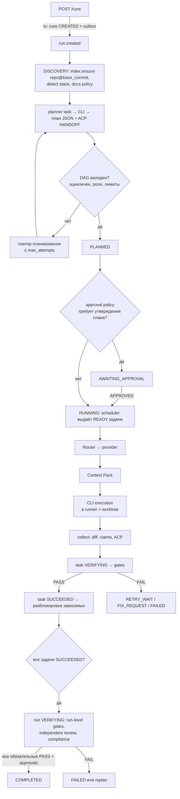
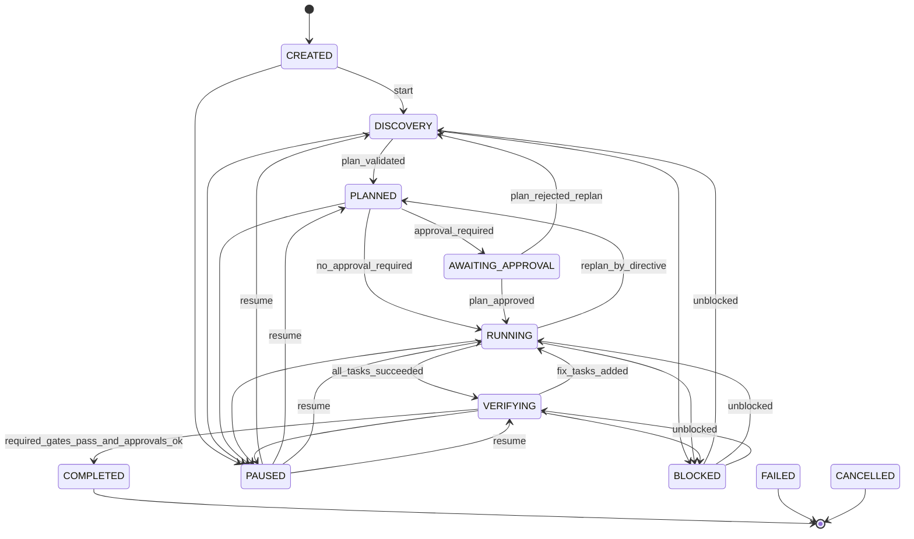
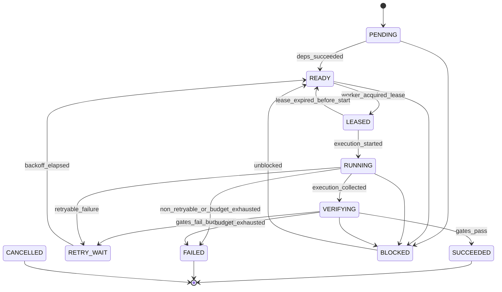
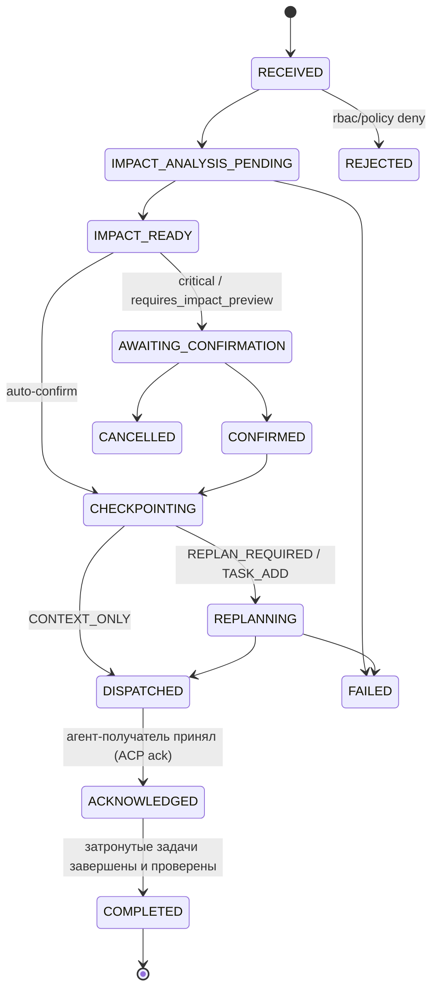
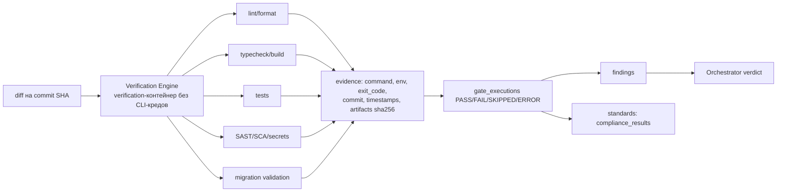

# DATA_FLOW — потоки данных, конечные автоматы, DAG Scheduler, надёжность

**Статус:** Proposed. **Основание:** ТЗ §6, §8.2, §10, §12, §16, §19; ADR-0002, 0007, 0011, 0012.
Этот документ — нормативный источник state machines (ТЗ §21 упоминает `docs/architecture/state-machines.md`; в Phase 1 раздел 3 выносится в этот файл-ссылку без дублирования).

## 1. Классы данных и где они живут

| Класс | Хранилище | Пример | Retention (предложение) |
|---|---|---|---|
| Состояние агрегатов | PostgreSQL | runs, tasks, approvals | бессрочно (архив по политике) |
| События доставки | PostgreSQL `outbox_events` → Redis | `task.state_changed` | опубликованные — 7 дней |
| Поток UI | PostgreSQL `run_event_log` | SSE | 90 дней, затем архив в artifact |
| Межагентные сообщения | PostgreSQL `agent_messages` | FIX_REQUEST | 1 год (настраиваемо) |
| Крупные данные | MinIO/FS (`artifacts`, sha256) | diff, raw CLI log, отчёты, context pack | по политике проекта |
| Исходный код | Git (worktrees, ветки) | изменения агентов | Git |
| Эфемерное | Redis | rate-limit, pub/sub | TTL |
| Учётные данные CLI | Том провайдера / OS credential store | — | **никогда** в PG/логах/артефактах |

## 2. Основной поток run (DEVELOP)



## 3. Конечные автоматы

Общие правила реализации (ADR-0007):
- Переход — условный UPDATE по `(id, version, status)` + запись `outbox_events` + `audit_events` (для пользовательских команд) в одной транзакции.
- Недопустимый переход → `409 invalid_state_transition` (API) / исключение (воркер). Таблицы переходов ниже — исчерпывающие: всё, чего нет в таблице, запрещено.
- Терминальные состояния не имеют исходящих переходов.
- **Консолидированный исчерпывающий список разрешённых переходов** (включая служебные: отмена/сбой из любого нетерминального состояния, возврат из `PAUSED`/`BLOCKED` в `resume_status`, `external_action`) — [DATABASE_DESIGN.md §18.3](../database/DATABASE_DESIGN.md) (справочник `allowed_transitions`). Таблицы ниже описывают триггеры и guards; при расхождении нормативен §18.3, а расхождение — дефект документации.

### 3.1 Run



| Из | В | Триггер / guard |
|---|---|---|
| CREATED | DISCOVERY | воркер принял run; репозиторий доступен |
| DISCOVERY | PLANNED | DAG прошёл валидацию (§4.1), `plan_version++` |
| PLANNED | AWAITING_APPROVAL | approval policy: `risk_based` — max(risk) ≥ high или есть задачи L4/L5; `always` — всегда; `critical_only` — утверждение плана не требуется, кроме L4/L5 (ТЗ §5: L4/L5 всегда требуют human approval); approvals критических действий требуются при любой политике |
| PLANNED | RUNNING | approval не требуется |
| AWAITING_APPROVAL | RUNNING | approval `PLAN_APPROVAL` = APPROVED |
| AWAITING_APPROVAL | DISCOVERY | REJECTED с запросом перепланирования |
| AWAITING_APPROVAL | CANCELLED | REJECTED без перепланирования |
| RUNNING | VERIFYING | все задачи плана в `SUCCEEDED` (или `CANCELLED` по директиве с подтверждением) |
| RUNNING | PLANNED | директива с `REPLAN_REQUIRED` после checkpoint (§6) |
| VERIFYING | COMPLETED | **guard:** все обязательные run-level gates `PASS` с evidence; нет открытых `critical`/`high` findings выше порога профиля; все требуемые approvals `APPROVED`; нет задач вне терминальных состояний |
| VERIFYING | RUNNING | gate FAIL → созданы fix-задачи (в пределах review loop budget) |
| VERIFYING | FAILED | gate FAIL и бюджет исчерпан |
| {CREATED,DISCOVERY,PLANNED,RUNNING,VERIFYING} | PAUSED | `POST /pause` / директива `PAUSE`; RUNNING-задачи доходят до safe point (§6.2), новые не выдаются |
| PAUSED | предыдущее состояние | `POST /resume`; хранится `paused_from_status` |
| {DISCOVERY,RUNNING,VERIFYING} | BLOCKED | оба провайдера недоступны / AUTH_REQUIRED / STRICT docs без источника / критичная задача BLOCKED; `blocked_reason` |
| BLOCKED | предыдущее | причина устранена (health probe, approval, ручное действие) |
| любое нетерминальное | CANCELLED | `POST /cancel` / директива `STOP` (с подтверждением) |
| {DISCOVERY,RUNNING,VERIFYING} | FAILED | необратимая ошибка, исчерпан retry budget обязательной задачи |

### 3.2 Task



| Из | В | Guard / эффект |
|---|---|---|
| PENDING | READY | все `depends_on` в `SUCCEEDED`; run в `RUNNING` |
| PENDING | CANCELLED | зависимость `FAILED`/`CANCELLED` и тип зависимости `finish` → каскад (`blocked_reason=DEPENDENCY_FAILED` если policy требует ручного решения, иначе CANCELLED) |
| READY | LEASED | `worker_leases` вставлен, `fencing_token` выдан, `attempt_count++`, создан `task_attempts` |
| LEASED | RUNNING | `cli_executions` → `STARTING/RUNNING` |
| LEASED | READY | аренда истекла до старта (reaper), попытка помечается `LEASE_LOST`, не расходует бюджет |
| RUNNING | VERIFYING | execution `COLLECTED`; claims сохранены как `UNVERIFIED` |
| RUNNING | RETRY_WAIT | ошибка с `retryable=true` (TIMEOUT, RATE_LIMITED, CRASHED, LEASE_LOST) и `attempt_count < max_attempts` и retry budget не исчерпан; `next_attempt_at = now + backoff` |
| RUNNING | BLOCKED | AUTH_REQUIRED, PROVIDER_UNAVAILABLE (оба), APPROVAL_REQUIRED, DOCS_REQUIRED, RUN_PAUSED (safe point) |
| RUNNING | FAILED | неретраемая ошибка (SANDBOX_DENIED, UNSUPPORTED_VERSION, POLICY_DENIED) либо бюджет исчерпан |
| VERIFYING | SUCCEEDED | все обязательные gates задачи PASS (+ независимое ревью, если требуется уровнем L3+) |
| VERIFYING | RETRY_WAIT | gate FAIL / REVIEW_REJECTED, есть бюджет и `review_loop_count < max_review_loops` (default 3) |
| VERIFYING | BLOCKED | `REVIEW_LOOP_EXHAUSTED` или `MANUAL_REVIEW` |
| RETRY_WAIT | READY | `now ≥ next_attempt_at` (tick-актор) |
| BLOCKED | READY | причина устранена; для `MANUAL_REVIEW` — approval APPROVED |
| BLOCKED | SUCCEEDED | только `MANUAL_REVIEW` approval с evidence ручной проверки (явно маркируется в evidence `producer=human`) |
| любое нетерминальное | CANCELLED | отмена run / директива |

Backoff: `min(base · 2^(n-1), cap) ± 20% jitter`; base 30 с, cap 15 мин; для `RATE_LIMITED` — значение из сообщения CLI, если CLI его предоставляет, иначе cooldown провайдера 5 мин → 60 мин экспоненциально. Retry budget задачи: `max_attempts` (default 3, 1..10) и `retry_budget_seconds` (суммарное время попыток).

### 3.3 CLI Execution

| Из | В | Условие |
|---|---|---|
| QUEUED | STARTING | worker-exec взял задание, создаёт контейнер |
| QUEUED | CANCELLED | отмена до старта |
| STARTING | RUNNING | процесс CLI запущен, событие `started` |
| STARTING | CRASHED / AUTH_REQUIRED | ошибка создания контейнера / probe auth |
| RUNNING | EXITED | процесс завершился (любой exit code) |
| RUNNING | TIMED_OUT | превышен `timeout_seconds` → SIGTERM → grace 15 с → SIGKILL группы процессов / `docker kill` |
| RUNNING | CANCELLED | отмена (pause/stop/директива с RESTART_REQUIRED) |
| RUNNING | CRASHED | контейнер/воркер упал, процесс потерян (обнаружено reconciler) |
| RUNNING | AUTH_REQUIRED / RATE_LIMITED | нормализованная ошибка CLI по сигналам вывода |
| EXITED | COLLECTED | diff, raw log, результат и claims сохранены в artifacts (sha256) |

`EXITED` с `exit_code=0` **не означает успех задачи** — только переход задачи в `VERIFYING` (ТЗ §9.3, AC-11).

### 3.4 Directive (Live Agent Chat)



`ASK` (вопрос) — упрощённый путь: `RECEIVED → DISPATCHED → ACKNOWLEDGED → COMPLETED` (ответ агента = ACP `ANSWER`), без replan.

**Доставка и выполнение (реализация, `aicd_orchestration.directives`):** `DISPATCHED` — строки `directive_acknowledgements` (`PENDING`) созданы для задач-получателей (задачи замены/новые задачи; для `CONTEXT_ONLY` — затронутые задачи). Ack `DELIVERED` — в транзакции старта попытки задачи-получателя (`LEASED → RUNNING`): поручение входит в её инструкции и в раздел `directives` Context Pack с `directive_id`. Ack `ACKNOWLEDGED`/`REJECTED` — по принятому итогу агента (`directive_acks`: `accepted`/`not_applicable` / `cannot_comply`; без записи — неявное `accepted`). Директива `ACKNOWLEDGED`, когда все ack `ACKNOWLEDGED`; `COMPLETED`, когда задачи-получатели и их производные по `origin_task_id` (замены, fix-задачи), кроме вытесненных, `SUCCEEDED` (обязательные gates пройдены); `FAILED` с причиной — отказ агента, `FAILED`/`CANCELLED` задачи, отмена или завершение run раньше, ack, не доставленный/не подтверждённый до завершения задачи (открытые ack → `EXPIRED`). Статус выводится из состояния БД в транзакции `tick` и обработчика отмены run — повторная обработка событий идемпотентна. `STOP` — команда: ack нет, `COMPLETED` по достижении целевого статуса run/задачи. `PAUSE/RESUME/STOP` — прямые команды FSM run (с impact preview для STOP). `APPROVE/REJECT` в чате = вызов `approvals.decide()` с теми же RBAC-правилами. UI различает **delivered** (`DISPATCHED`), **acknowledged** (`ACKNOWLEDGED`) и **done** (`COMPLETED`) — ТЗ §11.

### 3.5 Approval

`PENDING → APPROVED | REJECTED | EXPIRED | CANCELLED`. `EXPIRED` по `expires_at` (default 72 ч, для `PRODUCTION_DEPLOY` 24 ч). Решение принимает пользователь с правом на `action_type` (см. SECURITY_ARCHITECTURE), не равный `requested_by` для критических типов (four-eyes). Approval привязан к `plan_version`/target hash: изменение плана после утверждения инвалидирует его (`CANCELLED` + новый запрос).

## 4. DAG Scheduler

### 4.1 Валидация плана (транзакционно, ТЗ §7.3)
1. `SELECT … FROM runs WHERE id=:run FOR UPDATE` (сериализация планирования run).
2. Вставка задач и зависимостей с `plan_version = runs.plan_version + 1`; триггер БД запрещает зависимости между разными runs; CHECK запрещает self-reference.
3. Алгоритм Кана в приложении по всем задачам run текущей версии; при цикле — откат транзакции, ошибка `PLAN_CYCLE_DETECTED` с перечнем узлов цикла.
4. Дополнительные проверки: каждая роль ∈ `agent_role`; complexity 1..5; число задач ≤ policy (`max_tasks_per_run`, default 50); глубина ≤ 20; у задач `developer` есть хотя бы один зависимый верифицирующий узел при L3+ (reviewer/qa/security).
5. Commit → `run PLANNED` + outbox.

### 4.2 Выдача задач
- Tick-актор `scheduler.tick(run_id)` вызывается событиями (`task.state_changed`, `approval.decided`, `provider.health_changed`) и периодически (страховка, 10 с).
- `PENDING → READY`: запрос `tasks` без незавершённых зависимостей (anti-join по `task_dependencies`), только при `run.status = RUNNING`.
- `READY → LEASED`: `SELECT … FOR UPDATE SKIP LOCKED LIMIT n` с учётом лимитов: `max_parallel_tasks_per_run` (default 4), свободные слоты провайдеров (`max_concurrent_sessions` на установку), приоритет = критический путь (длина самой длинной цепочки зависимых) → время ожидания.
- Router (ROUTING_POLICY.md) вызывается на `READY → LEASED`; если допустимых провайдеров нет — `BLOCKED(PROVIDER_UNAVAILABLE)` (AC-16), без обхода.

### 4.3 Изменение плана
Replan создаёт новую `plan_version`: незатронутые `SUCCEEDED` задачи сохраняются; затронутые (по `directive_impacts`) — `CANCELLED` либо пересоздаются; DAG валидируется заново по §4.1.

## 5. Leases и fencing

- `worker_leases(resource_type, resource_id)` — UNIQUE для активной аренды; `lease_until = now + 60 с`, heartbeat каждые 20 с.
- `fencing_token` — из глобальной sequence (монотонно). Любая запись результата исполнения проверяет `fencing_token` = актуальный токен аренды; иначе запись отклоняется (защита от «зомби»-воркера после истечения аренды).
- Reaper (каждые 15 с): истёкшие аренды → задача `LEASED→READY` или `RUNNING→RETRY_WAIT(LEASE_LOST)` после проверки reconciler'ом, что процесс/контейнер действительно мёртв (иначе — `docker kill` и только потом переход).

## 6. Директивы, checkpoint и replan (ТЗ §8.2, AC-06)

### 6.1 Последовательность
```mermaid
sequenceDiagram
  actor U as Пользователь
  participant API
  participant ORCH as Orchestrator
  participant EX as CLI Gateway
  U->>API: POST /runs/{id}/directives (CHANGE_REQUEST, expected_run_version)
  API->>API: RBAC, Idempotency-Key, version check (412 при расхождении)
  API->>ORCH: user_directives RECEIVED → IMPACT_ANALYSIS_PENDING (tx+outbox)
  API-->>U: 202 {directive_id, status}
  ORCH->>ORCH: impact analysis (детерминированный: target, затронутые задачи/файлы по индексу; при необходимости planner-задача)
  ORCH-->>U: SSE directive.impact_ready (затронутые задачи, тип влияния, критичность)
  alt критично или requires_impact_preview
    U->>API: confirm (approval CRITICAL_DIRECTIVE)
  end
  ORCH->>EX: safe point для затронутых RUNNING задач
  ORCH->>ORCH: checkpoint (state_version, worktree commits)
  ORCH->>ORCH: replan → новая plan_version, DAG валидация
  ORCH->>ORCH: dispatch: ACP TASK_ASSIGN/HANDOFF с directive_id
  ORCH-->>U: SSE directive.state_changed (DISPATCHED → ACKNOWLEDGED → COMPLETED)
```

### 6.2 Safe point
Работающий CLI-процесс **не модифицируется незаметно** (ТЗ §8.2). Варианты по `impact_type`:
- `CONTEXT_ONLY` — директива добавляется в контекст **следующей** попытки/задачи; текущий процесс не трогается.
- `REPLAN_REQUIRED`/`TASK_CANCEL` — текущее исполнение завершается штатно (если до таймаута ≤ `safe_point_wait`, default 5 мин) либо отменяется; worktree фиксируется WIP-коммитом в ветке задачи, diff сохраняется artifact'ом.
- `RESTART_REQUIRED` — отмена исполнения, попытка помечается `CANCELLED`, не расходует retry budget.

Сигнал safe point между процессами: команду (pause/cancel run, применённое поручение) фиксирует в БД API или `worker-orchestrator`, а CLI-процесс принадлежит `worker-exec`. Исполнитель попытки периодически (`Orchestrator.cancel_poll_seconds`, по умолчанию 5 с) читает флаг — run `PAUSED`/`CANCELLED` или применённое влияние `REPLAN_REQUIRED`/`TASK_CANCEL` на задачу — и штатно останавливает свой процесс (`cancel(reason)` адаптера: `pause` / `run_cancel` / `directive`); in-process хук — лишь ускорение в том же процессе. Replan в утверждённом плане: рёбра утверждённой `plan_version` неизменяемы, поэтому не начатые задачи, зависящие от заменённых, пересоздаются в новой версии вместе с заменами (`directive_impacts` `TASK_ADD`, `details.reason = dependent_of_replaced`).

## 7. Checkpoint и recovery

**Checkpoint** (`checkpoints`): `run_id`, `state_version` (= `runs.version`), `state_ref` → artifact JSON: статусы и версии задач, `plan_version`, HEAD каждого worktree, открытые approvals, ссылки на последние evidence. Создаётся: при `PLANNED`, перед replan, при `PAUSED`, при `VERIFYING`.

**Recovery reconciler** (старт воркера + каждые 60 с):
1. `cli_executions` в `STARTING/RUNNING` без живой аренды → проверить контейнер (`docker inspect` по label `aicd.execution_id`) / PID группу → жив: переподключить стрим или убить по политике; мёртв: `CRASHED`, задача `RETRY_WAIT`.
2. `worktrees` без активной задачи → `ORPHANED`; удаление после сохранения diff.
3. `external_actions` в `EXECUTING` → запрос состояния внешней системы → `CONFIRMED`/повтор (ADR-0012). `CONFIRMED` никогда не повторяется (AC-09). GitHub-действия (`git_push`, `pr_create`, `pr_comment`, `pr_update`, `pr_merge`) сверяет воркер orchestrator, где есть ключ App (`aicd_orchestration.github_recovery`, Phase 9, OQ-47 (7)): только строки без живой аренды с их fencing token; probe по данным строки ledger (ветка на SHA, PR из head-ветки, ревью с маркером `aicd:review:<action_id>`, commit status, PR смёрджен) ⇒ `CONFIRMED` (`result.reconciled`), затем повторный вход в идемпотентный workflow (`open_pull_request`/`merge`) с новой арендой — оставшиеся шаги через `execute_once` (probe → do), без ожидания повторной доставки Dramatiq; GitHub недоступен ⇒ строка остаётся `EXECUTING` в отчёте (алерт по логу).
4. `outbox_events` неопубликованные старше 30 с → повторная публикация (consumers идемпотентны).
5. Runs в нетерминальных состояниях без прогресса > порога → алерт `stuck_run`.

## 8. Идемпотентность

| Уровень | Механизм |
|---|---|
| HTTP POST | `Idempotency-Key` → `idempotency_keys` (hash тела); повтор → тот же ответ; другой body → 422 |
| Событие/команда воркеру | `processed_events(consumer, event_id)` вставляется в транзакции обработки |
| ACP | `message_deliveries UNIQUE(message_id, consumer_id)`, `acked_at` |
| Внешние действия | `external_actions.idempotency_key UNIQUE` + reconcile |
| CLI-исполнение | `execution_id` = ключ; повтор доставки при `status ≠ QUEUED` игнорируется |
| SSE | `seq` + `event_id` |
| GitHub webhooks | `github_webhook_deliveries.delivery_guid UNIQUE` |

## 9. Поток Code Intelligence → Context Pack

```mermaid
flowchart LR
  C[commit SHA] --> S{snapshot\nrepo+commit+index_version\nсуществует?}
  S -- нет --> J[indexing_job: diff файлов vs\nпоследний snapshot по sha256] --> T[tree-sitter символы,\nграф, FTS, test links]
  S -- да --> Q
  T --> Q[retrieval: rg точный → символы/граф →\nFTS/trgm → docs (если режим разрешает)]
  Q --> R[ранжирование: exact > dependency > task relevance > recency]
  R --> B[бюджет: max_bytes, max_files]
  B --> P[context_pack: manifest + фрагменты\nsha256(commit+policy+inputs) → artifact]
  P --> CLI[монтируется ro в runner]
```

Фрагмент с `commit ≠ base` — исключается или маркируется `stale: true` в manifest и UI (ТЗ §12).

## 10. Поток верификации и evidence


