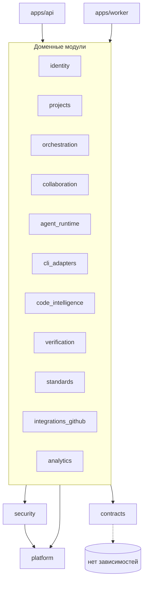

# MODULE_BOUNDARIES — модули, интерфейсы, владение данными

**Статус:** Proposed. **Основание:** ТЗ §17, ADR-0001.

## 1. Структура репозитория (целевая, создаётся в Phase 1)

```text
AiCodingDev/
  apps/
    api/            # FastAPI: routers, DI, middleware (auth, csrf, idempotency, rate limit, problem+json)
    worker/         # entrypoints: orchestrator, outbox, exec, verify, index (Dramatiq actors)
    web/            # React/TS SPA
    cli/            # `aicd` админ-CLI платформы (bootstrap owner, migrate, probe, backup) — дополнение к ТЗ §17
  packages/
    platform/       # общий слой: db session + RLS context, outbox, artifacts store, audit, telemetry, ids, clock, errors — дополнение к ТЗ §17
    contracts/      # OpenAPI, JSON Schema (CLI, ACP, events) + сгенерированные модели
    identity/       # users, sessions, membership, RBAC — дополнение к ТЗ §17 (выделено из api)
    projects/       # workspaces, projects, repositories, settings, technologies — дополнение
    orchestration/  # runs, tasks, DAG, FSM, router, scheduler, leases, checkpoints, recovery, approvals, directives, external_actions
    collaboration/  # ACP broker, chat threads/messages, activity events projection — дополнение
    agent_runtime/  # 12 профилей, шаблоны инструкций, prompt assembly, разбор ACP из вывода
    cli_adapters/   # CLIExecutor, codex/claude/fake, probe, compat matrix, process mgmt
    code_intelligence/ # индекс, retrieval, context packs, documentation sources/importer
    verification/   # Verification Engine, gates, evidence, findings, test results
    standards/      # registry, controls, applicability, compliance results
    security/       # sandbox policy, container spec builder, redaction, egress policy, SSRF guard
    integrations_github/ # GitHub App, webhooks, PR workflow — дополнение
    analytics/      # метрики, агрегаты для Analytics UI — дополнение
  infrastructure/{docker,migrations,monitoring}
  tests/{unit,contract,integration,e2e,security,chaos,performance}
  docs/
```

Дополнительные пакеты (`platform`, `identity`, `projects`, `collaboration`, `integrations_github`, `analytics`, `apps/cli`) — **отклонение от буквального списка ТЗ §17**, вынесено в OQ-02: без них таблицы IAM/проектов/GitHub не имеют владельца, что нарушает правило ТЗ §17 о запрете обращений к приватным таблицам.

## 2. Правила зависимостей



1. `platform`, `contracts` не зависят ни от одного доменного модуля.
2. Модуль импортирует у другого **только** `<module>.api` (фасад сервисов + DTO) и `<module>.events` (схемы событий). Импорт `<module>.models`, `<module>.repository`, `<module>.internal` чужого модуля запрещён.
3. Запрещены циклы между модулями. Направление: `orchestration` → (`agent_runtime`, `cli_adapters`, `code_intelligence`, `verification`, `collaboration`, `projects`, `identity`); обратные зависимости — только через доменные события.
4. `apps/api` не содержит бизнес-логики: валидация HTTP, RBAC-проверка через `identity.api.authorize()`, вызов сервиса.
5. Проверка: `import-linter` контракты в CI (P1-05) — сборка падает при нарушении.
6. SQL к чужим таблицам запрещён; отчётные чтения для `analytics` — только через read-only представления (`v_*`), владельцы которых — модули-источники.

## 3. Модули: ответственность, интерфейсы, таблицы

| Модуль | Ответственность | Публичный интерфейс (`api`) | Владеет таблицами | Публикует события |
|---|---|---|---|---|
| `platform` | DB-сессия и RLS-контекст, outbox writer, artifact store (MinIO/FS), audit writer, ID/clock, telemetry, problem errors | `db.transaction(ctx)`, `outbox.emit()`, `artifacts.put/get/presign()`, `audit.record()` | `outbox_events`, `processed_events`, `artifacts`, `audit_events`, `idempotency_keys`, `run_event_log`, `worker_leases` | — |
| `identity` | Пользователи, пароли, сессии, членство, RBAC | `authenticate()`, `authorize(actor, permission, resource)`, `members.*` | `users`, `user_credentials`, `user_sessions`, `workspace_members` | `member.added/removed/role_changed` |
| `projects` | Workspaces, проекты, репозитории, настройки, стек | `workspaces.*`, `projects.*`, `repositories.attach()`, `settings.get/patch()`, `technologies.detect()` | `workspaces`, `projects`, `repositories`, `project_settings`, `technologies`, `technology_versions`, `project_technologies` | `project.created`, `repository.attached`, `settings.changed` |
| `orchestration` | Runs/Tasks FSM, DAG, scheduler, router, approvals, directives (impact/replan), checkpoints, recovery, ledger внешних действий, policies | `runs.create/pause/resume/cancel()`, `tasks.*`, `approvals.decide()`, `directives.submit()`, `router.route()` | `runs`, `tasks`, `task_dependencies`, `task_attempts`, `agent_assignments`, `routing_decisions`, `approvals`, `user_directives`, `directive_impacts`, `directive_acknowledgements`, `checkpoints`, `policies`, `external_actions`, `worktrees`, `agent_decisions` | `run.*`, `task.*`, `approval.*`, `directive.*` |
| `collaboration` | ACP Broker (валидация, ACL, доставка), чат, проекция активности, персональные уведомления (UI redesign B8: хранение, чтение, отметка прочтения; генерацию по событиям выполняет `orchestration.notifications`), inline-комментарии ревью кода (UI redesign B5, ADR-0015: треды, ответы, правки, resolve; отправку ревью — approval/поручение — выполняет `orchestration.code_review`) | `acp.publish()`, `chat.post()`, `chat.list()`, `activity.list()`, `notifications.record()/list_for_user()/mark_read()`, `review_comments.create_thread()/reply()/edit_comment()/set_status()/record_submission()` | `agent_messages`, `message_deliveries`, `chat_threads`, `chat_messages`, `agent_activity_events`, `notifications`, `review_threads`, `review_comments`, `review_comment_revisions`, `review_submissions`, `review_submission_threads` | `agent.message`, `chat.message`, `notification.created`, `review.comment` |
| `agent_runtime` | 12 профилей, шаблоны инструкций, сборка промпта, разбор ACP/claims из результата | `profiles.get(role)`, `prompt.build(task, context_pack)`, `parse_result()` | `agent_profiles` | — |
| `cli_adapters` | CLIExecutor (codex/claude/fake), probe, auth check, compat matrix, процессы | `CLIExecutor` Protocol, `gateway.submit()`, `providers.probe()` | `cli_providers`, `cli_installations`, `cli_sessions`, `cli_executions`, `provider_health`, `usage_metrics`, `worker_hosts` | `cli.execution.*`, `cli.output`, `provider.health_changed` |
| `code_intelligence` | Индексация, поиск, граф, context packs, источники документации и импорт | `index.ensure(repo, commit)`, `retrieve(query)`, `context_pack.build(task_attempt)`, `docs.*` | `code_index_snapshots`, `code_symbols`, `code_dependencies`, `knowledge_chunks`, `retrieval_queries`, `retrieval_results`, `context_packs`, `indexing_jobs`, `knowledge_entries`, `architecture_decisions`, `documentation_sources`, `documentation_snapshots`, `documentation_sections` | `index.completed`, `context_pack.built`, `docs.refreshed` |
| `verification` | Verification Engine, gates, evidence, findings | `gates.plan(run/task)`, `gates.execute()`, `evidence.*`, `verdict(run)` | `quality_profiles`, `quality_gates`, `gate_executions`, `test_results`, `findings`, `evidence`, `evidence_links` | `gate.completed`, `finding.created` |
| `standards` | Registry, controls, применимость, compliance | `registry.*`, `compliance.evaluate(run)` | `standards`, `standard_controls`, `project_controls`, `compliance_results` | `compliance.evaluated` |
| `security` | Sandbox/контейнерная спецификация, egress policy, redaction, SSRF guard, path guard | `sandbox.spec(execution)`, `redact(text)`, `ssrf.fetch()`, `paths.safe_join()` | — (без таблиц) | — |
| `integrations_github` | GitHub App, вебхуки (HMAC), PR workflow, проверки установки/доступа на воркере (OQ-47 (2)) | `github.open_pr()`, `webhooks.handle()` | `github_installations`, `github_webhook_deliveries`, `pull_requests`, `github_verification_requests` | `github.pr.*`, `github.verification.requested` |
| `analytics` | Агрегаты метрик ТЗ §16 для UI | `metrics.query()` | — (читает `v_*`) | — |

## 4. Взаимодействие через события (примеры)

| Событие | Производитель | Потребители |
|---|---|---|
| `task.state_changed(→VERIFYING)` | orchestration | verification (`gates.plan/execute`) |
| `gate.completed` | verification | orchestration (переход задачи/run), standards (compliance) |
| `cli.execution.collected` | cli_adapters | orchestration (обработка результата), collaboration (ACP из результата через agent_runtime) |
| `agent.message(FIX_REQUEST)` | collaboration | orchestration (создание fix-задачи / review loop counter) |
| `directive.submitted` | orchestration | orchestration (impact analysis actor), collaboration (чат-эхо) |
| `repository.attached` | projects | code_intelligence (первичная индексация), projects (detect stack) |
| `provider.health_changed` | cli_adapters | orchestration.router (перемаршрутизация/BLOCKED) |
| `approval.*`, `run.completed`, `run.state_changed`, `directive.state_changed`, `external_action.state_changed`, `gate.completed` | orchestration, verification | orchestration.notifications (потребитель `notifications.project`) → collaboration.notifications (UI redesign B8) |

## 5. Тестирование границ

- `import-linter` (layers, forbidden, independence) — CI gate P1-05.
- Архитектурный тест: каждая таблица в миграциях перечислена ровно в одном `OWNED_TABLES` модуля.
- Contract tests для `<module>.api` DTO (pydantic schema snapshot).
