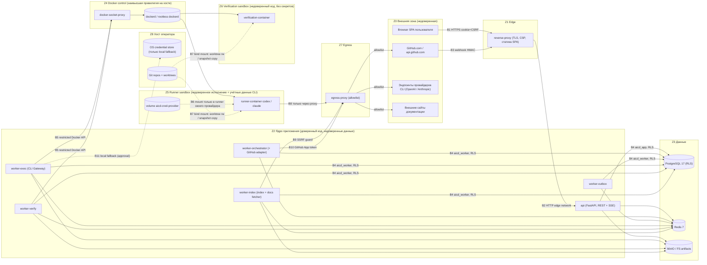
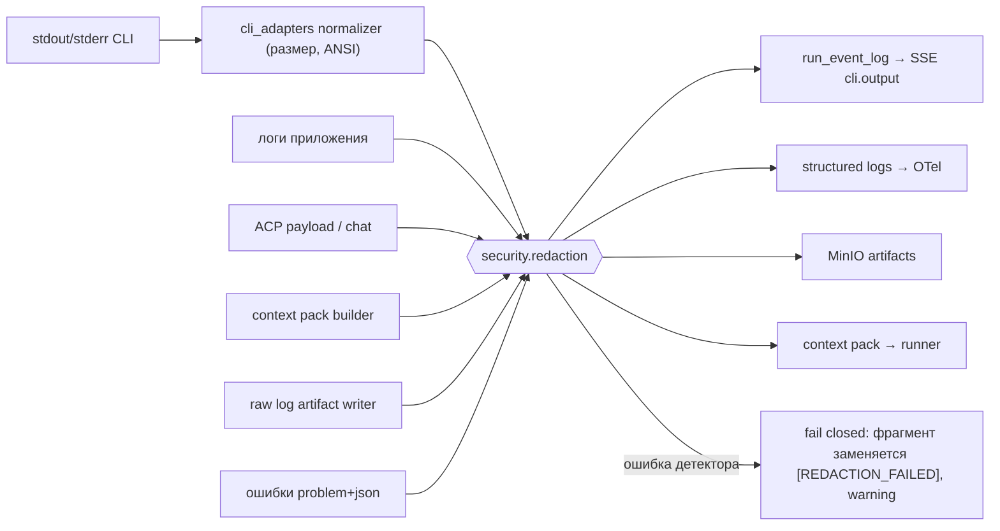
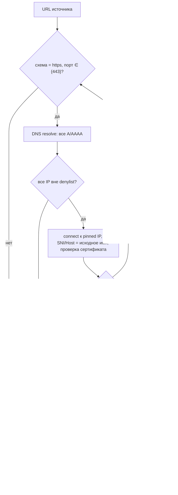

# SECURITY_ARCHITECTURE — архитектура безопасности AiCodingDev v1.0

**Статус:** Proposed (Phase 0). Документ описывает проектные решения; ничего из перечисленного не реализовано и не протестировано.
**Основание:** ТЗ §2 (п.3–8), §7.1, §8, §9, §10, §12, §15, §16, §20, §23; ADR-0003, ADR-0004, ADR-0006, ADR-0008, ADR-0009, ADR-0010, ADR-0011, ADR-0012.
**Связанные документы:** [THREAT_MODEL.md](../security/THREAT_MODEL.md) (угрозы `TH-NN`), [SECURITY_CONTROLS.md](../security/SECURITY_CONTROLS.md) (контроли `SC-<AREA>-NN`), [SYSTEM_ARCHITECTURE.md](SYSTEM_ARCHITECTURE.md), [MODULE_BOUNDARIES.md](MODULE_BOUNDARIES.md).

> Документ не заявляет соответствия OWASP ASVS, NIST SSDF, SLSA или иным стандартам и не является основанием для сертификации. Сопоставления со стандартами в SECURITY_CONTROLS.md — ориентиры для проектирования и проверки (ТЗ §13).

---

## 1. Принципы безопасности

| # | Принцип | Как реализуется | Контроли |
|---|---|---|---|
| 1 | **Любой текст от AI, репозитория, документации, чата и GitHub — недоверенные данные** (ТЗ §15) | Политики, права, сеть и approvals решает платформа; модель не может их изменить | SC-INJ-01…07 |
| 2 | **Платформа исполняет — модель предлагает** | Агент не получает shell к хосту, сетевой доступ, секреты; CLI работает только в runner-контейнере | SC-SBX-01…12, SC-CLI-01…09 |
| 3 | **Evidence-first** (ТЗ §2 п.4) | Статус `VERIFIED`/`PASS` выставляет только Verification Engine по сохранённому результату процесса | SC-INJ-04, SC-DATA-05 |
| 4 | **Defense in depth для изоляции арендаторов** | API RBAC → service authorize → PostgreSQL RLS → composite FK | SC-IAM-07, SC-TEN-01…08 |
| 5 | **Least privilege** (ТЗ §2 п.6) | Отдельные DB-роли, Docker только через socket proxy, GitHub App без лишних прав, учётные данные CLI только в runner своего провайдера | SC-SBX-05, SC-GH-04, SC-CLI-03 |
| 6 | **Human-in-the-loop для опасных действий** (ТЗ §2 п.5, §15) | Approval + four-eyes + привязка к параметрам + ledger `external_actions` | SC-APR-01…06 |
| 7 | **Secure by default** | Docs `SMART` без скачивания без разрешения, сеть sandbox — только провайдер, local fallback выключен, auto-merge запрещён | SC-SBX-10, SC-DOC-08, SC-GH-05 |
| 8 | **Секреты не покидают своё место хранения** | Нет секретов в PG; redaction на всех выходах; учётные данные CLI — только в томе провайдера / OS credential store | SC-SEC-01…07 |
| 9 | **Fail closed** | Отсутствие RLS-контекста → 0 строк; ошибка redaction → фрагмент отбрасывается; неизвестная версия CLI → `UNSUPPORTED_VERSION`; недоступность провайдеров → `BLOCKED` | SC-TEN-02, SC-SEC-03, SC-CLI-08 |
| 10 | **Нет захвата скрытых рассуждений и обхода подписок** (ТЗ §1, §2 п.8) | Только официальные события CLI; нет перехвата трафика CLI; нет ротации аккаунтов при лимитах | SC-CLI-05, SC-CLI-09 |

---

## 2. Зоны доверия и границы

### 2.1 Диаграмма зон доверия



### 2.2 Зоны

| Зона | Состав | Уровень доверия | Что считается недоверенным |
|---|---|---|---|
| Z0 | Браузер, GitHub, провайдеры CLI, сайты документации | Недоверенная | Всё входящее: HTTP-запросы, webhooks, ответы сайтов документации |
| Z1 | `reverse-proxy` (Caddy/nginx) | Доверенная инфраструктура | Заголовки клиента (`X-Forwarded-*` от клиента отбрасываются) |
| Z2 | `api`, `worker-*` (единый образ, разные entrypoints) | Доверенный код | Содержимое репозиториев, вывод CLI, ACP-payload, chat, документация, payload webhooks |
| Z3 | PostgreSQL, Redis, MinIO | Доверенное хранилище | Redis — эфемерные подсказки, не источник истины (SC-DATA-09) |
| Z4 | `docker-socket-proxy`, `dockerd` | Критическая (эквивалент root на хосте при rootful Docker) | Спецификации контейнеров проверяются линтером до отправки (SC-SBX-05) |
| Z5 | runner-контейнеры + том `aicd-cred-<provider>` | Недоверенное исполнение; содержит учётные данные подписки провайдера | Весь процесс CLI и всё, что он пишет |
| Z6 | verification-контейнеры | Недоверенное исполнение без секретов и без сети | Код пользователя, зависимости, тесты |
| Z7 | `egress-proxy` | Доверенная инфраструктура | Назначения соединений (проверяются по allowlist) |
| Z8 | Хост оператора: Git-клоны, worktrees, OS credential store | Доверенный администратор хоста | Файлы worktree после работы агента |

### 2.3 Границы доверия и проверки на них

| Граница | Переход | Обязательные проверки | Контроли |
|---|---|---|---|
| B1 | Browser → reverse-proxy | TLS 1.2+/1.3, HSTS, сессионная cookie `__Host-`, CSRF для небезопасных методов, CSP | SC-NET-03, SC-IAM-03, SC-IAM-05, SC-API-08 |
| B2 | reverse-proxy → api | Внутренняя сеть `edge`; доверие `X-Forwarded-For` только от адреса proxy; лимиты размера тела | SC-NET-02, SC-API-01 |
| B3 | GitHub → webhook endpoint | HMAC `X-Hub-Signature-256` по сырому телу до парсинга, дедупликация по `X-GitHub-Delivery` | SC-GH-01…03 |
| B4 | Приложение → PostgreSQL | Роли `aicd_app`/`aicd_worker` NOBYPASSRLS, `SET LOCAL app.workspace_id` в каждой транзакции | SC-TEN-01, SC-TEN-02 |
| B5 | worker-exec/verify → Docker | Только через `docker-socket-proxy`, спецификация контейнера проверяется линтером (запрет privileged, host ns, лишних mounts) | SC-SBX-05 |
| B6 | Том учётных данных → runner | Монтируется только в runner того же провайдера; никогда в verification, в артефакты, в бэкапы | SC-CLI-03, SC-DATA-03 |
| B7 | Хост → контейнер (файлы) | Runner: только назначенный worktree rw + context pack ro; verification: копия снимка по commit SHA | SC-SBX-02, SC-SBX-07, SC-SBX-12 |
| B8 | Runner → интернет | Только `egress-proxy`, allowlist эндпоинтов провайдера; нет внешнего DNS | SC-NET-01, SC-NET-05 |
| B9 | Docs fetcher → интернет | SSRF guard: схема, DNS resolve+pin, denylist IP, повторная проверка редиректов, лимиты | SC-DOC-01…08 |
| B10 | GitHub adapter → GitHub API | Installation token (≤1 ч) только в памяти; права App минимальны | SC-GH-04…06 |
| B11 | worker-exec → хост напрямую (local fallback) | Только при политике + approval `LOCAL_EXECUTION_FALLBACK`; отдельный OS-пользователь | SC-SBX-10 |

---

## 3. Аутентификация (AuthN)

Решение — ADR-0009: локальные учётные записи, серверные сессии, CSRF. OIDC — опция после v1.0 (OQ-04). Никаких API-ключей AI-провайдеров (ADR-0003).

### 3.1 Пароли

| Параметр | Значение (Phase 0, уточняется бенчмарком P1) | Обоснование |
|---|---|---|
| Алгоритм | argon2id (`argon2-cffi`), формат PHC-строки в `user_credentials.password_hash` | ТЗ не задаёт; argon2id — memory-hard KDF |
| Память `m` | 65536 KiB (64 MiB) | ADR-0009 |
| Итерации `t` | 3 | ADR-0009 |
| Параллелизм `p` | 1 | ADR-0009; калибровка: время хеширования 200–500 мс на целевом хосте |
| Соль / длина хеша | 16 байт CSPRNG / 32 байта | — |
| Rehash | При успешном входе, если параметры в PHC-строке устарели — пересчёт и запись | Миграция параметров без сброса паролей |
| Ограничение конкурентности | Семафор: ≤ 4 одновременных argon2-вычислений на процесс `api`; при превышении — `429` | Защита от memory-DoS через массовый логин |
| Политика пароля | Длина 12…128 символов (Unicode NFKC), без требований к составу; проверка по офлайн-списку скомпрометированных паролей (поставляется с образом) | ADR-0009 |
| Неизвестный пользователь | Выполняется фиктивная проверка argon2 по фиксированному хешу; ответ идентичен неверному паролю | Нет перечисления учётных записей по времени ответа |

### 3.2 Сессии

- Токен сессии: 32 байта CSPRNG (`secrets.token_urlsafe(32)`); в `user_sessions.token_hash` хранится **SHA-256** токена (токен высокоэнтропийный, перец не требуется); сам токен в БД не хранится.
- Cookie: `__Host-aicd_session`; `Secure`, `HttpOnly`, `SameSite=Strict`, `Path=/`, без `Domain`.
- Тайм-ауты (ADR-0009): idle 8 ч, absolute 7 дней; idle-тайм-аут продлевается только пользовательскими запросами (не SSE heartbeat). Обновление `last_seen_at` — не чаще раза в 60 с (предлагаемое дополнение колонки, §17).
- **Ротация** (новый токен + новый CSRF-токен, старая запись `revoked_at`): при входе (защита от fixation), при смене пароля, при изменении роли пользователя в любом workspace, после step-up re-auth.
- **Отзыв:** logout → `revoked_at`; смена пароля → отзыв всех сессий пользователя; удаление участника из workspace → немедленная инвалидация SSE-потоков этого workspace (SC-API-07); owner/admin может принудительно завершить сессии участника.
- **Step-up re-auth** (SC-IAM-08): для approvals из критического набора (§4.4), смены политик безопасности, `SECRET_CHANGE`, управления участниками — повторный ввод пароля, если последний ввод был > 10 мин назад (`user_sessions.reauthenticated_at`, предлагаемое дополнение).
- MFA (TOTP) — предложение P1 из ADR-0009; в данном документе не обязательна для v1.0 (OQ-04).

### 3.3 CSRF

Модель — **синхронизирующий токен, доставляемый как double-submit cookie** (ADR-0009):

1. При создании сессии генерируется CSRF-токен (32 байта); в `user_sessions.csrf_token_hash` — SHA-256; клиенту — cookie `__Host-aicd_csrf` (`Secure`, `SameSite=Strict`, **не** `HttpOnly`).
2. SPA для всех `POST/PUT/PATCH/DELETE` передаёт заголовок `X-CSRF-Token`; сервер сравнивает `sha256(header)` с `csrf_token_hash` через `hmac.compare_digest`. Совпадения cookie и заголовка недостаточно — токен привязан к серверной сессии.
3. Дополнительно: проверка `Origin` (обязан совпадать с настроенным origin), при отсутствии `Origin` — `Sec-Fetch-Site ∈ {same-origin, none}`; иначе `403`.
4. Login CSRF: `POST /auth/login` защищён проверкой `Origin` + pre-session CSRF cookie.
5. CORS не включается (SPA и API — один origin); preflight-ответы отсутствуют.
6. SSE (`GET /runs/{id}/events`) — безопасный метод без изменения состояния; защищён `SameSite=Strict` и authz (SC-API-07).

### 3.4 Защита от подбора и блокировка

| Механизм | Параметры |
|---|---|
| Счётчик на учётную запись | `user_credentials.failed_attempts`; после 10 подряд неудачных попыток (ADR-0009) — `locked_until = now() + 15 мин × 2^(n−10)`, максимум 24 ч; сброс счётчика при успехе |
| Ограничение на IP | Token bucket в Redis: 20 попыток / 10 мин на IP, 100 / ч на IP (SC-API-02) |
| Ограничение на пару (учётная запись, IP) | 5 попыток / 5 мин — снижает возможность злоумышленника блокировать чужую запись с одного IP |
| Ответ | Единый `401 problem+json` для неверного пароля, неизвестного email и заблокированной записи; блокировка видна владельцу записи по e-mail-уведомлению не в v1.0 — только в audit и UI owner/admin |
| Разблокировка | Автоматически по `locked_until`; досрочно — owner/admin через API (audit `user.unlocked`) |
| Аудит | `auth.login_succeeded`, `auth.login_failed` (без пароля), `auth.locked`, `auth.session_revoked` |

### 3.5 Bootstrap и машинный доступ

- Первый owner создаётся командой `aicd admin create-owner` на хосте (ADR-0009); дефолтных учётных записей и паролей нет; веб-регистрация отключена — участников приглашает owner/admin.
- Персональные токены доступа для `aicd` CLI (ADR-0009 п.7, OQ-04): если будут приняты — хранить только hash, scope ≤ роли пользователя, срок ≤ 90 дней, без права на approvals критического набора. В этом документе не проектируются детально.

---

## 4. Авторизация (AuthZ)

### 4.1 Модель RBAC

- Роли `workspace_role`: `owner`, `admin`, `developer`, `reviewer`, `viewer` (ТЗ §15), назначаются в `workspace_members.role`.
- Переопределения на уровне проекта в v1 допускают **только понижение** привилегий (brief).
- Глобальные таблицы (`cli_installations`, `provider_health`, `worker_hosts`) — административные: изменения только owner/admin любого workspace на хосте **не допускаются**; управление хостовыми ресурсами — роль «оператор хоста» = owner **bootstrap-workspace** (решение Phase 0, см. §18 Q-3).
- Субъекты: `user` (человек), `agent` (исполнение CLI от имени задачи — **не имеет прав RBAC**, только права задачи из policy snapshot), `system` (воркеры). `audit_events.actor_type ∈ {user, agent, system}` (предлагаемое значение, §17).
- Решение принимает единая функция `identity.api.authorize(actor, permission, resource)` (Policy Decision Point), deny-by-default; матрица прав — код (`identity/permissions.py`) + сгенерированный документ `permissions-matrix.md` (ТЗ §21).

### 4.2 Матрица прав (по действиям)

Обозначения: ✔ — разрешено; ○ — разрешено для собственных объектов (созданных пользователем); — — запрещено.

| Действие | Endpoint (ТЗ §8) | owner | admin | developer | reviewer | viewer |
|---|---|---|---|---|---|---|
| Просмотр workspace/проектов/runs/tasks/DAG | `GET /projects`, `/runs/{id}`, `/runs/{id}/tasks`, `/tasks/{id}` | ✔ | ✔ | ✔ | ✔ | ✔ |
| Просмотр SSE, activity, chat, ACP-сообщений | `GET /runs/{id}/events`, `/activity`, `/chat`, `/tasks/{id}/messages` | ✔ | ✔ | ✔ | ✔ | ✔ |
| Просмотр evidence, quality, compliance, report | `GET /tasks/{id}/evidence`, `/runs/{id}/quality`, `/compliance`, `/report` | ✔ | ✔ | ✔ | ✔ | ✔ |
| Скачивание raw CLI logs (защищённый artifact) | `GET /artifacts/{id}` (kind=`cli_raw_log`) | ✔ | ✔ | — | — | — |
| Скачивание diff/отчётов тестов | `GET /artifacts/{id}` (прочие kind) | ✔ | ✔ | ✔ | ✔ | ✔ |
| Создание workspace | `POST /workspaces` | ✔ (оператор хоста) | — | — | — | — |
| Удаление workspace, управление участниками/ролями | (members API) | ✔ | — (кроме приглашения ≤ developer) | — | — | — |
| Создание/изменение проекта, привязка репозитория | `POST /projects`, `PATCH /projects/{id}`, `POST .../repositories` | ✔ | ✔ | — | — | — |
| Изменение documentation policy | `PATCH /projects/{id}/documentation-policy` | ✔ | ✔ | — | — | — |
| Создание run | `POST /runs` | ✔ | ✔ | ✔ | — | — |
| Pause/Resume/Cancel run | `POST /runs/{id}/pause|resume|cancel` | ✔ | ✔ | ✔ (свои и runs проекта) | — | — |
| Chat-сообщение / директива `ASK`, `REVIEW` | `POST /runs/{id}/chat/messages`, `/directives` | ✔ | ✔ | ✔ | ✔ | — |
| Директивы `NEW_TASK`, `CHANGE_REQUEST`, `STOP`, `PAUSE`, `RESUME` | `POST /runs/{id}/directives` | ✔ | ✔ | ✔ | — | — |
| Директивы `APPROVE`, `REJECT` | `POST /runs/{id}/directives` → тот же путь, что `POST /approvals/{id}/decision` | по таблице §11 | по таблице §11 | по таблице §11 | по таблице §11 | — |
| Решение по approval | `POST /approvals/{id}/decision` | по таблице §11 | по таблице §11 | по таблице §11 | по таблице §11 | — |
| Просмотр списка approvals | `GET /approvals` | ✔ | ✔ | ✔ | ✔ | ✔ |
| Просмотр провайдеров CLI | `GET /providers` | ✔ | ✔ | ✔ | ✔ | ✔ |
| Probe провайдера | `POST /providers/{id}/probe` | ✔ | ✔ | ✔ (rate-limited) | — | — |
| Настройки провайдера | `PATCH /providers/{id}/settings` | ✔ | ✔ | — | — | — |
| Регистрация/refresh источника документации | `POST /documentation/sources`, `.../refresh` | ✔ | ✔ | ✔ (только `SMART`/`STRICT`, refresh одобренных) | — | — |
| Политики (routing, quality, approval, security), применимость стандартов | (policies API) | ✔ | ✔ | — | — | — |
| Изменение статуса finding (`FALSE_POSITIVE`, `ACCEPTED_RISK`) | (findings API) | ✔ | ✔ | — | ✔ (только `FALSE_POSITIVE` для `severity ≤ medium`) | — |
| Журнал аудита | `GET /audit-events` | ✔ | ✔ | — | — | — |
| Управление GitHub-установкой | (integrations API) | ✔ | ✔ | — | — | — |

### 4.3 Defense in depth: API → service → RLS

```mermaid
sequenceDiagram
  participant B as Browser
  participant A as api (router)
  participant I as identity.authorize (PDP)
  participant S as domain service
  participant DB as PostgreSQL (RLS)
  B->>A: POST /approvals/{id}/decision + cookie + X-CSRF-Token
  A->>A: session lookup, CSRF + Origin check, rate limit, schema validation
  A->>I: membership(user, workspace) + permission(approval.decide, action_type)
  I-->>A: allow / deny (deny → 404 если ресурс чужой, 403 если свой, но нет права)
  A->>S: approvals.decide(actor, approval_id, decision, expected_version)
  S->>DB: BEGIN; SET LOCAL app.workspace_id, app.user_id, app.actor_type
  S->>DB: SELECT ... FOR UPDATE (RLS отфильтрует чужое)
  S->>S: инварианты: four-eyes, step-up, статус PENDING, срок, params_hash
  S->>DB: UPDATE approvals + audit_events + outbox_events; COMMIT
```

1. **Слой API** — аутентификация, CSRF, membership + permission (грубая проверка), валидация схемы.
2. **Слой сервиса** — повторная проверка прав в контексте объекта (владелец run, тип approval, four-eyes, состояние FSM). Сервисы вызываются и воркерами, поэтому проверки не полагаются на HTTP-слой.
3. **Слой БД** — RLS по `workspace_id`; даже при ошибке в слоях 1–2 чужие строки недоступны; composite FK не позволяют сослаться на объект другого workspace.

### 4.4 Правило четырёх глаз

- Критический набор `approval_action_type`: `MERGE`, `PRODUCTION_DEPLOY`, `DESTRUCTIVE_MIGRATION`, `DATA_DELETION`, `SECRET_CHANGE`, `UNRESTRICTED_NETWORK`, `LOCAL_EXECUTION_FALLBACK`, `CRITICAL_DIRECTIVE`.
- Для критического набора `decided_by ≠ requested_by`. Для approvals, созданных агентом/системой, `requested_by` = `runs.requested_by` (человек, запустивший run) — **решение Phase 0, требует подтверждения** (§18 Q-1).
- Исключение: workspace с единственным участником **и** политика `approval.allow_single_member_self_approval = true` (устанавливает owner, step-up, audit `policy.changed`). Каждое такое решение помечается `self_approved=true` в `audit_events.metadata` и в UI/отчёте run.
- Проверка — в `orchestration.approvals.decide()` (слой сервиса) + `CHECK`-ограничение невозможно (зависит от политики) → дополнительный DB-триггер, запрещающий `decided_by = requested_by` для критического набора, если в `approvals` не выставлен флаг `self_approval_policy_ref` (предлагаемое дополнение колонки, §17).

---

## 5. Изоляция арендаторов

| Механизм | Решение | Контроль |
|---|---|---|
| Denormalized `workspace_id` | На каждой tenant-таблице (ADR-0008) | SC-TEN-03 |
| Composite FK | `UNIQUE (workspace_id, id)` у родителя; дочерние FK `(workspace_id, parent_id) REFERENCES parent(workspace_id, id)` — ссылка на объект другого workspace невозможна физически | SC-TEN-03 |
| RLS | `ENABLE` + `FORCE ROW LEVEL SECURITY` на всех tenant-таблицах; политика `USING (workspace_id = current_setting('app.workspace_id', true)::uuid)` и такое же `WITH CHECK`; при отсутствии настройки `current_setting(..., true)` возвращает `NULL` → 0 строк (fail closed) | SC-TEN-01, SC-TEN-02 |
| DB-роли | `aicd_migrator` (owner, DDL), `aicd_app`, `aicd_worker` (NOBYPASSRLS, не владельцы таблиц), `aicd_maintenance` (BYPASSRLS только для retention/backup, отдельные учётные данные, каждое подключение аудируется) | SC-TEN-01, SC-TEN-08 |
| Контекст транзакции | `platform.db.transaction(ctx)` выполняет `SET LOCAL app.workspace_id/app.user_id/app.actor_type` в начале каждой транзакции; `SET` (не `LOCAL`) запрещён линтером; пул соединений выполняет `RESET ALL` при возврате | SC-TEN-02 |
| Воркеры | Сообщения очереди несут `workspace_id` + ID ресурса; воркер устанавливает контекст и загружает строку; поддельный `workspace_id` даёт «не найдено» (RLS), событие логируется как аномалия | SC-TEN-02, SC-DATA-09 |
| Листинг workspaces пользователя | `SECURITY DEFINER` функция `list_my_workspaces()` с `SET search_path` и фильтром по `app.user_id`; иных SECURITY DEFINER функций нет без security review | SC-TEN-01 |
| Ответ на чужой ресурс | `404 problem+json` идентичный несуществующему (не `403`), включая SSE, artifacts, approvals | SC-TEN-04 |
| Хранилище артефактов | Ключ объекта `ws/<workspace_id>/<project_id>/<artifact_id>`; доступ только через API после RLS-проверки строки `artifacts`; MinIO не доступен из `edge` | SC-TEN-05 |
| Redis | Префиксы `aicd:<env>:ws:<workspace_id>:`; pub/sub-каналы `run:<run_id>` несут только `(run_id, seq)` для пробуждения; данные клиенту отдаются только из `run_event_log` после authz | SC-TEN-06 |
| Кэши (context packs, индекс) | Ключ кэша включает `workspace_id`; дедупликация по content hash между workspaces запрещена (исключение — глобальный кэш публичной документации с `trust_level`) | SC-TEN-07 |
| Глобальные таблицы | `users`, `cli_*`, `provider_health`, `worker_hosts`, `github_webhook_deliveries` — без tenant-данных; запись — только `aicd_worker`/оператор хоста | SC-TEN-01 |

---

## 6. Управление секретами

### 6.1 Инвентарь секретов и места хранения

| Секрет | Где хранится | Кто читает | Никогда не попадает в |
|---|---|---|---|
| Учётные данные подписки Codex CLI / Claude Code CLI | Том `aicd-cred-<provider>` (Docker-режим) или OS credential store хоста (local fallback); PG хранит только `auth_status` и непрозрачный `credential_ref` (имя тома / имя элемента keychain) | Только процесс CLI в runner своего провайдера | PG, Redis, MinIO, логи, SSE, артефакты, бэкапы, verification-контейнеры, context packs |
| Пароли DB-ролей, пароль/ACL Redis, ключи MinIO | Docker secrets (`/run/secrets/*`); в профиле dev — env-файл вне репозитория | Соответствующий процесс | Логи, `policy_snapshot`, ответы API |
| Приватный ключ GitHub App, webhook secret(ы) | Docker secrets | `integrations_github` (worker-orchestrator), webhook-хендлер `api` (только webhook secret) | PG, runner/verification-контейнеры |
| GitHub installation tokens | Память процесса, TTL ≤ 1 ч | GitHub adapter | Диск, PG, Git config, runner |
| Токены сессий и CSRF | Клиент — cookie; сервер — только SHA-256 | `identity` | Логи (cookie/Authorization вырезаются) |
| Секреты в репозиториях пользователей (`.env`, ключи) | В файлах пользователя (вне контроля платформы) | Индексатор их **исключает** | Индекс, context packs, артефакты, SSE (SC-SEC-05) |

### 6.2 Правила

1. **Нет секретов в PG** (ТЗ §7.1): CI-проверка схемы запрещает колонки с именами `*token*`, `*secret*`, `*password*`, `*api_key*`, кроме allowlist (`password_hash`, `token_hash`, `csrf_token_hash`); интеграционный тест сканирует дамп тестовой БД gitleaks-правилами (SC-SEC-01).
2. **Секреты приложения** загружаются модулем `platform.settings` из `/run/secrets/<name>`; значения оборачиваются в `SecretStr`; `repr`/логирование отдаёт `***`. Значения регистрируются в **known-secret registry** redaction-пайплайна.
3. **Логин CLI** выполняется оператором хоста официальным способом CLI: `aicd cli login <provider>` запускает официальный CLI в одноразовом контейнере с тем же томом `aicd-cred-<provider>` и интерактивным TTY оператора. Платформа не принимает токены через веб-UI/API и не читает содержимое учётных файлов, кроме вычисления отпечатков для детектора утечек (§6.3, SC-SEC-04).
4. **Ротация** секретов приложения — runbook; изменение секретов, управляемых через платформу (webhook secret, ключ App), — approval `SECRET_CHANGE` (owner, four-eyes). Webhook secret поддерживает два активных значения на время ротации.
5. Core dumps отключены (`ulimit -c 0`, `RLIMIT_CORE=0`), debug-режим FastAPI в prod запрещён, трассировки в ответах не возвращаются (SC-SEC-07).

### 6.3 Redaction pipeline

Единый модуль `security.redaction` применяется **на всех выходах**, а не в одном месте:



| Слой детекции | Содержание |
|---|---|
| Known-secret registry | Точные значения секретов приложения + отпечатки (SHA-256 скользящих окон значимых полей) учётных файлов CLI, вычисляемые `worker-exec` при старте/после логина; поиск — Aho-Corasick |
| Правила gitleaks-стиля | Vendored набор правил (pinned версия gitleaks config): AWS/GCP/Azure ключи, GitHub tokens (`ghp_`, `gho_`, `ghs_`, `github_pat_`), Slack, Stripe, приватные ключи PEM/OpenSSH, JWT, `Authorization:`/`Cookie:` заголовки, URL с userinfo, строки подключения БД, OAuth refresh tokens |
| Энтропийная эвристика | Строки ≥ 20 символов с энтропией Шеннона ≥ 4.0 в контексте `key|secret|token|password|passwd|credential = …`; только для логов/SSE (в diff — через gate SAST/secrets, чтобы не портить код) |
| Замена | `[REDACTED:<rule_id>:<первые 8 hex SHA-256 значения>]` — позволяет коррелировать без раскрытия |
| Чанкование | Детектор работает с перекрытием окон 256 байт между чанками потока, чтобы секрет на границе чанков не проходил |
| Fail closed | Исключение детектора → фрагмент не публикуется, метрика `redaction_failures_total`, warning-событие |

Redaction снижает, но не устраняет риск (обфусцированные/закодированные секреты) — остаточный риск отражён в THREAT_MODEL (TH-14, TH-15).

---

## 7. Архитектура sandbox

Основание: ТЗ §15 (filesystem allowlist, запись только в worktree, egress policy, CPU/RAM/time, завершение дерева процессов, no privileged Docker, no production secrets), ADR-0010.

### 7.1 Runner-контейнер (CLI-исполнение)

| Параметр | Значение | Контроль |
|---|---|---|
| Образ | `aicd-runner-<provider>@sha256:<digest>`; официальный CLI pinned версии установлен на этапе сборки образа из официального источника с проверкой integrity; подпись Cosign проверяется перед запуском | SC-SBX-08, SC-CLI-08 |
| Пользователь | Non-root UID/GID `10001:10001`; `--user` задаётся явно | SC-SBX-01 |
| Привилегии | Без `--privileged`; `--cap-drop=ALL`; `--security-opt no-new-privileges:true`; seccomp default profile; AppArmor `docker-default` (или SELinux label) | SC-SBX-01 |
| Namespaces | Без `--pid=host`, `--network=host`, `--ipc=host`, `--uts=host`, `--userns=host`; `--init` (tini) для корректного reaping | SC-SBX-01, SC-SBX-04 |
| Файловая система | `--read-only` rootfs; `tmpfs /tmp` (size=1g, `nosuid,nodev`); `tmpfs $HOME` (size=256m) кроме подкаталога учётных данных | SC-SBX-01 |
| Mounts | (1) worktree задачи → `/workspace` rw; (2) context pack → `/context` ro; (3) `aicd-cred-<provider>` → путь, ожидаемый CLI, rw (обновление токенов); (4) **ничего больше** — нет Docker socket, нет хостовых путей, нет основного клона | SC-SBX-02, SC-CLI-03 |
| Git внутри runner | Общий `.git` основного клона монтируется **read-only**; запись объектов — в `GIT_OBJECT_DIRECTORY` во временном каталоге worktree с `GIT_ALTERNATE_OBJECT_DIRECTORIES` на ro-объекты основного клона; refs и config основного клона агенту недоступны на запись. Коммит в ветку `aicd/...` выполняет платформа после сбора результата (§7.4). Решение требует spike в P2 (§18 Q-4) | SC-SBX-02, SC-SBX-11 |
| Ресурсы | `--pids-limit 512`, `--memory 4g --memory-swap 4g`, `--cpus 2`, `--ulimit nofile=4096`, wall-clock `timeout_seconds` из ExecutionRequest (по умолчанию 1800, ТЗ §9.2), лимит вывода 50 MiB raw / 4 KiB на `cli.output` событие; лимит размера worktree (проверка `du` после выполнения + квота XFS project, если доступна) | SC-SBX-03, SC-API-03 |
| Сеть | Сеть `sandbox` (`internal: true`); `HTTPS_PROXY`/`HTTP_PROXY` → `egress-proxy`; DNS-резолвинг внешних имён внутри runner не работает — имена разрешает proxy | SC-NET-01, SC-NET-05 |
| Переменные окружения | Только allowlist (`HOME`, `PATH`, `LANG`, прокси, флаги CLI); никаких секретов приложения | SC-SEC-02 |
| Метки | `aicd.execution_id`, `aicd.workspace_id`, `aicd.kind=runner` — для reconcile осиротевших контейнеров | SC-SBX-04 |

### 7.2 Завершение дерева процессов

1. Отмена/тайм-аут: `docker stop -t 10` (SIGTERM → через 10 с SIGKILL всему PID namespace контейнера); затем `docker rm -f`.
2. `--init` гарантирует reaping зомби; дерево процессов ограничено PID namespace — процессы не переживают контейнер.
3. Recovery reconciler периодически сверяет контейнеры с меткой `aicd.kind` и `cli_executions.status`: контейнер без активной аренды → kill + `CRASHED`/`CANCELLED`, worktree → `ORPHANED` (ADR-0006).
4. В local fallback — запуск в отдельной process group/session (`setsid`), убийство `killpg`, плюс cgroup v2 (systemd-run `--scope`), если доступно.

### 7.3 Verification-контейнер

- Отдельный образ `aicd-verify-<toolchain>@sha256:...` (инструменты gates: Ruff, ESLint, Semgrep, Gitleaks, Trivy, OSV, pytest, Vitest и т.п. — ТЗ §14).
- **Никаких учётных данных CLI, секретов приложения, GitHub-токенов.**
- Источник кода — **копия снимка** конкретного `commit_sha` (`git archive` в scratch-том), а не живой worktree: результат gate привязан к коммиту (evidence AC-14), агент не может изменить код во время проверки.
- `--network none` по умолчанию. Если gate требует зависимостей — отдельная фаза **prefetch** в отдельном контейнере с egress только к allowlist реестров пакетов (PyPI, npm и т.п., задаётся в quality profile), без кода тестов и без секретов; затем gate запускается без сети с подготовленным кэшем (SC-SUP-07).
- Те же ограничения, что и runner (non-root, cap-drop, read-only rootfs, лимиты).

### 7.4 Платформенные Git-операции над недоверенными worktree

Worktree после работы агента — недоверенный. Git, запускаемый платформой **вне** контейнера, иначе может выполнить код через `core.fsmonitor`, `core.hooksPath`, фильтры, `core.sshCommand` и т.п. Правила (SC-SBX-11):

- Агент не имеет записи в общий `.git` (см. §7.1); per-worktree `config.worktree` не включается (`extensions.worktreeConfig=false`).
- Все платформенные вызовы git: `GIT_CONFIG_NOSYSTEM=1`, `GIT_CONFIG_GLOBAL=/dev/null`, `-c core.hooksPath=/dev/null -c core.fsmonitor=false -c protocol.allow=never -c protocol.https.allow=always -c protocol.file.allow=never -c submodule.recurse=false`, `GIT_TERMINAL_PROMPT=0`, argv без shell, `--` перед путями.
- Проверка атрибутов: diff-сбор игнорирует `.gitattributes`-фильтры (`--no-ext-diff --no-textconv`).
- Перед коммитом: проверка путей (нет `..`, абсолютных, symlink наружу worktree, файлов в `.git`), лимит размера diff, secret scan (SC-SEC-04), запрет изменения `.github/workflows/**` без approval (SC-GH-04).

### 7.5 docker-socket-proxy

- Только `worker-exec` и `worker-verify` в сети `docker-ctl` (предлагаемая отдельная сеть, §17) видят `docker-socket-proxy`; `api` не имеет пути к Docker.
- Разрешённые классы API (tecnativa/docker-socket-proxy-подобная фильтрация по endpoint): `CONTAINERS` (create/start/stop/kill/wait/logs/inspect/remove), `IMAGES` (только inspect), `INFO`, `VERSION`, `PING`. Запрещены: `EXEC`, `BUILD`, `VOLUMES` (создание), `NETWORKS` (создание), `SWARM`, `SECRETS`, `CONFIGS`, `PLUGINS`, `SYSTEM`, `POST /images/create` (pull — только оператор/CI).
- Фильтрация по endpoint не проверяет **тело** `POST /containers/create`, поэтому дополнительно: **container spec linter** в `security.sandbox` (до вызова) отклоняет `Privileged`, `CapAdd`, `PidMode/NetworkMode/IpcMode/UsernsMode=host`, `Devices`, mounts вне allowlist корней (`/srv/aicd/worktrees/<id>`, тома `aicd-cred-*`, scratch-тома), `SecurityOpt` ослабляющие seccomp/AppArmor, образы не из allowlist digest. Рекомендуется (P9) прокси с проверкой тела запроса (например, OPA authz plugin Docker) как второй слой — §18 Q-5.

### 7.6 Опции дополнительного hardening

| Опция | Эффект | Статус |
|---|---|---|
| Rootless Docker / `userns-remap` | Root в контейнере ≠ root на хосте; компрометация dockerd не даёт root хоста | Рекомендуется для профиля `server`; проверка совместимости в P2 |
| gVisor (`runsc`) runtime для runner и verification | Пользовательское ядро, сокращает поверхность атаки на ядро хоста | Настройка `sandbox.runtime: runc|runsc`; оценка производительности и совместимости CLI в P9 (RISK) |
| Отдельный хост для `worker-exec` | Разделение zone Z5 и Z2/Z3 физически | Профиль `server`; `worker_hosts` |
| Kata Containers / microVM | Сильнейшая изоляция | Вне v1.0 |

### 7.7 Local execution fallback

Выключен по умолчанию. Включение: политика проекта `sandbox.local_fallback_allowed=true` (admin/owner) **и** approval `LOCAL_EXECUTION_FALLBACK` на конкретный run (owner, four-eyes). Ограничения: отдельный OS-пользователь `aicd-runner` без sudo, рабочий каталог — worktree, окружение очищено, process group kill, тайм-ауты; CLI использует нативное OS credential store. Evidence и UI помечают исполнение как `sandbox=local` (SC-SBX-10).

---

## 8. Защита от prompt injection

Ключевая позиция: **prompt injection не предотвращается полностью на уровне модели** — архитектура исходит из того, что любой агент может быть «перехвачен», и ограничивает последствия (ТЗ §15: «prompt injection не может менять policy/permissions»).

| Уровень | Механизм | Контроль |
|---|---|---|
| Источники | Файлы репозитория (включая инструкционные файлы, которые CLI читает сам, например `AGENTS.md`/`CLAUDE.md`), импортированная документация, ACP-сообщения других агентов, чат/директивы, PR-комментарии и issue из GitHub, вывод инструментов | — |
| Fencing недоверенных данных | Prompt assembly (`agent_runtime.prompt.build`) помещает недоверенный контент в блоки с меткой происхождения и случайной границей: `<<<UNTRUSTED source=repo path=... nonce=8f3a…>>> … <<<END nonce=8f3a…>>>`; nonce генерируется на каждое исполнение, совпадения nonce в контенте удаляются; шаблон инструкции роли явно говорит, что содержимое блоков — данные | SC-INJ-01 |
| Политика вне модели | Права исполнения (`permissions.network`, `write_scope`, `production_access=false`) задаются из `policy_snapshot` и реализуются контейнером/proxy, а не текстом промпта; агент не может «запросить» больше прав иначе, чем через ACP `BLOCKED` → human approval | SC-INJ-02 |
| Инструменты | Разрешённые инструменты роли (`agent_profiles.allowed_tools`) реализуются конфигурацией CLI (feature detection) **и** контейнером; при расхождении действует более строгое | SC-CLI-07 |
| ACP | Строгая JSON Schema по типу, `additionalProperties:false`, ≤ 32 KiB, ACL `(sender_role, recipient_role, type)`, отправитель определяется по контексту исполнения (не по полю `from`), `DECISION_RECORDED` публикует только оркестратор, лимит циклов review/fix (по умолчанию 3) | SC-INJ-03 |
| Заявления агента | `claims` и `TASK_COMPLETED` — только триггер проверки; `VERIFIED` ставит Verification Engine | SC-INJ-04 |
| Директивы | Тип директивы выбирается пользователем в UI из `directive_type` (не выводится моделью из свободного текста); RBAC, impact analysis, подтверждение для критичных; текст директивы попадает агенту только через новый context pack после checkpoint — работающий CLI-процесс не получает сообщение «на лету» (ТЗ §8.2) | SC-INJ-05 |
| Отображение | Весь контент агентов/CLI/репозитория в UI рендерится как текст; Markdown — через санитайзер без raw HTML; ANSI-последовательности удаляются | SC-INJ-06, SC-CLI-06 |
| Детекция | Эвристический сканер маркеров инъекций в context pack (фразы «ignore previous instructions», скрытые Unicode-теги U+E0000–E007F, bidi-override) → warning-событие и флаг в evidence; **не** блокирует автоматически (высокий FP) | SC-INJ-01 |
| Тестирование | Корпус red-team payload'ов в `tests/security/prompt_injection/` (ТЗ §20) на fake adapter: проверяется, что никакой вывод агента не меняет права, approvals, сеть | SC-INJ-02 |

---

## 9. Импортёр документации: защита от SSRF

Работает в `worker-index` (очередь `docs`), только при `documentation_mode ≠ OFF` и наличии разрешения (`DOCS_DOWNLOAD` в `SMART`; утверждённые источники в `STRICT`) (ТЗ §12, §15). Весь HTTP — через `security.ssrf.fetch()`; прямой `httpx`/`requests` в модуле запрещён линтером.



| Мера | Параметры | Контроль |
|---|---|---|
| Схемы | Только `https` (для Git — `https` без credentials в URL); запрещены `http`, `file`, `ftp`, `gopher`, `data`, `jar`, `ssh`; userinfo в URL запрещён | SC-DOC-01 |
| Порты | 443 (allowlist расширяется admin'ом) | SC-DOC-01 |
| DNS resolve + pin | Разрешение всех адресов; проверка **каждого**; соединение строго с проверенным IP (собственный transport с pinned-адресом), Host/SNI — исходное имя; повторный резолвинг при каждом редиректе — защита от DNS rebinding | SC-DOC-02 |
| Denylist IPv4 | `0.0.0.0/8`, `10.0.0.0/8`, `100.64.0.0/10`, `127.0.0.0/8`, `169.254.0.0/16` (в т.ч. `169.254.169.254` metadata), `172.16.0.0/12`, `192.0.0.0/24`, `192.0.2.0/24`, `192.88.99.0/24`, `192.168.0.0/16`, `198.18.0.0/15`, `198.51.100.0/24`, `203.0.113.0/24`, `224.0.0.0/4`, `240.0.0.0/4`, `255.255.255.255/32` | SC-DOC-03 |
| Denylist IPv6 | `::/128`, `::1/128`, `::ffff:0:0/96` (проверка встроенного IPv4), `64:ff9b::/96` и `64:ff9b:1::/48` (NAT64, проверка встроенного IPv4), `100::/64`, `2001::/32` (Teredo), `2001:db8::/32`, `2002::/16` (6to4, проверка встроенного IPv4), `fc00::/7` (включая `fd00:ec2::254` metadata), `fe80::/10`, `fec0::/10`, `ff00::/8` | SC-DOC-03 |
| Внутренние имена | Запрет имён без точки, `*.local`, `*.internal`, `localhost`, имён сервисов compose (`postgres`, `redis`, `minio`, …) | SC-DOC-03 |
| Редиректы | ≤ 3; каждый проходит весь конвейер заново; запрет понижения https→http | SC-DOC-04 |
| Тайм-ауты | connect 10 с, чтение 30 с без данных, общий 120 с | SC-DOC-05 |
| Размер | Потоковое чтение с обрывом: 50 MiB на ответ (настраивается до 200 MiB admin'ом), `Content-Length` не доверяется | SC-DOC-05 |
| MIME | Allowlist: `text/html`, `text/markdown`, `text/plain`, `application/pdf`, `application/zip`, `application/gzip`, `application/x-tar`; magic bytes обязаны соответствовать заявленному типу | SC-DOC-05 |
| Архивы | ≤ 10 000 записей; суммарно распакованных ≤ 500 MiB; коэффициент сжатия ≤ 100:1 на файл и в целом (проверка при потоковой распаковке, а не по заголовкам); вложенные архивы не распаковываются; отказ при абсолютных путях, `..`, symlink/hardlink, device/FIFO, имени с NUL, после NFC-нормализации — коллизии имён; распаковка в новый каталог через `safe_join` | SC-DOC-06 |
| HTML | Парсинг HTML-парсером → извлечение текста/Markdown; удаление `script`, `style`, `iframe`, `object`, `embed`, `form`, обработчиков `on*`, `javascript:`/`data:` URL; скрытый текст (CSS `display:none`) помечается как подозрительный (вектор инъекции) | SC-DOC-07 |
| PDF/прочие парсеры | Парсинг в одноразовом контейнере `--network none` с лимитами CPU/RAM/времени | SC-DOC-07 |
| Git-источники | Shallow clone через egress-proxy, `submodule.recurse=false`, без LFS, hooks отключены, лимит размера, в sandbox | SC-DOC-08 |
| Доверие | `documentation_sources.trust_level`, `license_info`; содержимое всегда идёт агенту в fenced-блоке (§8) | SC-DOC-08 |
| Сеть | Fetcher — единственный компонент `worker-index` с egress; egress-proxy дополнительно запрещает private-диапазоны на своей стороне (второй слой) | SC-NET-01 |

---

## 10. GitHub-интеграция

| Аспект | Решение | Контроль |
|---|---|---|
| Endpoint | `POST /api/v1/integrations/github/webhook` в `api` (без cookie-сессии, без CSRF — аутентификация HMAC) | — |
| Подпись | `X-Hub-Signature-256: sha256=<hex>` = HMAC-SHA256(webhook_secret, **сырое тело**); проверка до парсинга JSON; `hmac.compare_digest`; при ротации — проверка обоими активными секретами; лимит тела 25 MiB; при неверной подписи — `401`, запись `github_webhook_deliveries.signature_valid=false`, метрика и алерт при всплеске | SC-GH-01 |
| Дедупликация | `X-GitHub-Delivery` → `github_webhook_deliveries.delivery_guid UNIQUE`; повтор — `200` без обработки; обработка асинхронно через outbox | SC-GH-02 |
| Replay | GitHub не подписывает время отправки, поэтому защита от replay — дедупликация GUID + трактовка payload как **подсказки**: решения (merge, статус PR, check results) принимаются по состоянию, повторно запрошенному через GitHub API с installation token | SC-GH-03 |
| Права GitHub App | `contents: write` (push веток `aicd/*`), `pull_requests: write`, `checks: read`, `statuses: read`, `metadata: read`; **без** `workflows`, `administration`, `secrets`, `actions: write`, `environments` → платформа не может менять CI-workflow, branch protection и секреты репозитория | SC-GH-04 |
| Токены | Installation token запрашивается на действие, scope — конкретный репозиторий, TTL ≤ 1 ч, только в памяти `integrations_github`; передача в git через одноразовый `GIT_ASKPASS`-хелпер, не записывается в `.git/config`, никогда не попадает в runner | SC-GH-04, SC-GH-06 |
| Защищённые действия | Push только в `aicd/<run_short>/...`; без force-push в чужие ветки; merge — только approval `MERGE` (admin, four-eyes) + ledger `external_actions` + соблюдение branch protection/required reviews (без bypass); безусловный auto-merge запрещён (ТЗ §1) | SC-GH-05, SC-APR-01…04 |
| Изменения CI-конфигурации | Diff, затрагивающий `.github/workflows/**`, `.gitlab-ci.yml`, `Jenkinsfile` и т.п., не пушится без отдельного approval (`MANUAL_REVIEW`), т.к. push в ветку того же репозитория запускает workflow пользователя с его секретами | SC-GH-05 |

---

## 11. Таблица опасных действий и их gating

Все действия ниже исполняются только через ledger `external_actions` (ADR-0012) с проверкой `approval_id` (`APPROVED`, не истёк, `params_hash` совпадает).

| Опасное действие | `approval_action_type` | Мин. роль утверждающего | Four-eyes | Step-up | Привязка approval (params_hash от) | Срок действия | Дополнительно |
|---|---|---|---|---|---|---|---|
| Утверждение DAG-плана (L4/L5 или по политике) | `PLAN_APPROVAL` | developer | нет | нет | `run_id`, `plan_version`, hash DAG | 72 ч | Replan → новый approval |
| Merge PR / интеграция в защищённую ветку | `MERGE` | admin | да | да | `pull_request.id`, `head_sha`, target branch | 24 ч | Новый push в ветку → approval недействителен; branch protection не обходится |
| Production deploy | `PRODUCTION_DEPLOY` | owner | да | да | цель, commit SHA | 4 ч | В v1.0 платформа не имеет production credentials; действие возможно только как запуск внешнего защищённого процесса (OQ, §18 Q-6) |
| Деструктивная миграция БД | `DESTRUCTIVE_MIGRATION` | admin | да | да | hash файла миграции, целевая БД | 24 ч | Валидация миграций в gates — только против эфемерной БД в verification-контейнере |
| Удаление данных (проекта, артефактов, run, workspace) | `DATA_DELETION` | owner | да | да | список ресурсов | 24 ч | Мягкое удаление + отложенная очистка `aicd_maintenance` |
| Изменение секретов, управляемых платформой | `SECRET_CHANGE` | owner | да | да | имя секрета (без значения) | 1 ч | Значение не проходит через API в открытом виде, кроме одного защищённого запроса |
| Неограниченная сеть для исполнения | `UNRESTRICTED_NETWORK` | owner | да | да | `execution`/task, список доменов или `*` | на один run | Только расширение allowlist egress-proxy для конкретного контейнера |
| Исполнение без Docker sandbox | `LOCAL_EXECUTION_FALLBACK` | owner | да | да | run, хост | на один run | Требует включённой политики проекта (§7.7) |
| Критичная директива (CHANGE_REQUEST/STOP с impact `RESTART_REQUIRED`/`TASK_CANCEL` для задач `risk_level=critical`) | `CRITICAL_DIRECTIVE` | admin | да | нет | `directive_id`, impact hash | 24 ч | Impact preview обязателен |
| Загрузка внешней документации (`SMART`) | `DOCS_DOWNLOAD` | developer | нет | нет | `source_id`, URL | 7 дней | SSRF guard всегда |
| Ручное ревью (провайдер ревью недоступен / изменения CI) | `MANUAL_REVIEW` | reviewer | нет* | нет | task, `commit_sha` | 72 ч | *Автор изменений (agent) ≠ человек; повторный review при новом коммите |
| Самопроверка вместо независимого ревью | `SELF_REVIEW_FALLBACK` | reviewer | нет | нет | task, provider | на task | Метка `review_independence=self_review_fallback` в evidence/UI, не `independent` |

Назначение минимальных ролей для `DATA_DELETION`, `CRITICAL_DIRECTIVE`, `LOCAL_EXECUTION_FALLBACK` — решение данного документа (brief их не назначает), §18 Q-2.

---

## 12. Журнал аудита

- **Таблица** `audit_events` (ТЗ §7.2) — append-only на логическом уровне (ТЗ §15): роли `aicd_app`/`aicd_worker` имеют только `INSERT, SELECT`; триггер `BEFORE UPDATE OR DELETE` вызывает исключение; удаление — только `aicd_maintenance` через `DROP PARTITION` по retention (месячные партиции по `created_at`), сама операция retention аудируется в новую партицию (SC-AUD-01).
- **Запись** — `platform.audit.record()` в **той же транзакции**, что и изменение состояния (атомарность с FSM/outbox).
- **Hash chain (опционально, P9):** дополнительные колонки `seq bigint` (на workspace), `prev_hash bytea`, `hash bytea = SHA-256(prev_hash ‖ canonical_json(event))`; последовательность через advisory lock на workspace; ежедневный экспорт «якоря» (последний hash) в MinIO bucket с object lock (WORM) или во внешний носитель; верификация цепочки — команда `aicd audit verify` (SC-AUD-02). Позволяет обнаружить, но не предотвратить изменение администратором БД.
- **Каталог событий** (минимум, ТЗ §23 «Аудит»): вход/выход/неудача/блокировка; создание/отзыв сессий; изменения членства и ролей; создание/решение/истечение approval (с `self_approved`); подача и смена статуса директивы; запуск/завершение CLI-исполнения (provider, version, sandbox mode); результаты gates; переходы `external_actions`; изменения политик, настроек провайдеров, documentation policy, применимости стандартов; загрузки документации; включение local fallback / unrestricted network; использование `aicd_maintenance`; изменения finding на `FALSE_POSITIVE`/`ACCEPTED_RISK` (SC-AUD-03).
- **Содержимое:** `metadata` без секретов и без исходного кода (redaction + allowlist полей); IP и user agent — для событий аутентификации.
- **Доступ:** чтение — owner/admin своего workspace (RLS); экспорт — CSV/JSONL с redaction (SC-AUD-04).

---

## 13. Supply chain

| Область | Решение | Контроль |
|---|---|---|
| Зависимости платформы | Python — `uv.lock` с хешами; JS — `pnpm-lock.yaml`, `--frozen-lockfile`; установка только по lock-файлам в CI и образах | SC-SUP-01 |
| Базовые образы | Pinned по digest; минимальные (distroless/slim); обновление через PR бота | SC-SUP-01 |
| GitHub Actions | Pinned по commit SHA; `permissions:` минимальные (по умолчанию `contents: read`); запрет `pull_request_target` с checkout кода PR | SC-SUP-01, SC-SUP-06 |
| SCA | OSV-Scanner / `pip-audit` / `pnpm audit` + Trivy по образам; блокировка при `critical`/`high` с доступным исправлением | SC-SUP-02 |
| SAST/secrets | Semgrep, Ruff (security rules), ESLint security plugin; Gitleaks в CI и pre-commit | SC-SUP-06 |
| SBOM | Syft: SPDX JSON и CycloneDX для каждого образа (`api`/workers, runner-*, verify-*), прикладывается как attestation | SC-SUP-03 |
| Подпись | Cosign: keyless (GitHub OIDC, Rekor) для публичных релизов; key-pair (ключ в KMS/секрете CI) для self-hosted сборок; проверка подписи при `docker compose pull` (скрипт `aicd verify-images`) и в `worker-exec` перед запуском runner | SC-SUP-04 |
| Provenance | **Предлагаемая цель: SLSA Build Level 2** для v1.0 (сборка на hosted CI, подписанная provenance); путь к Build L3 (изолированные, неподделываемые сборки через reusable workflow) — после v1.0. Это цель, не заявление о соответствии | SC-SUP-05 |
| CLI провайдеров | Устанавливаются в runner-образ из официального канала распространения с pinned версией и проверкой integrity; обновление версии — PR с обновлением compatibility matrix и contract-тестами (ADR-0003) | SC-CLI-08 |
| Код пользователя | Считается враждебным: зависимости и тесты пользователя исполняются только в verification-контейнерах без секретов и без сети (§7.3) | SC-SUP-07 |
| Обновления | Renovate/Dependabot еженедельно; SLA исправления уязвимостей: critical — 7 дней, high — 30 дней, medium — следующий релиз | SC-SUP-08 |

---

## 14. Транспорт, шифрование, резервное копирование

| Аспект | Решение | Контроль |
|---|---|---|
| Внешний TLS | На reverse-proxy: TLS 1.2+ (предпочтительно 1.3), современные наборы шифров, HSTS `max-age=31536000`, автоматические сертификаты (ACME) или корпоративный CA; в профиле `local` — локальный CA (mkcert/Caddy internal) | SC-NET-03 |
| Внутренний TLS | **Опционально** на одном хосте (изолированные Docker-сети); **обязательно** при размещении компонентов на разных хостах (профиль `server` с внешним PG или удалёнными `worker-exec`): PG `sslmode=verify-full`, Redis TLS, MinIO HTTPS | SC-NET-03 |
| Шифрование at rest | Рекомендуется шифрование дисков хоста (LUKS/dm-crypt, FileVault/BitLocker на dev-машинах), включая тома `aicd-cred-*` и каталог worktrees; MinIO SSE-S3 через KES или шифрованный том; PostgreSQL — шифрование на уровне диска (TDE в PG 17 нет) | SC-DATA-02 |
| Бэкапы | pgBackRest (или `pg_basebackup` + WAL archiving) с шифрованием репозитория AES-256; MinIO — versioning + репликация/`mc mirror` в зашифрованное хранилище; ключи шифрования бэкапов отдельно от бэкапов; тест восстановления ежемесячно (ТЗ §16) | SC-DATA-03 |
| Исключения из бэкапов | Тома учётных данных CLI не бэкапятся (после восстановления — повторный логин оператором); Docker secrets бэкапятся отдельной процедурой оператора | SC-DATA-03 |
| Целостность артефактов | `artifacts.sha256` при записи; проверка при чтении для evidence; ключи объектов неизменяемы; опционально MinIO object lock для evidence | SC-DATA-05 |

---

## 15. Классификация данных

| Класс | Примеры | Хранилище | Шифрование at rest | Доступ | Логи/SSE | Retention (по умолчанию, предложение) |
|---|---|---|---|---|---|---|
| **S — Secret** | Учётные данные CLI, секреты приложения, ключ GitHub App, webhook secret, installation tokens, токены сессий/CSRF (значения) | Том `aicd-cred-*` / OS credential store; Docker secrets; память; в PG — только hash | Обязательно (диск) | Только целевой процесс | Никогда | По жизненному циклу секрета |
| **C — Confidential: код** | Исходный код, diffs, worktrees, индекс (`code_symbols`, `knowledge_chunks`), context packs, raw CLI logs | Git на хосте, PG, MinIO | Рекомендуется (диск/SSE) | Участники workspace (raw logs — owner/admin) | Только redacted-выдержки ≤ 4 KiB/событие | Raw logs 30 дней, context packs 30 дней, diffs — пока жив run + 180 дней |
| **C — Confidential: безопасность** | Findings, отчёты SAST/SCA, threat models проектов, audit_events | PG, MinIO | Рекомендуется | Участники workspace (audit — owner/admin) | Метаданные без секретов | Audit 1 год (настраивается), findings — пока жив проект |
| **I — Internal** | Runs, tasks, ACP-сообщения, чат, директивы, activity events, метрики, routing decisions | PG, Redis (эфемерно) | Рекомендуется | Участники workspace | Да (redacted) | `run_event_log`/activity 90 дней, чат/ACP — пока жив run + 180 дней |
| **P — Personal** | E-mail, display name, IP, user agent (сессии, audit) | PG | Рекомендуется | Сам пользователь, owner/admin | IP — только в audit auth-событий | IP/UA в `user_sessions` — 30 дней после истечения сессии |
| **U — Public** | Публичная импортированная документация, каталог стандартов (без лицензируемых полных текстов) | PG, MinIO | Нет требования | Все участники | Да | По `refresh_policy` |

Значения retention — предложение Phase 0 для утверждения владельцем (SC-DATA-04).

---

## 16. Наблюдаемость безопасности

- Структурированные JSON-логи с `run_id/task_id/execution_id/workspace_id/request_id`; тела запросов не логируются по умолчанию; фильтр redaction в форматтере (SC-OBS-01).
- Алерты (ТЗ §16): всплеск `auth.login_failed`/блокировок; рост `404` на чужие ресурсы (возможный перебор IDOR) — счётчик `tenant_denied_total`; `egress_denied_total` по runner'ам; `SANDBOX_DENIED`; невалидные подписи webhook; попытки approvals с нарушением four-eyes; подключения `aicd_maintenance`; сбои redaction; stuck leases; сбои бэкапов (SC-OBS-02).
- OTel: allowlist атрибутов, без промптов/кода/вывода CLI в span-атрибутах; Prometheus/Grafana доступны только через reverse-proxy с аутентификацией (SC-OBS-03).

---

## 17. Предлагаемые дополнения

Значения/поля, отсутствующие в каноническом списке docs/README.md и brief; требуют утверждения и отражения в DATABASE_DESIGN.md / EVENT_SCHEMAS.md.

| Дополнение | Где | Обоснование |
|---|---|---|
| `user_sessions.last_seen_at`, `user_sessions.reauthenticated_at` | DB | Idle-timeout и step-up re-auth (§3.2) |
| `approvals.params_hash`, `approvals.expires_at`, `approvals.self_approval_policy_ref` | DB | Привязка approval к параметрам действия, срок, исключение four-eyes (§4.4, §11) |
| `audit_events.seq`, `prev_hash`, `hash` (опционально) | DB | Hash chain (§12) |
| `audit_events.actor_type` значения `user`, `agent`, `system` | Enum | Нужен канонический список (§4.1) |
| `evidence`/`task_attempts`: `review_independence` (`independent`, `self_review_fallback`, `manual`) | Enum | Защита от ложной маркировки ревью (ТЗ §4) |
| `cli_installations.credential_ref` | DB | Непрозрачная ссылка на том/элемент OS credential store (ТЗ §7.1) |
| Сеть compose `docker-ctl` | Deployment | Изоляция доступа к docker-socket-proxy только для exec/verify (§7.5) |
| Политики `sandbox.local_fallback_allowed`, `approval.allow_single_member_self_approval`, `sandbox.runtime` | policies | §4.4, §7.6, §7.7 |
| Метрики `tenant_denied_total`, `egress_denied_total`, `redaction_failures_total`, `webhook_signature_invalid_total` | Observability | §16 |
| `failure_category`/`cli_error_code`: без изменений; при блокировке SSRF используется `POLICY_DENIED` | — | Не вводим новых значений |

---

## 18. Открытые вопросы для ведущего архитектора

| # | Вопрос | Предложение по умолчанию |
|---|---|---|
| Q-1 | Кто считается `requested_by` для approvals, созданных агентом: человек, запустивший run? Тогда инициатор run не может утвердить MERGE своего run — сильная, но ожидаемая для four-eyes политика | Да, `runs.requested_by` |
| Q-2 | Минимальные роли для `DATA_DELETION` (owner), `CRITICAL_DIRECTIVE` (admin), `LOCAL_EXECUTION_FALLBACK` (owner) — согласовано с API_DESIGN, OQ-18 не заданы brief | Как в §11 |
| Q-3 | Кто управляет хостовыми (глобальными) ресурсами (`cli_installations`, логин CLI, `worker_hosts`) в многоворкспейсной инсталляции | «Оператор хоста» = owner bootstrap-workspace + доступ к хосту; вынести в OQ |
| Q-4 | Модель Git-записи из runner (ro общий `.git` + отдельный object directory) требует spike P2; альтернатива — отдельный клон на задачу (дороже по диску, проще изоляция) | Spike P2-xx |
| Q-5 | Достаточно ли endpoint-фильтрации docker-socket-proxy + линтера в процессе, или нужен прокси с проверкой тела запроса уже в P2 | Линтер в P2, body-filtering прокси в P9 |
| Q-6 | Семантика `PRODUCTION_DEPLOY` в v1.0, если у платформы нет production credentials | Только gating для devops-задач, исполнение вне платформы |
| Q-7 | Использование одной подписки CLI (оператора хоста) многими пользователями/workspaces — вопрос соответствия условиям провайдеров | Вынести в OPEN_QUESTIONS; по умолчанию — подписка привязана к хосту, оператор отвечает за соответствие условиям; платформа не реализует пулинг/ротацию аккаунтов |
| Q-8 | CLI автоматически читают инструкционные файлы репозитория (`AGENTS.md`, `CLAUDE.md`); отключать ли это при поддержке CLI (feature detection) | Не отключать по умолчанию (легитимный механизм), но включать их в карту недоверенных источников и в prompt-injection тесты |
