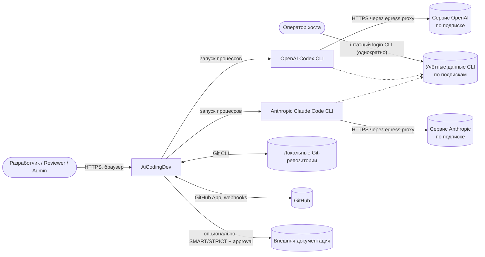
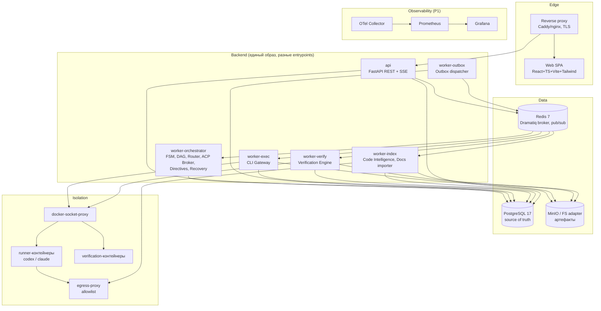
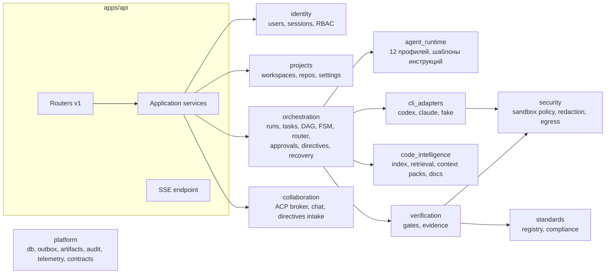
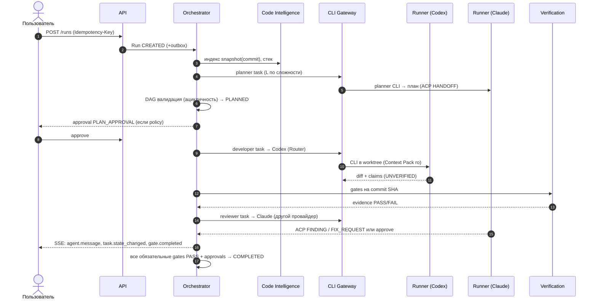
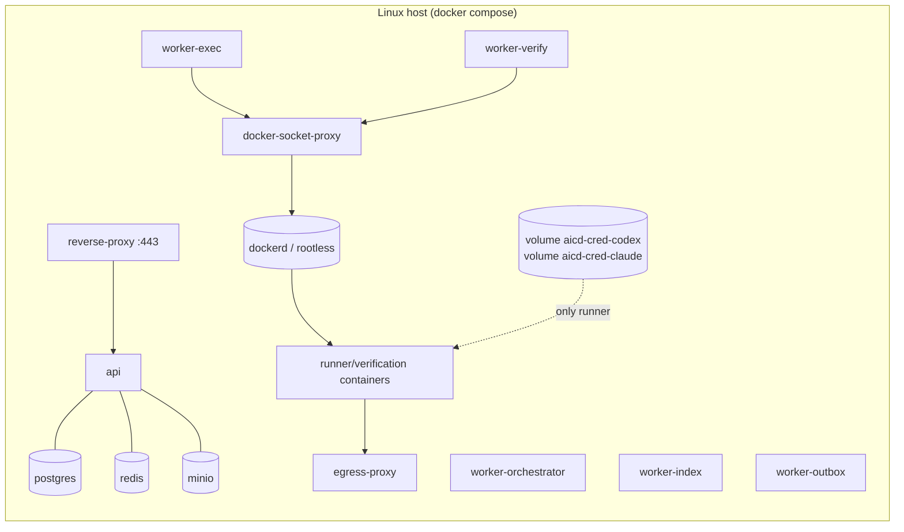

# SYSTEM_ARCHITECTURE — AiCodingDev v1.0

**Статус:** Proposed (Phase 0). **Основание:** ТЗ §1–3, §16–17, §22; ADR-0001…0014.
Нотация: C4 (Context → Container → Component) в Mermaid.

## 1. Назначение и границы системы

AiCodingDev — self-hosted / local-first платформа управляемой AI-разработки. Пользователь формулирует задачу (run), платформа декомпозирует её в DAG задач, назначает 12 логических ролей, исполняет их **только** через официальные Codex CLI и Claude Code CLI в изолированных worktree, независимо проверяет результат (quality gates + evidence), показывает межагентное общение в Live Agent Chat и запрашивает human approval для опасных действий.

**Не входит в v1.0** (ТЗ §1): собственная LLM, AI API, автономный production deploy, безусловный auto-merge, обязательная векторная БД, обязательный Kubernetes, официальная ISO-сертификация.

## 2. Контекст (C4 Level 1)

Платформа сама **не вызывает** AI API: сетевой трафик к провайдерам генерирует только официальный CLI внутри runner-контейнера.

## 3. Контейнеры (C4 Level 2)

| Контейнер | Ответственность | Масштабирование | Доступы |
|---|---|---|---|
| `reverse-proxy` | TLS, статика SPA, маршрутизация `/api`, SSE буферизация off | 1 | — |
| `api` | REST v1, SSE, AuthN/AuthZ, Idempotency, rate limit, приём директив/approvals | N реплик (stateless) | PG (`aicd_app`), Redis, MinIO (presign) |
| `worker-orchestrator` | FSM-переходы, DAG scheduler, Router, ACP Broker, impact analysis, таймеры, recovery reconciler | N (конкуренция через leases/SKIP LOCKED) | PG (`aicd_worker`), Redis |
| `worker-outbox` | Публикация outbox → Dramatiq + `run_event_log` + pub/sub | 1–2 | PG, Redis |
| `worker-exec` | CLI Gateway: probe, auth check, запуск runner, стрим событий, сбор результата | по хостам с CLI; лимит параллелизма на провайдер | PG, Redis, MinIO, docker-socket-proxy |
| `worker-verify` | Quality gates в verification-контейнерах, evidence | N | PG, MinIO, docker-socket-proxy |
| `worker-index` | Индексация, Context Packs, импорт документации | N | PG, MinIO, egress-proxy (только docs) |
| `postgres` | Состояние, FTS, pg_trgm, RLS | 1 (+ реплика/бэкап) | — |
| `redis` | Брокер Dramatiq, pub/sub, rate-limit | 1 | — |
| `minio` | Артефакты (diff, логи, отчёты, context packs, evidence) | 1 | — |
| `egress-proxy` | Allowlist исходящих соединений runner/docs | 1 | Интернет |
| `docker-socket-proxy` | Ограниченный Docker API для exec/verify | 1 на хост | Docker daemon |

## 4. Компоненты backend (C4 Level 3)

Соответствуют каталогу `packages/` (ТЗ §17); детали и владение таблицами — [MODULE_BOUNDARIES.md](MODULE_BOUNDARIES.md).

## 5. Ключевые сквозные решения

| Тема | Решение | ADR |
|---|---|---|
| Стиль | Modular monolith + workers | 0001 |
| Состояние | PostgreSQL source of truth; outbox; Dramatiq/Redis at-least-once | 0002 |
| Исполнители | Только официальные CLI, runtime probe, compat matrix | 0003 |
| Коммуникация агентов | ACP через брокер, evidence-first, approvals | 0004 |
| Знания | Обязательный локальный индекс, docs OFF/SMART/STRICT | 0005 |
| Изоляция | Worktree на задачу, runner-контейнеры, egress allowlist | 0006, 0010 |
| Workflow | Собственный durable engine на PG (FSM+DAG+leases+checkpoints) | 0007 |
| Данные/тенанты | UUIDv7, text+CHECK, workspace_id везде, RLS | 0008 |
| Вход | Локальные аккаунты, server-side сессии, CSRF | 0009 |
| Realtime | SSE из `run_event_log` с Last-Event-ID | 0011 |
| Побочные эффекты | `external_actions` ledger | 0012 |
| Контракты | `packages/contracts` единый источник, codegen, oasdiff | 0013 |
| Frontend | React+TS+Vite+Tailwind, TanStack Query, React Flow, Monaco | 0014 |

## 6. Сквозной сценарий (ТЗ §19, AC-01…AC-05)

## 7. Развёртывание

**Профиль `local` (по умолчанию):** `docker compose` на одном хосте (Linux; macOS/Windows через Docker Desktop — с ограничениями OQ-03). Все сервисы из §3; бэкенд-процессы — один образ.

**Профиль `server`:** тот же compose / systemd на выделенном Linux-хосте; PostgreSQL может быть внешним; несколько `worker-exec` хостов регистрируются в `worker_hosts`.

**Kubernetes** — не требуется (ТЗ §1); Helm chart — вне v1.0.

Сети compose: `edge` (proxy↔api), `backend` (api/workers↔data), `sandbox` (runners↔egress-proxy, `internal: true` для прямого выхода).

## 8. Качественные атрибуты и тактики

| Атрибут | Тактики | Требования |
|---|---|---|
| Надёжность | outbox, идемпотентные consumers, leases+fencing, checkpoints, ledger внешних действий, reconciler | NFR-REL-* |
| Безопасность | RBAC+RLS, sandbox, egress allowlist, redaction, approvals, four-eyes, SSRF-защита | NFR-SEC-* |
| Наблюдаемость | OTel traces с `run_id/task_id/execution_id`, структурные JSON-логи, метрики ТЗ §16 | NFR-OBS-* |
| Поддерживаемость | границы модулей + import-linter, контракты-first, ADR, миграции с downgrade | NFR-MAINT-* |
| Производительность | SKIP LOCKED очереди, partial indexes, инкрементальная индексация, SSE fan-out через pub/sub | NFR-PERF-* (SLO после baseline) |
| Переносимость | docker compose, отсутствие облачных зависимостей, режим docs OFF офлайн | NFR-PORT-* |
| Доступность UI | клавиатура, ARIA, пустые/ошибочные состояния, responsive | NFR-UX-* |

## 9. Ограничения и допущения

1. Возможности CLI (машинный вывод, usage, resume) определяются probe; архитектура не предполагает конкретных флагов.
2. Параллелизм ограничен лимитами подписок; Router учитывает наблюдаемые `RATE_LIMITED` и конфигурируемый `max_concurrent_sessions` на установку.
3. Целевая ОС хостов исполнения v1.0 — Linux x86_64/arm64 (OQ-03 для macOS/Windows).
4. SLO производительности не заявляются до baseline-измерений (ТЗ §23).
