# ER_DIAGRAM — ER-диаграммы по доменам

**Статус:** Proposed (Phase 0). **Основание:** ТЗ §7, §21 (`data-model.md`: ERD, cardinality, invariants); полное DDL — [DATABASE_DESIGN.md](DATABASE_DESIGN.md).

> Диаграммы описывают проектируемую схему; ничего не реализовано. Атрибуты показаны выборочно (ключи и колонки, важные для связей и инвариантов). Во всех tenant-таблицах есть `workspace_id`, а связи между tenant-таблицами реализованы составными FK `(workspace_id, <parent>_id)` (ADR-0008) — на диаграммах `workspace_id` опущен, кроме корневых сущностей, чтобы не загромождать.

Обозначения кардинальностей Mermaid: `||--||` один-к-одному, `||--o{` один-ко-многим (0..N), `||--|{` один-к-1..N, `|o--o{` необязательный родитель (FK nullable).

## Содержание

1. [Обзор доменов](#1-обзор-доменов)
2. [IAM и tenancy](#2-iam-и-tenancy)
3. [Проекты, репозитории, стек](#3-проекты-репозитории-стек)
4. [Оркестрация](#4-оркестрация)
5. [CLI Gateway](#5-cli-gateway)
6. [ACP, чат, поручения](#6-acp-чат-поручения)
7. [Code Intelligence и документация](#7-code-intelligence-и-документация)
8. [Качество, evidence, стандарты](#8-качество-evidence-стандарты)
9. [Approvals, политики, надёжность](#9-approvals-политики-надёжность)
10. [GitHub и аудит](#10-github-и-аудит)
11. [Ключевые инварианты](#11-ключевые-инварианты)

---

## 1. Обзор доменов

Связи между доменами (одна стрелка — одна или несколько FK; направление — от дочерней к родительской сущности по смыслу «принадлежит»).

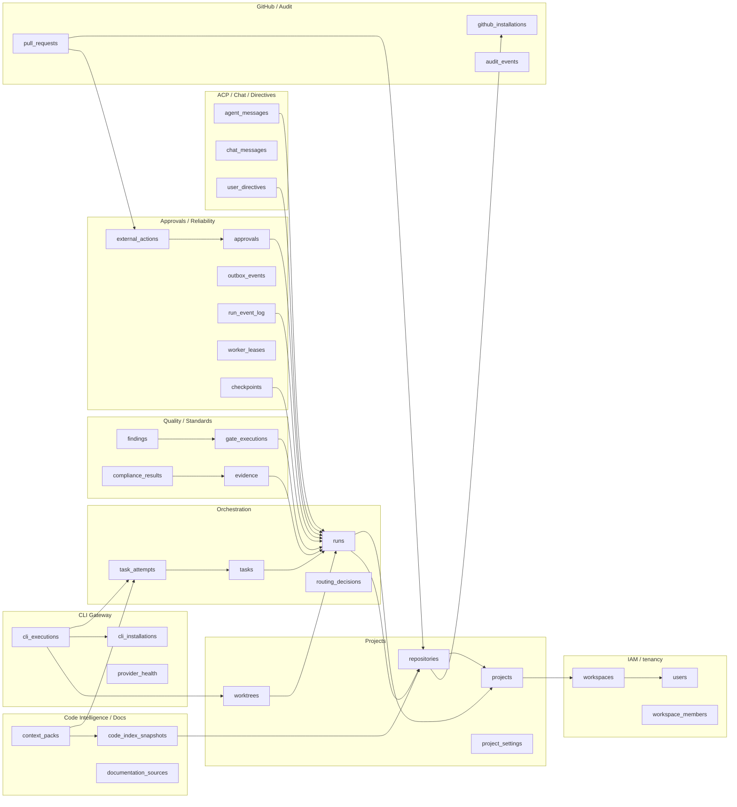

Сущности верхнего уровня и их место в tenancy:

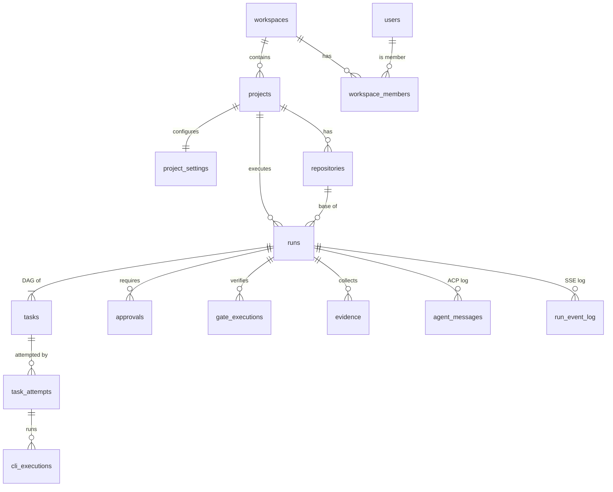

---

## 2. IAM и tenancy

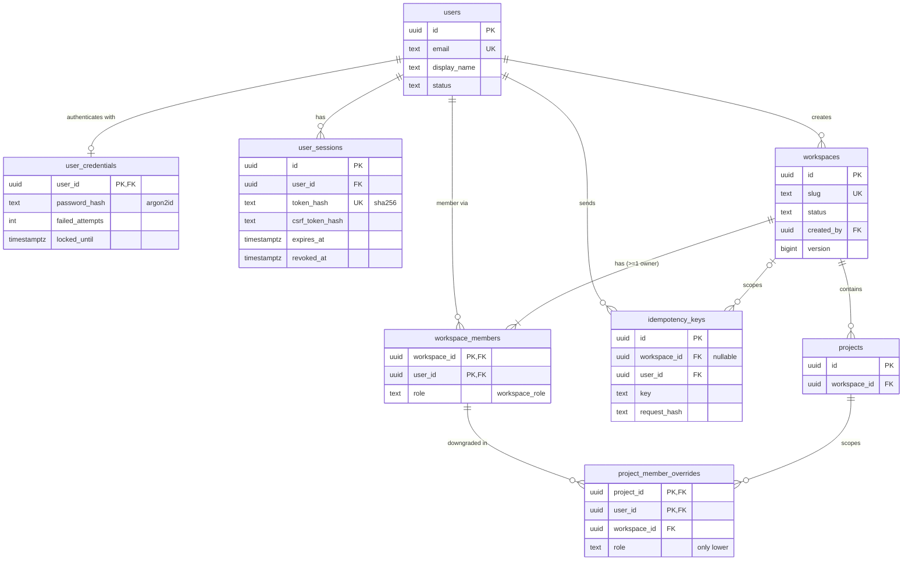

---

## 3. Проекты, репозитории, стек

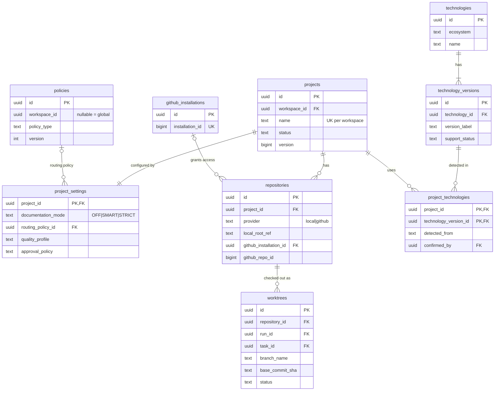

---

## 4. Оркестрация

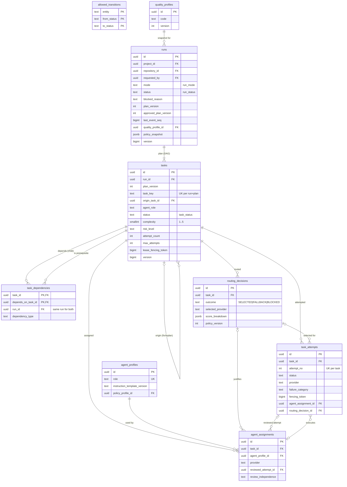

`allowed_transitions` не связана FK — это справочник, используемый триггерами `trg_*_transition` (DATABASE_DESIGN §18.3).

---

## 5. CLI Gateway

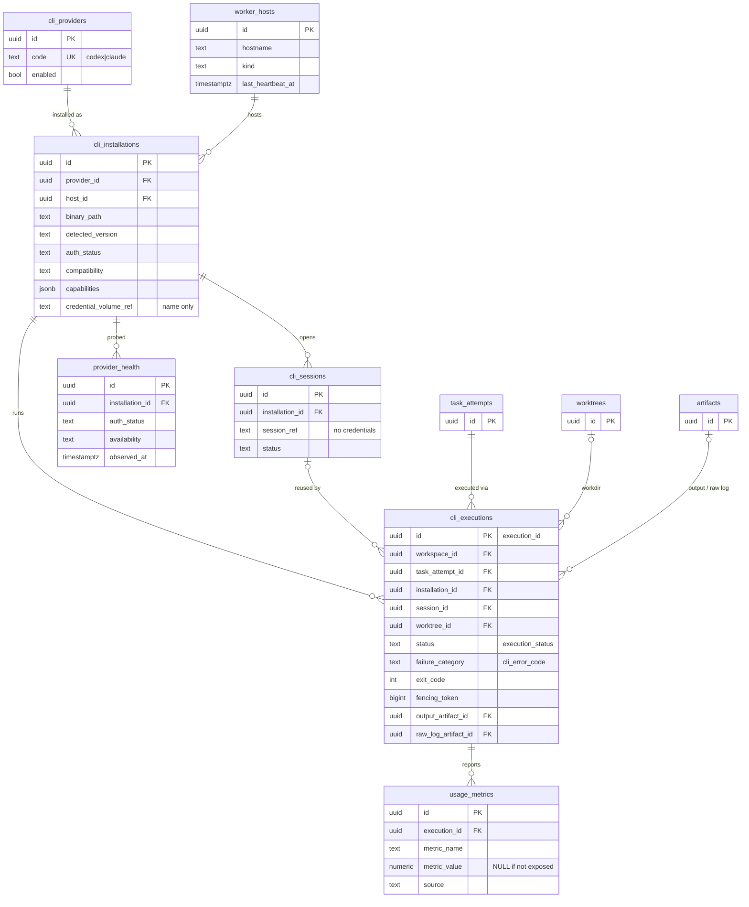

Граница tenancy: `worker_hosts`, `cli_providers`, `cli_installations`, `cli_sessions`, `provider_health` — глобальные; `cli_executions`, `usage_metrics` — tenant.

---

## 6. ACP, чат, поручения

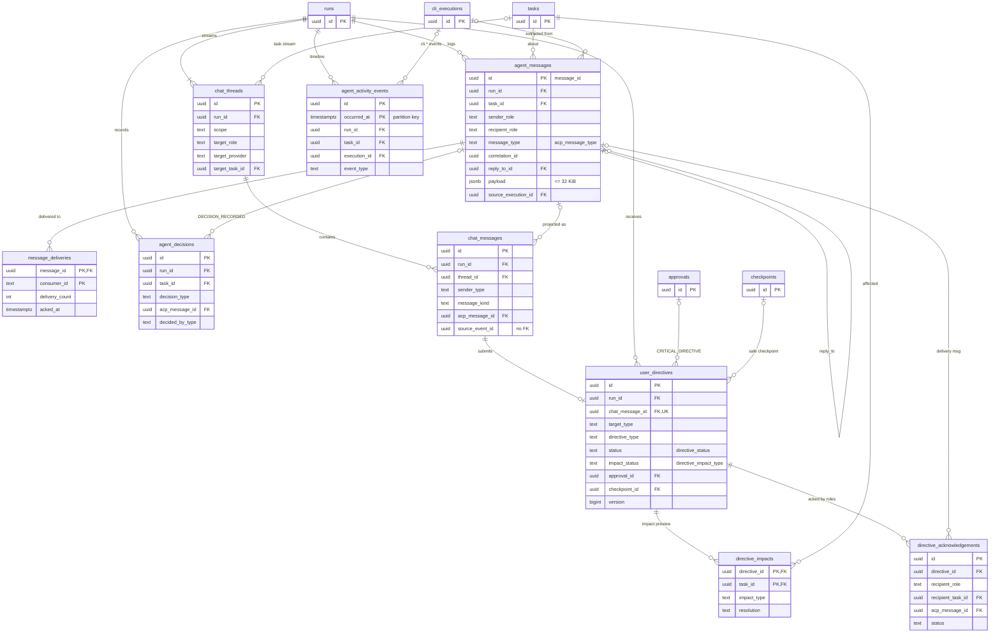

---

## 7. Code Intelligence и документация

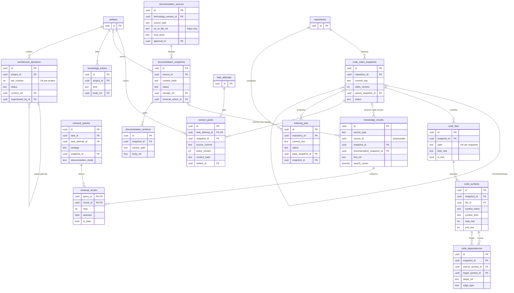

---

## 8. Качество, evidence, стандарты

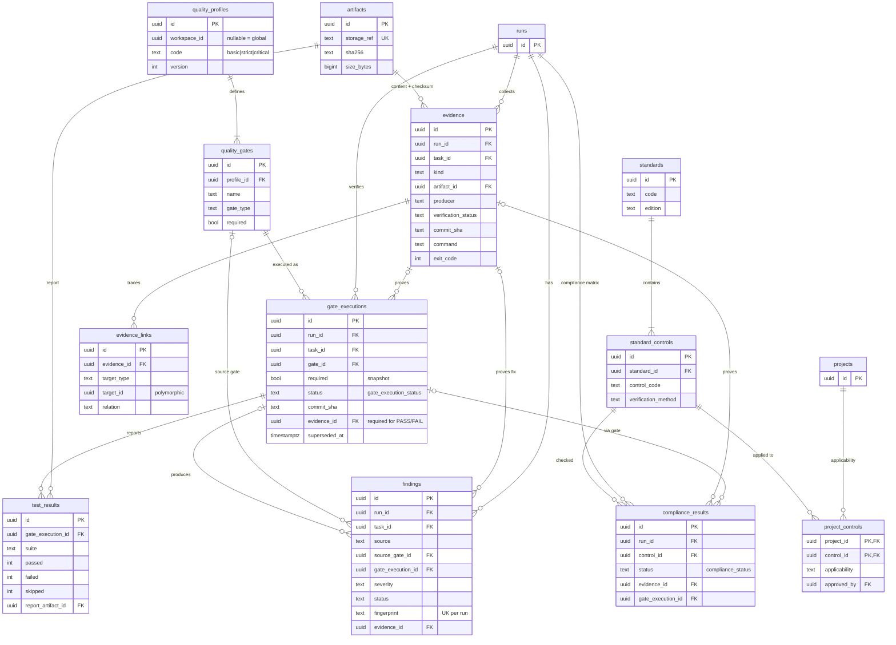

Трассировка ТЗ §13: `standards → standard_controls → project_controls (applicability, agent_role) → gate_executions (check) → evidence → compliance_results (verdict)`.

---

## 9. Approvals, политики, надёжность

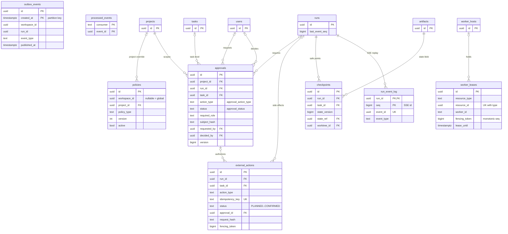

`outbox_events` → `run_event_log` — логическая связь (`run_event_log.event_id = outbox_events.id`), без FK; `processed_events.event_id` — также без FK (outbox партиционирован и очищается). `worker_leases.resource_id` — полиморфная ссылка на `tasks`/`runs`/`cli_executions`/`indexing_jobs`/`external_actions`.

---

## 10. GitHub и аудит

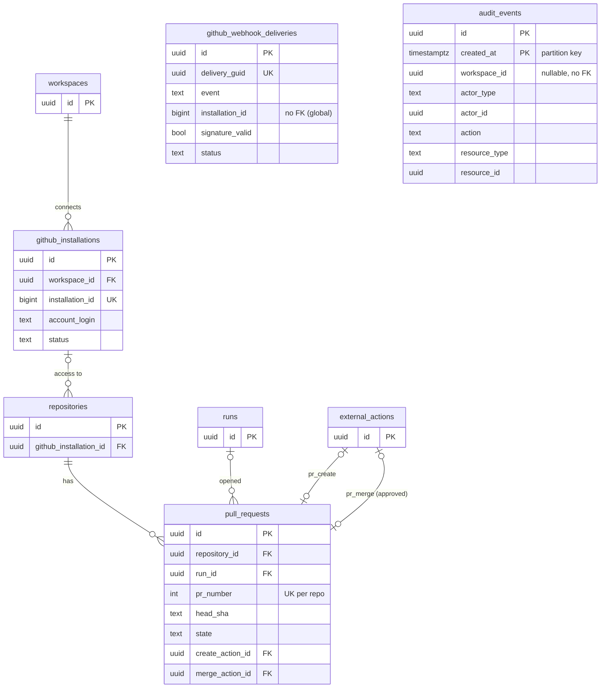

`audit_events` намеренно без FK (переживает удаление субъектов, append-only, партиционирована). `github_webhook_deliveries` → workspace определяется функцией `sys_resolve_installation_workspace(installation_id)` после проверки подписи.

---

## 11. Ключевые инварианты

| # | Инвариант | Источник | Механизм в БД | Где описано |
|---|---|---|---|---|
| I-01 | Межтенантные ссылки невозможны | ТЗ §7.1 | составные FK `(workspace_id, parent_id)`; `workspace_id` неизменяем | DD §1.3, §18.13 |
| I-02 | Чужой workspace не виден и не изменяем | ТЗ §15, AC-12 | RLS `ENABLE`+`FORCE`, контекст `SET LOCAL`, роли без `BYPASSRLS` | DD §19 |
| I-03 | Зависимость задач только внутри одного run | ТЗ §7.3 | `run_id` в обоих составных FK `task_dependencies` + защитный триггер | DD §7.3, §18.1 |
| I-04 | DAG без циклов; утверждённый план неизменяем | ТЗ §6, AC-02 | транзакционное утверждение с блокировкой run; deferred constraint trigger (recursive CTE `CYCLE`); запрет изменения рёбер утверждённой версии | DD §18.2 |
| I-05 | Только разрешённые переходы FSM (Run/Task/Execution/Directive/Approval/Ledger) | ТЗ §6 | `allowed_transitions` + `trg_*_transition`; основной контроль — код (ADR-0007) | DD §18.3 |
| I-06 | `COMPLETED` только при PASS обязательных gates, всех задачах SUCCEEDED, отсутствии PENDING approvals | ТЗ §6, §14, AC-11 | `trg_runs_completion_guard` + `FOR SHARE` блокировки писателей | DD §18.4 |
| I-07 | `PASS` gate только с сохранённым VERIFIED evidence; `SKIPPED ≠ PASS` | ТЗ §14, §9 | `ck_gate_executions_pass_evidence`, `trg_gate_executions_evidence_verified` | DD §12.4 |
| I-08 | Evidence процесса содержит commit, команду, exit code, время; checksum — в artifact | AC-14 | `ck_evidence_process_fields`; `artifacts.sha256 NOT NULL` | DD §12.7 |
| I-09 | Слова агента не являются verified-доказательством | ТЗ §2 п.4 | `ck_evidence_verified_producer`, `ck_evidence_agent_claim` | DD §12.7 |
| I-10 | Optimistic locking агрегатов | ТЗ §6, §7.1 | `version` + `trg_fn_enforce_version`; для версий политик — UNIQUE `(…, version)` | DD §1.5, §14.1 |
| I-11 | Аренда с монотонным fencing token; запись результата только владельцем актуального токена | ТЗ §16 | `worker_lease_fencing_seq`, `trg_worker_leases_fencing_monotonic`, условие `lease_fencing_token = :token` | DD §15.4, §18.6 |
| I-12 | Подтверждённое внешнее действие не повторяется | ТЗ §6, AC-09, ADR-0012 | `external_actions.idempotency_key UNIQUE`; FSM ledger; `CONFIRMED` терминален (кроме `COMPENSATED`) | DD §15.5 |
| I-13 | Merge / production deploy / destructive migration — только с approval конкретного предмета | ТЗ §15, AC-13 | `ck_external_actions_approval_required`, `trg_external_actions_approval_gate` (`subject_hash = request_hash`) | DD §15.5, §18.7 |
| I-14 | Четыре глаза: инициатор не утверждает своё критическое действие | бриф | `ck_approvals_four_eyes`, `trg_approvals_decider_role` | DD §14.2, §18.7 |
| I-15 | Самопроверка не маркируется как независимое ревью | ТЗ §4 | `trg_agent_assignments_independence` (разные провайдеры или approval `SELF_REVIEW_FALLBACK`) | DD §18.8 |
| I-16 | ACP-сообщение ≤ 32 KiB | ТЗ §10 | `ck_agent_messages_payload_size` (`octet_length(payload::text) <= 32768`) | DD §9.1 |
| I-17 | SSE без дублей при переподключении | AC-08, ADR-0011 | `run_event_log` PK `(run_id, seq)`, `UNIQUE (event_id)`, seq из `runs.last_event_seq` | DD §15.6 |
| I-18 | Идемпотентные потребители | ТЗ §10, §16 | `processed_events` PK `(consumer, event_id)`; `message_deliveries` PK `(message_id, consumer_id)` | DD §15.3, §9.2 |
| I-19 | Аудит append-only | ТЗ §15 | `REVOKE UPDATE/DELETE/TRUNCATE` + `trg_audit_events_append_only`; удаление только партиций после архива | DD §17.1, §18.5 |
| I-20 | Секреты и CLI-токены не хранятся | ТЗ §7.1 | нет колонок; schema-lint; redaction; параметры не логируются | DD §18.9 |
| I-21 | В workspace всегда ≥ 1 owner; проектные роли только понижают | бриф | deferred trigger `trg_workspace_members_last_owner`; `trg_project_member_overrides_downgrade_only` | DD §18.10 |
| I-22 | Фрагмент кода привязан к commit-снимку; устаревший помечается | ТЗ §12 | `ck_knowledge_chunks_freshness_anchor`; `retrieval_results.is_stale` | DD §10.5, §10.7 |
| I-23 | `OFF` не использует документацию | ТЗ §12, AC-10 | `ck_retrieval_queries_docs_off` | DD §10.6 |
| I-24 | Риск принимает / находку закрывает как ложную только человек | ТЗ §10 | `ck_agent_decisions_risk_by_user`, `ck_findings_human_resolution` | DD §9.3, §12.6 |
| I-25 | Токены/лимиты CLI показываются только если реально предоставлены | ТЗ §9, §16 | `ck_usage_metrics_value` (`not_exposed_by_cli` ⇔ `metric_value IS NULL`) | DD §8.7 |

(DD — [DATABASE_DESIGN.md](DATABASE_DESIGN.md).)
