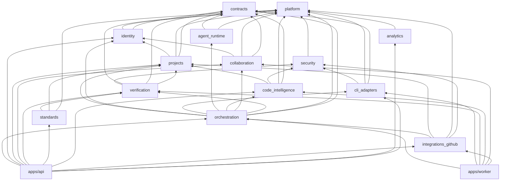
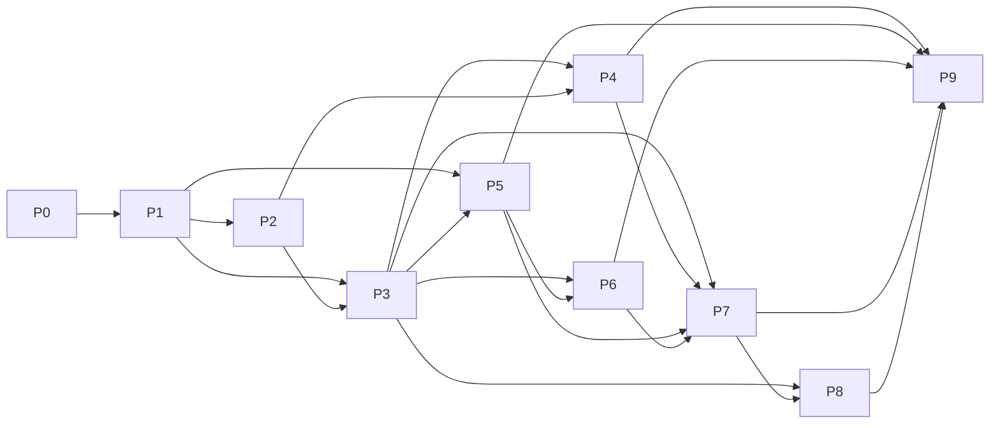
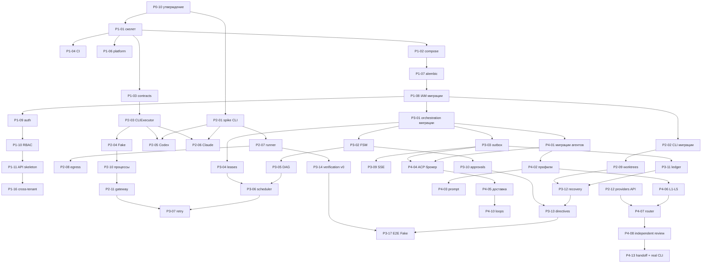

# DEPENDENCY_GRAPH — зависимости модулей, фаз и задач

**Статус:** Proposed.

## 1. Зависимости модулей (compile-time)

Обратная связь (`verification` → `orchestration`, `cli_adapters` → `orchestration`) — **только событиями**, не импортами (MODULE_BOUNDARIES §2).

## 2. Зависимости фаз

**Критический путь:** P0-10 → P1-01 → P1-07 → P1-08 → P3-01 → P3-02 → P3-03/P3-04 → P3-12 → P3-13 → P4-04 → P4-07 → P4-08 → P6-08 → P6-09 → P9-01.
**Ранний риск-спайк:** P2-01 (реальные CLI) стартует сразу после P0-10 параллельно P1, т.к. его результаты могут изменить ADR-0010 и контракт CLI.

## 3. Ключевые задачные зависимости

## 4. Внешние зависимости и предпосылки

| Предпосылка | Нужна для | Владелец |
|---|---|---|
| Машина Linux с Docker, установленными и авторизованными Codex CLI и Claude Code CLI (подписки) | P2-01, P2-13, P4-13, P9-01 | Владелец продукта |
| Ответы OQ-01, OQ-03 | P2 | Владелец продукта |
| Тестовая GitHub-организация и GitHub App | P8-02…P8-09 | Владелец продукта |
| Эталонное железо для baseline (OQ-14) | P9-04 | Владелец продукта |
