# DEVELOPMENT_ROADMAP — AiCodingDev v1.0

**Статус:** Proposed. Порядок фаз — по мастер-промпту (см. OQ-05 о расхождении с ТЗ §18). Детальные задачи — [IMPLEMENTATION_BACKLOG.md](IMPLEMENTATION_BACKLOG.md); зависимости — [DEPENDENCY_GRAPH.md](DEPENDENCY_GRAPH.md).

**Принципы:** вертикальные end-to-end срезы; каждая фаза включает документацию, тесты, миграции и demo (ТЗ §18); фаза закрывается только по критериям завершения с evidence; переход к следующей фазе — с явного разрешения владельца. Оценки длительности — ориентир при команде 3–4 инженеров, не обязательство (ТЗ §18: ≈ 20 недель).

## Обзор

```mermaid
gantt
  dateFormat  X
  axisFormat  нед. %s
  section Основа
  P0 Architecture & Planning      :done, p0, 0, 1
  P1 Project Foundation           :p1, 1, 4
  section Исполнение
  P2 CLI Integration              :p2, 3, 6
  P3 Core Orchestrator            :p3, 4, 8
  P4 Multi-Agent System           :p4, 8, 11
  section Знания и качество
  P5 Code Intelligence            :p5, 9, 12
  P6 Quality, Security & Standards:p6, 11, 14
  section Интерфейс и интеграции
  P7 Mission Control & Live Chat  :p7, 12, 16
  P8 GitHub & Analytics           :p8, 15, 18
  section Выпуск
  P9 Verification & Release       :p9, 17, 20
```

(Перекрытия возможны параллельной работой разных инженеров; критический путь: P1 → P3 → P4 → P6 → P9.)

## Phase 0 — Architecture & Planning
- **Задачи:** P0-01…P0-10. **Зависимости:** —. **Приоритет:** P0.
- **Результат:** комплект документов `docs/`, ADR, схемы, контракты, план.
- **Тесты:** валидация OpenAPI 3.1 и JSON Schema (машинная), согласованность перечислений.
- **Критерии завершения:** владелец утвердил архитектуру, схемы и ответы на OQ-01…OQ-16 (ТЗ §18 этап 0: «архитектура/схемы утверждены»).

## Phase 1 — Project Foundation
- **Задачи:** P1-01…P1-17. **Зависимости:** P0. **Приоритет:** P0.
- **Результат:** монорепозиторий, CI с security-гейтами, compose-окружение, миграционный фреймворк, IAM/RBAC/tenancy с RLS, API skeleton, контракты в `packages/contracts`, web shell, artifact store, базовая наблюдаемость.
- **Тесты:** unit, migration (upgrade/downgrade), RLS, cross-tenant negative suite, CSRF/session security, schemathesis, Playwright smoke + axe.
- **Критерии завершения:** tenant isolation tests зелёные (ТЗ §18 этап 1); CI блокирует нарушения границ модулей, утечки секретов, AI-SDK; demo: вход → workspace → проект → привязка локального репозитория.

## Phase 2 — CLI Integration
- **Задачи:** P2-01…P2-14. **Зависимости:** P1 (P1-03, P1-08, P1-15), решения OQ-01, OQ-03. **Приоритет:** P0.
- **Результат:** CLI Gateway, Codex и Claude адаптеры с probe и compat matrix, Fake adapter, runner-sandbox, egress proxy, worktree manager, Providers API.
- **Тесты:** contract (request/result/events), integration на Fake, sandbox security tests, **opt-in smoke/contract с реальными CLI** (ТЗ §18 этап 3).
- **Критерии завершения:** оба адаптера проходят opt-in suite на эталонной машине (evidence); AUTH_REQUIRED/RATE_LIMITED/TIMEOUT нормализуются; запись вне worktree и неразрешённая сеть блокируются.

## Phase 3 — Core Orchestrator
- **Задачи:** P3-01…P3-17. **Зависимости:** P1, P2 (P2-07, P2-09, P2-11). **Приоритет:** P0.
- **Результат:** durable engine (FSM, DAG, scheduler, outbox, leases, retry, checkpoints, recovery, ledger), approvals core, directives backend, SSE, Verification Engine v0, минимальный Run view.
- **Тесты:** property-based FSM, DAG unit, idempotency, chaos v1 (kill worker, Redis restart, lost lease, duplicate), SSE reconnect, E2E на Fake.
- **Критерии завершения:** recovery/idempotency tests зелёные (ТЗ §18 этап 2); AC-07, AC-08, AC-09, AC-11, AC-16 проходят на Fake.

## Phase 4 — Multi-Agent System
- **Задачи:** P4-01…P4-13. **Зависимости:** P3, P2-12. **Приоритет:** P0.
- **Результат:** 12 профилей, шаблоны инструкций, ACP-брокер, Router L1–L5, независимое ревью, пайплайны 11 режимов, review/fix loops, chat/task API.
- **Тесты:** ACP contract/negative по типам, routing table-тесты, prompt-injection corpus, handoff-тесты, real-CLI smoke Codex→Claude.
- **Критерии завершения:** agent handoff tests (ТЗ §18 этап 4); **MVP-срез**: AC-01, AC-03, AC-04, AC-05 (на уровне API) с реальными CLI в opt-in прогоне.

## Phase 5 — Code Intelligence
- **Задачи:** P5-01…P5-12. **Зависимости:** P1, P3-10 (approvals для docs), P2-11. **Приоритет:** P0 (импорт документации P1).
- **Результат:** commit-aware индекс, символы, поиск, граф, test links, Context Packs, стек, docs policy, безопасный импортёр.
- **Тесты:** golden-тесты парсинга, freshness/retrieval, SSRF/zip bomb/traversal, AC-02, AC-10.
- **Критерии завершения:** freshness/retrieval tests (ТЗ §18 этап 6); режим OFF работает офлайн.

## Phase 6 — Quality, Security & Standards
- **Задачи:** P6-01…P6-12. **Зависимости:** P3-14, P5-07. **Приоритет:** P0.
- **Результат:** полный Verification Engine, gates по категориям, evidence, findings, guard завершения, Standards Registry, compliance, отчёты.
- **Тесты:** фикстуры pass/fail каждого gate, false-pass prevention suite, AC-11, AC-14.
- **Критерии завершения:** false-pass prevention tests зелёные (ТЗ §18 этап 7).

## Phase 7 — Mission Control & Live Agent Chat
- **Задачи:** P7-01…P7-14. **Зависимости:** API фаз 3–6. **Приоритет:** P0.
- **Результат:** все 13 экранов ТЗ §11, Live Agent Chat со всеми потоками и командами, diff viewer, Run Graph.
- **Тесты:** Playwright E2E + axe, impact/replan UI тесты, обрыв сети.
- **Критерии завершения:** UI E2E + impact/replan tests (ТЗ §18 этап 5); AC-05, AC-06, AC-08 E2E.

## Phase 8 — GitHub Integrations & Analytics
- **Задачи:** P8-01…P8-09. **Зависимости:** P3-11, P7-01. **Приоритет:** P0.
- **Результат:** GitHub App, webhooks, PR workflow через ledger, merge с approval, метрики, Analytics, дашборды и алерты.
- **Тесты:** webhook spoofing/replay, permission tests, crash-тест дублирования PR.
- **Критерии завершения:** permission tests (ТЗ §18 этап 8); AC-13 для merge.

## Phase 9 — Verification & Release
- **Задачи:** P9-01…P9-10. **Зависимости:** P1–P8. **Приоритет:** P0.
- **Результат:** полный приёмочный прогон, security/chaos/perf, DR, runbooks, релизная цепочка поставки.
- **Критерии завершения:** release acceptance checklist (ТЗ §18 этап 9, §23): 100% обязательных acceptance tests, 0 открытых critical, fault-injection восстановление, cross-tenant отрицательны, секреты не в логах, coverage core ≥ 85%.
