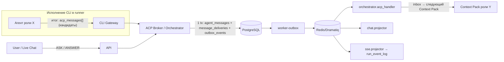
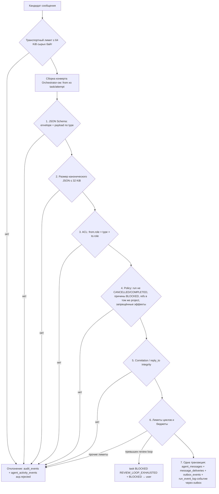
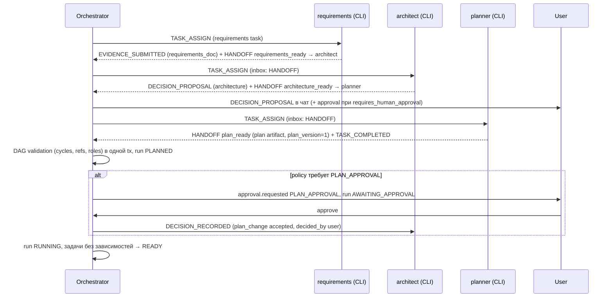
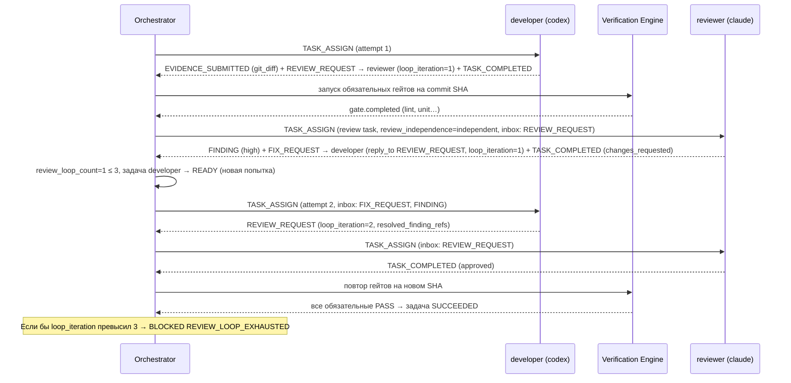
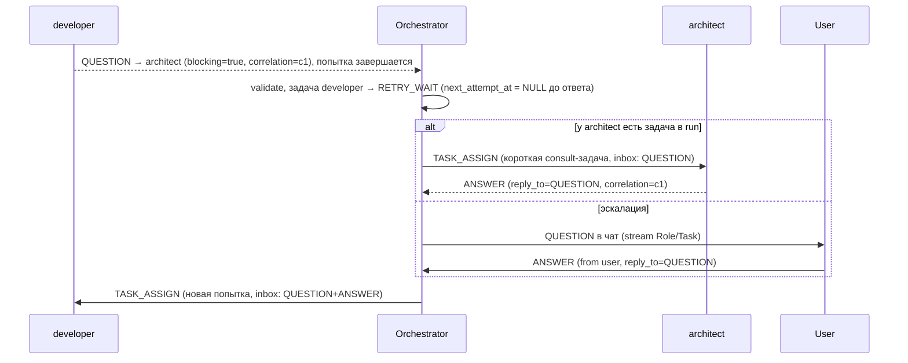
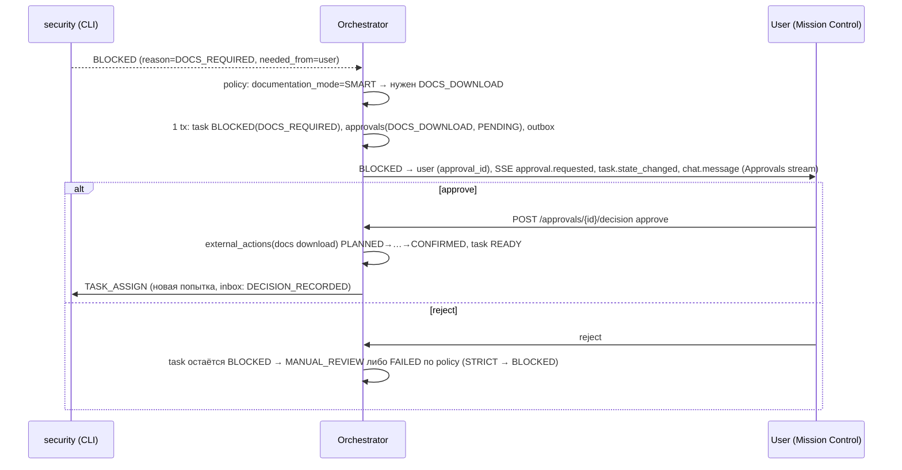

# Agent Communication Protocol (ACP) v1.0

**Статус:** Phase 0, проект на утверждение. Ничего из описанного не реализовано.
**Требования:** ТЗ §4, §6, §7.2 (`agent_messages`, `message_deliveries`, `agent_decisions`, `outbox_events`), §10, §11, §15, §16, §19 AC-04/AC-05, §20 (contract: ACP payload per type).
**Решения:** ADR-0002 (outbox), ADR-0004 (централизованный ACP через Orchestrator), ADR-0007 (собственный durable engine; Dramatiq — только транспорт), ADR-0013.
**Версия протокола:** `protocol: "acp/1.0"`; колонка `agent_messages.schema_version = "1.0"`. Файлы Phase 1: `packages/contracts/acp-envelope.schema.json`, `packages/contracts/acp/payloads/<type>.schema.json`, `packages/contracts/acp/common.schema.json` (ТЗ §21).

---

## 1. Модель

Агенты (12 логических ролей, исполняемых CLI) **не общаются напрямую**. Единственный брокер — ACP Broker в `worker-orchestrator`.

Ключевое решение: **агент не может сам заполнить конверт.** CLI-процесс в конце исполнения возвращает структурированный блок `acp_messages` (список `{to, type, payload}`) в машиночитаемом итоге (см. [AGENT_ROLES.md](../agents/AGENT_ROLES.md) §3). Gateway передаёт его в Orchestrator как *кандидатов*. Orchestrator сам формирует конверт: `message_id`, `run_id`, `task_id`, `from.role` (= `tasks.agent_role`), `from.provider` (= `task_attempts.provider`), `correlation_id`, `created_at`. Значения `from`, указанные агентом, игнорируются — подмена отправителя невозможна by design.

Отправители-«псевдороли» (не входят в `agent_role`): `orchestrator` (системные сообщения брокера) и `user` (человек через Live Agent Chat; `from.user_id` обязателен). Они перечислены в разделе «Предлагаемые дополнения» как `acp_participant`.



**Доставка агенту** означает включение сообщения в раздел `inbox` Context Pack следующего исполнения задачи роли-получателя (или создание новой задачи/попытки Orchestrator-ом). Работающий CLI-процесс никогда не получает сообщения «на лету» (ТЗ §8.2: сообщение пользователя не может незаметно изменить работающий процесс).

## 2. Конверт

```json
{
  "$schema": "https://json-schema.org/draft/2020-12/schema",
  "$id": "https://aicodingdev.local/contracts/acp/1.0/envelope.schema.json",
  "title": "AcpEnvelope",
  "type": "object",
  "additionalProperties": false,
  "required": ["protocol", "message_id", "run_id", "task_id", "from", "to", "type", "correlation_id", "reply_to_id", "payload", "created_at"],
  "properties": {
    "protocol": {"const": "acp/1.0"},
    "message_id": {"type": "string", "format": "uuid"},
    "run_id": {"type": "string", "format": "uuid"},
    "task_id": {"type": ["string", "null"], "format": "uuid"},
    "task_attempt_id": {"type": ["string", "null"], "format": "uuid"},
    "from": {
      "type": "object",
      "additionalProperties": false,
      "required": ["role"],
      "properties": {
        "role": {"enum": ["requirements", "architect", "planner", "developer", "reviewer", "security", "qa", "database", "performance", "devops", "maintenance", "documentation", "orchestrator", "user"]},
        "provider": {"enum": ["codex", "claude"]},
        "user_id": {"type": "string", "format": "uuid"}
      },
      "allOf": [
        {"if": {"properties": {"role": {"enum": ["orchestrator", "user"]}}},
         "then": {"not": {"required": ["provider"]}},
         "else": {"required": ["provider"], "not": {"required": ["user_id"]}}},
        {"if": {"properties": {"role": {"const": "user"}}}, "then": {"required": ["user_id"]}},
        {"if": {"properties": {"role": {"const": "orchestrator"}}}, "then": {"not": {"required": ["user_id"]}}}
      ]
    },
    "to": {
      "type": "object",
      "additionalProperties": false,
      "required": ["role"],
      "properties": {
        "role": {"enum": ["requirements", "architect", "planner", "developer", "reviewer", "security", "qa", "database", "performance", "devops", "maintenance", "documentation", "orchestrator", "user"]},
        "task_id": {"type": "string", "format": "uuid", "description": "конкретная задача-получатель, если известна"}
      }
    },
    "type": {"enum": ["TASK_ASSIGN", "HANDOFF", "QUESTION", "ANSWER", "REVIEW_REQUEST", "FINDING", "FIX_REQUEST", "EVIDENCE_SUBMITTED", "DECISION_PROPOSAL", "DECISION_RECORDED", "BLOCKED", "TASK_COMPLETED"]},
    "correlation_id": {"type": "string", "format": "uuid"},
    "reply_to_id": {"type": ["string", "null"], "format": "uuid"},
    "payload": {"type": "object"},
    "created_at": {"type": "string", "format": "date-time"}
  },
  "allOf": [
    {"if": {"properties": {"type": {"const": "ANSWER"}}}, "then": {"properties": {"reply_to_id": {"type": "string"}}}},
    {"if": {"properties": {"type": {"enum": ["TASK_ASSIGN", "DECISION_RECORDED"]}}}, "then": {"properties": {"from": {"properties": {"role": {"const": "orchestrator"}}}}}}
  ]
}
```

Правила конверта:

- `correlation_id` обязателен (в ТЗ колонка допускает `NULL`; ACP 1.0 требует значение): для первого сообщения «разговора» = его `message_id`; ответы, findings, fix-запросы наследуют `correlation_id` исходного сообщения. Review-цикл = один `correlation_id` (от первого `REVIEW_REQUEST`).
- `reply_to_id` обязателен для `ANSWER`; для `FIX_REQUEST`, `FINDING` — ссылка на `REVIEW_REQUEST` (рекомендуется, проверяется при наличии); для `DECISION_RECORDED` — на `DECISION_PROPOSAL`, если решение принято по предложению.
- `task_id` = `NULL` допустим только для сообщений уровня run (`orchestrator`→`user` `BLOCKED` по run, `QUESTION` пользователя роли без задачи).
- Payload валидируется схемой своего `type` (раздел 3). Ссылки — типизированные строки `<kind>:<uuid>` (раздел 3.0); условные строки примера ТЗ (`finding-44`) в production не допускаются.

Пример (production-форма примера ТЗ §10):

```json
{
  "protocol": "acp/1.0",
  "message_id": "0193a6f2-6c1e-7d2a-9b11-3f0e5c2d2a01",
  "run_id": "0193a6f2-6c1e-7d2a-9b11-3f0e5c2d1a03",
  "task_id": "0193a6f2-6c1e-7d2a-9b11-3f0e5c2d1a02",
  "from": {"role": "reviewer", "provider": "claude"},
  "to": {"role": "developer"},
  "type": "FIX_REQUEST",
  "correlation_id": "0193a6f2-6c1e-7d2a-9b11-3f0e5c2d2a00",
  "reply_to_id": null,
  "payload": {
    "finding": "Missing authorization check",
    "severity": "high",
    "file": "app/auth/service.py",
    "evidence_refs": ["finding:0193a6f2-6c1e-7d2a-9b11-3f0e5c2d2a44"],
    "requested_action": "Add authorization check and regression test",
    "loop_iteration": 1
  },
  "created_at": "2026-11-08T09:00:00Z"
}
```

## 3. Payload-схемы

### 3.0 Общие определения

```json
{
  "$schema": "https://json-schema.org/draft/2020-12/schema",
  "$id": "https://aicodingdev.local/contracts/acp/1.0/common.schema.json",
  "title": "AcpCommon",
  "$defs": {
    "uuid": {"type": "string", "format": "uuid"},
    "ref": {"type": "string", "pattern": "^(artifact|evidence|finding|message|task|decision|gate_execution|context_pack|adr|requirement|approval|knowledge):[0-9a-f]{8}-[0-9a-f]{4}-[0-9a-f]{4}-[0-9a-f]{4}-[0-9a-f]{12}$"},
    "refs": {"type": "array", "maxItems": 100, "items": {"$ref": "#/$defs/ref"}, "uniqueItems": true},
    "text_short": {"type": "string", "minLength": 1, "maxLength": 500},
    "text_long": {"type": "string", "minLength": 1, "maxLength": 8000},
    "severity": {"enum": ["info", "low", "medium", "high", "critical"]},
    "agent_role": {"enum": ["requirements", "architect", "planner", "developer", "reviewer", "security", "qa", "database", "performance", "devops", "maintenance", "documentation"]},
    "provider": {"enum": ["codex", "claude"]},
    "file_path": {"type": "string", "maxLength": 1024, "pattern": "^(?!/)(?!.*(^|/)\\.\\.(/|$)).+$", "description": "относительный путь внутри репозитория, без .."},
    "commit_sha": {"type": "string", "pattern": "^[0-9a-f]{40}([0-9a-f]{24})?$"},
    "claim": {
      "type": "object", "additionalProperties": false,
      "required": ["type", "evidence_refs"],
      "properties": {
        "type": {"enum": ["implementation_completed", "tests_added", "tests_passed", "review_completed", "analysis_completed", "documentation_updated", "migration_prepared", "no_changes_needed", "other"]},
        "summary": {"type": "string", "maxLength": 2000},
        "evidence_refs": {"$ref": "#/$defs/refs"}
      }
    }
  }
}
```

### 3.1 `TASK_ASSIGN` (только `orchestrator` → роль)

```json
{
  "$schema": "https://json-schema.org/draft/2020-12/schema",
  "$id": "https://aicodingdev.local/contracts/acp/1.0/payloads/TASK_ASSIGN.schema.json",
  "title": "TASK_ASSIGN payload",
  "type": "object",
  "additionalProperties": false,
  "required": ["task_id", "attempt_no", "title", "objective", "acceptance_criteria", "complexity", "risk_level", "provider", "context_pack_ref", "instruction_template_version", "permissions"],
  "properties": {
    "task_id": {"$ref": "../common.schema.json#/$defs/uuid"},
    "attempt_no": {"type": "integer", "minimum": 1, "maximum": 10},
    "title": {"$ref": "../common.schema.json#/$defs/text_short"},
    "objective": {"$ref": "../common.schema.json#/$defs/text_long"},
    "acceptance_criteria": {"type": "array", "minItems": 1, "maxItems": 100, "items": {"type": "string", "maxLength": 2000}},
    "complexity": {"enum": ["L1", "L2", "L3", "L4", "L5"]},
    "risk_level": {"enum": ["low", "medium", "high", "critical"]},
    "provider": {"$ref": "../common.schema.json#/$defs/provider"},
    "routing_decision_id": {"$ref": "../common.schema.json#/$defs/uuid"},
    "context_pack_ref": {"$ref": "../common.schema.json#/$defs/ref"},
    "instruction_template_version": {"type": "string", "pattern": "^[a-z_]+@[0-9]+\\.[0-9]+\\.[0-9]+$"},
    "input_refs": {"$ref": "../common.schema.json#/$defs/refs"},
    "permissions": {
      "type": "object", "additionalProperties": false,
      "required": ["write_scope", "network"],
      "properties": {
        "write_scope": {"enum": ["none", "worktree"]},
        "network": {"enum": ["none", "restricted", "unrestricted"]}
      }
    },
    "timeout_seconds": {"type": "integer", "minimum": 30, "maximum": 14400},
    "review_independence": {"enum": ["independent", "self_review_fallback", "not_required"], "description": "только для reviewer/security; см. ROUTING_POLICY"}
  }
}
```

### 3.2 `HANDOFF`

```json
{
  "$schema": "https://json-schema.org/draft/2020-12/schema",
  "$id": "https://aicodingdev.local/contracts/acp/1.0/payloads/HANDOFF.schema.json",
  "title": "HANDOFF payload",
  "type": "object",
  "additionalProperties": false,
  "required": ["handoff_kind", "summary", "artifact_refs"],
  "properties": {
    "handoff_kind": {"enum": ["requirements_ready", "architecture_ready", "plan_ready", "implementation_ready", "migration_ready", "analysis_ready", "test_plan_ready", "pipeline_ready", "other"]},
    "summary": {"$ref": "../common.schema.json#/$defs/text_long"},
    "artifact_refs": {"type": "array", "minItems": 1, "maxItems": 100, "items": {"$ref": "../common.schema.json#/$defs/ref"}},
    "commit_sha": {"$ref": "../common.schema.json#/$defs/commit_sha"},
    "plan_version": {"type": "integer", "minimum": 1, "description": "обязателен для plan_ready"},
    "open_questions": {"type": "array", "maxItems": 20, "items": {"type": "string", "maxLength": 2000}},
    "assumptions": {"type": "array", "maxItems": 50, "items": {"type": "string", "maxLength": 1000}},
    "next_role_hint": {"$ref": "../common.schema.json#/$defs/agent_role"}
  },
  "allOf": [
    {"if": {"properties": {"handoff_kind": {"const": "plan_ready"}}}, "then": {"required": ["plan_version"]}}
  ]
}
```

### 3.3 `QUESTION`

```json
{
  "$schema": "https://json-schema.org/draft/2020-12/schema",
  "$id": "https://aicodingdev.local/contracts/acp/1.0/payloads/QUESTION.schema.json",
  "title": "QUESTION payload",
  "type": "object",
  "additionalProperties": false,
  "required": ["question", "question_kind", "blocking"],
  "properties": {
    "question": {"$ref": "../common.schema.json#/$defs/text_long"},
    "question_kind": {"enum": ["clarification", "missing_context", "decision_needed", "docs_permission", "user_ask"]},
    "blocking": {"type": "boolean", "description": "true — задача отправителя не может продолжаться без ответа"},
    "options": {"type": "array", "maxItems": 10, "items": {"type": "string", "maxLength": 500}},
    "context_refs": {"$ref": "../common.schema.json#/$defs/refs"},
    "answer_deadline": {"type": "string", "format": "date-time"}
  }
}
```

### 3.4 `ANSWER`

```json
{
  "$schema": "https://json-schema.org/draft/2020-12/schema",
  "$id": "https://aicodingdev.local/contracts/acp/1.0/payloads/ANSWER.schema.json",
  "title": "ANSWER payload",
  "type": "object",
  "additionalProperties": false,
  "required": ["answer"],
  "properties": {
    "answer": {"$ref": "../common.schema.json#/$defs/text_long"},
    "selected_option": {"type": "string", "maxLength": 500},
    "confidence": {"enum": ["confirmed", "assumption", "unknown"]},
    "evidence_refs": {"$ref": "../common.schema.json#/$defs/refs"}
  }
}
```

### 3.5 `REVIEW_REQUEST`

```json
{
  "$schema": "https://json-schema.org/draft/2020-12/schema",
  "$id": "https://aicodingdev.local/contracts/acp/1.0/payloads/REVIEW_REQUEST.schema.json",
  "title": "REVIEW_REQUEST payload",
  "type": "object",
  "additionalProperties": false,
  "required": ["review_kind", "diff_ref", "commit_sha", "scope_summary", "acceptance_criteria", "loop_iteration"],
  "properties": {
    "review_kind": {"enum": ["code", "security", "test", "migration", "architecture", "documentation", "performance"]},
    "diff_ref": {"$ref": "../common.schema.json#/$defs/ref"},
    "commit_sha": {"$ref": "../common.schema.json#/$defs/commit_sha"},
    "scope_summary": {"$ref": "../common.schema.json#/$defs/text_long"},
    "changed_files": {"type": "array", "maxItems": 500, "items": {"$ref": "../common.schema.json#/$defs/file_path"}},
    "acceptance_criteria": {"type": "array", "maxItems": 100, "items": {"type": "string", "maxLength": 2000}},
    "review_focus": {"type": "array", "maxItems": 20, "items": {"type": "string", "maxLength": 500}},
    "loop_iteration": {"type": "integer", "minimum": 1, "maximum": 10},
    "resolved_finding_refs": {"$ref": "../common.schema.json#/$defs/refs"},
    "gate_refs": {"$ref": "../common.schema.json#/$defs/refs"}
  }
}
```

### 3.6 `FINDING`

```json
{
  "$schema": "https://json-schema.org/draft/2020-12/schema",
  "$id": "https://aicodingdev.local/contracts/acp/1.0/payloads/FINDING.schema.json",
  "title": "FINDING payload",
  "type": "object",
  "additionalProperties": false,
  "required": ["title", "severity", "category", "description", "blocking", "evidence_refs"],
  "properties": {
    "finding_id": {"$ref": "../common.schema.json#/$defs/uuid", "description": "findings.id, присваивается Orchestrator при сохранении"},
    "title": {"$ref": "../common.schema.json#/$defs/text_short"},
    "severity": {"$ref": "../common.schema.json#/$defs/severity"},
    "category": {"enum": ["correctness", "security", "performance", "maintainability", "test_gap", "requirement_gap", "documentation", "standards", "migration_safety"]},
    "rule_id": {"type": "string", "maxLength": 200, "description": "CWE-xxx, ASVS-ссылка, внутреннее правило"},
    "description": {"$ref": "../common.schema.json#/$defs/text_long"},
    "file": {"$ref": "../common.schema.json#/$defs/file_path"},
    "line": {"type": "integer", "minimum": 1},
    "blocking": {"type": "boolean"},
    "evidence_refs": {"type": "array", "minItems": 1, "maxItems": 50, "items": {"$ref": "../common.schema.json#/$defs/ref"}},
    "control_refs": {"type": "array", "maxItems": 20, "items": {"type": "string", "maxLength": 200}}
  }
}
```

### 3.7 `FIX_REQUEST`

Поля примера ТЗ §10 (`finding`, `severity`, `file`, `evidence_refs`, `requested_action`) обязательны; добавлены `loop_iteration` (обязательно) и необязательные уточнения.

```json
{
  "$schema": "https://json-schema.org/draft/2020-12/schema",
  "$id": "https://aicodingdev.local/contracts/acp/1.0/payloads/FIX_REQUEST.schema.json",
  "title": "FIX_REQUEST payload",
  "type": "object",
  "additionalProperties": false,
  "required": ["finding", "severity", "file", "evidence_refs", "requested_action", "loop_iteration"],
  "properties": {
    "finding": {"$ref": "../common.schema.json#/$defs/text_short"},
    "severity": {"$ref": "../common.schema.json#/$defs/severity"},
    "file": {"anyOf": [{"$ref": "../common.schema.json#/$defs/file_path"}, {"type": "null"}]},
    "line": {"type": "integer", "minimum": 1},
    "evidence_refs": {"type": "array", "minItems": 1, "maxItems": 50, "items": {"$ref": "../common.schema.json#/$defs/ref"}},
    "requested_action": {"$ref": "../common.schema.json#/$defs/text_long"},
    "finding_refs": {"$ref": "../common.schema.json#/$defs/refs"},
    "loop_iteration": {"type": "integer", "minimum": 1, "maximum": 10},
    "regression_test_required": {"type": "boolean"}
  }
}
```

### 3.8 `EVIDENCE_SUBMITTED`

Evidence, поданное агентом, сохраняется с `evidence.verification_status = UNVERIFIED` (`producer = agent:<role>`); статус `VERIFIED` выставляет только Verification Engine ([QUALITY_GATES.md](../agents/QUALITY_GATES.md) §4).

```json
{
  "$schema": "https://json-schema.org/draft/2020-12/schema",
  "$id": "https://aicodingdev.local/contracts/acp/1.0/payloads/EVIDENCE_SUBMITTED.schema.json",
  "title": "EVIDENCE_SUBMITTED payload",
  "type": "object",
  "additionalProperties": false,
  "required": ["items"],
  "properties": {
    "items": {
      "type": "array", "minItems": 1, "maxItems": 50,
      "items": {
        "type": "object", "additionalProperties": false,
        "required": ["kind", "artifact_ref", "sha256"],
        "properties": {
          "kind": {"enum": ["git_diff", "test_report", "benchmark", "analysis_report", "review_report", "migration_plan", "rollback_plan", "adr", "diagram", "requirements_doc", "threat_model", "documentation", "other"]},
          "artifact_ref": {"$ref": "../common.schema.json#/$defs/ref"},
          "sha256": {"type": "string", "pattern": "^[0-9a-f]{64}$"},
          "commit_sha": {"$ref": "../common.schema.json#/$defs/commit_sha"},
          "command": {"type": "string", "maxLength": 2000, "description": "команда, которую агент заявляет выполненной; не доверяется, гейт перезапускает"},
          "description": {"type": "string", "maxLength": 2000}
        }
      }
    },
    "claims": {"type": "array", "maxItems": 50, "items": {"$ref": "../common.schema.json#/$defs/claim"}}
  }
}
```

### 3.9 `DECISION_PROPOSAL`

```json
{
  "$schema": "https://json-schema.org/draft/2020-12/schema",
  "$id": "https://aicodingdev.local/contracts/acp/1.0/payloads/DECISION_PROPOSAL.schema.json",
  "title": "DECISION_PROPOSAL payload",
  "type": "object",
  "additionalProperties": false,
  "required": ["decision_type", "title", "options", "recommended_option", "rationale", "requires_human_approval"],
  "properties": {
    "decision_type": {"enum": ["architecture", "technology_choice", "scope_change", "plan_change", "risk_acceptance", "data_model", "api_contract", "other"]},
    "title": {"$ref": "../common.schema.json#/$defs/text_short"},
    "options": {
      "type": "array", "minItems": 1, "maxItems": 6,
      "items": {
        "type": "object", "additionalProperties": false,
        "required": ["option_id", "summary"],
        "properties": {
          "option_id": {"type": "string", "pattern": "^[a-z0-9_-]{1,40}$"},
          "summary": {"type": "string", "maxLength": 2000},
          "pros": {"type": "array", "maxItems": 10, "items": {"type": "string", "maxLength": 500}},
          "cons": {"type": "array", "maxItems": 10, "items": {"type": "string", "maxLength": 500}}
        }
      }
    },
    "recommended_option": {"type": "string", "pattern": "^[a-z0-9_-]{1,40}$"},
    "rationale": {"$ref": "../common.schema.json#/$defs/text_long"},
    "evidence_refs": {"$ref": "../common.schema.json#/$defs/refs"},
    "requires_human_approval": {"type": "boolean", "description": "Orchestrator может только повысить до true по policy"},
    "adr_draft_ref": {"$ref": "../common.schema.json#/$defs/ref"}
  }
}
```

### 3.10 `DECISION_RECORDED` (только `orchestrator`)

```json
{
  "$schema": "https://json-schema.org/draft/2020-12/schema",
  "$id": "https://aicodingdev.local/contracts/acp/1.0/payloads/DECISION_RECORDED.schema.json",
  "title": "DECISION_RECORDED payload",
  "type": "object",
  "additionalProperties": false,
  "required": ["decision_id", "decision_type", "outcome", "decided_by", "rationale"],
  "properties": {
    "decision_id": {"$ref": "../common.schema.json#/$defs/uuid", "description": "agent_decisions.id"},
    "decision_type": {"enum": ["architecture", "technology_choice", "scope_change", "plan_change", "risk_acceptance", "data_model", "api_contract", "review_verdict", "routing", "other"]},
    "outcome": {"enum": ["accepted", "rejected", "superseded"]},
    "chosen_option": {"type": "string", "pattern": "^[a-z0-9_-]{1,40}$"},
    "decided_by": {
      "type": "object", "additionalProperties": false,
      "required": ["type"],
      "properties": {
        "type": {"enum": ["user", "policy"]},
        "user_id": {"$ref": "../common.schema.json#/$defs/uuid"},
        "policy_version": {"type": "string", "maxLength": 100}
      },
      "allOf": [
        {"if": {"properties": {"type": {"const": "user"}}}, "then": {"required": ["user_id"]}},
        {"if": {"properties": {"type": {"const": "policy"}}}, "then": {"required": ["policy_version"]}}
      ]
    },
    "approval_id": {"$ref": "../common.schema.json#/$defs/uuid"},
    "rationale": {"$ref": "../common.schema.json#/$defs/text_long"},
    "evidence_refs": {"$ref": "../common.schema.json#/$defs/refs"},
    "adr_ref": {"$ref": "../common.schema.json#/$defs/ref"}
  }
}
```

Агентское решение не может записать само себя: `decided_by.type` — только `user` или `policy` (ТЗ §10: no self-authorized critical actions).

### 3.11 `BLOCKED`

```json
{
  "$schema": "https://json-schema.org/draft/2020-12/schema",
  "$id": "https://aicodingdev.local/contracts/acp/1.0/payloads/BLOCKED.schema.json",
  "title": "BLOCKED payload",
  "type": "object",
  "additionalProperties": false,
  "required": ["reason", "detail", "needed_from"],
  "properties": {
    "reason": {"enum": ["APPROVAL_REQUIRED", "PROVIDER_UNAVAILABLE", "AUTH_REQUIRED", "DIRECTIVE_REPLAN", "RUN_PAUSED", "DOCS_REQUIRED", "MANUAL_REVIEW", "REVIEW_LOOP_EXHAUSTED", "DEPENDENCY_FAILED"]},
    "detail": {"$ref": "../common.schema.json#/$defs/text_long"},
    "needed_from": {"enum": ["user", "operator", "role", "external"]},
    "needed_role": {"$ref": "../common.schema.json#/$defs/agent_role"},
    "unblock_condition": {"type": "string", "maxLength": 2000},
    "approval_id": {"$ref": "../common.schema.json#/$defs/uuid"},
    "evidence_refs": {"$ref": "../common.schema.json#/$defs/refs"}
  }
}
```

Агент может заявить только `DOCS_REQUIRED`, `MANUAL_REVIEW`, `APPROVAL_REQUIRED`, `DEPENDENCY_FAILED` (проверяется policy-шагом, раздел 5); остальные причины выставляет только `orchestrator`.

### 3.12 `TASK_COMPLETED`

`TASK_COMPLETED` — **заявление** агента. Задача получает `SUCCEEDED` только после обязательных гейтов (ТЗ §14, AC-11).

```json
{
  "$schema": "https://json-schema.org/draft/2020-12/schema",
  "$id": "https://aicodingdev.local/contracts/acp/1.0/payloads/TASK_COMPLETED.schema.json",
  "title": "TASK_COMPLETED payload",
  "type": "object",
  "additionalProperties": false,
  "required": ["summary", "claims", "artifact_refs"],
  "properties": {
    "summary": {"$ref": "../common.schema.json#/$defs/text_long"},
    "claims": {"type": "array", "minItems": 1, "maxItems": 50, "items": {"$ref": "../common.schema.json#/$defs/claim"}},
    "artifact_refs": {"$ref": "../common.schema.json#/$defs/refs"},
    "commit_sha": {"$ref": "../common.schema.json#/$defs/commit_sha"},
    "review_verdict": {"enum": ["approved", "changes_requested", "rejected"], "description": "обязателен для задач reviewer/security"},
    "open_finding_refs": {"$ref": "../common.schema.json#/$defs/refs"},
    "follow_ups": {"type": "array", "maxItems": 20, "items": {"type": "string", "maxLength": 1000}}
  }
}
```

## 4. ACL

### 4.1 Матрица по типам

Группы: **IMPL** = `developer`, `database`, `devops`, `maintenance`, `documentation`, `performance`; **VERIF** = `reviewer`, `security`, `qa`; **ANALYST** = `requirements`, `architect`, `planner`; **AGENT** = все 12 ролей.

| Тип | Разрешённые отправители | Разрешённые получатели | Дополнительные условия |
|---|---|---|---|
| `TASK_ASSIGN` | `orchestrator` | AGENT | задача в `READY`/`LEASED`, роль = `tasks.agent_role` |
| `HANDOFF` | `requirements` → `architect`, `planner`; `architect` → `planner`, `database`, `developer`; `planner` → `orchestrator`; IMPL → IMPL, `qa`, `documentation` | см. слева | между задачами отправителя и получателя есть ребро DAG (`task_dependencies`) либо получатель `orchestrator`; `plan_ready` — только от `planner` к `orchestrator` |
| `QUESTION` | AGENT, `user` | AGENT, `user` | AGENT → AGENT только в том же run, получатель имеет задачу в run; ≤ 5 открытых blocking-вопросов на задачу |
| `ANSWER` | AGENT, `user` | отправитель исходного `QUESTION` | `reply_to_id` → `QUESTION`, на который ещё нет принятого ответа; отправитель ANSWER = получатель QUESTION (или `user`, если вопрос эскалирован) |
| `REVIEW_REQUEST` | IMPL, `architect` | VERIF, `architect`, `database` | получатель ≠ роль отправителя; есть `diff_ref`; провайдер ревью выбирается Router (независимость — ROUTING_POLICY §5) |
| `FINDING` | VERIF, `architect`, `database`, `performance` | автор проверяемой работы (роль из `REVIEW_REQUEST`), `orchestrator` | в рамках `correlation_id` существующего `REVIEW_REQUEST` либо задачи анализа (AUDIT/SECURITY) |
| `FIX_REQUEST` | VERIF, `architect`, `database` | IMPL | лимит review/fix loops (раздел 5, шаг 6) |
| `EVIDENCE_SUBMITTED` | AGENT | `orchestrator` | артефакты существуют в `artifacts` того же project, sha256 совпадает |
| `DECISION_PROPOSAL` | AGENT | `orchestrator` | Orchestrator проецирует в чат и, при `requires_human_approval`, создаёт approval |
| `DECISION_RECORDED` | `orchestrator` | AGENT, `user` | существует строка `agent_decisions`; при `decided_by.user` — `approvals.status = APPROVED` либо чат-решение пользователя с правом |
| `BLOCKED` | AGENT → `orchestrator`; `orchestrator` → `user` | см. слева | причины агента ограничены (§3.11) |
| `TASK_COMPLETED` | AGENT | `orchestrator` | отправитель — роль задачи `task_id`, попытка активна (fencing) |

### 4.2 Матрица «роль × тип» (отправка)

✓ — разрешено; пусто — запрещено.

| Отправитель | TASK_ASSIGN | HANDOFF | QUESTION | ANSWER | REVIEW_REQUEST | FINDING | FIX_REQUEST | EVIDENCE_SUBMITTED | DECISION_PROPOSAL | DECISION_RECORDED | BLOCKED | TASK_COMPLETED |
|---|---|---|---|---|---|---|---|---|---|---|---|---|
| `orchestrator` | ✓ | | | | | | | | | ✓ | ✓ (→user) | |
| `user` | | | ✓ | ✓ | | | | | | | | |
| `requirements` | | ✓ | ✓ | ✓ | | | | ✓ | ✓ | | ✓ | ✓ |
| `architect` | | ✓ | ✓ | ✓ | ✓ | ✓ | ✓ | ✓ | ✓ | | ✓ | ✓ |
| `planner` | | ✓ | ✓ | ✓ | | | | ✓ | ✓ | | ✓ | ✓ |
| `developer` | | ✓ | ✓ | ✓ | ✓ | | | ✓ | ✓ | | ✓ | ✓ |
| `reviewer` | | | ✓ | ✓ | | ✓ | ✓ | ✓ | ✓ | | ✓ | ✓ |
| `security` | | | ✓ | ✓ | | ✓ | ✓ | ✓ | ✓ | | ✓ | ✓ |
| `qa` | | ✓¹ | ✓ | ✓ | | ✓ | ✓ | ✓ | ✓ | | ✓ | ✓ |
| `database` | | ✓ | ✓ | ✓ | ✓ | ✓ | ✓ | ✓ | ✓ | | ✓ | ✓ |
| `performance` | | ✓ | ✓ | ✓ | ✓ | ✓ | | ✓ | ✓ | | ✓ | ✓ |
| `devops` | | ✓ | ✓ | ✓ | ✓ | | | ✓ | ✓ | | ✓ | ✓ |
| `maintenance` | | ✓ | ✓ | ✓ | ✓ | | | ✓ | ✓ | | ✓ | ✓ |
| `documentation` | | ✓ | ✓ | ✓ | ✓ | | | ✓ | ✓ | | ✓ | ✓ |

¹ Уточнение для `qa`: `HANDOFF` с `handoff_kind = test_plan_ready` разрешён `qa` → IMPL (`developer`) и `qa` → `orchestrator`; прочие `HANDOFF` от `qa` запрещены. ACL хранится как данные (`policies.policy_type = 'acp_acl'`, версионируется) и попадает в `runs.policy_snapshot`; изменение ACL — только admin, с audit event. Policy проекта может только **сужать** ACL, но не расширять матрицу выше.

## 5. Конвейер валидации в Orchestrator



| Шаг | Проверки | Ошибка (`acp_rejection_code`, см. дополнения) |
|---|---|---|
| 1 Schema | Draft 2020-12, `additionalProperties: false`, формат UUID, неизвестный `type` | `SCHEMA_INVALID` |
| 2 Size | UTF-8 канонический JSON (сортированные ключи, без пробелов) ≤ 32 768 байт; крупное — только artifact refs (ТЗ §10) | `PAYLOAD_TOO_LARGE` |
| 3 ACL | раздел 4 + `policy_snapshot.acp_acl` | `ACL_DENIED` |
| 4 Policy | run в допустимом статусе (`RUNNING`, `DISCOVERY`, `PLANNED`, `AWAITING_APPROVAL`, `VERIFYING`); все `refs` принадлежат тому же `workspace_id`/project (RLS + явная проверка); причины `BLOCKED` от агента из разрешённого набора; payload не может инициировать защищённое действие (нет такого поля by design); `requires_human_approval` не может быть понижен | `POLICY_DENIED` |
| 5 Correlation | `reply_to_id` существует, в том же `run_id`, тип пары допустим (ANSWER→QUESTION, FIX_REQUEST/FINDING→REVIEW_REQUEST, DECISION_RECORDED→DECISION_PROPOSAL); `correlation_id` совпадает с корреляцией `reply_to`; нет второго принятого ANSWER на тот же QUESTION; глубина цепочки reply ≤ 20 | `CORRELATION_INVALID` |
| 6 Limits | review/fix loops (§6); ≤ 50 сообщений от одной попытки; ≤ 5 открытых blocking QUESTION на задачу; ≤ 500 сообщений на run в час (настраивается policy) | `LOOP_LIMIT` / `RATE_LIMITED_MESSAGES` |
| 7 Persist | `INSERT agent_messages` (+ `message_deliveries` для каждого потребителя) + `INSERT outbox_events(event_type='acp.message_accepted')` в **одной** транзакции; дубликат `message_id` → идемпотентный no-op | — |

Отклонённые сообщения не попадают в `agent_messages`; сохраняется факт отклонения (без payload целиком — только хеш и первые 1 KiB санитизированного текста) в `agent_activity_events` и `audit_events`. Отклонение не прерывает задачу автоматически; при `ACL_DENIED`/`POLICY_DENIED` повторяющемся ≥ 3 раз в попытке — attempt завершается `failure_category = POLICY_DENIED`.

## 6. Лимит review/fix циклов

- `max_review_loops` из `policy_snapshot.review.max_loops` (по умолчанию **3**, диапазон 1–10).
- Счётчик — `tasks.review_loop_count` задачи-реализации (дополнение к ТЗ, BRIEF) и `loop_iteration` в payload. Итерация = один принятый `FIX_REQUEST` в рамках `correlation_id` review-цикла.
- Когда принятие очередного `FIX_REQUEST` сделало бы `review_loop_count > max_review_loops`: сообщение сохраняется (для аудита и видимости в чате с пометкой `loop_limit_exceeded`), но **не** порождает новую попытку; вместо этого в одной транзакции задача → `BLOCKED` (`REVIEW_LOOP_EXHAUSTED`), создаётся approval `MANUAL_REVIEW`, `orchestrator` отправляет `BLOCKED` → `user` с ссылками на открытые findings. Пользователь (роль RBAC `reviewer`+) выбирает: принять риск по findings (`ACCEPTED_RISK`, только не `critical`), отправить `CHANGE_REQUEST`, увеличить лимит на +1…+3 (audited) или отменить задачу.
- Цикл, в котором reviewer вернул `review_verdict = approved`, закрывается; повторное ревью после новых изменений открывает новый `correlation_id`, но счётчик задачи не сбрасывается.

## 7. Доставка

| Аспект | Решение |
|---|---|
| Модель | PostgreSQL transactional outbox → `worker-outbox` → Redis/Dramatiq, **at-least-once**; exactly-once не заявляется (ТЗ §10). |
| Потребители | `orchestrator.acp_handler` (реакция: создание задач/попыток, inbox, эскалации), `chat.projector` (`chat_messages`), `sse.projector` (`run_event_log` → SSE `agent.message`). На каждое сообщение — строка `message_deliveries(message_id, consumer_id)`. |
| Идемпотентность | Потребитель в одной транзакции: `SELECT … FOR UPDATE` строки доставки → если `acked_at` не NULL — no-op → выполнить эффект → `acked_at = now()`. Эффекты потребителей ключуются по `message_id` (например, `chat_messages.source_event_id UNIQUE`). |
| Retry | при ошибке `delivery_count += 1`, `last_error` (санитизирован), задержка: 1 с, 5 с, 30 с, 2 мин, 10 мин, 30 мин, 1 ч, 1 ч (8 попыток). |
| DLQ | после 8 неудач строка помечается `dead_lettered_at` (дополнение), Dramatiq-сообщение уходит в DLQ-очередь `acp.dlq`; алерт; admin может выполнить replay (`POST /admin/acp/deliveries/{id}/replay`, Phase 3) — replay безопасен благодаря идемпотентности. |
| Порядок | Гарантируется порядок в рамках `run_id` для проекций (через `run_event_log.seq`); потребитель `acp_handler` обрабатывает сообщения одной задачи последовательно (advisory lock по `task_id`). Межзадачный порядок не гарантируется. |
| Inbox агента | При сборке Context Pack для задачи включаются все `acked` сообщения `to.role = роль задачи` и (`to.task_id = задача` или `task_id` задачи-источника связан ребром DAG), ещё не включённые в предыдущий Context Pack этой задачи; включение фиксируется в `context_packs.manifest`. |

## 8. Prompt-injection и доверие

1. Все payload — **недоверенные данные** (ТЗ §15). В промпт они попадают только внутри fenced-блока «UNTRUSTED DATA» со случайным разделителем (см. AGENT_ROLES §3); системный блок policy неизменяем и идёт первым.
2. Ни одно поле ACP не может изменить policy, права, `write_scope`, `network`, провайдера, лимиты, ACL, approvals: таких полей нет в схемах, а запрос «расширить права» в тексте не имеет эффекта.
3. `from` заполняет Orchestrator (раздел 1); агент не может выдать себя за `user`/`orchestrator`/другую роль.
4. Защищённые действия (merge, deploy, destructive migration, unrestricted network, docs download) инициируются только через `approvals` + `external_actions`, никогда — из ACP-сообщения.
5. Эвристический сканер (маркеры «ignore previous instructions», попытки закрыть fence, base64-блоки > 4 KiB) помечает сообщение флагом `suspected_injection` в `agent_activity_events`; сообщение не блокируется автоматически (во избежание ложных срабатываний), но в чате показывается предупреждение, а для профиля `critical` задача-получатель ставится `BLOCKED (MANUAL_REVIEW)` до просмотра пользователем.
6. Ответы пользователя (`from.role = user`) тоже данные: они не обходят RBAC/approval.

## 9. Диаграммы последовательностей

### 9.1 Передача плана (plan handoff)



### 9.2 Develop → review → fix



### 9.3 Вопрос / ответ



Задача, отправившая blocking-вопрос, переводится в `BLOCKED` с причиной `MANUAL_REVIEW`, если адресат — `user`, и в `RETRY_WAIT` (`next_attempt_at = NULL` до ответа, попытка не расходует `max_attempts`), если адресат — агентская роль; ожидание ответа ограничено `answer_deadline` (по умолчанию 24 ч), после чего вопрос эскалируется пользователю. Канонического значения «ожидает ответа» нет — предложено `AWAITING_ANSWER` (раздел 11).

### 9.4 Эскалация BLOCKED пользователю



## 10. Версионирование

- `protocol = "acp/MAJOR.MINOR"`. MINOR — только аддитивные **необязательные** поля payload и новые значения перечислений, помеченных как расширяемые (`handoff_kind`, `category`, `claim.type`); MAJOR — всё остальное (новые обязательные поля, удаление, смена семантики, новые `type`).
- Брокер принимает версии `acp/1.x`, где `x ≤` поддерживаемой; сообщения сохраняют исходную `schema_version`.
- Новый тип сообщения = MAJOR (меняет ACL-матрицу и FSM-реакции) и ADR.
- Схемы публикуются в `packages/contracts/acp/` с CI-проверкой обратной совместимости (ТЗ §19 AC-15): diff схем MINOR не может добавлять `required` или сужать типы.
- Шаблоны инструкций ролей указывают поддерживаемую версию ACP; несовпадение MAJOR блокирует назначение (`POLICY_DENIED`).

## 11. Предлагаемые дополнения

| Предложение | Обоснование |
|---|---|
| Перечисление `acp_participant` = `agent_role` ∪ {`orchestrator`, `user`} для `agent_messages.sender_role/recipient_role` | ТЗ §10/§11 требуют сообщений от/к пользователю и брокеру |
| Перечисление `acp_rejection_code`: `SCHEMA_INVALID`, `PAYLOAD_TOO_LARGE`, `ACL_DENIED`, `POLICY_DENIED`, `CORRELATION_INVALID`, `LOOP_LIMIT`, `RATE_LIMITED_MESSAGES` | диагностика и аудит отказов |
| `agent_messages.correlation_id NOT NULL`, `agent_messages.workspace_id`, `agent_messages.task_attempt_id`, `agent_messages.recipient_task_id` | целостность корреляции, tenant isolation, inbox |
| `message_deliveries.next_attempt_at`, `message_deliveries.dead_lettered_at` | backoff и DLQ |
| `tasks.review_loop_count` (уже в BRIEF) | счётчик циклов |
| `task_blocked_reason` значение `AWAITING_ANSWER` | ожидание ответа на blocking QUESTION без злоупотребления `RETRY_WAIT`/`MANUAL_REVIEW` |
| Значения `handoff_kind`, `question_kind`, `review_kind`, `finding category`, `decision_type`, `claim.type` | словари payload |
