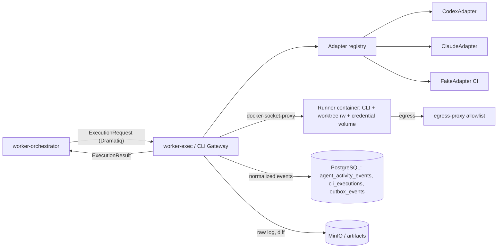
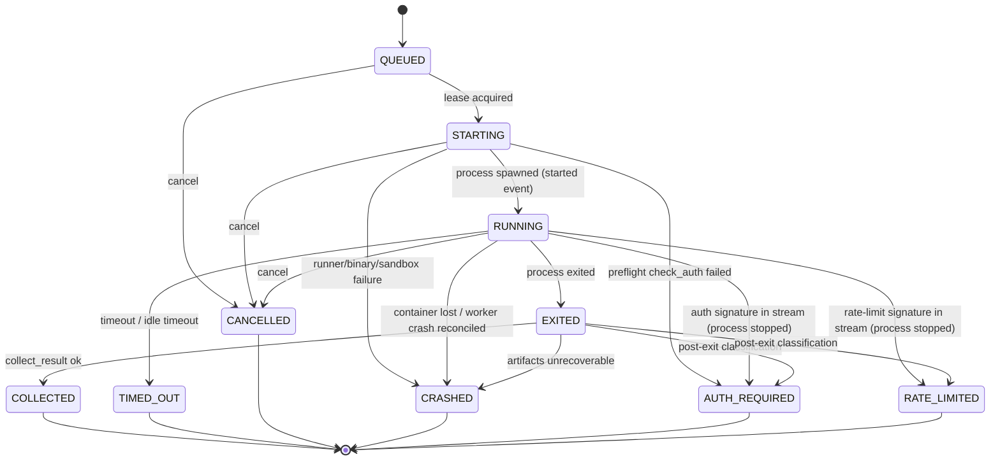

# CLI Execution Contract v1.0

**Статус:** Phase 0, проект на утверждение. Ничего из описанного не реализовано.
**Требования:** ТЗ §2 п.3, §6 (Execution FSM), §7.2 (`cli_installations`, `cli_sessions`, `cli_executions`, `usage_metrics`, `provider_health`), §9, §15, §16, §19 AC-07/AC-11/AC-16, §20.
**Решения:** ADR-0003 (только официальные Codex CLI и Claude Code CLI, авторизация собственным login CLI, runtime probe), ADR-0006, ADR-0010 (runner-контейнеры, egress proxy, docker-socket-proxy), ADR-0012 (side-effect ledger), ADR-0013 (контракты в `docs/` → `packages/contracts/`).
**Версия контракта:** `contract_version: "1.0"`. Машиночитаемые файлы Phase 1: `packages/contracts/cli-execution-request.schema.json`, `cli-execution-result.schema.json`, `cli-probe-result.schema.json`, `cli-normalized-event.schema.json` (ТЗ §21).

---

## 1. Назначение и границы

CLI Gateway (процесс `worker-exec`) — единственный компонент платформы, который запускает процессы официальных CLI. Он:

1. принимает от Orchestrator типизированный `ExecutionRequest` (через очередь Dramatiq, at-least-once; идемпотентность по `execution_id`);
2. выбирает адаптер (`codex` или `claude`) — реализацию протокола `CLIExecutor`;
3. строит argv **только** из allowlisted `command_profile` (раздел 8), запускает процесс внутри эфемерного runner-контейнера (ADR-0010);
4. нормализует поток вывода в события `started`/`output`/`tool_event`/`artifact`/`warning`/`finished`;
5. нормализует ошибки в `cli_error_code`;
6. сохраняет raw log как защищённый artifact, формирует `ExecutionResult`.

Что CLI Gateway **не делает**:

- не выполняет авторизацию CLI, не читает/не копирует/не логирует токены и cookies (раздел 7);
- не решает, повторять ли попытку: retry, failover и блокировку выбирает Orchestrator по таблице раздела 6 (адаптер исполняет запрос ровно один раз);
- не объявляет результат проверенным: `verification.status` в результате всегда `pending` (ТЗ §9.3, AC-11); проверку выполняет Verification Engine ([QUALITY_GATES.md](../agents/QUALITY_GATES.md));
- не предоставляет агенту unrestricted shell, сеть, секреты или production credentials (ТЗ §9);
- не обращается к AI API и не использует API keys (ADR-0003).

> **Внешние CLI меняются.** Контракт фиксирует нормативный интерфейс платформы, а не флаги внешних CLI. Конкретные подкоманды, флаги, форматы машинного вывода и признаки ошибок определяются runtime-probe для установленной версии и закрепляются в compatibility matrix (раздел 5) в Phase 2 (задачи P2). Все упоминания флагов ниже помечены как **кандидаты** и требуют проверки probe.



## 2. Протокол `CLIExecutor`

Нормативный интерфейс (расширение ТЗ §9.1 типизированными моделями Pydantic v2; `dict` из ТЗ заменён моделями, сериализуемыми в JSON строго по схемам раздела 3–4).

```python
from __future__ import annotations
from collections.abc import AsyncIterator
from datetime import datetime
from typing import Literal, Protocol
from uuid import UUID
from pydantic import BaseModel

CliProvider = Literal["codex", "claude"]
AuthStatus = Literal["UNKNOWN", "AUTHENTICATED", "AUTH_REQUIRED", "EXPIRED", "ERROR"]
CliErrorCode = Literal[
    "CLI_NOT_INSTALLED",
    "AUTH_REQUIRED",
    "RATE_LIMITED",
    "TIMEOUT",
    "SANDBOX_DENIED",
    "PROCESS_FAILED",
    "OUTPUT_PARSE_ERROR",
    "UNSUPPORTED_VERSION",
    "CANCELLED",
]
ExecutionStatus = Literal[
    "QUEUED",
    "STARTING",
    "RUNNING",
    "EXITED",
    "COLLECTED",
    "TIMED_OUT",
    "CANCELLED",
    "CRASHED",
    "AUTH_REQUIRED",
    "RATE_LIMITED",
]


class ProbeResult(BaseModel): ...  # схема §4.1


class AuthCheckResult(BaseModel): ...  # схема §4.2


class ExecutionRequest(BaseModel): ...  # схема §3.1


class ExecutionHandle(BaseModel):
    execution_id: UUID
    status: ExecutionStatus  # QUEUED | STARTING | RUNNING на момент возврата
    runner_ref: str  # opaque id runner-контейнера (не PID хоста)
    started_at: datetime | None


class NormalizedEvent(BaseModel): ...  # схема §4.3


class ExecutionResult(BaseModel): ...  # схема §3.2


class CLIExecutor(Protocol):
    provider: CliProvider
    adapter_version: str  # SemVer реализации адаптера

    async def probe(self, *, installation_id: UUID) -> ProbeResult:
        """Определяет бинарь, версию, capabilities, совместимость. Не меняет состояние CLI,
        не выполняет login, не обращается к модели (никаких «тестовых промптов»)."""

    async def check_auth(self, *, installation_id: UUID) -> AuthCheckResult:
        """Только чтение статуса авторизации официальным способом CLI (кандидат: штатная
        status-команда, если её подтвердит probe). Токены не читаются и не возвращаются."""

    async def execute(self, request: ExecutionRequest) -> ExecutionHandle:
        """Идемпотентно по request.execution_id: повторный вызов для существующего
        execution возвращает текущий handle и НЕ запускает второй процесс."""

    def stream_events(self, execution_id: UUID, *, after_seq: int = 0) -> AsyncIterator[NormalizedEvent]:
        """Нормализованные события по возрастанию seq; поддерживает переподключение (after_seq)."""

    async def cancel(
        self,
        execution_id: UUID,
        *,
        reason: Literal["user", "run_cancel", "directive", "pause", "lease_lost", "timeout"],
    ) -> None:
        """SIGTERM группе процессов → grace → SIGKILL → остановка runner-контейнера. Идемпотентно."""

    async def collect_result(self, execution_id: UUID) -> ExecutionResult:
        """Доступно в любом терминальном состоянии; идемпотентно (повтор возвращает тот же результат
        по content hash артефактов). Переводит EXITED → COLLECTED."""
```

Правила реализации:

| Правило | Содержание |
|---|---|
| Идемпотентность | `execution_id` = PK `cli_executions.id`; повторная доставка задания из Dramatiq проверяет строку и lease (`worker_leases`, `resource_type='cli_execution'`, fencing token). Второй процесс для того же `execution_id` не запускается никогда. |
| Fencing | Каждая запись состояния `cli_executions` выполняется условно `WHERE fencing_token = :token`; воркер, потерявший lease, обязан вызвать `cancel(reason="lease_lost")`. |
| Отсутствие shell | `asyncio.create_subprocess_exec` внутри runner (или Docker exec API с массивом argv), `shell=True` запрещён статической проверкой (Semgrep-правило в CI, P1). |
| Без побочных эффектов вне worktree | Адаптер не выполняет git push / PR / merge — это защищённые действия Orchestrator через `external_actions` (ADR-0012). |
| Ошибка = данные | Исключения адаптера не «пробиваются» в Orchestrator: любой сбой отражается в `ExecutionResult.error` (раздел 6). |

## 3. Схемы запроса и результата

### 3.1 `ExecutionRequest`

Поля ТЗ §9.2 сохранены без изменений; аддитивные поля помечены «доп.» и необязательны, кроме `run_id`, `task_attempt_id`, `workspace_id`, `command_profile` (обязательны для трассировки и tenant isolation — ТЗ §7.1, §16). Пример из ТЗ использует условные строки (`wt-104`, `a1b2c3d4`, `SPEC-018`); в production `worktree_id` — UUID записи `worktrees`, `base_commit` — полный SHA, `context_refs` — типизированные ссылки (ТЗ §10: «UUID в production вместо условных строк»).

```json
{
  "$schema": "https://json-schema.org/draft/2020-12/schema",
  "$id": "https://aicodingdev.local/contracts/cli/1.0/execution-request.schema.json",
  "title": "ExecutionRequest",
  "type": "object",
  "additionalProperties": false,
  "required": ["contract_version", "execution_id", "task_id", "provider", "agent_role", "workspace", "input", "limits", "permissions", "run_id", "task_attempt_id", "workspace_id", "command_profile"],
  "properties": {
    "contract_version": {"const": "1.0"},
    "execution_id": {"type": "string", "format": "uuid"},
    "task_id": {"type": "string", "format": "uuid"},
    "provider": {"enum": ["codex", "claude"]},
    "agent_role": {"enum": ["requirements", "architect", "planner", "developer", "reviewer", "security", "qa", "database", "performance", "devops", "maintenance", "documentation"]},
    "workspace": {
      "type": "object",
      "additionalProperties": false,
      "required": ["worktree_id", "base_commit"],
      "properties": {
        "worktree_id": {"type": "string", "format": "uuid", "description": "worktrees.id"},
        "base_commit": {"type": "string", "pattern": "^[0-9a-f]{40}([0-9a-f]{24})?$", "description": "Полный SHA-1 или SHA-256"},
        "branch_name": {"type": "string", "maxLength": 255, "description": "доп."}
      }
    },
    "input": {
      "type": "object",
      "additionalProperties": false,
      "required": ["objective", "context_refs", "acceptance_criteria"],
      "properties": {
        "objective": {"type": "string", "minLength": 1, "maxLength": 8000},
        "context_refs": {
          "type": "array",
          "maxItems": 200,
          "items": {"type": "string", "pattern": "^(artifact|context_pack|adr|knowledge|requirement|message|finding|evidence|task|decision):[0-9a-f-]{36}$"}
        },
        "acceptance_criteria": {"type": "array", "maxItems": 100, "items": {"type": "string", "minLength": 1, "maxLength": 2000}},
        "context_pack": {
          "type": "object",
          "description": "доп. Ссылка на собранный Context Pack (context_packs)",
          "additionalProperties": false,
          "required": ["context_pack_id", "artifact_ref", "sha256"],
          "properties": {
            "context_pack_id": {"type": "string", "format": "uuid"},
            "artifact_ref": {"type": "string", "pattern": "^artifact:[0-9a-f-]{36}$"},
            "sha256": {"type": "string", "pattern": "^[0-9a-f]{64}$"}
          }
        },
        "instruction_template_version": {"type": "string", "pattern": "^[a-z_]+@[0-9]+\\.[0-9]+\\.[0-9]+$", "description": "доп. например developer@1.2.0"}
      }
    },
    "limits": {
      "type": "object",
      "additionalProperties": false,
      "required": ["timeout_seconds", "max_attempts"],
      "properties": {
        "timeout_seconds": {"type": "integer", "minimum": 30, "maximum": 14400},
        "max_attempts": {"type": "integer", "minimum": 1, "maximum": 10, "description": "Информативно: адаптер исполняет запрос один раз; повторы решает Orchestrator"},
        "idle_timeout_seconds": {"type": "integer", "minimum": 30, "maximum": 3600, "description": "доп. нет вывода/heartbeat дольше → TIMEOUT"},
        "max_output_bytes": {"type": "integer", "minimum": 65536, "maximum": 268435456, "description": "доп. лимит raw log"},
        "cpu_limit": {"type": "number", "minimum": 0.25, "maximum": 16, "description": "доп."},
        "memory_limit_mb": {"type": "integer", "minimum": 256, "maximum": 65536, "description": "доп."}
      }
    },
    "permissions": {
      "type": "object",
      "additionalProperties": false,
      "required": ["network", "write_scope", "production_access"],
      "properties": {
        "network": {"enum": ["none", "restricted", "unrestricted"], "description": "restricted = только allowlist egress-proxy (endpoints провайдера); unrestricted требует approval UNRESTRICTED_NETWORK"},
        "write_scope": {"enum": ["none", "worktree"], "description": "none = worktree монтируется read-only (reviewer, security, qa-анализ)"},
        "production_access": {"const": false},
        "approval_refs": {"type": "array", "items": {"type": "string", "format": "uuid"}, "description": "доп. approvals.id, разрешающие расширение прав"}
      },
      "allOf": [
        {"if": {"properties": {"network": {"const": "unrestricted"}}}, "then": {"required": ["approval_refs"], "properties": {"approval_refs": {"minItems": 1}}}}
      ]
    },
    "run_id": {"type": "string", "format": "uuid"},
    "task_attempt_id": {"type": "string", "format": "uuid"},
    "workspace_id": {"type": "string", "format": "uuid"},
    "correlation_id": {"type": "string", "format": "uuid", "description": "доп. ACP correlation"},
    "command_profile": {"type": "string", "pattern": "^[a-z0-9_]+/[a-z0-9_.-]+@[0-9]+$", "description": "Ключ allowlisted профиля, например codex/agent_task@1"},
    "installation_id": {"type": "string", "format": "uuid", "description": "доп. выбранная Router установка cli_installations.id"},
    "session_ref_hint": {"type": "string", "maxLength": 200, "description": "доп. только если probe подтвердил resume_session и policy разрешает"}
  }
}
```

Нормативный пример (production-форма примера ТЗ §9.2):

```json
{
  "contract_version": "1.0",
  "execution_id": "0193a6f2-6c1e-7d2a-9b11-3f0e5c2d1a01",
  "task_id": "0193a6f2-6c1e-7d2a-9b11-3f0e5c2d1a02",
  "run_id": "0193a6f2-6c1e-7d2a-9b11-3f0e5c2d1a03",
  "task_attempt_id": "0193a6f2-6c1e-7d2a-9b11-3f0e5c2d1a04",
  "workspace_id": "0193a6f2-6c1e-7d2a-9b11-3f0e5c2d1a05",
  "provider": "codex",
  "agent_role": "developer",
  "command_profile": "codex/agent_task@1",
  "workspace": {"worktree_id": "0193a6f2-6c1e-7d2a-9b11-3f0e5c2d1a06", "base_commit": "a1b2c3d4e5f60718293a4b5c6d7e8f9012345678"},
  "input": {
    "objective": "Implement authentication",
    "context_refs": ["requirement:0193a6f2-6c1e-7d2a-9b11-3f0e5c2d1a07", "adr:0193a6f2-6c1e-7d2a-9b11-3f0e5c2d1a08"],
    "acceptance_criteria": ["Invalid credentials rejected", "Tests pass"]
  },
  "limits": {"timeout_seconds": 1800, "max_attempts": 2},
  "permissions": {"network": "restricted", "write_scope": "worktree", "production_access": false}
}
```

### 3.2 `ExecutionResult`

Поля ТЗ §9.3 сохранены. Решения:

- `status` (как в ТЗ, нижний регистр) — **итог исполнения процесса**, не проверки: `completed` (процесс завершился с кодом 0, вывод разобран, артефакты сохранены), `failed`, `cancelled`.
- `execution_status` (доп.) — терминальное состояние Execution FSM (раздел 9).
- `verification.status` — всегда `pending` (`const`): адаптер не может заявить проверку (ТЗ §9.3 «`exit_code=0` не равен `verified`»).
- `usage.tokens` — число только если CLI его реально сообщил (`source: cli_reported`), иначе `null` + `not_exposed_by_cli`; UI отображает «unknown».
- `claims` — утверждения агента; это не evidence. Каждое утверждение проверяется гейтами.

```json
{
  "$schema": "https://json-schema.org/draft/2020-12/schema",
  "$id": "https://aicodingdev.local/contracts/cli/1.0/execution-result.schema.json",
  "title": "ExecutionResult",
  "type": "object",
  "additionalProperties": false,
  "required": ["contract_version", "execution_id", "provider", "status", "exit_code", "artifacts", "claims", "verification", "usage", "execution_status", "started_at", "finished_at"],
  "properties": {
    "contract_version": {"const": "1.0"},
    "execution_id": {"type": "string", "format": "uuid"},
    "provider": {"enum": ["codex", "claude"]},
    "status": {"enum": ["completed", "failed", "cancelled"]},
    "execution_status": {"enum": ["COLLECTED", "TIMED_OUT", "CANCELLED", "CRASHED", "AUTH_REQUIRED", "RATE_LIMITED"]},
    "exit_code": {"type": ["integer", "null"], "description": "null если процесс не стартовал или убит сигналом"},
    "signal": {"type": ["string", "null"], "enum": ["SIGTERM", "SIGKILL", null]},
    "artifacts": {
      "type": "array",
      "maxItems": 100,
      "items": {
        "type": "object",
        "additionalProperties": false,
        "required": ["type", "ref", "sha256", "size_bytes"],
        "properties": {
          "type": {"enum": ["git_diff", "raw_log", "output_excerpt", "structured_output", "file_snapshot", "test_report", "plan", "review_report", "other"]},
          "ref": {"type": "string", "pattern": "^artifact:[0-9a-f-]{36}$"},
          "sha256": {"type": "string", "pattern": "^[0-9a-f]{64}$"},
          "size_bytes": {"type": "integer", "minimum": 0},
          "protected": {"type": "boolean", "description": "true для raw_log: доступ только admin/owner, не отдаётся в чат"}
        }
      }
    },
    "claims": {
      "type": "array",
      "maxItems": 50,
      "items": {
        "type": "object",
        "additionalProperties": false,
        "required": ["type", "evidence_refs"],
        "properties": {
          "type": {"enum": ["implementation_completed", "tests_added", "tests_passed", "review_completed", "analysis_completed", "documentation_updated", "migration_prepared", "no_changes_needed", "other"]},
          "summary": {"type": "string", "maxLength": 2000},
          "evidence_refs": {"type": "array", "items": {"type": "string", "pattern": "^artifact:[0-9a-f-]{36}$"}}
        }
      }
    },
    "verification": {
      "type": "object",
      "additionalProperties": false,
      "required": ["status"],
      "properties": {"status": {"const": "pending"}}
    },
    "usage": {
      "type": "object",
      "additionalProperties": false,
      "required": ["tokens", "source"],
      "properties": {
        "tokens": {"type": ["integer", "null"], "minimum": 0},
        "input_tokens": {"type": ["integer", "null"], "minimum": 0},
        "output_tokens": {"type": ["integer", "null"], "minimum": 0},
        "source": {"enum": ["cli_reported", "not_exposed_by_cli"]},
        "quota_remaining": {"type": ["string", "null"], "maxLength": 200, "description": "только если CLI сообщает; иначе null (UI: unknown)"}
      },
      "allOf": [
        {"if": {"properties": {"source": {"const": "not_exposed_by_cli"}}}, "then": {"properties": {"tokens": {"const": null}, "input_tokens": {"const": null}, "output_tokens": {"const": null}}}}
      ]
    },
    "error": {
      "type": "object",
      "additionalProperties": false,
      "required": ["code", "message", "retryable"],
      "properties": {
        "code": {"enum": ["CLI_NOT_INSTALLED", "AUTH_REQUIRED", "RATE_LIMITED", "TIMEOUT", "SANDBOX_DENIED", "PROCESS_FAILED", "OUTPUT_PARSE_ERROR", "UNSUPPORTED_VERSION", "CANCELLED"]},
        "message": {"type": "string", "maxLength": 2000, "description": "санитизированный текст"},
        "retryable": {"type": "boolean"},
        "retry_after_seconds": {"type": ["integer", "null"], "minimum": 0},
        "detection_signal": {"type": "string", "maxLength": 200}
      }
    },
    "cli_version": {"type": "string", "maxLength": 100},
    "adapter_version": {"type": "string", "maxLength": 50},
    "command_profile": {"type": "string"},
    "started_at": {"type": ["string", "null"], "format": "date-time"},
    "finished_at": {"type": "string", "format": "date-time"},
    "duration_ms": {"type": "integer", "minimum": 0},
    "session_ref": {"type": ["string", "null"], "maxLength": 200},
    "events_count": {"type": "integer", "minimum": 0},
    "truncated": {"type": "boolean", "description": "raw log обрезан по max_output_bytes"}
  },
  "allOf": [
    {"if": {"properties": {"status": {"const": "completed"}}},
     "then": {"properties": {"exit_code": {"const": 0}, "execution_status": {"const": "COLLECTED"}}, "not": {"required": ["error"]}}},
    {"if": {"properties": {"status": {"const": "failed"}}}, "then": {"required": ["error"]}},
    {"if": {"properties": {"status": {"const": "cancelled"}}},
     "then": {"required": ["error"], "properties": {"execution_status": {"const": "CANCELLED"}, "error": {"properties": {"code": {"const": "CANCELLED"}}}}}}
  ]
}
```

Пример (production-форма ТЗ §9.3):

```json
{
  "contract_version": "1.0",
  "execution_id": "0193a6f2-6c1e-7d2a-9b11-3f0e5c2d1a01",
  "provider": "codex",
  "status": "completed",
  "execution_status": "COLLECTED",
  "exit_code": 0,
  "artifacts": [{"type": "git_diff", "ref": "artifact:0193a6f2-6c1e-7d2a-9b11-3f0e5c2d1b00", "sha256": "4f9c0b6d8e1a2b3c4d5e6f708192a3b4c5d6e7f8091a2b3c4d5e6f708192a3b4", "size_bytes": 18234}],
  "claims": [{"type": "implementation_completed", "evidence_refs": ["artifact:0193a6f2-6c1e-7d2a-9b11-3f0e5c2d1b00"]}],
  "verification": {"status": "pending"},
  "usage": {"tokens": null, "source": "not_exposed_by_cli"},
  "started_at": "2026-11-08T09:00:00Z",
  "finished_at": "2026-11-08T09:12:41Z"
}
```

`ExecutionResult` сохраняется в `cli_executions` (status, exit_code, failure_category, output_artifact_id) и порождает outbox-событие `cli_execution.finished` ([EVENT_SCHEMAS.md](EVENT_SCHEMAS.md)). Числовые usage-метрики пишутся в `usage_metrics` только при `source = cli_reported` (`source` колонки = `cli_reported`).

## 4. Probe, auth check и нормализованные события

### 4.1 `ProbeResult`

```json
{
  "$schema": "https://json-schema.org/draft/2020-12/schema",
  "$id": "https://aicodingdev.local/contracts/cli/1.0/probe-result.schema.json",
  "title": "ProbeResult",
  "type": "object",
  "additionalProperties": false,
  "required": ["contract_version", "provider", "installation_id", "installed", "checked_at", "compatibility", "capabilities", "adapter_version"],
  "properties": {
    "contract_version": {"const": "1.0"},
    "provider": {"enum": ["codex", "claude"]},
    "installation_id": {"type": "string", "format": "uuid"},
    "host_id": {"type": "string", "format": "uuid", "description": "worker_hosts.id"},
    "installed": {"type": "boolean"},
    "binary_path": {"type": ["string", "null"], "maxLength": 1024},
    "binary_sha256": {"type": ["string", "null"], "pattern": "^[0-9a-f]{64}$"},
    "detected_version": {"type": ["string", "null"], "maxLength": 100, "description": "нормализованный SemVer, если извлекается"},
    "version_raw": {"type": ["string", "null"], "maxLength": 500, "description": "санитизированная строка версии"},
    "compatibility": {"enum": ["SUPPORTED", "UNTESTED", "UNSUPPORTED"]},
    "compatibility_matrix_entry": {"type": ["string", "null"], "description": "id строки матрицы (раздел 5.3)"},
    "capabilities": {
      "type": "object",
      "additionalProperties": false,
      "required": ["noninteractive_mode", "machine_readable_output", "sandbox_modes", "resume_session", "token_usage_exposed", "auth_status_command", "cancel_signal_safe"],
      "properties": {
        "noninteractive_mode": {"type": "boolean"},
        "machine_readable_output": {"enum": ["none", "json", "jsonl_stream"]},
        "sandbox_modes": {"type": "array", "items": {"enum": ["read_only", "workspace_write", "cli_managed_none"]}, "uniqueItems": true},
        "resume_session": {"type": "boolean"},
        "token_usage_exposed": {"type": "boolean"},
        "auth_status_command": {"type": "boolean"},
        "cancel_signal_safe": {"type": "boolean", "description": "корректно завершается по SIGTERM"},
        "tool_events_exposed": {"type": "boolean"},
        "model_selection": {"type": "boolean"},
        "max_prompt_bytes": {"type": ["integer", "null"], "minimum": 0}
      }
    },
    "auth_status": {"enum": ["UNKNOWN", "AUTHENTICATED", "AUTH_REQUIRED", "EXPIRED", "ERROR"]},
    "adapter_version": {"type": "string"},
    "checked_at": {"type": "string", "format": "date-time"},
    "duration_ms": {"type": "integer", "minimum": 0},
    "errors": {
      "type": "array",
      "items": {
        "type": "object",
        "additionalProperties": false,
        "required": ["code", "message"],
        "properties": {
          "code": {"enum": ["CLI_NOT_INSTALLED", "UNSUPPORTED_VERSION", "PROCESS_FAILED", "OUTPUT_PARSE_ERROR", "TIMEOUT", "SANDBOX_DENIED"]},
          "message": {"type": "string", "maxLength": 1000}
        }
      }
    }
  },
  "allOf": [
    {"if": {"properties": {"installed": {"const": false}}}, "then": {"properties": {"compatibility": {"const": "UNSUPPORTED"}}}}
  ]
}
```

### 4.2 `AuthCheckResult`

```json
{
  "$schema": "https://json-schema.org/draft/2020-12/schema",
  "$id": "https://aicodingdev.local/contracts/cli/1.0/auth-check-result.schema.json",
  "title": "AuthCheckResult",
  "type": "object",
  "additionalProperties": false,
  "required": ["contract_version", "provider", "installation_id", "auth_status", "checked_at", "method"],
  "properties": {
    "contract_version": {"const": "1.0"},
    "provider": {"enum": ["codex", "claude"]},
    "installation_id": {"type": "string", "format": "uuid"},
    "auth_status": {"enum": ["UNKNOWN", "AUTHENTICATED", "AUTH_REQUIRED", "EXPIRED", "ERROR"]},
    "method": {"enum": ["cli_status_command", "credential_presence_check", "last_execution_signal", "not_determinable"]},
    "account_hint": {"type": ["string", "null"], "maxLength": 100, "description": "только неидентифицирующий тип плана, если CLI его сам печатает; никаких email/токенов"},
    "operator_action": {"type": ["string", "null"], "maxLength": 500, "description": "инструкция оператору: выполнить официальный login CLI на хосте"},
    "checked_at": {"type": "string", "format": "date-time"}
  }
}
```

`credential_presence_check` означает только проверку **наличия** файла/каталога в credential volume по ожидаемому пути (stat, без чтения содержимого) и используется, лишь если у CLI нет status-команды; результат такой проверки не может быть `AUTHENTICATED` с уверенностью выше `UNKNOWN`, пока его не подтвердит успешное исполнение (`last_execution_signal`).

### 4.3 Нормализованные события (`normalized_cli_event`)

Конверт события и payload по типу. `seq` монотонен в рамках `execution_id` (начиная с 1). События сохраняются в `agent_activity_events` (`event_type = 'cli.' || type`), `output` — только санитизированные выдержки; в SSE проецируются как `cli.output` ([EVENT_SCHEMAS.md](EVENT_SCHEMAS.md)).

```json
{
  "$schema": "https://json-schema.org/draft/2020-12/schema",
  "$id": "https://aicodingdev.local/contracts/cli/1.0/normalized-event.schema.json",
  "title": "NormalizedCliEvent",
  "type": "object",
  "additionalProperties": false,
  "required": ["contract_version", "execution_id", "seq", "type", "timestamp", "payload"],
  "properties": {
    "contract_version": {"const": "1.0"},
    "execution_id": {"type": "string", "format": "uuid"},
    "seq": {"type": "integer", "minimum": 1},
    "type": {"enum": ["started", "output", "tool_event", "artifact", "warning", "finished"]},
    "timestamp": {"type": "string", "format": "date-time"},
    "payload": {"type": "object"}
  },
  "allOf": [
    {"if": {"properties": {"type": {"const": "started"}}}, "then": {"properties": {"payload": {"$ref": "#/$defs/started"}}}},
    {"if": {"properties": {"type": {"const": "output"}}}, "then": {"properties": {"payload": {"$ref": "#/$defs/output"}}}},
    {"if": {"properties": {"type": {"const": "tool_event"}}}, "then": {"properties": {"payload": {"$ref": "#/$defs/tool_event"}}}},
    {"if": {"properties": {"type": {"const": "artifact"}}}, "then": {"properties": {"payload": {"$ref": "#/$defs/artifact"}}}},
    {"if": {"properties": {"type": {"const": "warning"}}}, "then": {"properties": {"payload": {"$ref": "#/$defs/warning"}}}},
    {"if": {"properties": {"type": {"const": "finished"}}}, "then": {"properties": {"payload": {"$ref": "#/$defs/finished"}}}}
  ],
  "$defs": {
    "started": {
      "type": "object", "additionalProperties": false,
      "required": ["provider", "cli_version", "command_profile", "runner_ref"],
      "properties": {
        "provider": {"enum": ["codex", "claude"]},
        "cli_version": {"type": "string"},
        "command_profile": {"type": "string"},
        "runner_ref": {"type": "string"},
        "session_ref": {"type": ["string", "null"]}
      }
    },
    "output": {
      "type": "object", "additionalProperties": false,
      "required": ["stream", "text", "redactions", "truncated"],
      "properties": {
        "stream": {"enum": ["stdout", "stderr", "agent_message"]},
        "text": {"type": "string", "maxLength": 4096, "description": "санитизированная выдержка"},
        "redactions": {"type": "integer", "minimum": 0},
        "truncated": {"type": "boolean"}
      }
    },
    "tool_event": {
      "type": "object", "additionalProperties": false,
      "required": ["tool_kind", "phase"],
      "properties": {
        "tool_kind": {"enum": ["file_read", "file_write", "file_patch", "command", "search", "network", "other"]},
        "phase": {"enum": ["requested", "started", "completed", "denied", "failed"]},
        "target": {"type": "string", "maxLength": 1024, "description": "путь относительно worktree или имя команды; санитизировано"},
        "summary": {"type": "string", "maxLength": 1000}
      }
    },
    "artifact": {
      "type": "object", "additionalProperties": false,
      "required": ["artifact_type", "ref", "sha256", "size_bytes"],
      "properties": {
        "artifact_type": {"enum": ["git_diff", "raw_log", "output_excerpt", "structured_output", "file_snapshot", "test_report", "plan", "review_report", "other"]},
        "ref": {"type": "string", "pattern": "^artifact:[0-9a-f-]{36}$"},
        "sha256": {"type": "string", "pattern": "^[0-9a-f]{64}$"},
        "size_bytes": {"type": "integer", "minimum": 0}
      }
    },
    "warning": {
      "type": "object", "additionalProperties": false,
      "required": ["code", "message"],
      "properties": {
        "code": {"enum": ["OUTPUT_TRUNCATED", "SECRET_REDACTED", "UNPARSED_LINE", "SANDBOX_VIOLATION_ATTEMPT", "RATE_LIMIT_HINT", "AUTH_HINT", "IDLE", "UNTESTED_CLI_VERSION", "OTHER"]},
        "message": {"type": "string", "maxLength": 1000}
      }
    },
    "finished": {
      "type": "object", "additionalProperties": false,
      "required": ["execution_status", "exit_code"],
      "properties": {
        "execution_status": {"enum": ["EXITED", "TIMED_OUT", "CANCELLED", "CRASHED", "AUTH_REQUIRED", "RATE_LIMITED"]},
        "exit_code": {"type": ["integer", "null"]},
        "error_code": {"enum": ["CLI_NOT_INSTALLED", "AUTH_REQUIRED", "RATE_LIMITED", "TIMEOUT", "SANDBOX_DENIED", "PROCESS_FAILED", "OUTPUT_PARSE_ERROR", "UNSUPPORTED_VERSION", "CANCELLED", null]}
      }
    }
  }
}
```

Правила потока событий:

1. Ровно один `started` (первое событие) и ровно один `finished` (последнее) на execution; если процесс не стартовал, gateway синтезирует оба с `execution_status: CRASHED`.
2. Скрытые рассуждения не извлекаются (ТЗ §2 п.8): если CLI отдаёт блоки, помеченные им как «reasoning/thinking», адаптер их **не** публикует в `output` (только счётчик в warning `OTHER` не требуется — блоки просто отбрасываются). Публикуются только официальные сообщения, вызовы инструментов и артефакты.
3. Неразобранная строка машинного вывода → `warning UNPARSED_LINE` (не более 20 на execution, далее агрегируется); доля > 20% строк → `OUTPUT_PARSE_ERROR` при сборке результата.

## 5. Runtime probe и feature detection

### 5.1 Когда выполняется probe

| Триггер | Что делается |
|---|---|
| Старт `worker-exec` на хосте | `probe` + `check_auth` для каждой установки `cli_installations` хоста; обновление `provider_health` |
| `POST /providers/{provider_id}/probe` (admin) | внеочередной probe |
| Периодически (по умолчанию 15 мин) | `check_auth` (лёгкий); `probe` — раз в 6 ч или при изменении `binary_sha256` |
| Перед `execute`, если последний probe старше 15 мин или изменился бинарь | быстрый re-probe версии |
| После `AUTH_REQUIRED`/`UNSUPPORTED_VERSION` в исполнении | внеочередной probe/check_auth |

Probe выполняется в runner-контейнере того же образа, что и исполнения, без доступа к worktree, с `network: none`, за исключением check_auth, если официальная status-команда CLI требует сети (тогда — через egress-proxy allowlist).

### 5.2 Алгоритм probe

1. **Обнаружение бинаря**: путь задаётся конфигурацией хоста (`cli_installations.binary_path`), поиск по `PATH` запрещён в production (защита от подмены). Нет файла → `installed=false`, `CLI_NOT_INSTALLED`.
2. **Целостность**: `binary_sha256`; изменение хеша → новая строка матрицы `UNTESTED` до прогона smoke-набора (раздел 13).
3. **Версия**: запуск официального флага версии (кандидат: `--version`; подтверждается в Phase 2), timeout 10 с, парсинг SemVer регулярным выражением адаптера; сохраняется `version_raw`.
4. **Help-сканирование**: запуск официальной справки (кандидат: `--help` и help подкоманд), поиск маркеров capabilities, перечисленных в профиле адаптера для данной версии. Маркер найден ≠ capability подтверждена: подтверждение — только строка матрицы (5.3) со статусом `SUPPORTED`.
5. **Сопоставление с compatibility matrix** → `compatibility`.
6. **check_auth** (раздел 7).

Кандидаты неинтерактивных режимов (подлежат проверке probe в Phase 2, **не являются утверждёнными фактами**): для Codex CLI — подкоманда `exec` с машиночитаемым (JSON/JSONL) выводом; для Claude Code CLI — print-режим (`-p`) с JSON/stream-JSON форматом вывода. Опции sandbox/approval-режимов CLI, если существуют, используются только как дополнительный слой поверх runner-sandbox (ADR-0010), но никогда не заменяют его.

### 5.3 Compatibility matrix

Хранится как версионируемый файл `packages/contracts/cli-compatibility.yaml` (Phase 2) и импортируется в `cli_installations.capabilities` при probe. Формат строки:

```json
{
  "id": "codex-0.x-2026-11",
  "provider": "codex",
  "version_range": ">=0.50.0,<0.60.0",
  "adapter_version": "1.0.0",
  "status": "SUPPORTED",
  "verified_at": "2026-11-20T00:00:00Z",
  "verified_by_suite": "real-cli-smoke@1",
  "evidence_ref": "artifact:0193a6f2-6c1e-7d2a-9b11-3f0e5c2d1c00",
  "capabilities": {
    "noninteractive_mode": true,
    "machine_readable_output": "jsonl_stream",
    "sandbox_modes": ["read_only", "workspace_write"],
    "resume_session": false,
    "token_usage_exposed": false,
    "auth_status_command": true,
    "cancel_signal_safe": true,
    "tool_events_exposed": true,
    "model_selection": false,
    "max_prompt_bytes": null
  },
  "command_profiles": ["codex/agent_task@1", "codex/review_readonly@1"],
  "error_signatures_ref": "codex/error-signatures@1",
  "notes": "Пример формата; значения будут установлены probe и smoke-набором в Phase 2"
}
```

Статусы матрицы: `SUPPORTED` (smoke-набор пройден, evidence сохранён), `UNTESTED` (версия вне известных диапазонов; исполнение допускается только если policy `allow_untested_cli_versions=true`, по умолчанию `false` для профиля `critical` и `true` с warning `UNTESTED_CLI_VERSION` для `basic`/`strict`), `UNSUPPORTED` (известная несовместимость или отсутствует `noninteractive_mode`/`machine_readable_output` — исполнение запрещено).

### 5.4 `UNSUPPORTED_VERSION`

Возникает, если: версия попадает в диапазон `UNSUPPORTED`; нет `noninteractive_mode`; нет поддержки `command_profile`, требуемого ролью (например, read-only режим для reviewer при `write_scope: none` — компенсируется read-only монтированием, поэтому критичен только неинтерактивный режим); парсинг версии невозможен и policy запрещает `UNTESTED`. Эффект: `provider_health.availability = UNAVAILABLE`, `error_category = UNSUPPORTED_VERSION`, Router исключает установку (hard filter). Оператор видит в CLI Providers причину и диапазоны поддерживаемых версий.

## 6. Нормализация ошибок

Сигналы распознаются **сигнатурами**, хранимыми в версионируемом файле `error_signatures` адаптера (регулярные выражения по санитизированному stderr/структурированным полям, коды выхода, состояние контейнера). Сигнатуры подтверждаются в Phase 2 на реальных CLI; приоритет классификации — в порядке таблицы сверху вниз (первое совпадение).

| `cli_error_code` | Сигналы обнаружения | retryable | Эффект для задачи (решает Orchestrator) | `execution_status` |
|---|---|---|---|---|
| `CANCELLED` | вызван `cancel()` (пользователь, run cancel, directive, pause, lease_lost) | нет | run cancel → task `CANCELLED`; pause → task `BLOCKED` (`RUN_PAUSED`), повтор после resume; directive → `BLOCKED` (`DIRECTIVE_REPLAN`); lease_lost → attempt `failure_category=LEASE_LOST`, task `RETRY_WAIT` | `CANCELLED` |
| `CLI_NOT_INSTALLED` | бинарь отсутствует / не исполняемый / `ENOENT` при старте; probe `installed=false` | нет (для установки) | attempt FAILED; Router исключает установку; при наличии другого допустимого провайдера — новая попытка, иначе task `BLOCKED` (`PROVIDER_UNAVAILABLE`) | `CRASHED` |
| `UNSUPPORTED_VERSION` | probe `compatibility=UNSUPPORTED`; ответ CLI «unknown option/command» для флага профиля | нет | как `CLI_NOT_INSTALLED` | `CRASHED` |
| `AUTH_REQUIRED` | `check_auth` ≠ `AUTHENTICATED` перед стартом; сигнатура «not logged in/login required/session expired» в выводе; характерный код выхода, подтверждённый матрицей | нет (автоматически) | task `BLOCKED` (`AUTH_REQUIRED`); `cli_installations.auth_status=AUTH_REQUIRED`/`EXPIRED`; approval не создаётся, в чат и Approvals stream — уведомление оператору «выполните официальный login на хосте». Failover на другой провайдер только при policy `failover_on_auth_required=true` (по умолчанию `false`) | `AUTH_REQUIRED` |
| `RATE_LIMITED` | сигнатура лимита/usage limit в выводе или структурированном событии CLI; явный retry-after в выводе | да, после cooldown | attempt не увеличивает счётчик `max_attempts`, но расходует `retry_budget_seconds`; task `RETRY_WAIT` с `next_attempt_at = now + cooldown` (раздел 6.1) либо reroute на другой допустимый провайдер; оба провайдера ограничены и бюджет исчерпан → `BLOCKED` (`PROVIDER_UNAVAILABLE`) | `RATE_LIMITED` |
| `TIMEOUT` | превышен `timeout_seconds` (wall clock) или `idle_timeout_seconds` (нет событий и вывода) | да | attempt FAILED (`TIMEOUT`), task `RETRY_WAIT` с экспоненциальной задержкой, после `max_attempts` → `FAILED` (AC-07) | `TIMED_OUT` |
| `SANDBOX_DENIED` | отказ создания runner (policy, seccomp, mount вне allowlist); egress-proxy отказал запросу и CLI завершился ошибкой; попытка записи в read-only путь, приведшая к ошибке | нет | attempt FAILED (`SANDBOX_DENIED`), task `FAILED`; audit event `sandbox.denied`; finding severity `medium` (или `high` при попытке доступа к credential/секретам) | `CRASHED` (до старта) / `CANCELLED` (принудительная остановка) / `COLLECTED` (CLI сам завершился с ошибкой) |
| `OUTPUT_PARSE_ERROR` | процесс завершился 0, но машиночитаемый вывод не разобран (невалидный JSON финального результата, >20% неразобранных строк, отсутствует финальное сообщение) | да (1 раз) | attempt FAILED; одна повторная попытка, далее task `FAILED`; raw log сохраняется для диагностики | `COLLECTED` |
| `PROCESS_FAILED` | ненулевой код выхода без других сигнатур; OOM-kill; аварийное завершение контейнера | да | attempt FAILED, task `RETRY_WAIT` → после `max_attempts` `FAILED`. Падение инфраструктуры runner (не процесс CLI) → `failure_category=WORKER_CRASH` | `COLLECTED` (код выхода получен) / `CRASHED` (контейнер потерян) |

Инварианты: (1) `status=completed` невозможен с `error`; (2) неклассифицированная ошибка → `PROCESS_FAILED` (никогда не «успех»); (3) `failure_category` в `task_attempts` и `cli_executions` = `cli_error_code` (подмножество `failure_category`); (4) все ошибки порождают `provider_health` наблюдение с `error_category`.

### 6.1 Rate limit и cooldown

Cooldown на установку: `min(base * 2^(n-1), max)` с jitter ±20%, `base = 60 c`, `max = 3600 c`, `n` — число подряд наблюдённых `RATE_LIMITED`; если CLI сообщил retry-after — используется `max(retry_after, расчёт)`. Во время cooldown `provider_health.availability = RATE_LIMITED`, Router исключает установку. Запрещено: смена аккаунтов, ротация логинов, параллельные «пробные» запуски для обхода лимита (ТЗ §1, §5). Подробности маршрутизации — [ROUTING_POLICY.md](../agents/ROUTING_POLICY.md).

## 7. Авторизация CLI

| Правило | Содержание |
|---|---|
| Кто авторизует | Только человек-оператор, выполняющий **официальный** login CLI (интерактивный вход, предусмотренный разработчиком CLI) на хосте исполнения в контексте выделенного per-provider credential volume (runbook `docs/runbooks/cli-auth.md`, Phase 2). |
| Что делает платформа | Только `check_auth` (статус). Платформа не инициирует login, не проксирует OAuth/браузерный поток, не автоматизирует ввод. |
| Хранение | Учётные данные CLI живут только в credential volume (или OS credential store хоста), смонтированном в runner **read-write только для того CLI**, которому принадлежат (CLI может обновлять свои токены). Volume никогда не монтируется в verification-контейнеры, не архивируется в artifacts, не попадает в backup приложения (отдельная политика оператора). |
| Запреты | Чтение/копирование/логирование содержимого токенов, cookies, ключей; перенос credential между хостами средствами платформы; переменные окружения с AI API keys (runner стартует с очищенным env; denylist переменных `*_API_KEY`, `*_TOKEN` для провайдеров — адаптер отказывает в старте при их наличии в конфигурации). |
| БД | В `cli_installations.auth_status`, `provider_health.auth_status` — только статус; `cli_sessions.session_ref` — непрозрачный идентификатор сессии CLI без credentials (ТЗ §7.1, §7.2). |
| `AUTH_REQUIRED` | Задача → `BLOCKED` (`AUTH_REQUIRED`) с видимой причиной (AC-16); после того как оператор выполнил login и `check_auth` вернул `AUTHENTICATED`, Orchestrator переводит такие задачи в `READY` (событие `provider.auth_restored`). |

## 8. Построение команды из `command_profile`

`command_profile` — запись allowlist, поставляемая с кодом адаптера (не редактируется через UI/API; изменение = релиз + обновление матрицы). Структура:

```json
{
  "id": "codex/agent_task@1",
  "provider": "codex",
  "requires_capabilities": ["noninteractive_mode", "machine_readable_output"],
  "argv_template": ["{binary}", "<candidate-noninteractive-subcommand>", "<candidate-json-output-flag>", "{prompt_file_arg}"],
  "prompt_delivery": "stdin",
  "allowed_placeholders": ["binary", "prompt_file_arg"],
  "write_scope": "worktree",
  "network": "restricted",
  "env_allowlist": ["HOME", "PATH", "LANG", "TZ", "HTTPS_PROXY", "NO_PROXY"],
  "cwd": "/workspace"
}
```

Правила сборки:

1. argv — массив строк; `shell=True`, `sh -c`, конкатенация строк запрещены.
2. Плейсхолдеры подставляются только из `allowed_placeholders`; значения — пути, сгенерированные gateway (файл промпта во временном tmpfs), никогда не текст пользователя/агента. Объектив, критерии, контекст передаются **как данные** через stdin или файл промпта, не через argv.
3. Пользовательские или агентские флаги не принимаются ни в каком виде; `ExecutionRequest` не содержит поля для флагов.
4. `cwd` — точка монтирования worktree в runner (`/workspace`); путь хоста не передаётся в CLI.
5. Env формируется с нуля из `env_allowlist`; `HTTPS_PROXY` указывает на egress-proxy.
6. Значения `{binary}` — абсолютный путь из `cli_installations.binary_path`, проверенный probe (хеш совпадает).
7. Плейсхолдеры, помеченные `<candidate-…>`, заменяются конкретными токенами только после подтверждения probe в Phase 2 и фиксируются в строке матрицы.

Сборка промпта (system policy block, fenced untrusted data) описана в [AGENT_ROLES.md](../agents/AGENT_ROLES.md) §3.

## 9. Execution state machine



| Из \ В | STARTING | RUNNING | EXITED | COLLECTED | TIMED_OUT | CANCELLED | CRASHED | AUTH_REQUIRED | RATE_LIMITED |
|---|---|---|---|---|---|---|---|---|---|
| `QUEUED` | ✓ | — | — | — | — | ✓ | — | — | — |
| `STARTING` | — | ✓ | — | — | — | ✓ | ✓ | ✓ | — |
| `RUNNING` | — | — | ✓ | — | ✓ | ✓ | ✓ | ✓ | ✓ |
| `EXITED` | — | — | — | ✓ | — | — | ✓ | ✓ | ✓ |
| терминальные | — | — | — | — | — | — | — | — | — |

Все прочие переходы отклоняются (`InvalidTransition`), переход пишется в одной транзакции с outbox-событием `cli_execution.state_changed` и проверкой `fencing_token`. Терминальные состояния: `COLLECTED`, `TIMED_OUT`, `CANCELLED`, `CRASHED`, `AUTH_REQUIRED`, `RATE_LIMITED`. Для всех терминальных состояний выполняется сбор частичных артефактов (raw log), но статус не меняется. `EXITED` с ненулевым кодом → `COLLECTED` + `error.code=PROCESS_FAILED` (статус Execution отражает жизненный цикл процесса, `failure_category` — причину).

## 10. Жизненный цикл процесса

| Аспект | Решение |
|---|---|
| Изоляция | Один execution = один эфемерный runner-контейнер (ADR-0010): non-root, `cap-drop ALL`, read-only rootfs, tmpfs `/tmp`, seccomp default, pids/cpu/memory limits из `limits`, bind-mount worktree в `/workspace` (rw при `write_scope=worktree`, ro при `none`), credential volume провайдера, сеть — только egress-proxy. |
| Группа процессов | Внутри runner CLI запускается через минимальный init (tini-эквивалент) как лидер новой process group; `pid_ref` в `cli_executions` = `{host_id}/{container_id}/{pgid}`. |
| Отмена | `cancel` → SIGTERM группе → grace 10 с (настраивается 5–60 с) → SIGKILL группе → `docker stop/kill` контейнера → удаление контейнера. Идемпотентно; повторный cancel по терминальному execution — no-op. |
| Таймауты | wall-clock `timeout_seconds`; `idle_timeout_seconds` (по умолчанию 600 с); probe 10 с; check_auth 30 с; collect 120 с. |
| Heartbeat | `worker-exec` продлевает lease (`worker_leases.heartbeat_at`, `lease_until = now + 60 c`) каждые 15 с, проверяя живость контейнера; `cli_executions.updated_at` обновляется не чаще 1 раза в 15 с. Lease reaper (`worker-orchestrator`) при истёкшем lease запускает reconcile. |
| Reconcile после сбоя | По `pid_ref`: контейнер жив и lease можно захватить новым fencing token → «подхват» (продолжение стрима с `after_seq`); контейнер жив, но владелец неизвестен → cancel + `CRASHED` (`WORKER_CRASH`); контейнер отсутствует → `CRASHED`, сбор того, что успело попасть в artifacts. Изменения worktree не откатываются автоматически: следующая попытка стартует от checkpoint (см. DATA_FLOW). |
| Очистка | Runner удаляется всегда; tmpfs с промптом исчезает вместе с контейнером; worktree сохраняется до завершения задачи/run. |

## 11. Обработка вывода

1. **Raw log**: stdout+stderr (и машиночитаемый поток) пишутся потоково в объектное хранилище как artifact `kind=raw_log`, `protected=true`; лимит `max_output_bytes` (по умолчанию 32 MiB) — при превышении запись прекращается, `truncated=true`, warning `OUTPUT_TRUNCATED`; процесс не убивается из-за объёма. Доступ к raw log — только `admin`/`owner` через API с audit event; raw log всё равно проходит редакцию известных секретов перед записью (defence in depth), но считается потенциально чувствительным.
2. **Санитизация выдержек**: для `output` событий — редакция по набору правил (сигнатуры Gitleaks-класса: приватные ключи, JWT, `Bearer …`, `password=…`, ключи облаков, connection strings, значения env хоста), замена на `[REDACTED:<rule>]`; удаление ANSI/управляющих символов; нормализация UTF-8; длина ≤ 4 KiB на событие; агрегирование: не более 50 `output` событий в секунду на execution, избыточные коалесцируются.
3. **Разделение**: санитизированные выдержки → `agent_activity_events` и SSE `cli.output`; полные данные — только artifact.
4. **Diff**: после выхода gateway вычисляет `git diff <base_commit>` в worktree (сам, а не по словам агента), сохраняет artifact `git_diff` с sha256; изменения вне worktree невозможны физически (mount).
5. **Структурированный результат**: финальное сообщение агента (если CLI отдаёт машиночитаемый итог) парсится в `claims`; парсер допускает только перечисленные типы claims, остальное → `other` с summary.

## 12. Usage

Токены, стоимость и остаток лимитов фиксируются только если CLI действительно отдал их в машиночитаемом выводе (`token_usage_exposed=true` в матрице и поле присутствует в конкретном исполнении). Иначе `usage.tokens=null`, `source=not_exposed_by_cli`, UI и Analytics показывают «unknown». Оценки, вычисленные платформой (например, размер промпта в байтах), хранятся отдельными метриками (`metric_name='prompt_bytes'`, `source='platform_measured'`) и никогда не выдаются за токены.

## 13. Тестирование адаптеров

### 13.1 FakeAdapter (обычный CI)

`FakeAdapter` реализует `CLIExecutor` и управляется сценарием (`fake_scenario` в тестовой фикстуре, не в production-запросе):

| Сценарий | Поведение |
|---|---|
| `success_diff` | started → output×N → tool_event → artifact(git_diff, реально применённый патч к тестовому worktree) → finished EXITED 0 |
| `nonzero_exit` | finished EXITED, exit 1 → `PROCESS_FAILED` |
| `timeout` | бесконечный вывод/тишина → `TIMEOUT` |
| `auth_required` | `check_auth` → `AUTH_REQUIRED` |
| `rate_limited` | сигнатура лимита с retry-after |
| `garbage_output` | невалидный JSON → `OUTPUT_PARSE_ERROR` |
| `secret_leak` | вывод содержит тестовые секреты → проверка редакции |
| `sandbox_escape_attempt` | попытка записи вне `/workspace`, egress на неразрешённый хост → `SANDBOX_DENIED` |
| `crash_mid_run` | убийство процесса воркера → reconcile |
| `claims_without_evidence` | `exit 0` и claim `tests_passed` без артефактов → результат `verification.pending`, гейт не PASS |

Контрактные тесты (ТЗ §20): каждый адаптер (fake и реальные) обязан проходить общий набор `tests/contract/cli/` — валидация запросов/результатов/событий схемами этого документа, инварианты потока событий, таблица переходов, идемпотентность `execute`, отсутствие `shell=True`.

### 13.2 Real-CLI integration suite (opt-in)

- Маркер `@pytest.mark.real_cli`, запуск только при `AICD_REAL_CLI=1` на self-hosted runner с заранее выполненным оператором login; в обычном CI пропускается без авторизации подписки (ТЗ §20).
- Набор `real-cli-smoke@1`: probe; check_auth; минимальная задача в одноразовом репозитории (создать файл, вывести diff); отмена во время работы; read-only профиль (запись должна провалиться); проверка формата машинного вывода и наличия usage-полей.
- Результат прогона сохраняется как evidence и является условием перевода строки матрицы в `SUPPORTED`.
- Набор не делает массовых запусков и не пытается исчерпать или проверить лимиты подписки.

## 14. Версионирование контракта

- `contract_version` = `MAJOR.MINOR`. MINOR — только аддитивные необязательные поля и новые значения в перечислениях, которые потребитель обязан уметь игнорировать (`claims.type`, `warning.code`); для каждой MINOR публикуется отдельный файл схемы.
- MAJOR — удаление/переименование полей, изменение семантики `status`; требует ADR и периода поддержки двух версий в gateway.
- Orchestrator и gateway развёртываются из одного codebase (ADR-0001), но gateway обязан отклонять запрос с неизвестной `contract_version` (ошибка `PROCESS_FAILED` не используется — запрос отклоняется до создания execution с audit event `cli.contract_rejected`).

## 15. Предлагаемые дополнения

| Предложение | Обоснование |
|---|---|
| Перечисление `cli_compatibility_status`: `SUPPORTED`, `UNTESTED`, `UNSUPPORTED` | нужно для probe и матрицы; в README отсутствует |
| Поле `ExecutionResult.status` с значениями `completed`/`failed`/`cancelled` (нижний регистр) | значение `completed` взято из ТЗ §9.3; формально новое перечисление `execution_outcome` |
| Перечисление `warning.code` и `claims.type` (раздел 3–4) | словари нормализации, расширяемые аддитивно |
| Колонки `cli_executions.updated_at`, `cli_executions.fencing_token` (или через `worker_leases`), `cli_installations.binary_sha256`, `cli_installations.compatibility` | heartbeat, fencing и контроль подмены бинаря |
| Метрика `usage_metrics.source` значения `cli_reported`, `platform_measured` | различение достоверных и измеренных платформой метрик |
