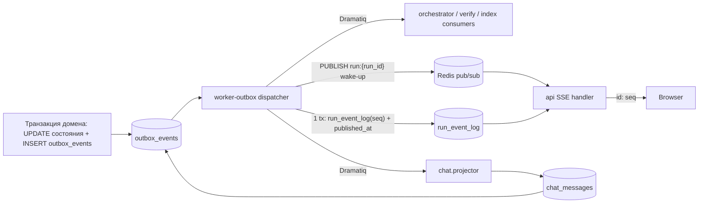
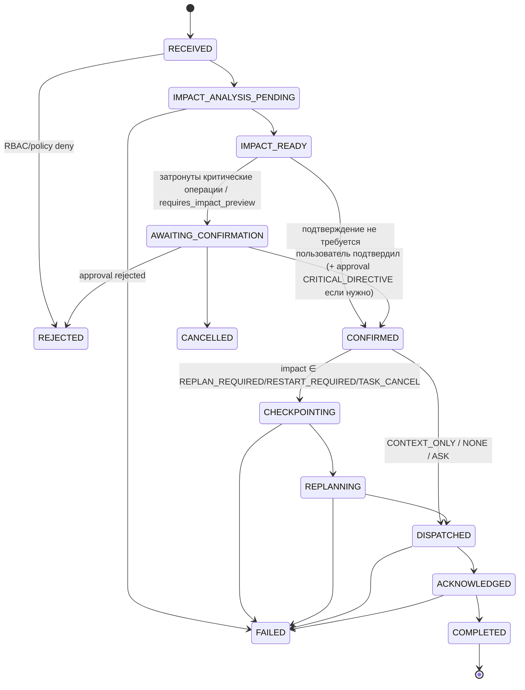

# Event Schemas v1.0

**Статус:** Phase 0, проект на утверждение. Ничего из описанного не реализовано.
**Требования:** ТЗ §6, §7.2 (`outbox_events`, `agent_activity_events`, `chat_threads`, `chat_messages`, `user_directives`, `directive_impacts`, `directive_acknowledgements`, `audit_events`), §8 (`/runs/{run_id}/events`, `/activity`, `/chat`), §8.2, §8.3, §11, §16, §19 AC-05/AC-06/AC-08.
**Решения:** ADR-0002 (transactional outbox), ADR-0007, ADR-0011 (SSE из `run_event_log`, Redis pub/sub только wake-up), ADR-0013. Файл Phase 1: `packages/contracts/events.schema.json` (ТЗ §21).
**Версия схем:** `schema_version: "1.0"`.

---

## 1. Три класса событий

| Класс | Назначение | Хранилище | Потребители | Гарантии |
|---|---|---|---|---|
| **Domain / outbox events** | Факты изменения агрегатов, записанные в одной транзакции с изменением состояния (ТЗ §16) | `outbox_events` → Redis/Dramatiq | внутренние воркеры (orchestrator, projectors, verify, index, analytics) | at-least-once, идемпотентные потребители (`processed_events`) |
| **SSE events** | Публичный поток run для UI (ТЗ §8.3) | `run_event_log` (PK `run_id, seq`) | браузер через `GET /api/v1/runs/{run_id}/events` | порядок по `seq` в run, replay по `Last-Event-ID`, дедупликация по `seq`/`event_id` |
| **Live Agent Chat** | Пользовательские потоки чата, поручения, их статусы (ТЗ §11) | `chat_threads`, `chat_messages`, `user_directives`, `directive_impacts`, `directive_acknowledgements` | UI Live Agent Chat; SSE `chat.message`, `directive.*` | проекция идемпотентна по `source_event_id` |

Кроме того, `agent_activity_events` — детальная история run (ТЗ §8 `/activity`), включая нормализованные CLI-события; `audit_events` — append-only журнал действий (вне этого документа, см. SECURITY_ARCHITECTURE).



## 2. Domain / outbox events

### 2.1 Конверт outbox-события

Колонки `outbox_events` (ТЗ §7.2) + `workspace_id`, `run_id` (дополнение для RLS и порядка) + `traceparent` (P8-06). Столбец `payload` хранит данные события (поля из каталога §2.2); конверт ниже — тело Dramatiq-сообщения, которое outbox-dispatcher собирает из строки (`OutboxRecord.message()`, `aicd_platform.sse`) и которое читают обработчики воркеров (`aicd_worker.handlers`/`docs`/`github`, доставка ACP): `payload` — данные, `traceparent` — продолжение трассы.

> P9-01 (OQ-49): первоначальный проект конверта (`trace{…}`, `data`, закрытое перечисление `aggregate_type`) не был реализован — с Phase 3 код и все потребители используют плоский конверт ниже. Схема приведена к фактическому сообщению; соответствие проверяет `tests/integration/test_outbox_dispatcher.py::test_dispatched_messages_match_outbox_envelope_schema` (настоящие сообщения диспетчера). Форматы `event_type`/`aggregate_type` — как CHECK-ограничения `outbox_events` (миграция 0003).

```json
{
  "$schema": "https://json-schema.org/draft/2020-12/schema",
  "$id": "https://aicodingdev.local/contracts/events/1.0/outbox-envelope.schema.json",
  "title": "OutboxEventEnvelope",
  "description": "Тело Dramatiq-сообщения outbox-dispatcher (OutboxRecord.message(), aicd_platform.sse): строка outbox_events + traceparent. Потребители перечитывают состояние из PostgreSQL; payload — данные события (каталог EVENT_SCHEMAS §2.2).",
  "type": "object",
  "additionalProperties": false,
  "required": ["event_id", "event_type", "schema_version", "aggregate_type", "aggregate_id", "workspace_id", "run_id", "occurred_at", "correlation_id", "causation_id", "payload", "traceparent"],
  "properties": {
    "event_id": {"type": "string", "format": "uuid", "description": "= outbox_events.id (UUIDv7)"},
    "event_type": {"type": "string", "pattern": "^[a-z][a-z0-9_]*(\\.[a-z][a-z0-9_]*)+$", "description": "= outbox_events.event_type (CHECK миграции 0003)"},
    "schema_version": {"const": "1.0"},
    "aggregate_type": {"type": "string", "pattern": "^[a-z][a-z0-9_]{0,63}$", "description": "= outbox_events.aggregate_type (run, task, agent_message, chat_message, directive, approval, gate_execution, external_action, cli_provider, documentation_source, github_verification, worktree, …)"},
    "aggregate_id": {"type": "string", "format": "uuid"},
    "workspace_id": {"type": ["string", "null"], "format": "uuid", "description": "null только для глобальных агрегатов"},
    "run_id": {"type": ["string", "null"], "format": "uuid"},
    "occurred_at": {"type": "string", "format": "date-time", "description": "outbox_events.created_at, UTC с Z"},
    "correlation_id": {"type": ["string", "null"], "format": "uuid", "description": "по умолчанию run_id"},
    "causation_id": {"type": ["string", "null"], "format": "uuid", "description": "event_id/команда, вызвавшая это событие"},
    "payload": {"type": "object", "description": "данные события (outbox_events.payload, редактированы, ≤ 64 KiB)"},
    "traceparent": {"type": ["string", "null"], "pattern": "^00-[0-9a-f]{32}-[0-9a-f]{16}-[0-9a-f]{2}$", "description": "W3C trace context спана публикации (P8-06); потребитель продолжает трассу"}
  }
}
```

### 2.2 Каталог

Каталог описывает **только** события, которые код действительно записывает в `outbox_events` (OQ-49: каталог приведён к коду): вызовы `aicd_platform.outbox.emit` в `packages/**`/`apps/**` и SQL-функции миграций с `INSERT INTO outbox_events`. Сверку в обе стороны (каждый `event_type` из кода есть в таблице и каждая строка таблицы порождается кодом) выполняет `tests/contract/test_event_catalog.py`. Колонка «SSE» — проекция в `run_event_log` (раздел 3, `aicd_platform.sse.project`; проецируются только события с `run_id`); «Потребители» — очереди Dramatiq, куда диспетчер направляет событие (`apps/worker/aicd_worker/broker.py`). Поля `payload` перечислены по коду; все ID — UUID строкой; тексты — санитизированы (`redact_value`), payload ≤ 64 KiB.

| `event_type` | Агрегат | Источник (в одной tx с) | Поля `payload` | SSE | Потребители |
|---|---|---|---|---|---|
| `run.created` | run | `INSERT runs` (`aicd_orchestration.runs.create_run`) | `mode` | — (создание видно как `run.state_changed` с `from = null`) | orchestrator |
| `run.state_changed` | run | создание run (`from = null`, `to = CREATED`); переход Run FSM (`store.transition_run`); перепланирование по поручению (`from = to`, `reason = replanned`) | `from`, `to`, `version`, `reason?`, `blocked_reason?`; при перепланировании — `plan_version`, `directive_id` | `run.state_changed` (`from_status`/`to_status`/`run_version`) | orchestrator |
| `run.completed` | run | переход run в `COMPLETED`/`FAILED`/`CANCELLED` (вместе с `run.state_changed`) | `final_status` | `run.completed` (`required_gates_total`/`_passed` — из `gate_executions` при проекции) | — |
| `task.state_changed` | task | переход Task FSM (`store.transition_task`); обновление причины блокировки (`BLOCKED → BLOCKED`) | `task_id`, `from`, `to`, `reason?`, `blocked_reason?` | `task.state_changed` (`title`, `agent_role`, версия, попытка, сложность — из `tasks`) | orchestrator (`to = READY` → постановка в `exec`) |
| `agent.message` | agent_message | шаг 7 конвейера ACP — сообщение принято (`aicd_collaboration.acp.broker`) | `message_id`, `message_type`, `task_id?`, `from{role, provider?}`, `to{role}`, `correlation_id`, `reply_to_id?`, `summary`, `suspected_injection`, `severity?`; только для потребителей — `recipient_task_id?`, `loop_limit_exceeded`, `consumers[]` | `agent.message` | orchestrator (доставки ACP `message_deliveries`, в т. ч. `chat.projector`) |
| `cli.output` | cli_execution | worker-exec, исполнение CLI (`aicd_orchestration.cli_output.CliOutputPublisher`, sink `ExecutionGateway.run`): санитизированное нормализованное событие; ≤ 20 событий/с на run, избыток — одним коалесцированным событием | форма SSE `cli_output`: `execution_id`, `task_id`, `provider`, `agent_role`, `cli_seq`, `cli_event_type`, `stream?`, `text?`, `redactions?`, `truncated?`, `coalesced_count?`, `dropped_chunks?`, `tool_kind?`, `tool_phase?`, `target?`, `warning_code?`, `execution_status?`, `artifact_id?` (у `finished` — полный санитизированный вывод, artifact `cli_output`) | `cli.output` | — |
| `acp.message_rejected` | agent_message | отказ валидации ACP | `rejection_code`, `reason`, `type`, `from_role`, `payload_sha256` | — (только activity/audit) | — |
| `chat.message` | chat_message | `INSERT chat_messages`: сообщение пользователя (`USER_TEXT`), сообщение поручения (`DIRECTIVE`), проекция ACP (`AGENT_MESSAGE`), выдержка CLI (`CLI_HIGHLIGHT`, worker-exec) | форма SSE `chat_message`: `chat_message_id`, `thread_id`, `scope`, `message_kind`, `sender_type`, `sender_id?`, `sender_role?`, `provider?`, `task_id?`, `target_role?`, `mentions[]`, `body`, `created_at`, `directive_id?`, `approval_id?`, `acp_type?`, `links?`, `source_event_id?` | `chat.message` | — |
| `directive.state_changed` | directive | переход Directive FSM (в т. ч. `RECEIVED → IMPACT_ANALYSIS_PENDING` при приёме) | `directive_id`, `directive_type`, `from`/`from_status`, `to`/`to_status`, `version`, `reason?` | `directive.state_changed` | orchestrator (шаги `IMPACT_ANALYSIS_PENDING`, `CONFIRMED`) |
| `directive.ack_changed` | directive | изменение `directive_acknowledgements` | `directive_id`, `directive_type`, `status`, `recipient_role`, `recipient_task_id?`, `ack_status`, `execution_id?`, `at` | `directive.state_changed` (поле `recipients`) | — |
| `directive.impact_ready` | directive | impact analysis завершён (`directive_impacts` записаны) | `directive_id`, `summary`, `impacts[{task_id, impact_type}]`, `requires_confirmation`, `approval_id?`, `expected_run_version` | `directive.impact_ready` | — |
| `approval.requested` | approval | `INSERT approvals (PENDING)` (`aicd_orchestration.approvals`; для `VULN_DB_UPDATE` — SQL-функция `sys_vulndb_request_approval`, миграция 0016, без `run_id`) | `approval_id`, `action_type`, `risk_level`, `required_role`, `task_id?` | `approval.requested` (остальные поля — из `approvals`) | — |
| `approval.decided` | approval | `PENDING → APPROVED/REJECTED` (решение), `CANCELLED` (отмена), `EXPIRED` (истечение) | `approval_id`, `action_type`, `status`, `subject`, `task_id?`, `wait_seconds?`, `reason?` | `approval.decided` | orchestrator; github (`MERGE`) |
| `gate.completed` | gate_execution | терминальный статус гейта (`aicd_verification.engine`) | `gate_execution_id`, `gate_type`, `task_id`, `status`, `required`, `commit_sha`, `evidence_id?`, `findings{по severity}`, `duration_ms`, `tool` | `gate.completed` | — |
| `external_action.state_changed` | external_action | переход ledger внешних действий (`PLANNED→EXECUTING→CONFIRMED/FAILED/COMPENSATED`) | `action_id`, `action_type`, `from`, `to`, `external_ref?` | — (видно через approvals/run) | — |
| `provider.probe_requested` (Phase 8, OQ-45 (c)) | cli_provider | `POST /providers/{id}/probe` (вместе с audit `provider.probe_requested`) | `probe_request_id`, `provider_id`, `provider` | — (итог — audit `provider.probe_completed`, статус — `GET /providers/{id}/probes/{probe_request_id}`) | exec (`exec.probe_provider`) |
| `documentation_source.refresh_requested` | documentation_source | PLANNED `docs_download` в ledger: явный refresh источника (`aicd_code_intelligence.docs.sources`) или загрузка, запланированная политикой документации (`aicd_orchestration.docs_flow.plan_download`) | `source_id`, `external_action_id` | — | docs (`aicd_worker.docs.import_documentation`) |
| `github.pr.requested` | run | `POST /runs/{id}/pull-requests` (`aicd_orchestration.github_flow.request_pull_request`) | `run_id`, `task_id`, `repository_id`, `repository_full_name`, `head_branch`, `head_sha`, `base_branch`, `title`, `requested_by` | — | github |
| `github.verification.requested` | github_verification | запрос проверки подключения GitHub (`aicd_orchestration.github_verification`) | `verification_id`, `kind` | — | github |
| `github.webhook.received` | github_webhook_delivery | SQL-функция `sys_github_webhook_receive` (миграция 0012): подпись валидна, событие в allowlist, не дубль | `delivery_id`, `delivery_guid`, `event`, `action?`, `installation_id?`, `hint` | — (глобальное, без `workspace_id`) | github (`process_webhook`) |
| `worktree.orphan_removed` | worktree | восстановление: удалён осиротевший worktree (diff сохранён артефактом) | `task_id`, `diff_artifact_id?` | — | — |

Правило: новый `event_type` добавляется в код и в эту таблицу одним изменением — иначе `tests/contract/test_event_catalog.py` падает (формат имени — CHECK `outbox_events`, миграция 0003).

### 2.2a Спроектированные, но не порождаемые в v1 события

Первоначальный проект каталога содержал события, которые код v1 не пишет в outbox. Они **не** входят в каталог §2.2 (их нельзя ожидать в очереди или SSE); информация доступна иначе:

| Проектное событие | Статус в v1 / где видно |
|---|---|
| `run.terminal` | переименовано: `run.completed` (SSE `run.completed`) |
| `chat.message_created` | переименовано: `chat.message` |
| `acp.message_accepted` | в outbox — `agent.message`; `acp.message_accepted` остался типом записи `agent_activity_events` (потребитель `activity.projector`) |
| `directive.received` | приём поручения — `chat.message` (`DIRECTIVE`) + `directive.state_changed` (`RECEIVED → IMPACT_ANALYSIS_PENDING`) |
| `run.plan_materialized`, `task.created` | материализация плана видна через `task.state_changed` и API задач |
| `task_attempt.started`, `task_attempt.finished`, `routing.decision_recorded`, `checkpoint.created`, `context_pack.created` | строки БД + `agent_activity_events`/audit; Task Detail через API |
| `cli_execution.state_changed`, `cli_execution.finished`, `cli_execution.output_batch` | статусы исполнения — `cli_executions`; вывод и завершение — `cli.output` (по событию на нормализованное событие CLI, `cli_event_type` = `output`/`tool_event`/`warning`/`artifact`/`finished`; пакеты не используются) |
| `gate.started`, `evidence.recorded`, `evidence.verification_changed`, `finding.created`, `finding.status_changed`, `compliance.result_recorded` | строки БД (Quality API); итог гейта — `gate.completed` |
| `provider.health_changed`, `provider.auth_restored` | `provider_health`, audit `provider.probe_completed`; UI CLI Providers опрашивает API |
| `code_index.snapshot_ready`, `documentation.snapshot_fetched` | статусы `code_index_snapshots`/`documentation_snapshots` (API индекса и документации) |
| `github.webhook_received` | переименовано: `github.webhook.received` |

## 3. SSE events

### 3.1 Протокол

- Endpoint: `GET /api/v1/runs/{run_id}/events` (`text/event-stream`), авторизация cookie-сессией + RBAC: любой член workspace с ролью ≥ `viewer` (ТЗ §8.3 «разграничение доступа»); RLS по `workspace_id`.
- Формат кадра:

```text
id: 1042
event: task.state_changed
data: {"event_id":"…","run_id":"…","seq":1042,"type":"task.state_changed","timestamp":"…","schema_version":"1.0","payload":{…}}

```

- `id` = `seq` (bigint, монотонно возрастает в рамках run, ADR-0011). Переподключение: браузер передаёт `Last-Event-ID`; сервер отдаёт `run_event_log WHERE run_id=? AND seq > ?` по возрастанию, затем переходит в live-режим (ожидание wake-up из Redis pub/sub + опрос раз в 5 с как страховка).
- Если `Last-Event-ID` меньше минимального сохранённого `seq` (retention), сервер первым отправляет синтетический `run.state_changed` с `payload.resync = true` (снимок текущего статуса, `id` = текущий максимальный `seq`), после чего клиент обязан перезагрузить состояние через REST.
- `heartbeat` каждые 15 с; **не** сохраняется в `run_event_log`, отправляется без строки `id:` (чтобы не сдвигать `Last-Event-ID`).
- Ограничения: ≤ 3 одновременных SSE-соединения на пользователя на run; `cli.output` прореживается в worker-exec до записи в outbox — ≤ 20 событий/с на run (лишние объединяются в одно событие с `coalesced_count`/`dropped_chunks`; история — `/activity` с пагинацией, полный санитизированный вывод — artifact `cli_output`).

### 3.2 Схема SSE-события

```json
{
  "$schema": "https://json-schema.org/draft/2020-12/schema",
  "$id": "https://aicodingdev.local/contracts/events/1.0/sse-event.schema.json",
  "title": "SseEvent",
  "type": "object",
  "additionalProperties": false,
  "required": ["event_id", "run_id", "seq", "type", "timestamp", "schema_version", "payload"],
  "properties": {
    "event_id": {"type": "string", "format": "uuid"},
    "run_id": {"type": "string", "format": "uuid"},
    "seq": {"type": ["integer", "null"], "minimum": 1, "description": "null только для heartbeat"},
    "type": {"enum": ["run.state_changed", "task.state_changed", "agent.message", "cli.output", "directive.impact_ready", "directive.state_changed", "approval.requested", "approval.decided", "gate.completed", "run.completed", "chat.message", "heartbeat"]},
    "timestamp": {"type": "string", "format": "date-time"},
    "schema_version": {"const": "1.0"},
    "source_event_id": {"type": ["string", "null"], "format": "uuid", "description": "outbox event_id, из которого спроецировано"},
    "payload": {"type": "object"}
  },
  "allOf": [
    {"if": {"properties": {"type": {"const": "heartbeat"}}}, "then": {"properties": {"seq": {"type": "null"}, "payload": {"$ref": "#/$defs/heartbeat"}}}, "else": {"properties": {"seq": {"type": "integer"}}}},
    {"if": {"properties": {"type": {"const": "run.state_changed"}}}, "then": {"properties": {"payload": {"$ref": "#/$defs/run_state_changed"}}}},
    {"if": {"properties": {"type": {"const": "task.state_changed"}}}, "then": {"properties": {"payload": {"$ref": "#/$defs/task_state_changed"}}}},
    {"if": {"properties": {"type": {"const": "agent.message"}}}, "then": {"properties": {"payload": {"$ref": "#/$defs/agent_message"}}}},
    {"if": {"properties": {"type": {"const": "cli.output"}}}, "then": {"properties": {"payload": {"$ref": "#/$defs/cli_output"}}}},
    {"if": {"properties": {"type": {"const": "directive.impact_ready"}}}, "then": {"properties": {"payload": {"$ref": "#/$defs/directive_impact_ready"}}}},
    {"if": {"properties": {"type": {"const": "directive.state_changed"}}}, "then": {"properties": {"payload": {"$ref": "#/$defs/directive_state_changed"}}}},
    {"if": {"properties": {"type": {"const": "approval.requested"}}}, "then": {"properties": {"payload": {"$ref": "#/$defs/approval_requested"}}}},
    {"if": {"properties": {"type": {"const": "approval.decided"}}}, "then": {"properties": {"payload": {"$ref": "#/$defs/approval_decided"}}}},
    {"if": {"properties": {"type": {"const": "gate.completed"}}}, "then": {"properties": {"payload": {"$ref": "#/$defs/gate_completed"}}}},
    {"if": {"properties": {"type": {"const": "run.completed"}}}, "then": {"properties": {"payload": {"$ref": "#/$defs/run_completed"}}}},
    {"if": {"properties": {"type": {"const": "chat.message"}}}, "then": {"properties": {"payload": {"$ref": "#/$defs/chat_message"}}}}
  ],
  "$defs": {
    "uuid": {"type": "string", "format": "uuid"},
    "run_status": {"enum": ["CREATED", "DISCOVERY", "PLANNED", "AWAITING_APPROVAL", "RUNNING", "VERIFYING", "COMPLETED", "PAUSED", "BLOCKED", "FAILED", "CANCELLED"]},
    "task_status": {"enum": ["PENDING", "READY", "LEASED", "RUNNING", "VERIFYING", "SUCCEEDED", "BLOCKED", "RETRY_WAIT", "FAILED", "CANCELLED"]},
    "blocked_reason": {"enum": ["APPROVAL_REQUIRED", "PROVIDER_UNAVAILABLE", "AUTH_REQUIRED", "DIRECTIVE_REPLAN", "RUN_PAUSED", "DOCS_REQUIRED", "MANUAL_REVIEW", "REVIEW_LOOP_EXHAUSTED", "DEPENDENCY_FAILED", null]},
    "agent_role": {"enum": ["requirements", "architect", "planner", "developer", "reviewer", "security", "qa", "database", "performance", "devops", "maintenance", "documentation"]},
    "acp_participant": {"enum": ["requirements", "architect", "planner", "developer", "reviewer", "security", "qa", "database", "performance", "devops", "maintenance", "documentation", "orchestrator", "user"]},
    "provider": {"enum": ["codex", "claude"]},
    "directive_status": {"enum": ["RECEIVED", "IMPACT_ANALYSIS_PENDING", "IMPACT_READY", "AWAITING_CONFIRMATION", "CONFIRMED", "CHECKPOINTING", "REPLANNING", "DISPATCHED", "ACKNOWLEDGED", "COMPLETED", "REJECTED", "CANCELLED", "FAILED"]},
    "severity_counts": {
      "type": "object", "additionalProperties": false,
      "properties": {"info": {"type": "integer", "minimum": 0}, "low": {"type": "integer", "minimum": 0}, "medium": {"type": "integer", "minimum": 0}, "high": {"type": "integer", "minimum": 0}, "critical": {"type": "integer", "minimum": 0}}
    },
    "heartbeat": {
      "type": "object", "additionalProperties": false,
      "required": ["server_time", "last_seq"],
      "properties": {"server_time": {"type": "string", "format": "date-time"}, "last_seq": {"type": "integer", "minimum": 0}}
    },
    "run_state_changed": {
      "type": "object", "additionalProperties": false,
      "required": ["from_status", "to_status", "run_version"],
      "properties": {
        "from_status": {"anyOf": [{"$ref": "#/$defs/run_status"}, {"type": "null"}]},
        "to_status": {"$ref": "#/$defs/run_status"},
        "blocked_reason": {"$ref": "#/$defs/blocked_reason"},
        "run_version": {"type": "integer", "minimum": 0},
        "reason": {"type": "string", "maxLength": 1000},
        "resync": {"type": "boolean"}
      }
    },
    "task_state_changed": {
      "type": "object", "additionalProperties": false,
      "required": ["task_id", "agent_role", "from_status", "to_status", "task_version"],
      "properties": {
        "task_id": {"$ref": "#/$defs/uuid"},
        "title": {"type": "string", "maxLength": 500},
        "agent_role": {"$ref": "#/$defs/agent_role"},
        "from_status": {"anyOf": [{"$ref": "#/$defs/task_status"}, {"type": "null"}]},
        "to_status": {"$ref": "#/$defs/task_status"},
        "blocked_reason": {"$ref": "#/$defs/blocked_reason"},
        "task_version": {"type": "integer", "minimum": 0},
        "attempt_no": {"type": ["integer", "null"], "minimum": 1},
        "provider": {"anyOf": [{"$ref": "#/$defs/provider"}, {"type": "null"}]},
        "complexity": {"enum": ["L1", "L2", "L3", "L4", "L5"]},
        "failure_category": {"type": ["string", "null"], "enum": ["CLI_NOT_INSTALLED", "AUTH_REQUIRED", "RATE_LIMITED", "TIMEOUT", "SANDBOX_DENIED", "PROCESS_FAILED", "OUTPUT_PARSE_ERROR", "UNSUPPORTED_VERSION", "CANCELLED", "GATE_FAILED", "REVIEW_REJECTED", "LEASE_LOST", "WORKER_CRASH", "POLICY_DENIED", "INTERNAL_ERROR", null]}
      }
    },
    "agent_message": {
      "type": "object", "additionalProperties": false,
      "required": ["message_id", "message_type", "from", "to", "correlation_id", "summary"],
      "properties": {
        "message_id": {"$ref": "#/$defs/uuid"},
        "message_type": {"enum": ["TASK_ASSIGN", "HANDOFF", "QUESTION", "ANSWER", "REVIEW_REQUEST", "FINDING", "FIX_REQUEST", "EVIDENCE_SUBMITTED", "DECISION_PROPOSAL", "DECISION_RECORDED", "BLOCKED", "TASK_COMPLETED"]},
        "task_id": {"type": ["string", "null"], "format": "uuid"},
        "from": {
          "type": "object", "additionalProperties": false, "required": ["role"],
          "properties": {"role": {"$ref": "#/$defs/acp_participant"}, "provider": {"$ref": "#/$defs/provider"}}
        },
        "to": {
          "type": "object", "additionalProperties": false, "required": ["role"],
          "properties": {"role": {"$ref": "#/$defs/acp_participant"}}
        },
        "correlation_id": {"$ref": "#/$defs/uuid"},
        "reply_to_id": {"type": ["string", "null"], "format": "uuid"},
        "summary": {"type": "string", "maxLength": 1000, "description": "санитизированная выдержка; полный payload — GET /tasks/{task_id}/messages"},
        "severity": {"enum": ["info", "low", "medium", "high", "critical"]},
        "suspected_injection": {"type": "boolean"}
      }
    },
    "cli_output": {
      "type": "object", "additionalProperties": false,
      "required": ["execution_id", "task_id", "provider", "agent_role", "cli_seq", "cli_event_type"],
      "properties": {
        "execution_id": {"$ref": "#/$defs/uuid"},
        "task_id": {"$ref": "#/$defs/uuid"},
        "provider": {"$ref": "#/$defs/provider"},
        "agent_role": {"$ref": "#/$defs/agent_role"},
        "cli_seq": {"type": "integer", "minimum": 1},
        "cli_event_type": {"enum": ["started", "output", "tool_event", "artifact", "warning", "finished"]},
        "stream": {"enum": ["stdout", "stderr", "agent_message"]},
        "text": {"type": "string", "maxLength": 4096},
        "redactions": {"type": "integer", "minimum": 0},
        "truncated": {"type": "boolean"},
        "coalesced_count": {"type": "integer", "minimum": 1},
        "dropped_chunks": {"type": "integer", "minimum": 0, "description": "сколько из coalesced_count нормализованных событий не вошло в text (лимит 20 событий/с на run); полный вывод — artifact cli_output"},
        "tool_kind": {"enum": ["file_read", "file_write", "file_patch", "command", "search", "network", "other"]},
        "tool_phase": {"enum": ["requested", "started", "completed", "denied", "failed"]},
        "target": {"type": "string", "maxLength": 1024},
        "artifact_id": {"$ref": "#/$defs/uuid"},
        "warning_code": {"type": "string", "maxLength": 50},
        "execution_status": {"enum": ["EXITED", "TIMED_OUT", "CANCELLED", "CRASHED", "AUTH_REQUIRED", "RATE_LIMITED"]}
      }
    },
    "directive_impact_ready": {
      "type": "object", "additionalProperties": false,
      "required": ["directive_id", "impacts", "requires_confirmation", "expected_run_version"],
      "properties": {
        "directive_id": {"$ref": "#/$defs/uuid"},
        "summary": {"type": "string", "maxLength": 2000},
        "impacts": {
          "type": "array", "maxItems": 500,
          "items": {
            "type": "object", "additionalProperties": false,
            "required": ["task_id", "impact_type"],
            "properties": {
              "task_id": {"type": ["string", "null"], "format": "uuid", "description": "null для TASK_ADD (новая задача ещё не создана)"},
              "impact_type": {"enum": ["NONE", "CONTEXT_ONLY", "REPLAN_REQUIRED", "TASK_CANCEL", "TASK_ADD", "RESTART_REQUIRED"]},
              "resolution": {"type": "string", "maxLength": 500}
            }
          }
        },
        "requires_confirmation": {"type": "boolean"},
        "approval_id": {"type": ["string", "null"], "format": "uuid"},
        "expected_run_version": {"type": "integer", "minimum": 0}
      }
    },
    "directive_state_changed": {
      "type": "object", "additionalProperties": false,
      "required": ["directive_id", "directive_type", "from_status", "to_status"],
      "properties": {
        "directive_id": {"$ref": "#/$defs/uuid"},
        "directive_type": {"enum": ["ASK", "NEW_TASK", "CHANGE_REQUEST", "STOP", "PAUSE", "RESUME", "REVIEW", "APPROVE", "REJECT"]},
        "from_status": {"anyOf": [{"$ref": "#/$defs/directive_status"}, {"type": "null"}]},
        "to_status": {"$ref": "#/$defs/directive_status"},
        "reason": {"type": "string", "maxLength": 1000},
        "recipients": {
          "type": "array", "maxItems": 12,
          "items": {
            "type": "object", "additionalProperties": false,
            "required": ["role", "ack_status"],
            "properties": {
              "role": {"$ref": "#/$defs/agent_role"},
              "ack_status": {"enum": ["PENDING", "DELIVERED", "ACKNOWLEDGED", "REJECTED", "EXPIRED", "COMPLETED", "FAILED"]},
              "execution_id": {"type": ["string", "null"], "format": "uuid"},
              "at": {"type": ["string", "null"], "format": "date-time"}
            }
          }
        }
      }
    },
    "approval_requested": {
      "type": "object", "additionalProperties": false,
      "required": ["approval_id", "action_type", "summary", "required_role", "expires_at"],
      "properties": {
        "approval_id": {"$ref": "#/$defs/uuid"},
        "action_type": {"enum": ["PLAN_APPROVAL", "MERGE", "PRODUCTION_DEPLOY", "DESTRUCTIVE_MIGRATION", "DATA_DELETION", "SECRET_CHANGE", "UNRESTRICTED_NETWORK", "DOCS_DOWNLOAD", "CRITICAL_DIRECTIVE", "MANUAL_REVIEW", "SELF_REVIEW_FALLBACK", "LOCAL_EXECUTION_FALLBACK", "VULN_DB_UPDATE"]},
        "task_id": {"type": ["string", "null"], "format": "uuid"},
        "summary": {"type": "string", "maxLength": 2000},
        "required_role": {"enum": ["owner", "admin", "developer", "reviewer"]},
        "requested_by": {
          "type": "object", "additionalProperties": false, "required": ["type"],
          "properties": {"type": {"enum": ["user", "agent", "system"]}, "id": {"type": ["string", "null"]}}
        },
        "expires_at": {"type": "string", "format": "date-time"},
        "evidence_refs": {"type": "array", "maxItems": 50, "items": {"type": "string"}}
      }
    },
    "approval_decided": {
      "type": "object", "additionalProperties": false,
      "required": ["approval_id", "action_type", "status"],
      "properties": {
        "approval_id": {"$ref": "#/$defs/uuid"},
        "action_type": {"enum": ["PLAN_APPROVAL", "MERGE", "PRODUCTION_DEPLOY", "DESTRUCTIVE_MIGRATION", "DATA_DELETION", "SECRET_CHANGE", "UNRESTRICTED_NETWORK", "DOCS_DOWNLOAD", "CRITICAL_DIRECTIVE", "MANUAL_REVIEW", "SELF_REVIEW_FALLBACK", "LOCAL_EXECUTION_FALLBACK", "VULN_DB_UPDATE"]},
        "status": {"enum": ["APPROVED", "REJECTED", "EXPIRED", "CANCELLED"]},
        "decided_by": {"type": ["string", "null"], "format": "uuid"},
        "decision_reason": {"type": ["string", "null"], "maxLength": 2000}
      }
    },
    "gate_completed": {
      "type": "object", "additionalProperties": false,
      "required": ["gate_execution_id", "gate_type", "status", "required", "commit_sha"],
      "properties": {
        "gate_execution_id": {"$ref": "#/$defs/uuid"},
        "gate_type": {"type": "string", "pattern": "^[A-Z_]+$"},
        "task_id": {"type": ["string", "null"], "format": "uuid"},
        "status": {"enum": ["PASS", "FAIL", "ERROR", "SKIPPED", "NOT_APPLICABLE"]},
        "required": {"type": "boolean"},
        "commit_sha": {"type": "string", "pattern": "^[0-9a-f]{40}([0-9a-f]{24})?$"},
        "evidence_id": {"type": ["string", "null"], "format": "uuid"},
        "findings": {"$ref": "#/$defs/severity_counts"},
        "duration_ms": {"type": "integer", "minimum": 0},
        "tool": {"type": "string", "maxLength": 100}
      }
    },
    "run_completed": {
      "type": "object", "additionalProperties": false,
      "required": ["final_status", "required_gates_total", "required_gates_passed"],
      "properties": {
        "final_status": {"enum": ["COMPLETED", "FAILED", "CANCELLED"]},
        "required_gates_total": {"type": "integer", "minimum": 0},
        "required_gates_passed": {"type": "integer", "minimum": 0},
        "open_findings": {"$ref": "#/$defs/severity_counts"},
        "report_artifact_id": {"type": ["string", "null"], "format": "uuid"},
        "reason": {"type": "string", "maxLength": 1000}
      }
    },
    "chat_message": {
      "type": "object", "additionalProperties": false,
      "required": ["chat_message_id", "thread_id", "scope", "message_kind", "sender_type", "body", "created_at"],
      "properties": {
        "chat_message_id": {"$ref": "#/$defs/uuid"},
        "thread_id": {"$ref": "#/$defs/uuid"},
        "scope": {"enum": ["RUN", "ROLE", "TASK"]},
        "message_kind": {"enum": ["USER_TEXT", "DIRECTIVE", "AGENT_MESSAGE", "CLI_HIGHLIGHT", "STATUS", "APPROVAL", "DIRECTIVE_STATUS", "SYSTEM_NOTICE"]},
        "sender_type": {"enum": ["user", "agent", "system"]},
        "sender_id": {"type": ["string", "null"]},
        "sender_role": {"anyOf": [{"$ref": "#/$defs/acp_participant"}, {"type": "null"}]},
        "provider": {"anyOf": [{"$ref": "#/$defs/provider"}, {"type": "null"}]},
        "task_id": {"type": ["string", "null"], "format": "uuid"},
        "target_role": {"anyOf": [{"$ref": "#/$defs/agent_role"}, {"type": "null"}]},
        "mentions": {"type": "array", "maxItems": 12, "items": {"$ref": "#/$defs/agent_role"}},
        "body": {"type": "string", "maxLength": 8000},
        "acp_type": {"enum": ["TASK_ASSIGN", "HANDOFF", "QUESTION", "ANSWER", "REVIEW_REQUEST", "FINDING", "FIX_REQUEST", "EVIDENCE_SUBMITTED", "DECISION_PROPOSAL", "DECISION_RECORDED", "BLOCKED", "TASK_COMPLETED", null], "description": "тип ACP-сообщения для AGENT_MESSAGE (= ChatItem.acp_type)"},
        "source_event_id": {"type": ["string", "null"], "format": "uuid"},
        "directive_id": {"type": ["string", "null"], "format": "uuid"},
        "approval_id": {"type": ["string", "null"], "format": "uuid"},
        "links": {
          "type": "array", "maxItems": 20,
          "items": {
            "type": "object", "additionalProperties": false, "required": ["kind", "id"],
            "properties": {"kind": {"enum": ["diff", "test_report", "evidence", "finding", "artifact", "task", "approval", "gate_execution"]}, "id": {"$ref": "#/$defs/uuid"}}
          }
        },
        "created_at": {"type": "string", "format": "date-time"}
      }
    }
  }
}
```

### 3.2a Поток уведомлений workspace (Phase 8, OQ-45 (c))

`GET /api/v1/workspaces/{workspace_id}/events` — тот же формат кадров и конверт `SseEnvelope` (схема `sse-event.schema.json`), но только типы `approval.requested`, `approval.decided`, `run.state_changed`, `run.completed` **всех run workspace** (источник — `run_event_log`, RLS). Отличия от потока run (API_DESIGN §13.1):

- `id:` — курсор потока: `run_event_log.created_at` в микросекундах Unix epoch (не `seq`; `seq` в данных — номер события в его run);
- возобновление по `Last-Event-ID` с перекрытием 60 с — **клиент дедуплицирует по `event_id`** (§5); курсор старше 24 ч ⇒ `410 replay_window_exceeded`, без `Last-Event-ID` — с текущего момента;
- heartbeat: `event: heartbeat`, `data: {"type":"heartbeat","workspace_id":"…","timestamp":"…"}` без `id:` (контракт `WorkspaceSseHeartbeat`);
- пробуждение — Redis `aicd:ws:{workspace_id}` (worker-outbox после commit, только сигнал), опрос раз в 5 с как страховка;
- поток не терминальный (сервер закрывает его по max lifetime 30 мин, при отзыве доступа и удалении участника).

### 3.3 Правила проекции outbox → SSE

1. Проекцию выполняет `worker-outbox` в той же транзакции, где выставляется `outbox_events.published_at` для событий из каталога с непустой колонкой «SSE»: `INSERT run_event_log(workspace_id, run_id, seq, event_id, event_type, schema_version, payload)`.
2. `seq` назначается под per-run advisory lock (`pg_advisory_xact_lock(hashtext(run_id))`) как `max(seq)+1` (или счётчик `runs.last_event_seq`); откат транзакции откатывает и `seq` → разрывов нет, но клиенты не обязаны на это полагаться.
3. `run_event_log.event_id` = новый UUIDv7, `source_event_id` = outbox `event_id`; `UNIQUE(source_event_id, event_type)` обеспечивает идемпотентность повторной публикации (`cli.output` пишется в outbox по одному событию на SSE-событие — пакетов вывода нет, §2.2).
4. После коммита — `PUBLISH run:{run_id} <seq>` в Redis (только сигнал; потеря сигнала компенсируется опросом раз в 5 с); для потока уведомлений workspace — также `PUBLISH aicd:ws:{workspace_id}` (Phase 8).
5. Payload SSE не содержит секретов, полных промптов, raw log, скрытых рассуждений; тексты прошли санитизацию CLI Gateway (CLI_ADAPTER_CONTRACT §11) и ограничены по длине.

## 4. Live Agent Chat

### 4.1 Треды и потоки

Решение: **потоки** `All Agents`, `Codex`, `Claude`, `Role`, `Task`, `Approvals` (ТЗ §11) — это **представления (фильтры)** над единой лентой `chat_messages` run, а не отдельные копии сообщений. **Треды** (`chat_threads`) — адресация пользовательских сообщений.

| `chat_threads.scope` | Создаётся | `target_role` | `task_id` (доп.) | Назначение |
|---|---|---|---|---|
| `RUN` | автоматически при создании run (ровно один) | NULL | NULL | общий тред: системные события, ACP, поручения без адресата |
| `ROLE` | лениво, при первом сообщении пользователя роли или от роли | роль | NULL | диалог пользователя с ролью (`@developer …`) |
| `TASK` | лениво, при первом сообщении по задаче | роль задачи | задача | обсуждение конкретной задачи |

| Поток UI | Фильтр по `chat_messages` (денормализованные поля, см. дополнения) |
|---|---|
| All Agents | все сообщения run |
| Codex | `provider = 'codex'` (сообщения агентов и CLI highlights исполнений на Codex) |
| Claude | `provider = 'claude'` |
| Role | `sender_role = :role OR target_role = :role OR :role = ANY(mentions)` |
| Task | `task_id = :task_id` |
| Approvals | `message_kind IN ('APPROVAL') OR (message_kind = 'DIRECTIVE_STATUS' AND status = 'AWAITING_CONFIRMATION')` |

Поиск: PostgreSQL FTS по `body` (tsvector, `simple` + `russian` конфигурации) в пределах run; timeline — сортировка по `created_at, id`.

### 4.2 Виды сообщений (`chat_messages.message_kind`)

| `message_kind` | `sender_type` | Источник | Пример |
|---|---|---|---|
| `USER_TEXT` | user | `POST /runs/{id}/chat/messages` без директивы | комментарий |
| `DIRECTIVE` | user | `POST /runs/{id}/directives` (создаёт и сообщение, и `user_directives`) | `CHANGE_REQUEST` |
| `AGENT_MESSAGE` | agent | проекция `agent.message` | `FIX_REQUEST reviewer→developer` |
| `CLI_HIGHLIGHT` | agent | проекция значимых нормализованных CLI-событий: `tool_event` (`file_patch`, `command` completed/denied), `warning`, `finished` | «developer (codex) изменил 3 файла» |
| `STATUS` | system | `task.state_changed`, `run.state_changed`, `gate.completed` | «Гейт QG-UNIT: FAIL» |
| `APPROVAL` | system | `approval.requested` / `approval.decided` | «Требуется MERGE approval» |
| `DIRECTIVE_STATUS` | system | `directive.state_changed`, `directive.ack_changed` | «Поручение доставлено developer» |
| `SYSTEM_NOTICE` | system | provider/auth события, предупреждения injection | «Claude: требуется вход оператора» |

Сырые `output`-события CLI в чат **не** проецируются (только в Task Detail / SSE `cli.output`), чтобы чат оставался читаемым.

### 4.3 Проекция в чат

| Источник | Правило | `source_event_id` |
|---|---|---|
| ACP `agent.message` | 1 сообщение `AGENT_MESSAGE` в тред: `TASK` (если `task_id`) иначе `RUN`; `body` = шаблонное резюме по типу (например, для `FINDING`: severity, title, файл), ссылки → `links` | outbox `event_id` |
| ACP к/от `user` | в тред `ROLE` (роль-собеседник) | outbox `event_id` |
| `cli.output` (worker-exec, `CliOutputPublisher`) | `CLI_HIGHLIGHT` (`chat_messages.message_kind = 'cli_excerpt'`, тред задачи): инструмент `file_patch`/`file_write`/`command` в фазе `completed`/`denied`/`failed`, предупреждение, завершение; не более 1 сообщения на 10 с на execution (кроме завершения), остальные — пропускаются | — (пишется в момент исполнения, до outbox) |
| `task.state_changed` | только переходы в `RUNNING`, `VERIFYING`, `SUCCEEDED`, `BLOCKED`, `FAILED`, `CANCELLED` | outbox `event_id` |
| `gate.completed` | только `required = true` или `status ∈ {FAIL, ERROR}` | outbox `event_id` |
| `approval.*` | всегда | outbox `event_id` |
| `directive.*` | всегда (статусы из 4.4) | outbox `event_id` |

Идемпотентность: `UNIQUE(thread_id, source_event_id, projection_index)` — повторная доставка не создаёт дубль (AC-08). Проекция не изменяет сообщения задним числом: изменения статуса — новые сообщения.

### 4.4 Жизненный цикл поручения и различие «доставлено / принято / выполнено»



Полная FSM и impact analysis — в `architecture/DATA_FLOW.md`; здесь — семантика статусов для UI и событий:

| Понятие в UI | Статус | Точное условие | Событие |
|---|---|---|---|
| «Принято системой» | `RECEIVED` | директива сохранена, RBAC пройден | `chat.message` (`DIRECTIVE`) + `directive.state_changed` (`RECEIVED → IMPACT_ANALYSIS_PENDING`) |
| «Анализ влияния готов» | `IMPACT_READY` | все `directive_impacts` записаны | `directive.impact_ready` |
| «Ожидает подтверждения» | `AWAITING_CONFIRMATION` | нужен confirm/approval | `directive.state_changed` + `approval.requested` |
| «Отправлено» | `DISPATCHED` | строки `directive_acknowledgements` получателей созданы (`PENDING`): задачи замены/новые задачи несут огороженный текст поручения, поручение войдёт в раздел `directives` Context Pack следующей попытки задачи-получателя (отдельного ACP `TASK_ASSIGN` оркестратор не формирует, `acp_message_id = NULL`) | `directive.state_changed` |
| **«Доставлено»** | ack `DELIVERED` (по получателю) | попытка задачи-получателя стартовала (задача `LEASED → RUNNING`, её Context Pack содержит директиву); получатель уровня run привязывается к первой стартовавшей задаче своей роли; попытка, начатая до dispatch, поручение не получает | `directive.ack_changed` |
| **«Принято агентом»** | `ACKNOWLEDGED` (директива) / ack `ACKNOWLEDGED` | принятый Orchestrator итог попытки, которой директива доставлена, содержит `directive_acks[{directive_id, status:"accepted"\|"not_applicable"}]`; итог без записи о директиве — неявное `accepted`; `cannot_comply` → ack `REJECTED`, директива `FAILED`; директива `ACKNOWLEDGED`, когда все получатели подтвердили | `directive.ack_changed`, `directive.state_changed` |
| **«Выполнено»** | `COMPLETED` | все задачи-получатели и их производные по `origin_task_id` (замены, fix-задачи), кроме вытесненных, `SUCCEEDED` (т.е. прошли обязательные гейты); для `ASK`/`REVIEW` — то же для задач-получателей (ответ агента — итог его задачи; связь ACP `ANSWER` с директивой не моделируется); для `PAUSE`/`RESUME`/`STOP` — run/задача достигли целевого статуса | `directive.state_changed` |
| «Не выполнено» | `FAILED` / `REJECTED` / `CANCELLED` | с причиной (`failure_message`): отказ агента, задача рабочего множества `FAILED`/`CANCELLED`, получатель не получил/не подтвердил директиву (ack `EXPIRED`), run завершён раньше; открытые ack при этом → `EXPIRED` | `directive.state_changed` |

UI обязан показывать «доставлено», «принято агентом» и «выполнено» разными индикаторами (ТЗ §11); `COMPLETED` никогда не выставляется по факту доставки или по заявлению агента.

`directive_acknowledgements.status` (DATABASE_DESIGN §9.8): `PENDING`, `DELIVERED`, `ACKNOWLEDGED`, `REJECTED`, `EXPIRED`. SSE `recipients[].ack_status` использует эти значения; `COMPLETED`/`FAILED` в перечислении схемы сохранены для совместимости и сервером не выдаются («выполнено» — статус директивы, а не ack).

## 5. Дедупликация

| Уровень | Механизм |
|---|---|
| Outbox → потребители | `processed_events(consumer, event_id)` PK; потребитель вставляет строку в той же tx, что и эффект; конфликт → no-op |
| ACP | `message_deliveries UNIQUE(message_id, consumer_id)` + `acked_at` |
| SSE сервер | `run_event_log PK(run_id, seq)`, `event_id UNIQUE`; идемпотентная проекция (3.3) |
| SSE клиент | хранит последний `seq`; событие с `seq ≤ last_seq` отбрасывается; `event_id` — для журналов |
| SSE клиент, поток workspace (§3.2a) | хранит последний `id:` (курсор) для `Last-Event-ID`; дубли перекрытия отбрасываются по `event_id` (последние 2000), `seq` не сравнивается (события разных run) |
| Chat | `UNIQUE(thread_id, source_event_id, projection_index)` |
| Directives API | `Idempotency-Key` (`idempotency_keys`) + `expected_run_version` |
| GitHub webhooks | `github_webhook_deliveries.delivery_guid UNIQUE` |

## 6. Порядок и retention

**Гарантии порядка:**

- Внутри run: полный порядок SSE-событий по `seq` (единственный источник порядка для UI).
- Внутри агрегата: outbox-события упорядочены по `id` (UUIDv7, монотонен в рамках процесса) и `aggregate_version`; dispatcher обрабатывает события одного run последовательно (advisory lock), поэтому порядок сохраняется в `seq`.
- Между run и между агрегатами разных run порядок не гарантируется.
- Dramatiq-потребители могут получить события вне порядка при повторах; потребитель обязан сравнивать `aggregate_version` и игнорировать устаревшие.
- `cli.output` внутри execution упорядочены по `cli_seq`.

**Retention (по умолчанию, настраивается workspace policy; удаление/архивация выполняет `aicd_maintenance`, с audit):**

| Данные | Срок | После срока |
|---|---|---|
| `outbox_events` (опубликованные) | 7 дней | удаление |
| `processed_events` | 30 дней | удаление |
| `run_event_log` | 90 дней после терминального статуса run | архив NDJSON в объектное хранилище (sha256 в `artifacts`), удаление строк |
| `agent_activity_events` (включая `cli.*`) | 180 дней | архив + удаление |
| `agent_messages`, `chat_messages`, `user_directives`, `directive_*` | срок жизни проекта; архив через 1 год | архив |
| raw CLI logs (artifacts `raw_log`) | 30 дней | удаление объекта, метаданные остаются |
| `audit_events` | ≥ 1 год, append-only | архив, не удаление в v1 |

## 7. Предлагаемые дополнения

| Предложение | Обоснование |
|---|---|
| Перечисление `chat_thread_scope`: `RUN`, `ROLE`, `TASK`; колонка `chat_threads.task_id` | адресация тредов; потоки UI — фильтры |
| Перечисление `chat_message_kind`: `USER_TEXT`, `DIRECTIVE`, `AGENT_MESSAGE`, `CLI_HIGHLIGHT`, `STATUS`, `APPROVAL`, `DIRECTIVE_STATUS`, `SYSTEM_NOTICE` | ТЗ §7.2 `message_kind` без значений |
| Перечисление `chat_sender_type`: `user`, `agent`, `system` | ТЗ §7.2 `sender_type` без значений |
| Колонки `chat_messages`: `workspace_id`, `run_id`, `task_id`, `sender_role`, `target_role`, `provider`, `mentions text[]`, `projection_index`, `search_vector` | фильтры потоков, поиск, дедупликация |
| Перечисление `directive_ack_status`: `PENDING`, `DELIVERED`, `ACKNOWLEDGED`, `REJECTED`, `EXPIRED` (как CHECK `directive_acknowledgements.status`) | различение «доставлено/принято»; «выполнено» — статус директивы |
| Колонки `outbox_events.workspace_id`, `run_id`, `aggregate_version`; `runs.last_event_seq` | RLS, порядок, назначение `seq` |
| `run_event_log.source_event_id` | идемпотентная проекция |
| SSE `run.completed` эмитируется для всех терминальных статусов run (`COMPLETED`, `FAILED`, `CANCELLED`) с полем `final_status` | имя типа из ТЗ; UI нужен единый сигнал завершения |
